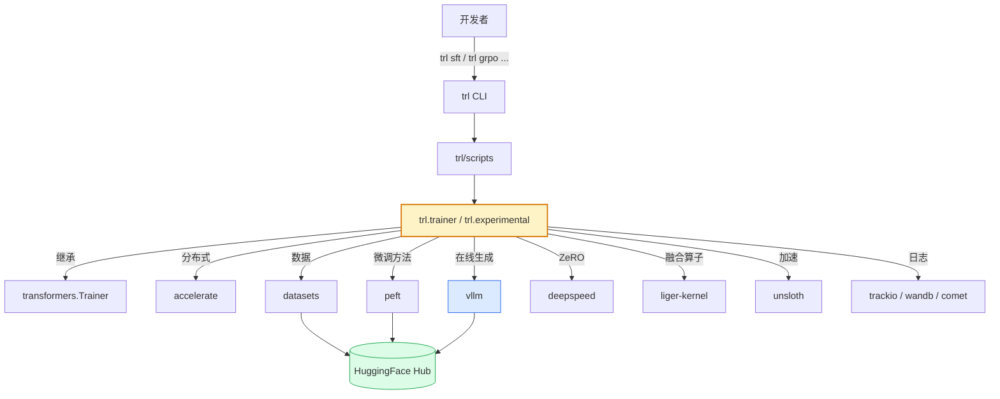
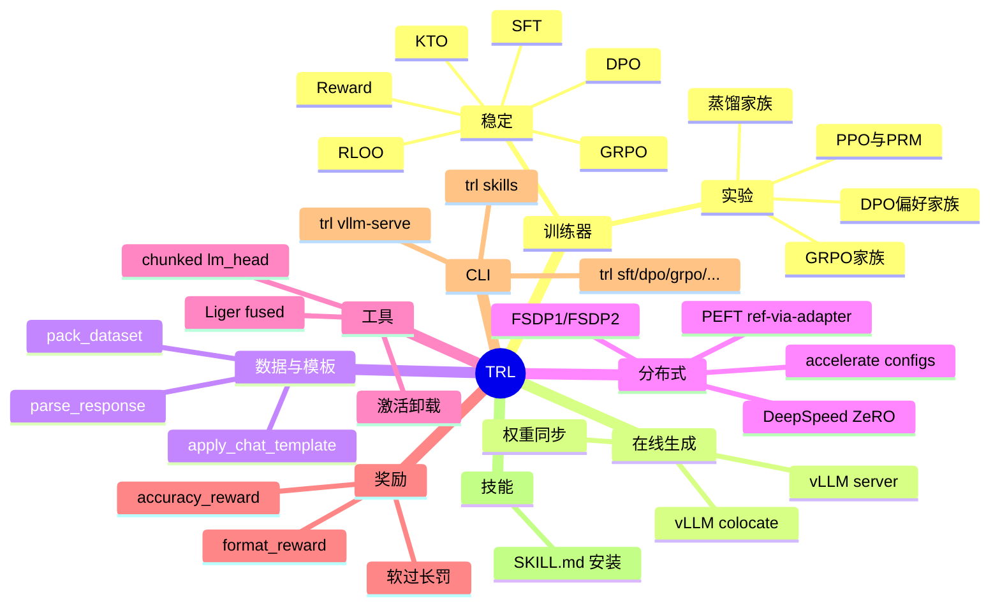

# 00 · 项目总览与设计理念

> 本篇导览：TRL（Transformers Reinforcement Learning）是 HuggingFace 出品的大模型**后训练（post-training）**库，本篇回答 "TRL 是什么、解决什么问题、为什么这样设计"。读完本篇你能用一句话讲清楚 TRL 的定位，并理解它为什么放弃传统 OOP 抽象、坚持"自包含训练器 + 一致性复制"的工程哲学。
>
> 核心问题：
> - TRL 与 transformers / accelerate / peft / vllm 的边界在哪里？
> - 为什么 TRL 不抽象出共享的 `RLTrainer` 基类？
> - v1 里程碑带来了哪些根本性变化？
> - "一致性优先于正确性" 是什么意思？

---

## 一、TRL 是什么

TRL 是构建在 [🤗 Transformers](https://github.com/huggingface/transformers) 之上的**后训练（post-training）**库。"后训练"指基础模型预训练完成之后的全部微调阶段，覆盖：

- **监督微调（SFT）**：用指令/对话数据让模型学会"按指令回答"。
- **偏好对齐（DPO / KTO / ORPO / ...）**：用人类偏好数据让模型回答得"更好"。
- **在线强化学习（GRPO / RLOO / PPO / OnlineDPO / ...）**：用可计算的奖励函数（如答案正确性、格式合规）直接优化策略。
- **奖励模型训练（RewardTrainer / PRM）**：训练一个给策略打分的模型。
- **知识蒸馏（GKD / GOLD / Distillation / ...）**：用大模型蒸馏小模型。

它和上游生态的边界：

| 依赖 | 提供什么 | TRL 在其上加了什么 |
|---|---|---|
| `transformers.Trainer` | 训练循环骨架、optimizer/scheduler、log/save/eval | 各算法的 `compute_loss` / 数据预处理 / 在线生成 |
| `accelerate` | 多卡/多机/DDP/FSDP/DeepSpeed 启动 | accelerate 配置模板、`unwrap_model_for_generation` |
| `peft` | LoRA / QLoRA / Prompt Tuning | `get_peft_config`、ref-via-adapter 技巧 |
| `datasets` | 数据加载 | `apply_chat_template` / `pack_dataset` 等变换 |
| `vllm` | 高速生成 | `VLLMGeneration`（colocate + server）+ 权重同步 |
| `deepspeed` | ZeRO-1/2/3 优化 | `prepare_deepspeed` + ref 模型同设备策略 |
| `liger-kernel` | 融合算子 | `LigerFusedLinearDPOLoss` 等集成 |
| `unsloth` | 训练加速 | 模型加载兼容 |

TRL **不重新发明**训练循环，它**扩展** transformers 的 `Trainer`：每个算法是一个独立的 `*Trainer` 子类，自己负责数据、损失、生成、参考模型等所有算法相关逻辑。

---

## 二、v1 里程碑

根据 README 的 "What's New"，TRL v1 是一次根本性转变：

1. **稳定训练器收敛为 6 个**：`SFTTrainer` / `DPOTrainer` / `GRPOTrainer` / `KTOTrainer` / `RLOOTrainer` / `RewardTrainer`。其他算法（CPO / ORPO / BCO / OnlineDPO / NashMD / ...）下沉到 `trl.experimental`，明确不保证稳定。
2. **vLLM 成为一等公民**：GRPO/RLOO 内置 `VLLMGeneration`，支持 colocate（同进程）与 server（独立 `trl vllm-serve` 进程）两种模式，配套权重广播与重要性采样校正。
3. **Harbor**：通过 `GRPOTrainer.environment_factory` 把沙箱任务套件接入训练（指令 + 沙箱镜像 + 沙箱内 verifier）。
4. **CLI 体验统一**：`trl sft|dpo|grpo|rloo|kto|reward` 子命令直接调起训练，`--config <yaml>` + `--accelerate_config <name>` 一键分布式。

---

## 三、设计哲学（来自 `.ai/AGENTS.md`）

TRL 的工程哲学与传统 OOP 框架**背道而驰**，是理解整个代码库的关键。下表逐条对照：

| 传统 OOP 哲学 | TRL 哲学 | 落地表现 |
|---|---|---|
| 抽象出共享基类 + 钩子 | 训练器**自包含**，共享逻辑**故意复制** | `_BaseTrainer` 仅做 telemetry 与 model card；vLLM 生成、`_get_per_token_logps_and_entropies`、`_calculate_rewards`、`_prepare_inputs` 在每个 trainer 中各写一遍 |
| DRY（Don't Repeat Yourself） | **一致性优先于正确性** | 复制出去的块必须与原版**逐字对齐**：变量名、控制流、注释都一致；分歧仅允许在算法语义处 |
| 抽象覆盖 100% 边界 | 覆盖 90% 用例的简洁实现 | "20 行覆盖 90% 用例优于 80 行兜底所有边界" |
| 防御式编程、`hasattr` 兜底 | **拒绝防御式编程** | "避免 `hasattr`/`getattr`，避免为不存在的场景加分支" |
| 工厂 / 注册表 / 插件 | **极简优先** | 不引入注册表、工厂、插件系统；贡献者能从头到尾读完一个 trainer |
| 修复 bug 时局部修 | 修复必须**跨训练器同步** | "GRPO 的修复 ⇒ RLOO 同步修复；不同步就是 bug" |

### 为什么这样设计？

这套哲学并非任性，而是基于一个核心权衡：

> **可演化性 > 可复用性**

如果抽象出 `RLTrainerBase`，每个算法只需要重写 100 行钩子；但代价是：

1. 任何对基类的修改都可能波及所有子类，难以独立演化。
2. 贡献者读 GRPO 时必须在 `GRPOTrainer` ↔ `RLTrainerBase` ↔ `Trainer` 三层之间反复跳转，认知负担大。
3. 研究型算法（GRPO 有 VESPO/SAPO/DR-GRPO/off-policy-mask/IS-correction 等多个研究分支）需要频繁修改生成/损失逻辑，基类钩子要么不够灵活要么过度膨胀。

TRL 的选择是：**接受复制代价，换取每个训练器可独立读懂、独立修改、独立演化**。这导致 GRPO 文件达 3123 行，但贡献者可以从头到尾读完一个文件就理解整个算法。

### 一致性规则的执行细节

`AGENTS.md` 给出了非常具体的规则：

- 同一逻辑出现在多个训练器中时，**变量名一致**（`self._last_loaded_step`、`self._metrics[mode]`）。
- **控制流结构一致**（if/elif/else 顺序一致）。
- **注释逐字一致**（逻辑相同时注释必须相同）。
- **分歧仅允许在算法语义处**（如 GRPO 从 vLLM 抽取 logprobs，RLOO 丢弃）。

最反直觉的一条：

> **一致性优先于正确性**：复制代码时即使发现原版有 bug，也要**保持一致地复制 bug**，并报告问题在专门 PR 中统一修复。一个"正确但不一致"的代码库比"一致地错"的代码库更难维护。

---

## 四、本系列文档地图

本系列在 `/workspace/ReadCode/` 下生成 24 篇文档，按 **总—分—总** 三段组织：

```
ReadCode/
├── 00–01  总览（项目概览 / 整体架构）
├── 02–20  分卷剖析
│   ├── 02     共性机制（基类 / 配置 / utils）
│   ├── 03–08  6 个稳定训练器详解
│   ├── 09–13  实验性训练器（按家族分组）+ 环境集成
│   └── 14–20  vLLM / 数据 / 分布式 / CLI / 奖励 / 模型工具 / 性能
├── 21     使用指南与实战案例（10 个可运行案例）
├── 22     总结与最佳实践
└── 23     Mermaid 语法检查与修正报告
```

---

## 五、配图

### 图 1 · TRL 在 HF 生态中的位置



**图说明**：从上往下读 —— 开发者通过 `trl` CLI 触发脚本，脚本调用训练器；训练器是 TRL 的核心（黄色），向下层依赖 HF 生态各组件。蓝色 vLLM 是 GRPO/RLOO 在线生成的关键依赖，绿色 Hub 表示数据/模型/PEFT 都可从 Hub 拉取。理解这张图就理解了 TRL "在 transformers 之上做加法、不重新发明轮子" 的定位。

### 图 2 · TRL 功能域心智图



**图说明**：以 TRL 为根的 8 大功能域心智图。**训练器** 是绝对核心，分稳定（6 个）与实验（4 大家族）。其余 7 个域都是为训练器服务的支撑模块 —— 在线生成服务在线 RL；数据与模板服务所有训练器；分布式让训练能跨多卡；工具降低显存/算力消耗；奖励给在线 RL 提供信号；CLI 是用户入口；技能是给 AI Agent 用的"教科书"。读后续章节时可以不断回到这张图定位当前模块的位置。

---

## 六、小结

- TRL = transformers 之上的**后训练**库；6 个稳定训练器 + 27 个实验训练器 + 一套支撑模块。
- v1 里程碑：训练器收敛、vLLM 一等公民、Harbor、CLI 统一。
- 工程哲学：**自包含训练器** + **一致性优先于正确性** + **极简 + 拒绝防御式编程** —— 为了"每个训练器可独立演化"。
- 理解这套哲学，比记住任何一个 API 都重要：它解释了为什么 GRPO/RLOO 70% 代码逐字相同却不抽象，为什么 `_BaseTrainer` 几乎是空类，为什么 README 反复强调"修改一处要同步所有副本"。

下一篇 [01 · 整体架构与模块依赖](01_总_整体架构与模块依赖.md) 将拆开顶层目录，给出模块依赖图与端到端调用链。
