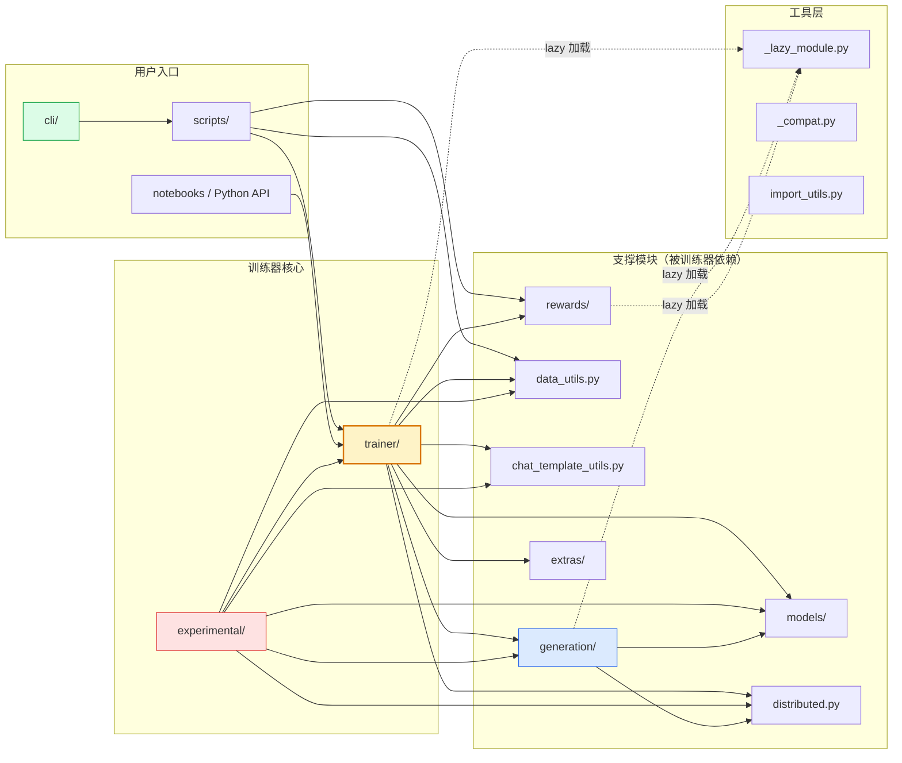
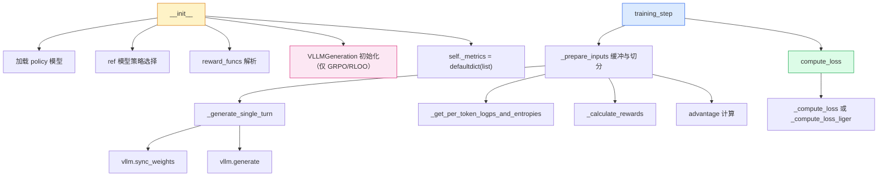

# 01 · 整体架构与模块依赖

> 本篇导览：上一篇讲了 "为什么 TRL 这样设计"，本篇拆开 `trl/` 顶层目录，回答 "每个模块做什么、谁依赖谁、一次 `trl sft` 命令从敲下回车到 `.train()` 跑起来经过哪些环节"。读完本篇你能拿到一张全局地图，后续读到任何子模块都能回到这里定位它在哪里。
>
> 核心问题：
> - `trl/` 顶层每个目录的职责一句话是什么？
> - 模块间的依赖方向是怎样的？为什么用 `_LazyModule`？
> - CLI → 脚本 → 训练器 的端到端调用链是什么样的？
> - `accelerate_config` 是怎么被解析的？

---

## 一、顶层目录与职责

```
trl/
├── trainer/              # 6 个稳定训练器 + 基类 + 共享 utils + callbacks
├── experimental/         # 27 个实验性训练器与 3 个环境集成
├── generation/           # vLLM 在线生成（colocate + server）
├── models/               # unwrap_model_for_generation + 激活卸载
├── data_utils.py         # 数据集变换（apply_chat_template / pack_dataset）
├── chat_template_utils.py # 训练模板、tool calling、parse_response
├── distributed.py        # DistributedBackend（DeepSpeed/FSDP 抽象）
├── rewards/              # 内置奖励函数（accuracy / format / 软过长罚）
├── scripts/              # CLI 入口脚本（sft/dpo/grpo/kto/rloo/reward/vllm_serve/env）
├── cli/                  # trl 命令行（main + commands + accelerate_launcher）
├── skills/               # SKILL.md 安装机制（给 AI Agent 用）
├── extras/               # dataset_formatting + profiling
├── _lazy_module.py       # 懒加载机制（避免 import vllm 等重依赖）
├── _compat.py            # transformers 版本兼容垫片
├── import_utils.py       # is_*_available 工具
└── chat_templates/       # 30+ 个 .jinja 模板
```

每个目录的"一句话职责"：

| 模块 | 一句话职责 |
|---|---|
| `trainer/` | 6 个用户直接调用的稳定训练器，所有算法相关逻辑都在这里 |
| `experimental/` | 不稳定实验区，包含 GRPO/DPO/蒸馏/PPO 四大家族变体 + 3 个环境集成 |
| `generation/` | 把 vLLM 包成训练器友好的接口（权重同步 + 生成 API） |
| `models/` | 训练时如何"剥开" FSDP/DeepSpeed 包装拿到底层模型用于生成；激活卸载 |
| `data_utils.py` | 纯函数：把原始 dataset 变成训练器期望的格式（对话/标准/packing） |
| `chat_template_utils.py` | chat template 的"训练化"（加 `` 损失掩码）+ tool call 解析 |
| `distributed.py` | 50 行的薄抽象：把 ZeRO-3 gather / FSDP summon 包成统一接口 |
| `rewards/` | GRPO/RLOO 的内置奖励函数库 |
| `scripts/` | `trl <cmd>` 实际调起的入口，每个文件有 `make_parser` + `main` |
| `cli/` | argparse 顶层 + 命令分发 + accelerate launch 包装 |
| `skills/` | 把"trl-training"这个 SKILL.md 安装到 `~/.claude/skills` 等目录 |
| `extras/` | 数据 schema 工具 + Profiling 计时上下文 |
| `_lazy_module.py` | 让 `import trl` 不触发 vllm/deepspeed 等重依赖加载 |

---

## 二、模块依赖图

依赖方向**自上而下**：上层（CLI/Scripts）依赖下层（Trainer/支撑模块），但训练器**不**依赖 CLI/Scripts。这保证训练器可被任意 Python 代码直接调用，不必经过 CLI。

### 图 1 · 顶层模块依赖（含 lazy module 边界）



**图说明**：从上到下三层 —— 用户入口（绿）→ 训练器核心（黄=稳定，红=实验）→ 支撑模块（白）→ 工具层（虚线 = 通过 `_LazyModule` 间接）。三个关键观察：

1. **训练器不依赖 CLI/Scripts**：你可以直接 `from trl import GRPOTrainer` 用 Python API，不必走 `trl grpo`。
2. **实验训练器依赖稳定训练器**：例如 `DPPOTrainer(GRPOTrainer)` 直接子类化；这也是为什么修改 GRPO 会自动惠及 DPPO/GMPO/PAPO 等所有 GRPO 家族成员。
3. **`generation/` 依赖 `models/`**：vLLM 权重同步需要 `unwrap_model_for_generation` 把 FSDP/DeepSpeed 包装剥开才能取出权重张量。
4. **虚线 = 懒加载**：`trl/__init__.py` 用 `_LazyModule` 替换 `sys.modules[__name__]`，所以 `import trl` 不会立刻加载 vllm/deepspeed 等重依赖；只有 `trl.GRPOTrainer` 真正被访问时才触发。

### `_LazyModule` 的作用

`trl/_lazy_module.py` 是受 Optuna 启发的 100 行小工具：

```python
# trl/__init__.py 第 124 行附近
sys.modules[__name__] = _LazyModule(
    __name__, globals()["__file__"], _import_structure, ...
)
```

效果：

- `import trl` 立即返回，不加载 vllm。
- `trl.GRPOTrainer` 第一次访问时才 `import trl.trainer.grpo_trainer`。
- IDE 自动补全正常（`_import_structure` 声明了所有公开符号）。

这一招让 TRL 的 import 时间从 "几十秒"（如果 eagerly 加载 vllm/deepspeed）压到 "几百毫秒"，对 CLI 与 notebook 体验至关重要。

---

## 三、端到端调用链

### 图 2 · 一次 `trl sft` 命令的端到端调用链

```mermaid
flowchart LR
    A["shell: trl sft --model_name_or_path Qwen/Qwen2.5-0.5B --dataset_name trl-lib/Capybara --output_dir ./out"] --> B[trl CLI 入口]
    B --> C["trl/cli/main.py: main(argv)"]
    C --> D["get_commands 返回 TrainingCommand('sft')"]
    D --> E["TrainingCommand.run: 动态 import trl.scripts.sft"]
    E --> F["TrlParser.parse_args_and_config<br/>separate_remaining_strings=True"]
    F --> G["拆出 accelerate launch 参数 + 训练参数"]
    G --> H["resolve_accelerate_config_argument<br/>--accelerate_config zero2 → config_file 路径"]
    H --> I["launch_training_script via accelerate launch"]
    I --> J["scripts/sft.py: main"]
    J --> K["TrlParser 解析 ScriptArguments + SFTConfig + ModelConfig + DatasetMixtureConfig"]
    K --> L["get_dataset 加载并 mix 多个数据集"]
    L --> M["create_model_from_path 加载模型 + get_peft_config"]
    M --> N["SFTTrainer(model, args, train_dataset, processing_class)"]
    N --> O["trainer.train()"]
    O --> P["trainer.save_model() / push_to_hub()"]

    style B fill:#dcfce7,stroke:#16a34a
    style F fill:#fef3c7,stroke:#d97706
    style I fill:#dbeafe,stroke:#2563eb
    style N fill:#fce7f3,stroke:#db2777
    style O fill:#fce7f3,stroke:#db2777
```



**图说明**：从最左边的 shell 命令到最右边的 `trainer.save_model()`，共 16 个环节。颜色分组：

- **绿色**：CLI 入口（`trl/cli/main.py`）。
- **黄色**：参数解析关键步骤 —— `TrlParser.parse_args_and_config(separate_remaining_strings=True)` 把命令行拆成 accelerate-launch 部分（如 `--num_processes 8 --multi_gpu`）与训练脚本部分（如 `--learning_rate 1e-5`），这是 `trl` CLI 能"既调起 accelerate 又传训练参数"的关键。
- **蓝色**：`accelerate launch` 子进程拉起 `scripts/sft.py`，从此进入 Python 进程内。
- **粉色**：训练器构造与训练循环。

注意 `resolve_accelerate_config_argument` 把 `--accelerate_config zero2` 这种**短名**解析为 `trl/accelerate_configs/zero2.yaml` 的绝对路径，再传给 `accelerate launch --config_file`。这就是 `trl sft --accelerate_config zero2` 一行就能起 ZeRO-2 分布式训练的原因。

---

## 四、`scripts/<name>.py` 的统一骨架

`trl/scripts/` 下 8 个脚本（`sft/dpo/grpo/kto/rloo/reward/vllm_serve/env`）都遵循同一骨架：

```python
# 简化骨架（以 scripts/sft.py 为例）
def make_parser(subparsers=None, prog="trl sft"):
    parser = TrlParser(ScriptArguments, SFTConfig, ModelConfig, DatasetMixtureConfig)
    # 注册子命令、--help 等
    return parser

def main():
    parser = make_parser()
    args = parser.parse_args_and_config()
    # 1) 加载数据
    dataset = get_dataset(args.dataset_mixture)  # 或 datasets.load_dataset
    # 2) 加载模型 + PEFT
    model_config = ModelConfig.from_pretrained(args.model_name_or_path, ...)
    model = create_model_from_path(model_config, ...)
    peft_config = get_peft_config(model_config)
    # 3) 构造训练器
    trainer = SFTTrainer(
        model=model,
        args=SFTConfig(...),
        train_dataset=dataset,
        processing_class=tokenizer,
        peft_config=peft_config,
    )
    # 4) 训练
    trainer.train()
    # 5) 保存
    trainer.save_model(args.output_dir)
    if args.push_to_hub:
        trainer.push_to_hub()
```

**关键观察**：

1. **`TrlParser`** 是 vendored `HfArgumentParser`（在 `scripts/_hf_argparser.py`），加上了 `--config <yaml>` 支持，且能从 yaml 的 `env:` 段设置环境变量。这是 vendored 而非 import 的原因：上游 transformers 的 `HfArgumentParser` 有 import-latency bug（#44273），TRL 直接复制一份修。
2. **`ScriptArguments` / `DatasetMixtureConfig`** 是所有脚本共享的数据类：前者管数据集名/split/streaming，后者管多数据集混合（`path`/`name`/`data_dir`/`data_files`/`split`/`columns`）。
3. **`get_dataset`** 支持混合多个数据集 + train/test split。
4. **GRPO/RLOO 脚本额外**有 `reward_funcs: list[str]` 字段，从内置注册表（`trl.rewards.accuracy_reward` 等）按名映射，也支持点分导入路径（`mymodule.my_reward`）。

---

## 五、训练器内部模块依赖

每个 `*Trainer` 内部的依赖结构高度同构（来自一致性原则）：



**图说明**：训练器内部从 `__init__`（黄）到 `training_step`（蓝）的标准结构。GRPO/RLOO 走完整的 vLLM 路径（粉色），DPO/KTO/SFT/Reward 不需要在线生成（跳过 vLLM 块）。`compute_loss`（绿）是每个训练器最重写的方法，是算法差异的核心所在。

注意 `_prepare_inputs` 在 GRPO/RLOO 中是**生成缓冲**逻辑（一次 generation_batch 切多次 accumulation step），但在 SFT/DPO/KTO/Reward 中是**数据预处理 + collate**逻辑。同名不同义，这是 TRL "复用方法名但允许语义分歧"的体现。

---

## 六、模块边界的几个反直觉设计

读 TRL 代码时，下面这些"看起来应该在一起但实际分散"的设计经常让人困惑，提前知晓可少走弯路：

1. **`distributed.py` 在顶层而不是 `trainer/` 里**：因为它不仅训练器用，`generation/` 与 `models/` 也用。放顶层避免循环依赖。
2. **`create_reference_model` 在 `models/utils.py` 但实际是 `trl.experimental.utils.create_reference_model` 的 deprecated 别名**：HF 兼容老 API。
3. **`activation_offloading` 在 `models/` 而不是 `trainer/`**：因为它是 `saved_tensors_hook` 机制，跟训练循环无关，是 PyTorch autograd 层面的。
4. **`formatting_func` / `compute_loss_func` 是 SFT 专属**：DPO/KTO/GRPO 等不需要，因为它们的 loss 不像 SFT 那样可以"自定义钩子"。
5. **`examples/scripts/` 与 `trl/scripts/` 是两套东西**：前者是教学示例（如 `grpo_vlm.py`、`sft_gemma3.py`），后者是 CLI 真正调起的入口。
6. **`tests/experimental/` 与 `trl/experimental/` 一一对应**：每个实验训练器都有自己的测试文件，但实验区不保证测试完备。

---

## 七、小结

- TRL 顶层 ~15 个目录，核心是 `trainer/`（6 个稳定）+ `experimental/`（27 个实验），其余都是支撑模块。
- 依赖方向：CLI/Scripts → Trainer → 支撑模块 → 工具层；训练器**不**依赖 CLI。
- `_LazyModule` 让 `import trl` 不触发重依赖加载，CLI/notebook 体验丝滑。
- 一次 `trl sft` 命令经过 16 个环节：CLI 解析 → TrlParser 拆参 → accelerate launch → scripts/sft.py → SFTTrainer → train()。
- 各训练器内部结构同构（`__init__` → `training_step` → `_prepare_inputs` → `compute_loss`），这是"一致性原则"的物理表现。

下一篇 [02 · 核心训练器共性机制](02_分_核心训练器共性机制.md) 进入 `trainer/` 目录，剖析 `_BaseTrainer`、`_BaseConfig`、`ModelConfig`、`utils.py` 这 4 个所有训练器共享的基石。
