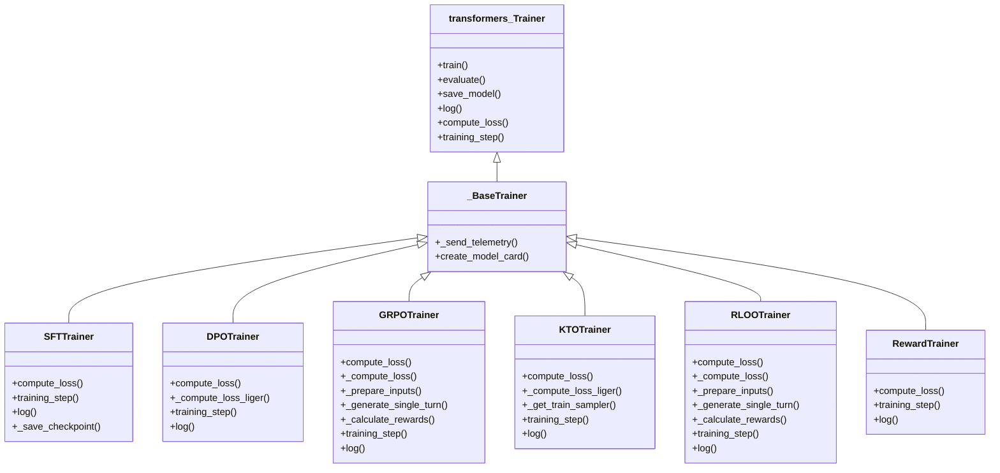
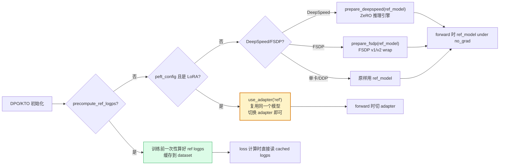

# 02 · 核心训练器共性机制

> 本篇导览：6 个稳定训练器虽然算法各异，但都站在 4 块基石之上 —— `_BaseTrainer`、`_BaseConfig`、`ModelConfig`、`trainer/utils.py`。本篇讲清楚这 4 块基石提供什么、训练器都怎么用，以及为什么 "复制一致性" 原则下还允许保留这几个共享文件。
>
> 核心问题：
> - `_BaseTrainer` 为什么几乎是空的？
> - `_BaseConfig` 改了哪些 transformers 默认值？
> - `ModelConfig` 与训练器 config 是什么关系？
> - `trainer/utils.py` 里哪些工具几乎所有训练器都在用？
> - DPO/KTO 的 ref-model 三策略是什么？

---

## 一、`_BaseTrainer`（`trainer/base_trainer.py`，~190 行）

### 1.1 设计意图

`AGENTS.md` 明确："`_BaseTrainer` provides only minimal utilities (model card generation)"。这是**自包含训练器**原则的物理表现 —— 基类不掺任何算法逻辑，所有共享行为要么是 telemetry（与算法无关）、要么是 model card（与算法无关）。

### 1.2 关键代码

```python
# trl/trainer/base_trainer.py:33-64
_TELEMETRY_TRAINERS = {
    # Stable
    "DPOTrainer", "GRPOTrainer", "KTOTrainer", "RewardTrainer", "RLOOTrainer", "SFTTrainer",
    # Experimental
    "A2POTrainer", "AsyncGRPOTrainer", "BCOTrainer", "CPOTrainer", "DistillationTrainer",
    "DPPOTrainer", "GFPOTrainer", "GKDTrainer", "GOLDTrainer", "GRPOWithReplayBufferTrainer",
    "MiniLLMTrainer", "NashMDTrainer", "OnlineDPOTrainer", "ORPOTrainer", "PAPOTrainer",
    "PPOTrainer", "PRMTrainer", "SDFTTrainer", "SDPOTrainer", "SSDTrainer", "TPOTrainer", "XPOTrainer",
}

class _BaseTrainer(Trainer):
    _tag_names = []
    _name = "Base"
    _paper = {}
    _template_file = None

    def __init__(self, *args, **kwargs):
        super().__init__(*args, **kwargs)
        self._send_telemetry()
```

`__init__` 只做一件事：调 `super().__init__()` 然后发遥测。

### 1.3 telemetry 细节

`_send_telemetry` 收集 6 类信息（行 77-125）：

- **rank0 only + 跳过 CI**：避免多卡重复上报，避免自动化测试污染数据。
- **distributed**：`deepspeed` / `fsdp` / `ddp` / `none`。
- **world_size 分桶**：`1` / `2-8` / `9-64` / `65+`（避免指纹化部署）。
- **trainer 类名**：**仅当类在白名单 `_TELEMETRY_TRAINERS` 且模块以 `trl.` 开头**才上报真名，否则报 `"other"`。这是为了避免泄漏用户自定义子类名或内部未发布训练器名。
- **model_arch**：仅当 `model_type` 在 `transformers.CONFIG_MAPPING` 中才上报，否则 `"other"`。

### 1.4 `create_model_card`

每个训练器继承 `_template_file`（指向 `trl/templates/*.md`）、`_name`、`_paper`（含 `title` / `id` / `citation`），`create_model_card` 调 `utils.generate_model_card` 渲染最终 README.md 写入 `output_dir/README.md`。

---

## 二、`_BaseConfig`（`trainer/base_config.py`，~107 行）

`_BaseConfig(TrainingArguments)` 改了几处 transformers 默认值，使其更适合后训练场景：

```python
# trl/trainer/base_config.py（简化）
@dataclass
class _BaseConfig(TrainingArguments):
    logging_steps: float = 10
    gradient_checkpointing: bool = True
    use_liger_kernel: bool = False  # 重声明以修正上游 % 转义 bug
    torch_empty_cache_steps: int | None = None

    def __post_init__(self):
        super().__post_init__()
        # fp16 未设且 bf16 可用时默认开 bf16
        if self.fp16:
            ...  # 警告
        elif self.bf16 is None and torch.cuda.is_available() and torch.cuda.is_bf16_supported():
            self.bf16 = True
```

**为什么默认 `gradient_checkpointing=True`**：后训练动辄 7B+ 模型，不开 checkpointing 单卡根本放不下。

**为什么修正 `%` 转义**：transformers 5.3 之前 `HfArgumentParser` 把 help 字符串中的 `%` 当成 argparse format-specifier 报错。TRL 直接重声明字段绕过。

---

## 三、`ModelConfig`（`trainer/model_config.py`，~178 行）

`ModelConfig` **不是** `TrainingArguments` 的子类，是独立 dataclass，专门为 CLI 加载模型服务：

```python
# 字段分类
- model_name_or_path, model_revision, dtype (auto/bfloat16/float16/float32)
- attn_implementation (sdpa/eager/flash_attention_2)
- # PEFT 全字段
- use_peft, lora_r=16, lora_alpha=32, lora_dropout=0.05
- lora_target_modules / lora_target_parameters / lora_modules_to_save
- lora_task_type (CAUSAL_LM / SEQ_CLS)  # RewardTrainer 用 SEQ_CLS
- use_rslora, use_dora
- # QLoRA
- load_in_8bit, load_in_4bit
- bnb_4bit_quant_type (nf4), use_bnb_nested_quant, bnb_4bit_quant_storage
```

`__post_init__` 做最小校验：拒绝同时 8+4 bit；把单元素 `lora_target_modules` 列表解包。

**与 `<Trainer>Config` 的关系**：脚本里同时持有两个 config —— `ModelConfig` 管"加载什么模型 + 怎么量化/LoRA"；`<Trainer>Config`（继承 `_BaseConfig`）管"怎么训"。`ModelConfig` 在 `scripts/<name>.py` 中被消费，构造出 `model` 与 `peft_config`，再传给 `Trainer.__init__`。

---

## 四、`trainer/utils.py` 关键工具（~1515 行）

挑出"几乎所有训练器都在用"的工具：

### 4.1 模型加载与 PEFT

```python
def create_model_from_path(model_config, *, dtype, sharding, trust_remote_code):
    """根据 ModelConfig 加载模型 + 应用 PEFT"""

def get_peft_config(model_config) -> PeftConfig | None:
    """把 ModelConfig 的 LoRA/QLoRA 字段翻译成 PeftConfig"""

def get_quantization_config(model_config) -> QuantizationConfig | None:
    """构造 bnb 4bit/8bit 量化配置"""

@contextmanager
def use_adapter(model, adapter_name: str):
    """ref-via-adapter 技巧：临时切换激活的 PEFT adapter
    用于 DPO/KTO：把同一个 LoRA 模型既当 policy 又当 ref"""
```

### 4.2 张量工具

```python
def selective_log_softmax(logits, index):
    """内存高效的 per-token logprob 计算（仅算指定 index 的 logprob，不算整词表）"""

def pad(tensors, padding_value, padding_side, pad_to_multiple_of):
    """对齐变长 tensor 列表"""

def flush_left(*, x, mask, mask_value=0.0):
    """把 padding 全压到右侧"""

def entropy_from_logits(logits):
    """从 logits 算熵"""

def nanstd(x, *args, **kwargs):
    """忽略 NaN 的 std"""
```

### 4.3 采样器

```python
class RepeatSampler:
    """把每个样本重复 N 次，用于 GRPO/RLOO 一个 prompt 生成 G 个完成"""
```

### 4.4 chunked LM head

```python
class _ChunkedLogProbFunction(torch.autograd.Function):
    """分块计算 lm_head matmul，避免大词表一次性 OOM"""

def patch_chunked_lm_head(model, chunk_size):
    """monkey-patch model.lm_head 走分块路径"""
```

SFT 的默认 `loss_type="chunked_nll"` 就用它。

### 4.5 异步与端口

```python
def start_event_loop_in_daemon() -> asyncio.AbstractEventLoop:
    """起一个 daemon 线程的事件循环，用于异步奖励函数"""

def _find_free_port() -> str:
    """找空闲端口"""

def ensure_master_addr_port(...):
    """vLLM server 模式下保证 master addr/port 一致"""
```

### 4.6 报告

```python
def generate_model_card(*, base_model, model_name, hub_model_id, dataset_name, tags, ...):
    """渲染 model card 模板"""

def get_comet_experiment_url() -> str | None: ...
def get_trackio_space_url() -> str | None: ...

def print_prompt_completions_sample(prompts, completions, ...):
    """打印 prompt+completion 样本，便于训练中观察"""

def compute_flops_per_token(model_config, seq_length): ...
def compute_mfu(...) -> float: ...
def adjusted_mfu(...) -> float: ...
```

---

## 五、所有训练器的共性模式

每个 `*Trainer` 至少重写下面 4 个方法（细节见各详解篇）：



**图说明**：`_BaseTrainer` 仅是 `transformers.Trainer` 的薄包装，加了 telemetry 与 model card。6 个训练器各自重写 `compute_loss` / `training_step` / `log`（红色，必选），算法相关的额外方法（如 GRPO 的 `_prepare_inputs` / `_generate_single_turn`）按需重写（蓝色，可选）。注意 RLOO 与 GRPO 几乎重写相同的方法集 —— 这是它们 70% 代码逐字对齐的物理表现。

### 5.1 `compute_loss` 的统一签名

```python
def compute_loss(self, model, inputs, return_outputs=False, num_items_in_batch=None):
    ...
```

- DPO/KTO/GRPO 在 `compute_loss` 内部进一步 dispatch 到 `_compute_loss` 或 `_compute_loss_liger`（看是否启用 Liger）。
- GRPO/RLOO **拒绝** `return_outputs=True`（不需要 outputs，直接返回标量 loss）。

### 5.2 `training_step` 的统一模板

```python
def training_step(self, model, inputs, num_items_in_batch=None):
    with self.maybe_activation_offload_context():
        return super().training_step(model, inputs, num_items_in_batch)
```

所有训练器都是这个模板，只是上下文管理器名 `maybe_activation_offload_context` 略有差异。

### 5.3 `log` 的统一模板

```python
def log(self, logs: dict[str, float]):
    # 1) 把 self._metrics[mode] 列表平均
    # 2) 合并进 logs（eval 模式加 eval_ 前缀）
    # 3) 清空 self._metrics[mode]
    super().log(logs)
```

每个训练器都有 `self._metrics = defaultdict(list)` 在 `__init__` 末尾创建，每个 step 内累积指标，`log` 时取均值。这块代码在每个训练器里**逐字相同**（一致性原则）。

### 5.4 MoE aux loss

SFT/DPO/KTO/GRPO 都检测 MoE：

```python
text_config = self.model.config.text_config if isinstance(...) else self.model.config
moe_layer = text_config.router_aux_loss_coef > 0.0
...
outputs = model(..., output_router_logits=moe_layer)
if moe_layer:
    aux_loss = outputs.router_aux_loss
    loss += self.args.router_aux_loss_coef * aux_loss
```

---

## 六、ref-model 三策略

DPO/KTO 需要参考模型（GRPO/RLOO 也有 `sync_ref_model` 选项）。TRL 提供三种 ref-model 实现：



**图说明**：从"DPO/KTO 初始化"出发，按 `precompute_ref_logps` → `peft + LoRA` → `分布式后端` 三层优先级决策 ref 模型实现。绿色 `precompute` 是最省显存（训练时根本不加载 ref）；黄色 `use_adapter` 是 LoRA 场景的省显存利器（一个模型当两个用，靠切 adapter 区分 policy/ref）；蓝色是常规多卡场景。

### `use_adapter` 的实现要点

```python
@contextmanager
def use_adapter(model, adapter_name):
    old = model.active_adapter  # 保存当前 adapter
    model.set_adapter(adapter_name)  # 切到 ref adapter
    try:
        yield
    finally:
        model.set_adapter(old)  # 恢复
```

DPO `_compute_loss` 中典型用法：

```python
# 算 policy logps
policy_logps = self._compute_logps(model, batch)

# 算 ref logps（同一模型，切 adapter）
with torch.no_grad():
    if self.peft_config:
        with use_adapter(model, "ref"):
            ref_logps = self._compute_logps(model, batch)
    else:
        with disable_gradient_checkpointing(model):
            ref_logps = self._compute_logps(self.ref_model, batch)
```

---

## 七、小结

- `_BaseTrainer` 几乎是空的 —— 这是**自包含训练器**原则的物理表现，只有 telemetry 与 model card 与算法无关。
- `_BaseConfig` 改了几处 transformers 默认（`gradient_checkpointing=True` / `bf16` 自适配 / `logging_steps=10`）。
- `ModelConfig` 是 CLI 加载模型的独立 dataclass，与训练器 config 解耦。
- `trainer/utils.py` 1500 行工具：模型加载、PEFT、`selective_log_softmax`、`RepeatSampler`、chunked LM head、报告生成。
- 所有训练器重写 `compute_loss` / `training_step` / `log`，模板逐字相同（一致性原则）。
- DPO/KTO 的 ref-model 三策略：`precompute_ref_logps` / 独立 ref_model（DeepSpeed/FSDP prepare）/ PEFT `use_adapter` 复用基模型。

下一篇 [03 · SFT 训练器详解](03_分_SFT训练器详解.md) 进入第一个具体训练器，从最简单的 SFT 开始。
