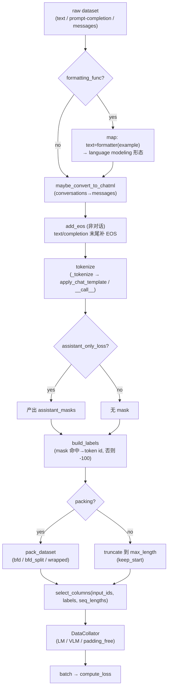
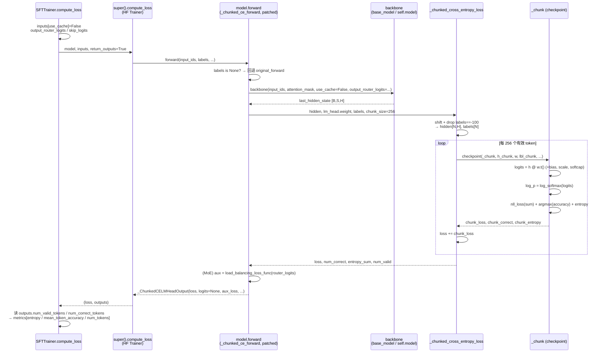

# 03 · SFT 训练器详解

> 本篇导览：SFT（Supervised Fine-Tuning）是 TRL 里最朴素也最常用的训练器——把任意"文本/对话"喂给一个因果 LM，用 next-token 交叉熵把它往目标分布拉。本篇从损失原理出发，逐段拆解 `trl/trainer/sft_trainer.py`：`__init__` 里模型加载与 collator 选择的完整决策树、`compute_loss` 里 `use_cache=False` / MoE aux loss / Liger `skip_logits` / chunked 路径如何各司其职、`training_step` 怎样套上激活卸载上下文，以及 `bfd/bfd_split/wrapped` 三种 packing、`completion_only_loss` / `assistant_only_loss` 掩码、`padding_free`、VLM collator 与 DeepSpeed ZeRO-3 tied-embedding gather 等集成件如何串成一条可训练流水线。

> 核心问题：
> - 因果 LM 的 next-token loss 在 TRL 里有 `nll` / `dft` / `chunked_nll` 三种实现，它们各自解决什么问题、何时该选哪个？
> - `chunked_nll` 怎样在不物化 `[B, S, V]` logits 的前提下完成前向 + 反向？为什么要在 `super().__init__` 之前 patch `model.forward`？
> - `completion_only_loss` / `assistant_only_loss` / packing / padding-free 这几条数据预处理分支，在 `__init__` 里以什么顺序决策、彼此如何互斥？
> - PEFT + DeepSpeed ZeRO-3 + gradient checkpointing 三者叠加时，TRL 为什么要强制 `use_reentrant=True` 和 `autocast_adapter_dtype=False`？
> - 为什么 SFT 集成了 Accelerate / PEFT / Liger / DeepSpeed / 激活卸载，却**不**集成 vLLM？

---

## 一、损失原理：因果 LM 的 next-token NLL

SFT 的目标只有一个：最大化"给定前缀，下一 token 是 ground truth"的对数似然。对一个 tokenized 序列 $x_{1..T}$，因果 LM 在位置 $t$ 输出 logits $z_t \in \mathbb{R}^V$，损失为：

$$\mathcal{L} = -\frac{1}{|\mathcal{M}|}\sum_{t \in \mathcal{M}} \log p_\theta(x_{t+1} \mid x_{\le t}),\quad p_\theta = \mathrm{softmax}(z_t)$$

其中 $\mathcal{M}$ 是有效 token 集合（label 不为 `-100` 的位置）。TRL 用 `labels == -100` 作为统一掩码：prompt 段、padding 段、被 packing 切掉的 token 都置 `-100`，只对真正要"学会生成"的 token 计 loss。

TRL 在 `SFTConfig.loss_type` 暴露三种实现，默认 `chunked_nll`：

```python
# trl/trainer/sft_config.py:283-295（节选）
loss_type: str | None = field(
    default=None,
    metadata={"help": "... 'nll' / 'dft' / 'chunked_nll' ..."},
)
# __post_init__ 里的默认值兜底
if self.loss_type is None:
    self.loss_type = "nll" if self.use_liger_kernel else "chunked_nll"
```

`nll` 是 HF 原生 `ForCausalLMLoss`，会物化完整 `[B, S, V]` logits；`dft` 是 Dynamic Fine-Tuning（[论文 2508.05629](https://huggingface.co/papers/2508.05629)），用 `p.detach() * (-log p)` 重加权；`chunked_nll` 数学等价 `nll`，但跳过 `-100` 位置的 `lm_head` matmul 并按 chunk 算 CE，把峰值显存从 `B·S·V` 降到 `chunk_size·V`。

---

## 二、`__init__`：模型加载与 collator 决策树

`__init__`（sft_trainer.py:898，行号基于 2026-07 探索）做四件事：把字符串模型加载成 `PreTrainedModel`、决定 collator、准备好 dataset、选好 loss 路径，**最后才**调 `super().__init__()`。

**模型加载**：当 `model` 是字符串时，走 `create_model_from_path`（utils.py:1008），它会把字符串 dtype 转成 `torch.dtype`、默认 `device_map="auto"`，并通过 `config.architectures[0]` 推断具体类（含 remote-code 回退）。分布式训练（`MULTI_GPU` / `DEEPSPEED`）会强制 `device_map=None`，否则 `auto` 在多卡上会崩。

```python
# trl/trainer/sft_trainer.py:942-955（节选）
if isinstance(model, str):
    model_init_kwargs = dict(args.model_init_kwargs or {})
    if quantization_config is not None:
        model_init_kwargs["quantization_config"] = quantization_config
    if args.distributed_state.distributed_type in ["MULTI_GPU", "DEEPSPEED"]:
        model_init_kwargs["device_map"] = None  # "auto" 在多卡下会失败
    model_init_kwargs.setdefault("trust_remote_code", args.trust_remote_code)
    model = create_model_from_path(model, **model_init_kwargs)
```

**processing_class 与 VLM 判定**：`processing_class` 缺省走 `AutoProcessor.from_pretrained`。若是 `ProcessorMixin`，则 `self._is_vlm = True`，并取 `processing_class.tokenizer` 作为内部 `_tokenizer`。VLM 下 packing / padding_free / assistant_only_loss 全部被显式拒绝（sft_trainer.py:1008-1028），因为图像 token 必须和像素值一一对应，被打包或截断会破坏这种对应。

**collator 选择**：BFD packing 会强制开 `padding_free`（sft_trainer.py:1134），否则 padded attention_mask 会让 FlashAttention 忽略 `position_ids` 重算出错的 `cu_seq_lens`。非视觉数据用 `DataCollatorForLanguageModeling`（动态右 pad，padding_free 下输出 `position_ids` 而非 `attention_mask`），视觉数据用 `DataCollatorForVisionLanguageModeling`，后者会处理 `pixel_values` 与 `image_grid_thw` 等图像网格张量。

**PEFT 集成**：`peft_config` 非空时调 `get_peft_model`。两个易踩坑的细节——ZeRO-3 + 非量化模型要传 `autocast_adapter_dtype=False`，否则 LoRA 参数被 upcast 到 fp32 而 base 是 bf16，ZeRO-3 的 `_allgather_params_coalesced` 按"第一个持久参数 dtype"分配缓冲区会报 `TypeError`；QLoRA 则手动把可训练参数 cast 到 bf16（遵循 [QLoRA 论文 2305.14314](https://huggingface.co/papers/2305.14314)）。PEFT + ZeRO-3 + gradient checkpointing 三件套还会被强制 `use_reentrant=True`，否则 checkpoint 在 ZeRO-3 下会静默丢梯度。

---

## 三、数据预处理流水线

`_prepare_dataset`（sft_trainer.py:1409）是一条 `map` 流水线，顺序固定：formatting_func → maybe_convert_to_chatml → add_eos → tokenize → build_labels → truncate → pack。`completion_only_loss` 缺省时按数据集是否含 `prompt`/`completion` 字段自动判定（sft_trainer.py:1165-1168）；`assistant_only_loss=True` 时若 chat template 没有 `` 标记，会换上 `get_training_chat_template` 训练模板，并通过 `return_assistant_tokens_mask` 让 `apply_chat_template` 产出 `assistant_masks`。

```python
# trl/trainer/sft_trainer.py:1599-1605（build_labels）
def build_labels(example, mask_columns):
    masks = [example[column] for column in mask_columns]
    labels = [
        token_id if all(bits) else -100
        for token_id, *bits in zip(example["input_ids"], *masks, strict=False)
    ]
    return {"labels": labels}
```

packing 在 `data_utils.pack_dataset`（data_utils.py:804）里实现，三策略对应不同 SFT 场景：

- `bfd`（Best-Fit Decreasing，默认）：保留序列边界，**截断**超长序列的溢出 token。SFT 友好，不破坏对话结构。
- `bfd_split`：把溢出序列**拆分**后塞进别的样本，零 token 损失，适合预训练/长文档，但可能切断对话。
- `wrapped`：最快最激进，无视边界、中途切断，彻底填满每个 packed 序列。

`bfd` / `bfd_split` 会额外产出 `seq_lengths` 列，供 document-aware FlashAttention 区分包内边界。VLM 走 `skip_prepare_dataset=True`，因为图像→像素转换太贵，改为在线做。



**图说明**：图自上而下描述单条样本从原始字段到 batch 的转换链路。菱形节点是配置驱动的分支点（`formatting_func` / `assistant_only_loss` / `packing`），矩形节点是 `dataset.map` 阶段。注意三条互斥路径：`assistant_only_loss` 仅对话数据可用、`completion_only_loss` 仅 prompt-completion 可用、VLM 自动跳过整条 `map` 链（`skip_prepare_dataset=True`，预处理移到 collator 在线做）。`bfd/bfd_split` 会多产 `seq_lengths` 列，`wrapped` 不会。

---

## 四、`compute_loss`：三套前向路径的汇合点

`compute_loss`（sft_trainer.py:1729）只做"准备 forward kwargs + 调 `super().compute_loss` + 后处理 metrics"，真正的 loss 在被 patch 过的 `model.forward` 或 Liger kernel 里算。它做四件准备性工作：

```python
# trl/trainer/sft_trainer.py:1739-1766（节选）
inputs["use_cache"] = False  # 与 gradient checkpointing 冲突
if self.aux_loss_enabled:           # MoE：要 router_logits 才能算负载均衡 aux loss
    inputs["output_router_logits"] = True
if self.args.use_liger_kernel:
    inputs["skip_logits"] = (        # 训练/只算 loss 时跳过 logits 物化，省显存
        self.model.training or self.args.prediction_loss_only or ...
    )
    inputs["return_token_accuracy"] = True
    inputs["use_token_scaling"] = self.args.loss_type == "dft"  # DFT 的 token-level 缩放
```

`use_cache=False` 是硬性要求——gradient checkpointing 与 KV cache 不兼容。`output_router_logits` 对 MoE 模型必备，且 VLM wrapper 只认 forward kwarg、不认 config，所以必须在这里注入而非靠 model config。Liger 的 `skip_logits` 在 eval 且无 `compute_metrics`/`preprocess_logits_for_metrics` 时也跳过 logits，避免 `lm_head` 投影的显存尖峰（[trl issue 4679](https://github.com/huggingface/trl/issues/4679)）。

metrics 后处理按 loss_type 分支：`chunked_nll` 直接读 patched forward 返回的 `outputs.num_valid_tokens` / `entropy_sum` / `num_correct_tokens`（来自 `_ChunkedCELMHeadOutput`，sft_trainer.py:87），**不重新算 logits**；非 Liger 的 `nll`/`dft` 则从 `outputs.logits` 现算熵和准确率；Liger 则读 `outputs.token_accuracy`。`aux_loss_enabled` 时统一日志 `outputs.aux_loss`。

---

## 五、`chunked_nll`：分块交叉熵的内存杀手

这是 SFT 的默认 loss 路径，核心思路：**先跑 decoder 拿 `last_hidden_state`，跳过 `lm_head` 全量 matmul，把有效 token（label≠-100）按 chunk 算 CE，每个 chunk 用 gradient checkpointing 让 `[chunk_size, V]` logits 只在自己那次前向/反向存活。**

patch 发生在 `super().__init__` **之前**（sft_trainer.py:1310），这样 accelerate 包装的就是 patched forward。对 PEFT，patch 的是 `get_base_model()` 而非 `PeftModel` wrapper——保证 PromptTuning 类的虚拟 token 注入仍走 `PeftModel.forward`。patch 函数 `_patch_chunked_ce_lm_head`（sft_trainer.py:242）替换 `model.forward` 为 `_chunked_ce_forward`：无 labels 时回退原 forward（保留 generation 与 logits 后处理）；有 labels 时跑 backbone、丢 `-100`、分块算 loss，最后包成 `_ChunkedCELMHeadOutput`（`logits=None`、附 `num_correct_tokens`/`entropy_sum`/`num_valid_tokens`/`aux_loss`）。

```python
# trl/trainer/sft_trainer.py:216-239（节选）
for start in range(0, n_valid, chunk_size):
    h_chunk = hidden[start : start + chunk_size]
    lbl_chunk = labels[start : start + chunk_size]
    chunk_loss, chunk_correct, chunk_entropy = torch.utils.checkpoint.checkpoint(
        _chunk, h_chunk, lm_head_weight, lm_head_bias, lbl_chunk,
        logit_scale, final_logit_softcapping, use_reentrant=False,
    )
    loss = loss + chunk_loss          # sum，最后再 / num_items_in_batch
```

`_chunk`（sft_trainer.py:114）内部就是 `matmul → (+bias) → logit_scale → softcap → log_softmax → nll_loss(sum) → argmax 算准确率 → 算熵`。两个工程细节值得注意：一是 `_maybe_gather_lm_head_ctx`（sft_trainer.py:96）在 ZeRO-3 下用 `deepspeed.zero.GatheredParameters` allgather 被分片的 `lm_head` 权重，且对 tied embedding（`embed_tokens` 共享权重）做去重——否则 partition 退出会和共享者的 active-submodule 跟踪撞车；二是 FSDP2 下 `lm_head.weight` 是 `DTensor`，会先 `full_tensor()` 转普通 tensor，避免每个 chunk 反向重算时各 all-gather 一次。

> **关于 `patch_chunked_lm_head` 的澄清**：`trl/trainer/utils.py` 里还有另一套同名家族——`patch_chunked_lm_head`（utils.py:1312）+ `_ChunkedLogProbFunction`（utils.py:1176，自定义 `torch.autograd.Function`，用 online logsumexp 算 logprob+entropy）+ `selective_log_softmax`（utils.py:429，内存高效的 `log_softmax→gather`）。但 SFT 的 `chunked_nll` **不**走这条——它走的是上面 sft_trainer.py 本地的 `_patch_chunked_ce_lm_head`/`_chunked_cross_entropy_loss`。`utils.py` 那套目前只被实验性 `AsyncGRPOTrainer`（async_grpo_trainer.py:546）使用；`selective_log_softmax` 则被 SFT 的 `dft_loss`（sft_trainer.py:783）用来取目标 token 的 logprob。两者目标一致（不物化 `[N,V]` logits），实现路径不同。



**图说明**：自上而下是时间轴。`compute_loss` 只准备 kwargs 并委托给 HF Trainer，真正的 forward 已经被 patch 成 `_chunked_ce_forward`。注意三条关键箭头：①`F→B` 走 `backbone` 而非 `get_decoder()`，因为 VLM 需要 vision-token 注入先于 text decoder；②`C→K` 的循环是显存省下的关键——`[256, V]` logits 只在该 chunk 存活；③`F→F` 的 MoE 分支只在 `output_router_logits=True` 时触发，复用 `transformers.models.mixtral.load_balancing_loss_func` 保持与各 MoE 家族（Qwen3Moe/GptOss/OLMoE…）上游一致。`logits=None` 是 chunked 路径的签名特征——metric 必须从 `_ChunkedCELMHeadOutput` 的扩展字段读，不能从 `outputs.logits` 读。

---

## 六、`training_step` / `log` / `_save_checkpoint`：薄薄的三层壳

```python
# trl/trainer/sft_trainer.py:1869-1871
def training_step(self, *args, **kwargs):
    with self.maybe_activation_offload_context:
        return super().training_step(*args, **kwargs)
```

`training_step` 唯一的事是用 `self.maybe_activation_offload_context` 包住 `super().training_step()`——`args.activation_offloading=True` 时它是 `get_act_offloading_ctx_manager(model)`，否则是 `contextlib.nullcontext()`（sft_trainer.py:1342-1346）。激活卸载把前向中间激活移到 CPU，换省显存换算力，适合长上下文 + 大模型。

`log`（sft_trainer.py:1873）把 `self._metrics[mode]` 里的 list 求平均后 `logs.update(metrics)` 再调 `super().log`，eval 时给 key 加 `eval_` 前缀。`_save_checkpoint`（sft_trainer.py:1887）在落 checkpoint 前先 `self.create_model_card(model_name=...)`——`create_model_card` 来自 `_BaseTrainer`（base_trainer.py:176），它调 `utils.generate_model_card`（utils.py:230）按 `_template_file` 渲染 README.md，保证每个 checkpoint 目录都带可读模型卡。

---

## 七、集成件清单

SFT 是 TRL 集成面最广的训练器，但**不集成 vLLM**——SFT 不需要生成，只有 RL 系训练器（GRPO/RLOO/PPO 等）才需要 vLLM 做 rollout。它的集成件：

- **Accelerate**：通过 `super().__init__()`（继承 `transformers.Trainer`）自动获得 DDP/FSDP/DeepSpeed 调度，`self.accelerator.gather_for_metrics` 跨卡聚合 metric。
- **PEFT**：`get_peft_model` 包装，QLoRA 走 `quantization_config` + PEFT，新增 token 时自动加进 `trainable_token_indices` 并提示把 `lm_head` 加进 `modules_to_save`。
- **Liger kernel**：`use_liger_kernel=True` 时默认 `loss_type="nll"`（与 chunked_nll 互斥），用融合 CE 算子，`skip_logits` 进一步省显存。
- **DeepSpeed ZeRO-3**：tied-embedding 下用 `_maybe_gather_lm_head_ctx` allgather `lm_head` 权重做 chunked matmul（见第五节）。
- **激活卸载**：`maybe_activation_offload_context` 包 `training_step`。
- **MoE aux loss**：`router_aux_loss_coef=0.001`（默认），仅在 `output_router_logits` 存在时生效，复用 Mixtral 的 `load_balancing_loss_func`。

---

## 上手示例

最小可运行 SFT：用 `trl-lib/Capybara` 对话数据 + `Qwen/Qwen2.5-0.5B` 模型，开 packing + padding-free，仅对 assistant 回复算 loss。

```python
from datasets import load_dataset
from trl import SFTConfig, SFTTrainer

dataset = load_dataset("trl-lib/Capybara", split="train")

config = SFTConfig(
    output_dir="qwen-sft-capybara",
    learning_rate=2e-5,        # SFTConfig 默认 2e-5（TrainingArguments 是 5e-5）
    per_device_train_batch_size=4,
    gradient_checkpointing=True,  # SFTConfig 默认 True
    bf16=True,                    # SFTConfig 默认 fp16 未设时开 bf16
    logging_steps=10,             # SFTConfig 默认 10（TrainingArguments 是 500）
    num_train_epochs=1,
    max_length=2048,
    packing=True,
    packing_strategy="bfd",       # 默认；自动开启 padding_free
    assistant_only_loss=True,     # 只对 assistant 回复算 loss
    loss_type="chunked_nll",      # 默认；省显存
)

trainer = SFTTrainer(
    model="Qwen/Qwen2.5-0.5B",
    args=config,
    train_dataset=dataset,
)
trainer.train()
```

---

## 小结

- SFT 的核心是 next-token NLL，`labels==-100` 是贯穿数据预处理与 loss 计算的统一掩码约定；`completion_only_loss` / `assistant_only_loss` / packing 截断都只是"把哪些 token 置 -100"的不同策略。
- `chunked_nll` 是默认 loss 路径，通过 `_patch_chunked_ce_lm_head` 在 `super().__init__` 前 patch `model.forward`，丢 `-100` 后分块（256 token/块）算 CE + gradient checkpointing，把 logits 峰值显存从 `B·S·V` 降到 `256·V`；与 Liger 互斥，Liger 走 `nll`。
- `__init__` 是一条严格顺序的决策链：模型加载 → VLM 判定 → collator 选择（BFD 强制 padding_free）→ PEFT 包装 → dataset 预处理 → loss 路径选择 → `super().__init__()`，最后才初始化激活卸载与 MoE aux loss。
- `compute_loss` 本身很薄，真正的前向被 patch 过；它负责 `use_cache=False`、MoE `output_router_logits`、Liger `skip_logits`/`use_token_scaling` 三套 kwargs 注入，以及按 loss_type 分支的 metric 后处理。
- SFT 集成 Accelerate/PEFT/Liger/DeepSpeed ZeRO-3/激活卸载/MoE aux loss，但**不**集成 vLLM——SFT 无需生成；ZeRO-3 tied-embedding 与 FSDP2 DTensor 在 chunked 路径里有专门的 gather/full_tensor 处理。

下一篇 [04 · DPO 训练器详解](04_分_DPO训练器详解.md) 将从偏好数据出发，拆解 DPO 的隐式奖励推导与 ref-model 三策略。
