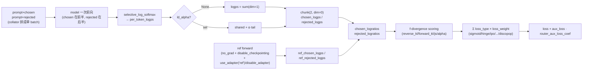
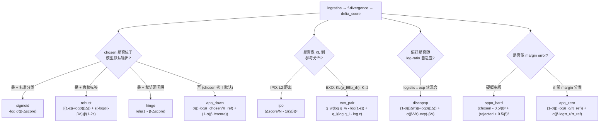

# 04 · DPO 训练器详解

> 本篇导览：DPO 把"训练奖励模型 + PPO 微调策略"两阶段流程折叠成一步监督学习——只要给定 (prompt, chosen, rejected) 偏好对，就能直接用分类式的 sigmoid 损失更新策略。本篇从 DPO 的隐式奖励推导出发，逐段拆解 `trl/trainer/dpo_trainer.py`：参考模型的三种来源、chosen+rejected 拼接前向的 batch 布局、f-散度族如何替换原版 reverse-KL、十余种 `loss_type` 的具体数学式，以及 Liger 融合损失与 `SyncRefModelCallback` 等集成件。

> 核心问题：
> - DPO 为什么"不需要显式奖励模型"也能学偏好？隐式奖励 `β·log(π/π_ref)` 是怎么落到 sigmoid 损失里的？
> - TRL 怎么避免加载第二份完整模型当 reference？三种 ref 策略各自的适用场景是什么？
> - chosen 和 rejected 是分两次前向，还是拼一次？batch 在内存里如何布局？
> - `f_divergence_type` 从 reverse-KL 换成 JS/α-divergence 时，损失公式具体改成什么？
> - `loss_type` 现在支持 10+ 种，它们各自的数学式与适用场景是什么？

---

## 一、DPO 原理回顾

论文 [DPO: Direct Preference Optimization](https://huggingface.co/papers/2305.18290) 的核心观察：在 KL 约束下的奖励最大化问题

```
max_π  E_π[r(x,y)] - β·KL(π || π_ref)
```

有闭式最优解

```
π*(y|x) = π_ref(y|x) · exp(r(x,y)/β) / Z(x)
```

把它反解出来，得到**隐式奖励**

```
r̂(x,y) = β·log( π(y|x) / π_ref(y|x) ) + β·log Z(x)
```

代入 Bradley-Terry 偏好模型 `P(y_w ≻ y_l | x) = σ(r̂_w − r̂_l)`，配分函数 `Z(x)` 在 chosen/rejected 的差里被消掉，最终得到 DPO 损失：

```
L_DPO = -E[ log σ( β·( log π(y_w|x)/π_ref(y_w|x) − log π(y_l|x)/π_ref(y_l|x) ) ) ]
```

即"策略相对参考模型对 chosen 的对数概率提升"减去"对 rejected 的提升"，再过 sigmoid。β 越大，越紧贴 `π_ref`；β → 0 时退化为纯粹的 log-likelihood 比较。注意 `π` 在代码中以"序列对数概率之和"出现（token 级 logp 求和）。

---

## 二、`__init__` 与参考模型三策略

入口 `__init__`（trl/trainer/dpo_trainer.py:511，行号基于 2026-07 探索）做完模型/PEFT/数据集处理之后，在 859-922 行确定参考模型来源。三种策略分支互斥：

```python
# trl/trainer/dpo_trainer.py:859-903（简化）
if ref_model is None:
    if is_peft_model(self.model) or args.precompute_ref_log_probs:
        self.ref_model = None            # 策略 A 或 B：不需要在显存里常驻第二份模型
    else:
        self.ref_model = create_model_from_path(ref_model_path, **kwargs)  # 策略 C：独立加载
# ...
if self.ref_model is not None:
    if self.is_deepspeed_enabled:
        self.ref_model = prepare_deepspeed(self.ref_model, self.accelerator)
    elif self.is_fsdp_enabled:
        self.ref_model = prepare_fsdp(self.ref_model, self.accelerator)
    else:
        self.ref_model = self.accelerator.prepare_model(self.ref_model, evaluation_mode=True)
```

- **策略 A：PEFT 用 adapter 当 ref**（638-660 行）。给模型 `add_adapter("ref", default_config)`，把 `default` 的权重 copy 过去冻结。前向时通过上下文管理器 `use_adapter(model, "ref")` 临时切到 ref adapter；若用户已自带预训练 adapter，则用 `use_adapter(model, None)` 调 `disable_adapter()` 回退到 base 模型。好处是只存一份模型权重 + 两份小 LoRA。
- **策略 B：`precompute_ref_logps=True`**（1121-1169 行）。训练前先用 ref 模型把整个数据集的 `ref_chosen_logps` / `ref_rejected_logps` 跑一遍缓存到磁盘（指纹含 `hash_module(self.ref_model or self.model)` + dataset fingerprint），训练时直接从 batch 里读，省掉第二份模型显存。`precompute_ref_batch_size` 可设得比训练 batch 大以加速预处理。
- **策略 C：独立 ref_model**。加载第二份完整模型，再走 DeepSpeed ZeRO / FSDP / Accelerate `prepare_model(evaluation_mode=True)` 包一层。最直白但显存翻倍。

另外，`disable_dropout=True`（默认）会同时关掉 `model` 与 `ref_model` 的 dropout（880-883 行），保证 chosen/rejected 在同一确定性的网络里前向。

```python
# use_adapter（trl/trainer/utils.py:1085-1121，简化）
@contextmanager
def use_adapter(model, adapter_name):
    if adapter_name is None:
        with model.disable_adapter():    # 临时关掉所有 adapter
            yield
    else:
        prev = model.active_adapter
        model.set_adapter(adapter_name)   # 切到 ref adapter
        try: yield
        finally: model.set_adapter(prev) # 还原
```

---

## 三、损失计算主流程 `_compute_loss`

入口 `compute_loss`（1681 行）分发到 `_compute_loss`（1320 行）或 `_compute_loss_liger`（1215 行）。

任务描述里提到的 `concatenated_forward` 方法在 2026-07 重构后已不再独立存在——拼接逻辑下沉到了 `DataCollatorForPreference`：每个 example 拆成 `prompt_ids + chosen_ids` 与 `prompt_ids + rejected_ids`，**所有 chosen 序列放 batch 前半，所有 rejected 序列放后半**，一次 pad 成 `input_ids`（91-211 行）。`_compute_loss` 只需要做一次 `model(**model_kwargs)` 前向，再用 `chunk(2, dim=0)` 拆回来。这是关键性能优化：把两次前向合成一次。

```python
# trl/trainer/dpo_trainer.py:1331-1389（简化伪代码）
outputs = model(**model_kwargs)                      # 一次前向跑 [chosen_batch + rejected_batch]
shift_logits = outputs.logits[..., :-1, :]
per_token_logps = selective_log_softmax(shift_logits, shift_labels)
per_token_logps[shift_completion_mask == 0] = 0.0    # 只保留 completion 部分

if self.ld_alpha is None:
    logps = per_token_logps.sum(dim=1)                # 标准 DPO：直接 sum
else:                                                 # LD-DPO：按 shared/tail 段加权
    shared_logps = (per_token_logps * shared_mask).sum(dim=1)
    tail_logps    = (per_token_logps * tail_mask   ).sum(dim=1)
    logps = shared_logps + self.ld_alpha * tail_logps

chosen_logps, rejected_logps = logps.chunk(2, dim=0) # batch 是 [chosen, rejected] 顺序

# 参考 forward：torch.no_grad + disable_gradient_checkpointing，避免 reentrant 警告
with torch.no_grad(), disable_gradient_checkpointing(self.model, ...):
    if is_peft_model(model) and self.ref_model is None:
        with use_adapter(model_unwrapped, "ref" if "ref" in peft_configs else None):
            ref_outputs = self.model(**ref_model_kwargs)
    else:
        ref_outputs = self.ref_model(**ref_model_kwargs)
# 同样 selective_log_softmax + (可选 ld_alpha 切段) → ref_chosen_logps, ref_rejected_logps

chosen_logratios   = chosen_logps   - ref_chosen_logps
rejected_logratios = rejected_logps - ref_rejected_logps
```

注意 ref forward 显式 `drop` 了 `output_router_logits`：frozen ref 不需要算 MoE 负载均衡 aux loss（1360 行）。

`ld_alpha` 来自 LD-DPO 论文：chosen 和 rejected 通常长度不等，标准 DPO 让长序列"白拿"了 tail 段的概率质量。`ld_alpha ∈ [0,1]` 把 chosen/rejected 共享长度以内的 token 视作 `shared`，超出部分视作 `tail` 并按 `α` 加权——`α=1` 退化为标准 DPO，`α=0` 完全丢掉 tail 段。

### 图 1：DPO 损失张量流



**图说明**：纵向表示数据流，从 batch 拼接开始，主策略和参考策略各自走一次前向、各自的 logps 计算路径平行对应（共享 `selective_log_softmax` 与 `ld_alpha` 切段逻辑），最终汇合到 `logratios` 上做 f-散度变换，再按 `loss_type` 列表逐项求和。MoE 模型还会把 `router_aux_loss_coef · aux_loss` 加到最终 loss 上。

---

## 四、f-散度族 `f_divergence_type`

原版 DPO 用 reverse-KL，f-DPO 论文把散度换成任意 f-divergence，对应 `chosen_scores/rejected_scores` 的不同变换（1391-1419 行）：

- **`reverse_kl`（默认）**：`scores = logratios`，落回标准 DPO。
- **`forward_kl`**：`scores = -exp(-logratios)`（去掉常数后）。
- **`js_divergence`**：`scores = logsigmoid(logratios)`。
- **`alpha_divergence`**：`f'(t) = (t^(α-1) - 1)/(α-1)`，配合 `f_alpha_divergence_coef`（默认 0.5）；当 α→1 退化回 `reverse_kl`，并对 `exp((α-1)·logratio)` 做按 dtype 的 clamp（fp16 限 11.0，bf16/fp32 限 80.0）防止数值溢出。

```python
# 简化
if f_divergence_type == "reverse_kl":
    chosen_scores, rejected_scores = chosen_logratios, rejected_logratios
elif f_divergence_type == "js_divergence":
    chosen_scores   = F.logsigmoid(chosen_logratios)
    rejected_scores = F.logsigmoid(rejected_logratios)
# ... forward_kl / alpha_divergence 见正文
delta_score = chosen_scores - rejected_scores
```

后续所有 `loss_type` 都作用在这个 `delta_score`（或 `chosen_scores`/`rejected_scores`）上。

---

## 五、损失类型清单 `loss_type`

`DPOConfig.loss_type` 是 `list[str]`（1424 行 `for loss_type, loss_weight in zip(self.loss_types, self.loss_weights, strict=True)` 循环），多种类型按 `loss_weights` 加权求和。任务要求覆盖的核心类型：

| loss_type | 数学式 | 一句话说明 |
|---|---|---|
| `sigmoid` | `-log σ(β·Δscore)` | 原版 DPO |
| `hinge` | `relu(1 - β·Δscore)` | SVM 风格间隔损失 |
| `ipo` | `(Δscore/N_chosen − Δscore/N_rejected − 1/(2β))²` | IPO（[论文](https://huggingface.co/papers/2310.12036)），β 此处是 τ；按 token 数归一化 |
| `apo_zero` | `(1-σ(β·logπ_chosen/π_ref)) + σ(β·logπ_rejected/π_ref)` | APO Eq.7，假设 chosen 优于模型默认输出 |
| `apo_down` | `σ(β·logπ_chosen/π_ref) + (1-σ(β·Δscore))` | APO Eq.8，假设 chosen 劣于默认，更狠地压 rejected |
| `exo_pair` | `q_w(log q_w − log(1-ε)) + q_l(log q_l − log ε)` | EXO-pref，KL(p_fθ‖p_rh)，K=2 |
| `discopop` | `(1-σ(βΔscore/τ))·(-logσ(βΔscore)) + σ(βΔscore/τ)·exp(-βΔscore)` | DiscoPOP，logistic 与 exponential 软混合 |
| `sppo_hard` | `(chosen_scores - 0.5/β)² + (rejected_scores + 0.5/β)²` | SPPO 硬概率版 |
| `robust` | `[(1-ε)(-logσ(βΔ)) + ε(-logσ(-βΔ))] / (1-2ε)` | Robust DPO，ε ∈ [0,0.5) 是标签翻转概率 |

其中 `Δscore = chosen_scores - rejected_scores`。除上述外，TRL 还实现 `nca_pair` / `bco_pair` / `aot` / `aot_unpaired` / `sft` / `sigmoid_norm`，组合时直接列在 `loss_type` 列表里：

```python
# 多损失组合示例
args = DPOConfig(
    loss_type=["sigmoid", "sft"],   # MPO 风格
    loss_weights=[0.8, 0.2],
    ...
)
```

`use_weighting=True` 时还会在 `per_sequence_loss` 上乘 WPO 权重 `exp(mean_aligned_logps_chosen · mean_aligned_logps_rejected)`（1556-1567 行），不过 `aot` / `aot_unpaired` 因为对样本排序会与 per-pair 权重错位而被禁用。

### 图 2：DPO 损失类型决策树



**图说明**：每个叶节点标注对应 `loss_type` 的核心数学式。决策分支并非互斥——TRL 通过 `loss_type: list[str]` + `loss_weights` 允许同时启用多个叶节点做加权求和；`use_weighting` 还能在最终 loss 上乘 WPO 风格权重。注意 `delta_score` 的具体含义会随 `f_divergence_type` 变化（reverse-KL 时就是 logratios 之差，JS 时是 `logsigmoid` 之差）。

---

## 六、Liger 融合损失 `_compute_loss_liger`

启用 `use_liger_kernel=True` 时走 1215 行的 Liger 分支。它直接拿 `model.base_model`（绕过 `lm_head`）的 `last_hidden_state` 与 `lm_head.weight`，调用 `LigerFusedLinearDPOLoss` 把"matmul + log_softmax + DPO loss"融合成一个 kernel，不物化 logits，省显存。参考 hidden state 在同一 `torch.no_grad` 块里算出，PEFT 模型同样用 `use_adapter(model_unwrapped, "ref" ...)` 切到 ref adapter（1247-1272 行）。

```python
# trl/trainer/dpo_trainer.py:1280（简化）
loss, metrics = self.liger_loss(
    weight, hidden_states, labels, bias,
    ref_hidden_states, ref_weight, ref_bias,
)
```

限制：仅支持单 `loss_type`、不支持 `precompute_ref_logps`、不支持 MoE aux loss、不支持给 `lm_head` 加 PEFT adapter（804 行 `LigerFusedLinearDPOLoss(beta=args.beta, loss_type=self.loss_types[0])`）。

---

## 七、`DPOConfig` 关键字段

`trl/trainer/dpo_config.py` 中值得记的字段（默认值与 transformers 的差异见文件末 NOTE：`learning_rate=1e-6`、`gradient_checkpointing=True`、`bf16=True if not fp16`、`logging_steps=10`）：

```python
# trl/trainer/dpo_config.py（精选字段）
loss_type: list[str] = ["sigmoid"]                       # 多损失求和
loss_weights: list[float] | None = None                  # 缺省全 1.0
ld_alpha: float | None = None                            # LD-DPO 切段加权
f_divergence_type: str = "reverse_kl"                   # reverse_kl/forward_kl/js_divergence/alpha_divergence
f_alpha_divergence_coef: float = 0.5
beta: float = 0.1                                        # IPO 时为 τ
label_smoothing: float = 0.0                             # robust / exo_pair 共用
use_weighting: bool = False                             # WPO 权重
discopop_tau: float = 0.05                              # discopop 温度
precompute_ref_log_probs: bool = False                  # 策略 B
precompute_ref_batch_size: int | None = None
sync_ref_model: bool = False                            # TR-DPO
ref_model_mixup_alpha: float = 0.6                       # π_ref = α·π_θ + (1-α)·π_ref_prev
ref_model_sync_steps: int = 512
max_length: int | None = 1024
truncation_mode: str = "keep_start"                     # "keep_end" 已 deprecated
padding_free: bool = False                              # 当前被强制关掉
disable_dropout: bool = True
router_aux_loss_coef: float = 0.001                      # MoE aux loss 权重
activation_offloading: bool = False
```

注意 `padding_free=True` 在 2026-07 重构后暂时不可用，会在 `__init__` 里打 warning 并强制回落到标准 padding（dpo_trainer.py:676-683）。

---

## 八、集成与回调

- **Accelerate**：`self.accelerator.gather / gather_for_metrics` 跨 rank 聚合 metric；`prepare_deepspeed / prepare_fsdp / prepare_model(evaluation_mode=True)` 包装 ref model。
- **PEFT**：ref-via-adapter 技巧避免加载第二份模型；ZeRO-3 + 非量化模型时显式传 `autocast_adapter_dtype=False` 避免 bf16/fp32 dtype mismatch（628-636 行）。
- **DeepSpeed/FSDP**：ref model 走与主模型并行的分布式包装，且其 forward 在 `disable_gradient_checkpointing` 上下文里以避免 reentrant 警告。
- **Liger**：见上节。
- **`SyncRefModelCallback`**（trl/trainer/callbacks.py:104）：`sync_ref_model=True` 时挂载，每 `ref_model_sync_steps` 步在 `on_step_end` 把 ref 模型按 `π_ref = α·π_θ + (1-α)·π_ref_prev` EMA 更新。ZeRO-3 下用 `deepspeed.zero.GatheredParameters` 收齐参数再混。**与 PEFT 和 `precompute_ref_logps` 不兼容**（905-921 行直接 raise）。
- **不集成 vLLM**：DPO 是离线偏好学习，不需要在线采样，所以没有 vLLM 生成路径。

---

## 九、上手示例

基于 `trl-lib/ultrafeedback_binarized` + `Qwen/Qwen3-0.6B` 的最小可运行片段：

```python
from datasets import load_dataset
from transformers import AutoModelForCausalLM, AutoTokenizer
from trl import DPOConfig, DPOTrainer

model = AutoModelForCausalLM.from_pretrained("Qwen/Qwen3-0.6B", torch_dtype="bfloat16")
tokenizer = AutoTokenizer.from_pretrained("Qwen/Qwen3-0.6B")
if tokenizer.pad_token is None:
    tokenizer.pad_token = tokenizer.eos_token

ds = load_dataset("trl-lib/ultrafeedback_binarized", split="train")
# 字段: prompt / chosen / rejected (均为 [{"role":..., "content":...}, ...])

args = DPOConfig(
    output_dir="dpo-qwen3-0.6b",
    beta=0.1,
    loss_type=["sigmoid"],          # 标准 DPO
    f_divergence_type="reverse_kl",
    max_length=1024,
    per_device_train_batch_size=4,
    gradient_accumulation_steps=4,
    learning_rate=5e-7,
    num_train_epochs=1,
    bf16=True,
    logging_steps=10,
)

trainer = DPOTrainer(
    model=model,
    ref_model=None,                 # 走策略 C: 自动加载第二份相同模型作为 reference
    args=args,
    train_dataset=ds,
    processing_class=tokenizer,
)
trainer.train()
```

把 `ref_model=None` 改成传 LoRA + `peft_config=LoraConfig(...)`，就走策略 A（adapter-as-ref）；显存吃紧时配 `precompute_ref_log_probs=True` 走策略 B。

---

## 小结

- DPO 把奖励隐式化进 `β·log(π/π_ref)`，用 sigmoid 分类损失直接监督策略，绕开显式 reward model 与 PPO 采样循环。
- TRL 的 `DPOTrainer` 提供 ref-model 三策略：PEFT `use_adapter("ref")` / `disable_adapter()`、`precompute_ref_logps` 离线缓存、独立 `ref_model` 走 DeepSpeed/FSDP。优先选前两者省显存。
- `concatenated_forward` 在 2026-07 重构后已下沉到 `DataCollatorForPreference`——chosen 放 batch 前半、rejected 放后半，一次前向后 `chunk(2, dim=0)` 拆分，是关键性能优化。
- `f_divergence_type` 把 reverse-KL 推广到 forward-KL / JS / α-divergence；`loss_type: list[str]` 支持十余种损失（sigmoid/hinge/ipo/apo_*/exo_pair/discopop/sppo_hard/robust/...），可加权组合。
- 集成 Accelerate / PEFT / DeepSpeed / FSDP / Liger / `SyncRefModelCallback`；**不集成 vLLM**——DPO 是纯离线偏好学习，无需在线生成。

下一篇 [05 · GRPO 训练器详解](05_分_GRPO训练器详解.md) 将转向"在线采样 + 组内相对优势"的 GRPO 训练器，那里 vLLM 生成路径会成为主角。
