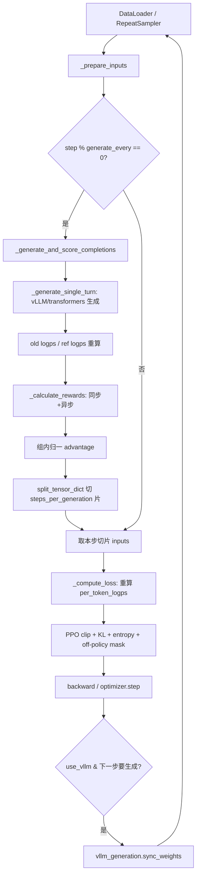
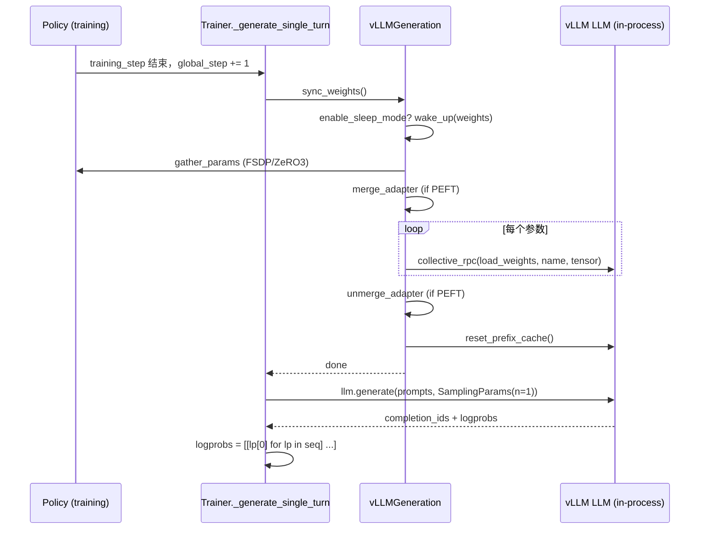
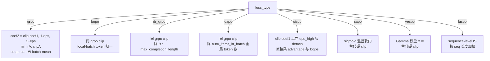

# 05 · GRPO 训练器详解（重点）

> 本篇导览：`GRPOTrainer` 是 TRL 6 个稳定训练器中**最复杂**的一个 —— 单文件 3123 行（grpo_trainer.py，行号基于 2026-07 探索），代码体量几乎是其它训练器的两倍。它的复杂度来自三条线交叠：(1) **生成与训练解耦的缓冲机制**（`generation_batch_size` / `steps_per_generation` / `num_iterations` 三角）；(2) **vLLM 深度集成**（colocate + server 双模式，权重同步 + IS 校正 + sleep mode）；(3) **算法变体爆炸**（`loss_type` 7 种、`importance_sampling_level` 2 种、`scale_rewards` 3 种、off-policy mask / VESPO / 自适应 entropy 等可选叠加）。本篇按"采样 → 生成 → 奖励 → advantage → loss"的真实数据流逐段拆解。
>
> 核心问题：
> - GRPO 为什么不需要 value model？advantage 从哪来？
> - `num_generations` / `steps_per_generation` / `generation_batch_size` / `num_iterations` 四者关系是什么？effective batch 为什么要被 `num_generations` 整除？
> - vLLM colocate 模式下，训练侧的梯度更新如何"流"到 vLLM 推理引擎里？`_last_loaded_step` 是什么？
> - `loss_type` 7 种之间区别是什么？PPO clip 在每种里以什么形式出现？
> - vLLM 与训练模型分布不一致时，importance sampling 怎么校正？DeepSeek-V3.2 off-policy mask 怎么用？

---

## 一、GRPO 算法原理：无 value model 的 PPO

GRPO（Group Relative Policy Optimization）出自 [DeepSeekMath 论文](https://huggingface.co/papers/2402.03300)。其核心思想用一句话概括：**用同一 prompt 下 G 个采样的组内归一化奖励替代 value model 估计的 advantage**。

PPO 的 advantage 形式是 `A = R - V_φ(s)`，需要训练一个 value head `V_φ`；GRPO 把它换成：

```
A_i = (R_i - mean(R_1..R_G)) / (std(R_1..R_G) + ε)
```

即同一 prompt 的 G 个完成里，奖励高于均值的获得正 advantage、低于均值的获得负 advantage。这砍掉了 value model、节省一半显存、也避免了 value 估计的偏差。

策略目标沿用 PPO clip：

```
L = -E[ min(r·A, clip(r, 1-ε, 1+ε)·A) ]   其中 r = π_θ(a|s) / π_old(a|s)
```

可选附加项：KL 惩罚（`beta · KL(π_θ || π_ref)`，`beta=0` 时干脆不加载 ref model）、entropy bonus（鼓励探索）、off-policy mask（DeepSeek-V3.2）、VESPO γ 权重（替代硬 clip）。这些叠加构成了后面 `_compute_loss` 的全部复杂性。

---

## 二、`__init__`：多形态 reward_funcs 与异步事件循环

`__init__`（grpo_trainer.py:284，行号基于 2026-07 探索）签名包含 11 个参数，其中 `tools`、`rollout_func`、`environment_factory` 是高级接入点：

```python
# trl/trainer/grpo_trainer.py:284-300
def __init__(
    self,
    model: "str | PreTrainedModel | PeftModel",
    reward_funcs: RewardFunc | list[RewardFunc],
    args: GRPOConfig | None = None,
    ...
    tools: list[Callable] | None = None,
    rollout_func: RolloutFunc | None = None,
    environment_factory: EnvironmentFactory | None = None,
):
```

### 2.1 reward_funcs 多形态

`reward_funcs` 接受 4 种形态，会被统一规整为 `list`（行 463-479）：

- **str**：Hub 上的 reward model 名，自动 `AutoModelForSequenceClassification.from_pretrained(..., num_labels=1)` 加载。
- **nn.Module**：已经是预训练 reward model 或 torch.compile 过的模型，直接用。注意类型判断用 `nn.Module` 而非 `PreTrainedModel`，是为了兼容 compiled 模型。
- **callable**：同步函数 `f(prompts, completions, **kwargs) -> list[float]`。
- **list**：以上任意组合。

所有 reward func 被命名（`reward_func_names`）并收集成 `reward_funcs` / `reward_processing_classes` 两个并行 list。

### 2.2 异步事件循环

行 601-610 检测 reward_funcs 与 tools 中是否有协程函数：

```python
# trl/trainer/grpo_trainer.py:601-610
self._has_async_funcs = any(inspect.iscoroutinefunction(func) for func in self.reward_funcs + self.tools)
if self._has_async_funcs:
    self.async_loop_thread, self.async_loop, self.async_loop_ready_event = start_event_loop_in_daemon(
        name="GRPOTrainer-AsyncLoop"
    )
    self.async_loop_ready_event.wait()
    atexit.register(shutdown_event_loop_in_daemon, self.async_loop_thread, self.async_loop)
```

这条事件循环是异步奖励与异步 tool calling 的运行容器（见后文 `_calculate_rewards` 与 `_generate_single_turn`）。

### 2.3 vLLM 初始化与 `_last_loaded_step`

`use_vllm=True` 时构造 `VLLMGeneration`（行 920-953），关键参数：`mode`（colocate/server）、`tensor_parallel_size`、`gpu_memory_utilization`、`max_model_length`、`enable_sleep_mode`、`model_impl`、`structured_outputs_regex`，以及一份采样参数（temperature/top_p/top_k/min_p/repetition_penalty/max_completion_length，`logprobs=0` 表示只要 top-1 即采样 token 自己的 logprob，用于 IS 校正）。

紧接着：

```python
# trl/trainer/grpo_trainer.py:954
self._last_loaded_step = -1  # tag to avoid useless loading during grad accumulation
```

`-1` 是哨兵：第一次 `_generate_single_turn` 时 `self.state.global_step` 与它必然不等，触发首次权重同步。

### 2.4 ref model 与 sync_ref_model

`beta == 0.0` → 不加载 ref model；PEFT → ref model 设为 `None`，靠禁用 adapter 回退到 base；非 PEFT + `beta>0` → 创建独立的 `ref_model`，并按 Deepspeed/FSDP/普通路径 prepare。`sync_ref_model=True` 时挂 `SyncRefModelCallback`（TR-DPO 风格的 `π_ref = α·π_θ + (1-α)·π_ref_prev`，每 `ref_model_sync_steps` 步触发），但 PEFT 下显式禁止。

---

## 三、采样与缓冲：`RepeatSampler` 与 `_prepare_inputs`

### 3.1 RepeatSampler：每 prompt 复制 G 次

`_get_train_sampler`（grpo_trainer.py:1071）返回 `RepeatSampler`，把每个 prompt 复制 `num_generations` 次，并按 `num_iterations * steps_per_generation` 重复整批：

```python
# trl/trainer/grpo_trainer.py:1100-1107
return RepeatSampler(
    data_source=dataset,
    mini_repeat_count=self.num_generations,
    batch_size=self.args.generation_batch_size // self.num_generations,
    repeat_count=self.num_iterations * self.args.steps_per_generation,
    shuffle=self.shuffle_dataset,
    seed=self.args.seed,
)
```

关键不变量：`effective_batch = num_processes * per_device_train_batch_size * gradient_accumulation_steps` 必须被 `num_generations` 整除（见 GRPOConfig 行 64-66）；`generation_batch_size` 同样必须能整除 `num_generations`。

代码里那张 ASCII 图（行 1085-1097）值得反复看 —— 它揭示了"generation batch 一次生成、按 `steps_per_generation` 切片、再被 `num_iterations` 复用"的缓冲机制。`_get_eval_sampler`（行 1109）逻辑相同，只是用 `num_generations_eval`。

### 3.2 `_prepare_inputs`：核心缓冲逻辑

`_prepare_inputs`（grpo_trainer.py:1337）是整个训练器数据流的"心跳"：

```python
# trl/trainer/grpo_trainer.py:1351-1366
mode = "train" if self.model.training else "eval"
if mode == "train":
    generate_every = self.args.steps_per_generation * self.num_iterations
    if self._step % generate_every == 0 or self._buffered_inputs is None:
        generation_batch = self._generate_and_score_completions(generation_batch)
        generation_batch = split_pixel_values_by_grid(generation_batch)
        generation_batch = shuffle_sequence_dict(generation_batch)
        generation_batches = split_tensor_dict(generation_batch, self.args.steps_per_generation)
        self._buffered_inputs = [unsplit_pixel_values_by_grid(batch) for batch in generation_batches]
    inputs = self._buffered_inputs[self._step % self.args.steps_per_generation]
else:
    inputs = self._generate_and_score_completions(generation_batch)
return inputs
```

要点：

- `generate_every = steps_per_generation * num_iterations` 是真正重新生成的周期。
- 周期内首步：调 `_generate_and_score_completions` 跑一次大生成，得到一个 `generation_batch`（含 G 倍采样 + 奖励 + advantage + old logps）；按 `steps_per_generation` 切片缓存到 `self._buffered_inputs`。
- 后续 `steps_per_generation - 1` 步：从缓存里取对应切片，避免重复生成。
- `num_iterations > 1` 时，整个缓存会被复用多轮（μ 次更新共享同一批 old logps）。
- eval 模式无缓冲，每批现生成。

这是 GRPO 比 DPO 慢的根源：一次"生成 + 计分"的开销要被分摊到 `steps_per_generation * num_iterations` 个优化步上。

### 图 1：一次 `training_step` 全流程



**图说明**：从 sampler 出发的"生成 → 缓冲 → 切片 → loss → 反向 → 同步 vLLM 权重"循环。`_prepare_inputs` 是分流阀：周期首步走 D-D5 重生成并缓存，其余步骤直接 E 取缓存切片。vLLM 权重同步只发生在将要生成、且 `global_step` 与 `_last_loaded_step` 不一致时。

---

## 四、`_generate_single_turn`：vLLM 权重同步与生成

`_generate_single_turn`（grpo_trainer.py:1536）是三种生成路径的分发器。

### 4.1 vLLM 路径

```python
# trl/trainer/grpo_trainer.py:1541-1557
if self.use_vllm:
    if self.state.global_step != self._last_loaded_step:
        with profiling_context(self, "sync_weights"):
            self.vllm_generation.sync_weights()
        self._last_loaded_step = self.state.global_step

    num_generations = self.num_generations if mode == "train" else self.num_generations_eval
    _, completion_ids, logprobs, _ = self.vllm_generation.generate(
        prompts=prompt_ids,
        images=images,
        num_generations=num_generations,
        profiler=profiling_context(self, "vLLM.generate"),
    )
    logprobs = [[lp[0] for lp in seq] for seq in logprobs]
```

`sync_weights`（vllm_generation.py:439）做四件事：

1. 若 colocate + sleep mode：`empty_cache()` + `llm.wake_up(tags=["weights"])` 把权重页重新映射到 GPU。
2. PEFT 模型：`gather_params` 全聚 → `merge_adapter` 合并 LoRA → 把合并后的 base 权重推到 vLLM → `unmerge_adapter`。FSDP 走 `_sync_fsdp_params_to_vllm` 的后序遍历；DeepSpeed ZeRO-3 逐参数 gather 后 push。
3. 非 PEFT：逐参数 `gather_params` 后 `_push_param_to_vllm`，server 模式通过 vLLM client 推，colocate 模式直接走 in-process `llm.collective_rpc("load_weights")`。
4. **`reset_prefix_cache`**：必清 —— 否则 vLLM 会用旧权重算出 stale prefix cache，污染后续生成的 KV。

`generate`（vllm_generation.py:498）在 colocate 模式下每张卡只生成自己的那份（`n=1`，因为 `num_generations` 已经被 RepeatSampler 在 prompt 层面展开了）；server 模式下由 rank 0 用 `n=num_generations` 一次性生成所有副本并广播。

### 4.2 transformers 连续批处理 / 普通生成路径

`use_transformers_continuous_batching=True` 走 `unwrapped_model.generate_batch(...)`（需 transformers ≥ 5.8.0）；否则走经典 `model.generate(...)`，左 padding、套 `unwrap_model_for_generation` 上下文（处理 DeepSpeed ZeRO-3 gather、FSDP summon_full_params、dtype 强制）。多模态字段（pixel_values、image_grid_thw、token_type_ids 等）按字段类型逐项 padding。

### 图 2：vLLM colocate 权重同步 + 生成时序



**图说明**：colocate 模式下 vLLM 与训练策略共享同一进程与同一组 GPU，所以"同步"本质是把 FSDP/ZeRO-3 gather 出来的全量参数 push 到 vLLM 的内部权重张量；PEFT 要先 merge 再 push 再 unmerge，因为 vLLM 不认识 LoRA adapter 结构。`reset_prefix_cache` 是必清项 —— KV 缓存里残留的是旧权重的中间状态。

### 4.3 多轮 tool calling 循环

当 `tools` 非空时，`_generate` 内部走多轮 tool calling 循环（受 `max_tool_calling_iterations` 限制）：每轮解析模型输出里的 tool call → 同步执行 `_sync_tool_dicts` 里的工具 / 异步工具通过 `asyncio.run_coroutine_threadsafe` 提交到 `self.async_loop` → 把 tool 返回（可能是文本或图像）拼回 prompt → 继续生成，直到模型不再发 tool call 或达迭代上限。`environment_factory` 提供"每 rollout 一个 environment 实例"的池化机制，支持类 OpenAI Gym 的有状态交互环境。

---

## 五、`_calculate_rewards`：同步 callable 与异步 coroutine

`_calculate_rewards`（grpo_trainer.py:1394）按 reward func 类型分三路：

```python
# trl/trainer/grpo_trainer.py:1413-1463 (节选)
for i, (reward_func, reward_processing_class, reward_func_name) in enumerate(...):
    if isinstance(reward_func, nn.Module):
        # 走 reward model forward
        rewards_per_func[:, i] = reward_func(**reward_inputs).logits[:, 0]
    elif inspect.iscoroutinefunction(reward_func):
        async_funcs_info.append((i, reward_func, reward_func_name))  # 稍后并行
    else:
        output_reward_func = reward_func(prompts=prompts, completions=completions,
                                          completion_ids=completion_ids_list, **reward_kwargs)
        rewards_per_func[:, i] = torch.tensor(output_reward_func, ...)

if async_funcs_info:
    async def _run_async_funcs():
        coros = [_invoke_async(i, func, func_name) for (i, func, func_name) in async_funcs_info]
        return await asyncio.gather(*coros)
    async_results = asyncio.run_coroutine_threadsafe(_run_async_funcs(), self.async_loop).result()
```

异步函数被打包成 `asyncio.gather` 并行执行 —— 这是 GRPO 支持 LLM-as-judge / 远程 API reward 的关键。`reward_kwargs` 里被透传的 4 个特殊键：

- `trainer_state`：`self.state`，奖励函数可基于训练进度做课程学习。
- `log_extra`：`_log_completion_extra`，奖励函数可向 completions 表追加自定义列。
- `log_metric`：`_log_metric`，奖励函数可上报自定义标量到训练日志。
- `environments`：当 `environment_factory` 非空时透传 environment 实例。

行 1482 `rewards_per_func = gather(rewards_per_func)` 把 reward 跨进程聚合 —— 这是组内归一化的前提，因为同一 prompt 的 G 个副本可能分布在不同的 GPU 上。所有 reward 全 NaN 的行被特殊标记（行 1466-1478），后续 advantage 计算时被强制置 0，避免 `nansum` 把它当 0 奖励污染基线。

---

## 六、`_generate_and_score_completions`：old logps / advantage / off-policy

`_generate_and_score_completions`（grpo_trainer.py:2023）是生成 + 评分的总装函数。它先调 `_generate`（内含 `_generate_single_turn` 与可能的 tool 循环）拿到 prompt_ids / completion_ids / sampling_per_token_logps / tool_mask，然后：

### 6.1 old_per_token_logps 与 IS ratio

行 2293-2308 决定是否重算 old logps：

```python
# trl/trainer/grpo_trainer.py:2293-2308
generate_every = self.args.steps_per_generation * self.num_iterations
if self.args.gradient_accumulation_steps % generate_every != 0 or (
    self.use_vllm and self.vllm_importance_sampling_correction
):
    old_per_token_logps, _, _ = self._get_per_token_logps_and_entropies(
        self.model, prompt_completion_ids, attention_mask, logits_to_keep, batch_size, ...
    )
else:
    old_per_token_logps = None
```

`old_per_token_logps = None` 是一个优化：当生成与优化步对齐（`gradient_accumulation_steps % generate_every == 0`）且不用 vLLM IS 校正时，`old_per_token_logps == per_token_logps`，`_compute_loss` 里直接用 `per_token_logps.detach()` 顶替。

vLLM IS 校正（行 2310-2351）计算 `importance_sampling_ratio = exp(old_logps - sampling_logps)`，按 `vllm_importance_sampling_mode` 四种模式裁剪或 mask：

- `token_truncate`：per-token ratio clip 到 `[C_min, C_max]`。
- `token_mask`：per-token ratio 越界置 0。
- `sequence_truncate` / `sequence_mask`：把 per-token log-ratio sum 成 sequence-level ratio 后 clip / mask。

### 6.2 ref_per_token_logps

`beta != 0` 时算 ref logps。PEFT 走 `use_adapter(model, adapter_name="ref")` 临时切换到 ref adapter（或禁用 adapter 回退 base），非 PEFT 直接 forward `self.ref_model`。

### 6.3 advantage 组内归一

行 2413-2458 实现两种多目标聚合（`sum_then_normalize` / `normalize_then_sum`）。默认前者：

```python
# trl/trainer/grpo_trainer.py:2437-2439
advantages = rewards - mean_grouped_rewards
if self.scale_rewards != "none":
    advantages = advantages / (std_rewards + 1e-4)
```

`scale_rewards` 三档：`group`（默认，组内 std）、`batch`（PPO Lite 风格的全局 std）、`none`（Dr. GRPO 推荐，不除 std 避免难度偏差）。advantage 算完后按 process_slice 切回本进程的子集。

---

## 七、`compute_loss` / `_compute_loss`：多 loss_type 决策

`compute_loss`（grpo_trainer.py:2653）只是分发：`use_liger_kernel` 走 `_forward_redirection` 把调用转到 `compute_liger_loss`（Liger fused kernel），否则走 `_compute_loss`（grpo_trainer.py:2734）。

### 7.1 重算 per_token_logps 与 IS 权重

`_compute_loss` 首先用 `_get_per_token_logps_and_entropies` 重算当前策略的 logps（带梯度！）。然后算 IS 权重：

```python
# trl/trainer/grpo_trainer.py:2797-2807
log_ratio = per_token_logps - old_per_token_logps
if self.importance_sampling_level == "token":
    log_importance_weights = log_ratio
elif self.importance_sampling_level == "sequence":
    log_importance_weights = (log_ratio * mask).sum(-1) / mask.sum(-1).clamp(min=1.0)
    log_importance_weights = log_importance_weights.unsqueeze(-1)
coef_1 = torch.exp(log_importance_weights)
```

`importance_sampling_level`：`token`（默认，per-token ratio）vs `sequence`（GSPO 风格的 sequence-level ratio，更稳定）。

### 7.2 PPO clip 与 7 种 loss_type

```python
# trl/trainer/grpo_trainer.py:2823-2852 (精简)
if self.loss_type == "cispo":
    clamped_ratios = torch.clamp(coef_1, max=self.epsilon_high).detach()
    per_token_loss = -clamped_ratios * advantages * per_token_logps
elif self.loss_type in ["grpo", "bnpo", "dr_grpo", "dapo", "luspo"]:
    coef_2 = torch.clamp(coef_1, 1 - self.epsilon_low, 1 + self.epsilon_high)
    if self.args.delta is not None:  # 双侧 clip (INTELLECT-2)
        coef_1 = torch.clamp(coef_1, max=self.args.delta)
    per_token_loss1 = coef_1 * advantages
    per_token_loss2 = coef_2 * advantages
    per_token_loss = -torch.min(per_token_loss1, per_token_loss2)
elif self.loss_type == "sapo":
    temperatures = torch.where(advantages > 0, self.args.sapo_temperature_pos, self.args.sapo_temperature_neg)
    soft_coef_1 = torch.sigmoid(temperatures * (coef_1 - 1)) * 4 / temperatures
    per_token_loss = -soft_coef_1 * advantages
elif self.loss_type == "vespo":
    phi_seq = self.get_gamma_weights(...)
    per_token_loss = -phi_seq * advantages * per_token_logps
```

7 种 loss_type 的聚合方式也不同（行 2866-2893）：`grpo`/`sapo` 按 sequence 长度归一、`bnpo` 按 local batch token 数归一、`dr_grpo` 除以 `B * max_completion_length` 全局常数、`dapo`/`cispo`/`vespo` 除以全局 token 数 `num_items_in_batch`、`luspo` 按 sequence 长度加权。

### 图 3：GRPO loss_type 决策树



**图说明**：7 种 loss_type 的核心区别在两点 —— PPO clip 的形式（硬 clip / 软门 / Gamma 权重 / detach 后乘 logps）和 token-level 损失的归一化常数（seq / local batch / global token / max_len）。`grpo` 是最朴素的 PPO clip + sequence 长度归一，但论文里证实有 length bias，故衍生出 `dr_grpo`（去 bias 常数）与 `dapo`（默认，全局 token 归一）。`cispo`（MiniMax-M1）和 `vespo` 不再用 min(rA, clipA) 结构，而是把 clip 作用在 IS 权重上、再与 logps 相乘 —— 这让梯度直接落在策略对数概率上。

### 7.3 可选叠加项

- **off-policy mask**（行 2854-2855）：`off_policy_mask_threshold` 非空时，按 DeepSeek-V3.2 算 sequence-level KL，对负 advantage 且高 KL 的样本 mask 掉。
- **entropy mask**（行 2857-2858）：`top_entropy_quantile < 1.0` 时只保留高熵 token 的梯度。
- **vLLM IS 校正**（行 2860-2861）：把 `importance_sampling_ratio` 乘到 `per_token_loss` 上（除 `vespo`，因为 VESPO 内部已含 IS）。
- **KL 惩罚**（行 2863-2864）：`beta * per_token_kl`，`use_bias_correction_kl=True` 时再乘 `coef_1` 做 IS 校正。
- **entropy bonus**（行 2898-2924）：`L = L_policy - apply_coef * H`，`use_adaptive_entropy=True` 时按 `world_entropy vs entropy_target` 动态调 `entropy_coef`。
- **MoE aux loss**（行 2961-2964）：`router_aux_loss_coef * aux_loss`。

---

## 八、`get_off_policy_mask` 与 `get_gamma_weights`（静态方法）

这两个静态方法是 GRPO 的两个"高级稳定化"开关。

### 8.1 `get_off_policy_mask`（grpo_trainer.py:2663）

DeepSeek-V3.2 的 off-policy sequence mask：

```python
# trl/trainer/grpo_trainer.py:2674-2682
kl_div = sampling_per_token_logps - per_token_logps.detach()
seq_kl_sum = (kl_div * mask).sum(dim=1, keepdim=True)
avg_seq_kl = seq_kl_sum / mask.sum(dim=1, keepdim=True).clamp(min=1.0)
is_pos_adv = advantages >= 0
is_low_kl = avg_seq_kl <= off_policy_threshold
return (is_pos_adv | is_low_kl).to(dtype=mask.dtype)
```

逻辑：advantage ≥ 0 总是保留（不要浪费正向信号）；advantage < 0 且 KL 超过阈值则丢弃 —— 因为这种样本既"过时"又"被惩罚"，留着只会把策略推离数据分布。`off_policy_threshold` 对应论文 Eq.9 的 `δ`（典型值 0.5）。

### 8.2 `get_gamma_weights`（grpo_trainer.py:2686）

VESPO 的 γ 加权函数 `φ(w) = e^λ · w^k · e^{-λw}`（归一化使 `φ(1)=1`）：

```python
# trl/trainer/grpo_trainer.py:2728-2732
log_phi = lambda_seq + k_seq * log_w_seq - lambda_seq * w_seq
phi_seq = torch.exp(log_phi).nan_to_num(nan=0.0, posinf=0.0, neginf=0.0)
```

`@torch.no_grad()` 标记 —— φ 只作为梯度缩放系数，不参与反向。`k`/`λ` 按 advantage 符号取不同值（`vespo_k_pos/lambda_pos/k_neg/lambda_neg`）：正 advantage 用一组压低低 IS 比例的样本，负 advantage 用另一组压低高 IS 比例的样本，从而替代硬 clip 实现平滑稳定化。

---

## 九、`_get_per_token_logps_and_entropies` 与 Liger / `_ForwardRedirection`

`_get_per_token_logps_and_entropies`（grpo_trainer.py:1217）是 logps/entropy/aux_loss 的统一入口。关键技巧有三：

1. **chunking**：`batch_size` 参数把大 batch 切片，降低显存峰值。
2. **logits_to_keep**：只保留 completion 部分的 logits（行 1296-1298），通过 `selective_log_softmax` 避免 full-vocab softmax 的内存爆炸。
3. **entropy 的梯度门控**：只有当 `_entropy_bonus_enabled`（即 entropy bonus 实际生效）时 entropy 才带梯度，否则 `torch.no_grad()` 算（行 1310-1314）—— 因为 entropy bonus 是 loss 项时才需要它参与 backward，否则只用于日志和 top-entropy mask。

Liger fused 路径走 `compute_liger_loss`（`LigerFusedLinearGRPOLoss`），把 lm_head 的 matmul 与 logprob / KL / clip 全部 fuse 成一个 kernel。但 Liger 与 PEFT 有硬性 guard：不兼容 lm_head 上的 adapter、不兼容 prompt-learning PEFT。

`_ForwardRedirection`（trl/models/utils.py:324）解决 PEFT-under-FSDP 的钩子丢失问题：Liger 的 fused kernel 直接调 `model.forward`，绕过了 FSDP 包装层的 pre-forward hook（hook 负责在 forward 前 gather 全参数）。`_ForwardRedirection` 把调用重定向到 `model.module.forward`（即未包装的 inner module），让 pre-forward hook 仍能触发。这是 PEFT + FSDP + Liger 三者同存的关键。

---

## 十、配置要点速查（`GRPOConfig`）

`trl/trainer/grpo_config.py` 的字段按功能分组：

| 组别 | 字段 | 说明 |
|------|------|------|
| 采样 | `num_generations=8` / `num_generations_eval` | 每 prompt 复制次数；effective batch 必须被它整除 |
| 采样 | `max_completion_length=256` | 单次完成最大长度 |
| 缓冲 | `generation_batch_size` ↔ `steps_per_generation` | 二者互斥；后者默认 = `gradient_accumulation_steps` |
| 缓冲 | `num_iterations=1` | μ —— 同批生成复用的优化轮数 |
| 采样参数 | `temperature=1.0` / `top_p=1.0` / `top_k=0` / `min_p` / `repetition_penalty=1.0` | 透传到 vLLM `SamplingParams` 或 `GenerationConfig` |
| vLLM 开关 | `use_vllm=False` / `vllm_mode="colocate"` | server / colocate 二选一 |
| vLLM | `vllm_model_impl` / `vllm_enable_sleep_mode` / `vllm_structured_outputs_regex` | 后端实现 / sleep 模式 / 正则结构化输出 |
| vLLM server | `vllm_server_base_url/host/port/timeout` / `vllm_group_port=51216` | server 模式连接与权重同步端口 |
| vLLM colocate | `vllm_gpu_memory_utilization=0.3` / `vllm_max_model_length` / `vllm_tensor_parallel_size=1` | 显存与上下文窗口 |
| loss/RL | `beta=0.0` / `num_iterations` / `epsilon=0.2` / `delta` / `epsilon_high` | KL 系数、PPO clip 上下界、双侧 clip |
| loss/RL | `sapo_temperature_neg=1.05` / `pos=1.0` / `vespo_k_*` / `vespo_lambda_*` | SAPO 与 VESPO 专属 |
| loss/RL | `importance_sampling_level="token"` / `reward_weights` / `scale_rewards="group"` / `loss_type="dapo"` / `mask_truncated_completions=False` | IS 粒度、多 reward 加权、奖励缩放、loss 形式、截断 mask |
| ref sync | `sync_ref_model=False` / `ref_model_mixup_alpha=0.6` / `ref_model_sync_steps=512` / `top_entropy_quantile=1.0` | TR-DPO 风格 ref 同步 + 高熵 token mask |
| entropy | `entropy_coef=0.0` / `use_adaptive_entropy=False` / `entropy_coef_min/max/delta` / `entropy_target=0.2` | 静态/自适应 entropy bonus |
| vLLM IS | `vllm_importance_sampling_correction=True` / `vllm_importance_sampling_mode="sequence_mask"` / `vllm_importance_sampling_clip_max=3.0` / `clip_min` / `off_policy_mask_threshold` / `use_bias_correction_kl=False` | IS 校正模式与上下界、DeepSeek-V3.2 mask、KL 偏差校正 |
| 日志 | `log_completions=False` / `num_completions_to_print` / `log_unique_prompts=False` / `log_completions_hub_repo` | completions 表打印与 Hub 数据集上传 |
| 连续批处理 | `use_transformers_continuous_batching=False` / `transformers_continuous_batching_config` | transformers ≥ 5.8.0 的连续批处理引擎 |
| tool | `max_tool_calling_iterations` | 多轮 tool calling 上限 |

注意 GRPOConfig 还覆盖了若干 `TrainingArguments` 默认值（grpo_config.py:401-407）：`logging_steps=10`、`gradient_checkpointing=True`、`bf16=True`、`learning_rate=1e-6`。

---

## 十一、集成：vLLM / Accelerate / PEFT / DeepSpeed-FSDP ref

- **vLLM**：最深的集成。colocate 模式下 vLLM 与训练策略共享 GPU，`sync_weights` 走 in-process `collective_rpc("load_weights")`；server 模式下 vLLM 独立部署，`sync_weights` 走 vLLM client（`reset_prefix_cache` 由 rank 0 触发）。`enable_sleep_mode=True` 在反向阶段把 vLLM 权重 offload 到 host，留出显存给训练，代价是 wake_up 的 host→device 拷贝延迟。
- **Accelerate**：`gather` / `gather_object` / `gather_for_metrics` / `pad_across_processes` / `reduce` 跨进程聚合 reward、advantage、entropy stats；`process_index` 切本地切片。
- **PEFT**：`autocast_adapter_dtype=False` 在 ZeRO-3 + 非量化模型下避免 bf16/fp32 混合 dtype 触发 `_allgather_params_coalesced` 的 TypeError（行 415-423）；预训练 adapter 自动加 "ref" adapter 当 ref model（行 425-446）；PEFT + `sync_ref_model` 显式不支持。
- **DeepSpeed/FSDP ref model prepare**：行 984-990，`ref_model` 按三种路径 prepare —— Deepspeed 走 `prepare_deepspeed`、FSDP 走 `prepare_fsdp`、其它走 `accelerator.prepare_model(evaluation_mode=True)`。`ds3_gather_for_generation` 控制 ZeRO-3 生成时是否 gather 全参数（关掉可训超单卡显存的模型，但与 vLLM 不兼容）。

---

## 上手示例

### 示例 1：vLLM colocate 模式训练（DeepMath + Qwen2.5-0.5B）

```python
from datasets import load_dataset
from trl import GRPOConfig, GRPOTrainer
from trl.trainer.utils import accuracy_reward

dataset = load_dataset("trl-lib/DeepMath-103K", split="train")

def reward_func(completions, solution, **kwargs):
    return accuracy_reward(completions, solution)  # 返回 list[float]

config = GRPOConfig(
    output_dir="qwen-grpo",
    num_generations=8,                # 每 prompt 8 个完成
    max_completion_length=512,
    per_device_train_batch_size=8,    # 8 * 8 = 64，被 num_generations 整除
    gradient_accumulation_steps=2,
    steps_per_generation=2,           # 一次生成服 2 个优化步
    num_iterations=1,
    learning_rate=1e-6,
    temperature=1.0,
    use_vllm=True,
    vllm_mode="colocate",
    vllm_gpu_memory_utilization=0.3,
    vllm_max_model_length=2048,
    log_completions=True,
    logging_steps=10,
    bf16=True,
)

trainer = GRPOTrainer(
    model="Qwen/Qwen2.5-0.5B-Instruct",
    reward_funcs=reward_func,
    args=config,
    train_dataset=dataset,
)
trainer.train()
```

### 示例 2：transformers 生成（不开 vLLM 的小 demo）

```python
from datasets import load_dataset
from trl import GRPOConfig, GRPOTrainer

dataset = load_dataset("trl-lib/tldr", split="train[:1000]")

def length_reward(completions, **kwargs):
    return [float(len(c) > 50) for c in completions]

config = GRPOConfig(
    output_dir="gpt2-grpo-demo",
    num_generations=4,
    max_completion_length=128,
    per_device_train_batch_size=4,
    gradient_accumulation_steps=1,
    learning_rate=1e-6,
    temperature=0.9,
    use_vllm=False,                    # 走 transformers generate
    logging_steps=5,
    bf16=True,
)

trainer = GRPOTrainer(
    model="sshleifer/tiny-gpt2",
    reward_funcs=length_reward,
    args=config,
    train_dataset=dataset,
)
trainer.train()
```

---

## 小结

5 个 takeaway：

1. **无 value model 是 GRPO 的灵魂**：advantage 来自组内 `mean/std` 归一化，所以 `num_generations` 是底层不变量 —— effective batch 必须被它整除，RepeatSampler 必须把每个 prompt 复制 G 次，跨进程 reward 必须先 `gather` 再归一。
2. **生成与训练解耦靠 `_prepare_inputs` 缓冲**：一次 `generation_batch` 生成被切成 `steps_per_generation` 片缓存，再被 `num_iterations` 复用；周期首步触发 `_generate_and_score_completions`，其余步骤直接取切片。这个缓冲机制是 GRPO 比 DPO 慢的根源，也是它能把生成开销摊到多步优化的关键。
3. **vLLM 集成的核心是 `sync_weights` + IS 校正**：colocate 模式下训练梯度通过 `sync_weights` push 到 vLLM 权重，每次必清 `reset_prefix_cache`；vLLM 与训练模型分布不一致通过 `vllm_importance_sampling_correction` 的 4 种模式（token/sequence × truncate/mask）校正，对应字段 `vllm_importance_sampling_mode` + `clip_max/min`。
4. **7 种 `loss_type` 共享 `coef_1 = exp(log_ratio)`，差异在 clip 与归一化**：`grpo/bnpo/dr_grpo/dapo/luspo` 走经典 PPO `min(rA, clip(r)A)`，归一化常数各不同；`cispo` 把 clip 作用在 IS 权重上后 detach 再乘 logps；`sapo` 用 sigmoid 软门；`vespo` 用 γ 加权函数 `φ(w) = e^λ · w^k · e^{-λw}`。
5. **稳定化是叠加项**：off-policy mask（DeepSeek-V3.2）、entropy bonus（自适应 `entropy_coef`）、top-entropy quantile mask、bias-corrected KL、ref model mixup sync —— 都是可选开关，但每一项都对应一篇论文。GRPO 的 3123 行里相当一部分就是在把这些可选项正确地"挂"到主 loss 上，并且让它们与 `loss_type`、`importance_sampling_level`、vLLM IS 校正互不冲突。

下一篇 [06 · RLOO 训练器详解](06_分_RLOO训练器详解.md) 将对照 GRPO 讲 RLOO —— 它是 GRPO 的"同门兄弟"（同样无 value model、同样组内归一化），但 baseline 用 leave-one-out mean 替代 group mean，结构上更简洁，是理解 GRPO 算法变体的最佳参照系。
