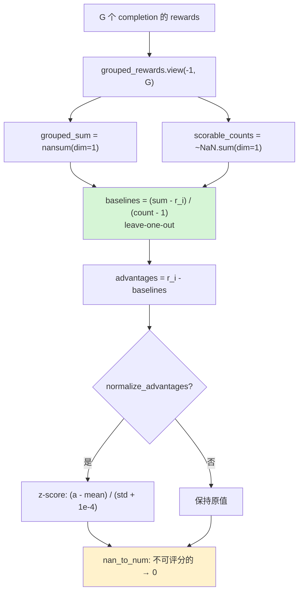

# 06 · RLOO 训练器详解

> 本篇导览：RLOO 是 6 个稳定训练器里最像 GRPO 的一个 —— 两份代码 70% 逐字对齐，连注释都一字不差。本篇要回答的核心问题是：RLOO 把 GRPO 的哪些研究特性砍掉、哪些原样保留、唯一关键分歧 `_compute_loss` 到底怎么写。理解了 RLOO，就理解了 "复制一致性" 原则的最纯粹案例。
>
> 核心问题：
> - RLOO 的 advantage = r_i − mean(r_{j≠i}) 是怎么实现 leave-one-out 的？
> - 为什么说 RLOO 和 GRPO 的 70% 代码是逐字复制？
> - `_compute_loss` 是唯一分歧点，它和 GRPO 的多 loss_type 分支差在哪？
> - KL 惩罚的处理 RLOO 用一阶 log-ratio，GRPO 用 Schulman 近似，为什么有意分叉？
> - `AGENTS.md` 的 "A fix in GRPO often implies the same fix in RLOO" 怎么落地？

---

## 一、原理：REINFORCE Leave-One-Out

RLOO 来自论文 [Back to Basics: Revisiting REINFORCE-Style Optimization for Learning from Human Feedback in LLMs](https://huggingface.co/papers/2402.14740)。它回到最朴素的 REINFORCE，但用一个无偏的 **leave-one-out baseline** 替代 learned critic：

> 对同一个 prompt 采样 G 个完成，每个完成的 advantage = r_i − mean(r_{j≠i})。

这个 baseline 是无偏的（每个完成的 baseline 都不含它自己的奖励），等价于 G-折交叉验证的均值估计。相比 GRPO 的 "组内标准化"（z-score），RLOO 的 baseline 减去了组均值但未除以标准差，方差更可控、且不需学习一个 critic。代码里的 `_paper` 字段（`trl/trainer/rloo_trainer.py:213`）固化了 ID `2402.14740`。

---

## 二、与 GRPO 的关系：同源异构

RLOO 文档的核心不是讲算法本身，而是讲它和 GRPO 的关系。`AGENTS.md` 把这件事说得很直白：

> A fix in GRPO often implies the same fix in RLOO, and vice versa. Not propagating a change is a bug.

代码层面体现在三件事：

1. **共享子树逐字对齐**（约 70%）：生成、奖励计算、sampler、ref-sync、`_prepare_inputs` 缓冲机制、`_get_per_token_logps_and_entropies` 等都是逐字复制，连注释都一致。
2. **唯一关键分歧**：`_compute_loss` —— RLOO 只保留 "简化 PPO clip" 一支，丢弃 GRPO 的所有研究分支。
3. **配置层裁剪**：`RLOOConfig` 砍掉 GRPO 的研究特性字段（VESPO / SAPO / off-policy-mask / IS-correction / entropy bonus / DAPO delta 等），保留生成 + vLLM + ref-sync 主体。

下面用一张图标注同源异构的位置：

```mermaid
flowchart LR
    subgraph Shared["RLOO & GRPO 逐字对齐（绿色）"]
        A1["__init__ 主体"]
        A2["_get_train_sampler / _get_eval_sampler<br/>RepeatSampler"]
        A3["_get_per_token_logps_and_entropies"]
        A4["_prepare_inputs<br/>(buffered 切片)"]
        A5["_calculate_rewards<br/>(async + gather)"]
        A6["_generate_single_turn<br/>(vLLM / tcb / 默认)"]
        A7["_generate_and_score_completions<br/>(old_logps / ref / mask)"]
        A8["training_step / log / prediction_step"]
        A9["vLLM sync_weights 块"]
    end
    subgraph Diverge["分歧（红色）"]
        B1["_compute_loss<br/>RLOO: 单支 clip"]
        B2["KL 处理<br/>RLOO: 一阶 log-ratio<br/>GRPO: Schulman 近似"]
        B3["advantage<br/>RLOO: leave-one-out<br/>GRPO: z-score"]
        B4["GRPO 砍掉:<br/>VESPO/SAPO/CISPO/DAPO/<br/>LUSPO/DR-GRPO/BNPO/<br/>off-policy-mask/IS-correction/<br/>entropy bonus/delta"]
    end
    Shared --> Diverge
    style Shared fill:#d6f5d6
    style Diverge fill:#ffd6d6
```



**图说明**：绿色子树是两个训练器共有的逐字对齐块（行号一一对应），红色是 RLOO 相对 GRPO 做减法或有意分叉的位置。RLOO 的本质是 "GRPO 去掉研究特性 + 换一个更朴素的 advantage"。

---

## 三、共享代码逐字对齐

下面这些方法在 `trl/trainer/rloo_trainer.py` 与 `trl/trainer/grpo_trainer.py` 之间是逐字一致的（注释、变量名、控制流完全相同），RLOO 只是删掉了自己不需要的 GRPO 字段引用。

### 3.1 `__init__`（rloo_trainer.py:229，行号基于 2026-07 探索）

签名与 GRPO 几乎相同，**只缺三个参数**：

```python
def __init__(
    self,
    model, reward_funcs, args: RLOOConfig | None = None,
    train_dataset=None, eval_dataset=None, processing_class=None,
    reward_processing_classes=None, callbacks=None, optimizers=(None, None),
    quantization_config=None, peft_config=None,
    # ↑ 与 GRPO 完全一致；GRPO 还多出 tools / rollout_func / environment_factory
):
```

GRPO 的 `__init__` 多出 `tools` / `rollout_func` / `environment_factory`（grpo_trainer.py:297-299），用于工具调用与环境交互。RLOO 不做 agentic 场景，这三条全砍。其余 PEFT 包装、reward funcs 解析、async loop 启动、reward_weights 校验全部逐字对齐。

### 3.2 sampler：`_get_train_sampler` / `_get_eval_sampler`（rloo_trainer.py:720 / 758）

两个训练器都用 `RepeatSampler`，且参数完全一致：

```python
return RepeatSampler(
    data_source=dataset,
    mini_repeat_count=self.num_generations,
    batch_size=self.args.generation_batch_size // self.num_generations,
    repeat_count=self.num_iterations * self.args.steps_per_generation,
    shuffle=self.shuffle_dataset, seed=self.args.seed,
)
```

`RepeatSampler` 保证：① 同一 prompt 跨 GPU 复制 `num_generations` 份；② 一个 generation batch 内复用 `steps_per_generation` 个 micro-step。源码里那张 ASCII 图（rloo_trainer.py:729-746）也是逐字复制的。

### 3.3 `_prepare_inputs`（rloo_trainer.py:881）—— 几乎逐字复制 GRPO 的

```python
mode = "train" if self.model.training else "eval"
if mode == "train":
    generate_every = self.args.steps_per_generation * self.num_iterations
    if self._step % generate_every == 0 or self._buffered_inputs is None:
        generation_batch = self._generate_and_score_completions(generation_batch)
        generation_batch = split_pixel_values_by_grid(generation_batch)
        generation_batch = shuffle_sequence_dict(generation_batch)
        generation_batches = split_tensor_dict(generation_batch, self.args.steps_per_generation)
        self._buffered_inputs = [unsplit_pixel_values_by_grid(b) for b in generation_batches]
    inputs = self._buffered_inputs[self._step % self.args.steps_per_generation]
```

这段在 GRPO 里**一字不差**：同样的 `generate_every` 计算逻辑、同样的 `split_pixel_values_by_grid` → `shuffle_sequence_dict` → `split_tensor_dict` → `unsplit_pixel_values_by_grid` 流水、同样的缓冲切片。这正是一致性原则要求的 "复制即对齐"。

### 3.4 `_calculate_rewards`（rloo_trainer.py:938）—— 几乎逐字复制 GRPO 的

同样逐字对齐：同步 reward func 走 `profiling_context`、异步 reward func 收集到 `async_funcs_info` 后 `asyncio.gather` 并行、`reward_kwargs` 注入 `trainer_state` / `log_extra` / `log_metric`、最后 `gather(rewards_per_func)` 跨进程聚合。两个训练器连 "all reward funcs return None" 的警告文案都一致。

### 3.5 其它逐字对齐块

- `_get_per_token_logps_and_entropies`（rloo_trainer.py:767）：分块前向、`selective_log_softmax`、`logits.div_(self.temperature)`、MoE `aux_loss` 收集 —— 与 GRPO 一字不差。
- `_generate_single_turn`（rloo_trainer.py:1072）：三条生成路径（vLLM / transformers continuous batching / 默认 `model.generate`）逐字一致，包括 `sync_weights` 块、`unwrap_model_for_generation` 上下文、`mask everything after the first EOS token` 注释。
- `_generate_and_score_completions`（rloo_trainer.py:1212）：左侧 pad prompt、右侧 pad completion、`mask_truncated_completions` 处理、多模态 `forward_kwargs` 拼装、`old_logps` 与 `ref_per_token_logps` 计算顺序 —— 逐字对齐。唯一分叉在 advantage 计算和 KL（见第五节）。
- `training_step`（rloo_trainer.py:869）：计时 + step 累加，与 GRPO 完全相同。

---

## 四、唯一关键分歧：`_compute_loss`

`compute_loss`（rloo_trainer.py:1534）只是个转发壳，真正逻辑在 `_compute_loss`（rloo_trainer.py:1539）。这是整个 RLOO 训练器**唯一**与 GRPO 实质性不同的方法。

### 4.1 RLOO 的 loss（极简）

```python
logps = (per_token_logps * completion_mask).sum(1)
old_logps = inputs["old_logps"]
log_ratio = logps - old_logps                              # 序列级 log-ratio
advantages = inputs["advantages"]
coef_1 = torch.exp(log_ratio)                             # importance sampling ratio
coef_2 = torch.clamp(coef_1, 1 - self.epsilon_low, 1 + self.epsilon_high)  # clipped
per_sequence_loss1 = coef_1 * advantages
per_sequence_loss2 = coef_2 * advantages
per_sequence_loss = -torch.min(per_sequence_loss1, per_sequence_loss2)
loss = per_sequence_loss.mean()
```

注意三个关键点：

1. **序列级 ratio**：`logps` 是 `(per_token_logps * mask).sum(1)`，即整段 completion 的 logp 之和。GRPO 默认是 token 级（`importance_sampling_level="token"`），RLOO 直接固定为序列级，连配置项都没有。
2. **简化 PPO clip**：标准的 `min(r·A, clip(r)·A)`，没有 DAPO 的 `delta`、没有 SAPO 的 sigmoid、没有 CISPO 的 detach、没有 VESPO 的 gamma 权重。
3. **不加 KL 到 loss**：`per_sequence_loss` 里完全没有 KL 项。KL 是怎么进来的？见第五节 —— 作为 reward 惩罚在 `_generate_and_score_completions` 里扣。

### 4.2 GRPO 的 loss（多分支 + 多叠加）

对比 GRPO 的 `_compute_loss`（grpo_trainer.py:2734），同一段逻辑被一个巨大的 `if/elif` 包裹：

```python
if self.loss_type == "cispo":       ...
elif self.loss_type in ["grpo", "bnpo", "dr_grpo", "dapo", "luspo"]:
    coef_2 = torch.clamp(coef_1, 1 - self.epsilon_low, 1 + self.epsilon_high)
    if self.args.delta is not None:
        coef_1 = torch.clamp(coef_1, max=self.args.delta)
    per_token_loss1 = coef_1 * advantages
    per_token_loss2 = coef_2 * advantages
    per_token_loss = -torch.min(per_token_loss1, per_token_loss2)
elif self.loss_type == "sapo":      ...
elif self.loss_type == "vespo":     ...
```

GRPO 的 `grpo` 分支与 RLOO 的 loss **逐字对应** —— 同样的 `coef_2 = clamp(...)`、同样的 `min(coef_1·A, coef_2·A)`。但 GRPO 在这条之外还多了：

- `off_policy_mask_threshold`：基于 ratio 偏离度的样本级 mask
- `entropy_bonus` + 自适应熵控制（`use_adaptive_entropy` / `entropy_target`）
- `top_entropy_quantile` 高熵 token mask
- vLLM `importance_sampling_correction`
- `use_bias_correction_kl`：KL 乘以 ratio 做重要性采样校正
- 5 种 normalizer 分支（grpo / bnpo / dr_grpo / cispo+dapo+vespo / luspo）
- KL 直接加到 `per_token_loss`（`per_token_loss = per_token_loss + self.beta * per_token_kl`）

RLOO **全砍**。这是 "70% 对齐，30% 是 GRPO 的研究特性" 这句话的字面证据。

---

## 五、两个有意分叉：advantage 与 KL

虽然 `_compute_loss` 是唯一关键分歧，但 RLOO 在 `_generate_and_score_completions` 里还有两处与 GRPO **有意分叉**（不是 bug，是论文设计）。

### 5.1 advantage：leave-one-out

RLOO 的 advantage 计算（rloo_trainer.py:1430-1447）：

```python
scorable_counts = (~torch.isnan(grouped_rewards)).sum(dim=1, keepdim=True)
grouped_sum = torch.nansum(grouped_rewards, dim=1, keepdim=True)
if num_generations > 1:
    baselines = (grouped_sum - grouped_rewards) / (scorable_counts - 1)
    baselines = baselines.view(-1)
    advantages = rewards - baselines
```

`(grouped_sum - grouped_rewards) / (scorable_counts - 1)` 就是 leave-one-out 均值：把第 i 个完成从组总和中减掉，除以剩下的 G-1 个数。GRPO 这里走的是 `z-score`（减均值、除标准差），RLOO 只减均值不除标准差。`scorable_counts` 处理的是 "全 NaN 的不可评分完成" 这一边缘情况 —— 注释明确说 `A group with a single scorable completion yields 0/0 = NaN`，最后由 `nan_to_num` 兜底。

### 5.2 KL：一阶 log-ratio vs Schulman

RLOO 的 KL 处理（rloo_trainer.py:1413-1421）有一段非常显眼的注释，明确说这是**有意分叉**：

```python
# RLOO uses the first-order log ratio for the per-token KL estimate, ...
# Unlike GRPOTrainer's Schulman approximation (always >= 0), this can be negative per token.
# The divergence is intentional: RLOO applies KL as a reward penalty (summed across tokens
# per sequence), while GRPO adds it to the per-token loss.
per_token_kl = old_per_token_logps - ref_per_token_logps
kl = (per_token_kl * completion_mask).sum(-1)
kl = gather(kl)
rewards = rewards - self.beta * kl
```

两点分叉：
1. **估计式**：RLOO 用一阶 `logp_old − logp_ref`（可负），GRPO 用 `exp(ref−cur) − (ref−cur) − 1`（Schulman，恒非负）。
2. **作用位置**：RLOO 把 KL 作为 **reward 惩罚**（每个 sequence 扣 `beta * kl`），所以 loss 里没有 KL；GRPO 把 KL 加到 **per-token loss**。



**图说明**：RLOO advantage 的完整数据流。绿色节点 `baselines` 是 leave-one-out 的核心：每个完成的 baseline 来自其余 G-1 个的均值。`scorable_counts` 让 baseline 只在可评分的兄弟上求均值，避免 NaN 污染；`nan_to_num` 在最后把不可评分完成的 advantage 兜底为 0，使其不更新策略。

---

## 六、`RLOOConfig` 的字段差异

`RLOOConfig`（`trl/trainer/rloo_config.py`，约 53 个字段）保留 GRPO 的 **生成 + vLLM + ref-sync** 三大块，**砍掉 GRPO 的研究特性字段**：

| 类别 | RLOO 保留 | RLOO 砍掉（GRPO 有） |
|---|---|---|
| 生成 | `num_generations`（默认 2）、`temperature`、`top_p`/`top_k`/`min_p`、`repetition_penalty`、`generation_kwargs`、`chat_template_kwargs` | — |
| vLLM | `use_vllm`、`vllm_mode`、`vllm_model_impl`、`vllm_gpu_memory_utilization`、`vllm_max_model_length`、`vllm_tensor_parallel_size`、`vllm_enable_sleep_mode`、server 系列、`vllm_structured_outputs_regex` | `vllm_importance_sampling_correction`、`importance_sampling_level` |
| 训练 | `beta`、`num_iterations`、`epsilon`、`epsilon_high`、`reward_weights`、`normalize_advantages`、`reward_clip_range`、`mask_truncated_completions`、`sync_ref_model` / `ref_model_mixup_alpha` / `ref_model_sync_steps` | `loss_type`、`delta`、`scale_rewards`、`top_entropy_quantile`、`entropy_coef` / `entropy_coef_min` / `use_adaptive_entropy` / `entropy_target`、`off_policy_mask_threshold`、`use_bias_correction_kl`、`vespo_k_pos` / `vespo_lambda_pos` / `vespo_k_neg` / `vespo_lambda_neg`、`sapo_temperature_pos` / `sapo_temperature_neg` |
| 工具 | — | `tools`、`rollout_func`、`environment_factory`（在 `__init__` 而非 config） |

`__post_init__` 里有一处 RLOO 专属校验（rloo_config.py:664）：

```python
if self.num_generations < 2:
    raise ValueError(
        "RLOO requires at least 2 generations per prompt to calculate the advantages. ..."
    )
```

这是 leave-one-out 的物理要求 —— G=1 时没有 "其他" 兄弟，baseline 退化。GRPO 没有这条强约束。

---

## 七、一致性原则的落地

`AGENTS.md` 那段 "Consistency over correctness" 在 RLOO 上有最严格的体现。具体到三个动作：

1. **复制即对齐**：GRPO 改了 `_generate_single_turn` 的 vLLM 调用签名，RLOO 必须同步改；GRPO 修了 `split_pixel_values_by_grid` 的一个边界 bug，RLOO 必须同步修。源码注释 "this tradeoff: duplication is accepted, but consistency is mandatory" 是这套规约的合同条款。
2. **不偷偷修 bug**：如果发现 GRPO 某处逻辑可疑，RLOO 的副本里也保留同样的可疑代码，**不单独修**。理由是 "A correct-but-inconsistent codebase is harder to maintain than a consistently-wrong one" —— 一致地错，可以一个 PR 全扫；分叉了，就得 case by case。
3. **分叉必须显式**：RLOO 的 KL 分叉（5.2）有一段显式注释说明 "The divergence is intentional"，并指向论文。这就是规约里说的 "Divergences only where the trainer's semantics require it"。

对代码读者而言，这意味着：**读 RLOO 时遇到一段代码看不懂，去查 GRPO 的对应行；改 GRPO 时改到一个 RLOO 也有的块，记得把同样的 diff 应用到 RLOO**。

---

## 八、上手示例

下面是一个最小可运行 RLOO 片段，数据集和模型与 GRPO 文档对齐，方便直接对比差异（唯一要改的就是 `GRPOTrainer` → `RLOOTrainer`、`GRPOConfig` → `RLOOConfig`）：

```python
from datasets import load_dataset
from trl import RLOOTrainer, RLOOConfig
from transformers import AutoModelForCausalLM, AutoTokenizer

model_id = "Qwen/Qwen2.5-0.5B-Instruct"
model = AutoModelForCausalLM.from_pretrained(model_id, torch_dtype="bfloat16")
tokenizer = AutoTokenizer.from_pretrained(model_id)

dataset = load_dataset("trl-lib/DeepMath-103K", split="train")

def accuracy_reward(prompts, completions, answer, **kwargs):
    import re
    rewards = []
    for c, a in zip(completions, answer):
        m = re.search(r"\\boxed\{([^}]*)\}", c[0]["content"] if isinstance(c, list) else c)
        rewards.append(1.0 if m and m.group(1).strip() == a else 0.0)
    return rewards

args = RLOOConfig(
    output_dir="rloo-qwen0.5b",
    num_generations=4,                  # RLOO 要求 >= 2，越大方差越小
    max_completion_length=512,
    per_device_train_batch_size=4,
    gradient_accumulation_steps=2,
    learning_rate=1e-6,
    beta=0.05,                          # KL 作为 reward 惩罚
    epsilon=0.2,
    num_iterations=1,
    use_vllm=True,
    vllm_mode="colocate",
    bf16=True,
    logging_steps=10,
)

trainer = RLOOTrainer(
    model=model,
    reward_funcs=accuracy_reward,
    args=args,
    train_dataset=dataset,
    processing_class=tokenizer,
)
trainer.train()
```

注意 `num_generations=4`：RLOO 在 G=2 时 baseline 只有一个样本，方差偏高；G=4~8 是论文推荐的实用区间。GRPO 那边同样的 `num_generations=4` 也能跑，但 GRPO 的 z-score 会再压一道标准差，所以 G=2 时 GRPO 通常更稳。

---

## 小结

- **RLOO ≈ GRPO − 研究特性 + leave-one-out advantage**。70% 代码（`_prepare_inputs` / `_calculate_rewards` / `_generate_single_turn` / `_generate_and_score_completions` / `_get_per_token_logps_and_entropies` / sampler / vLLM 同步块）逐字对齐。
- **唯一关键分歧是 `_compute_loss`**（rloo_trainer.py:1539）：RLOO 固定序列级 ratio + 简化 PPO clip，砍掉 GRPO 的 cispo / sapo / vespo / dapo / dr_grpo / bnpo / luspo / off-policy-mask / IS-correction / entropy bonus / delta 等 10+ 分支。
- **advantage 用 leave-one-out**：`(sum − r_i) / (count − 1)`，只减均值不除标准差；不可评分的完成走 `nan_to_num` 兜底为 0。
- **KL 有意分叉**：RLOO 用一阶 log-ratio（可负）作为 reward 惩罚；GRPO 用 Schulman 近似（恒非负）加到 per-token loss。源码注释明确这是设计选择不是 bug。
- **一致性规约**：改 GRPO 的某段若 RLOO 也有副本，必须同步改；RLOO 的副本即使有 bug 也保持一致，由专门 PR 统一修。

下一篇 [07 · KTO 训练器详解](07_分_KTO训练器详解.md) 将转向 DPO 家族里的 Kahneman-Tversky 偏好学习 —— 它和 GRPO/RLOO 几乎没有共享代码块，是另一种 "成对偏好 + 二元 reward" 的范式。
