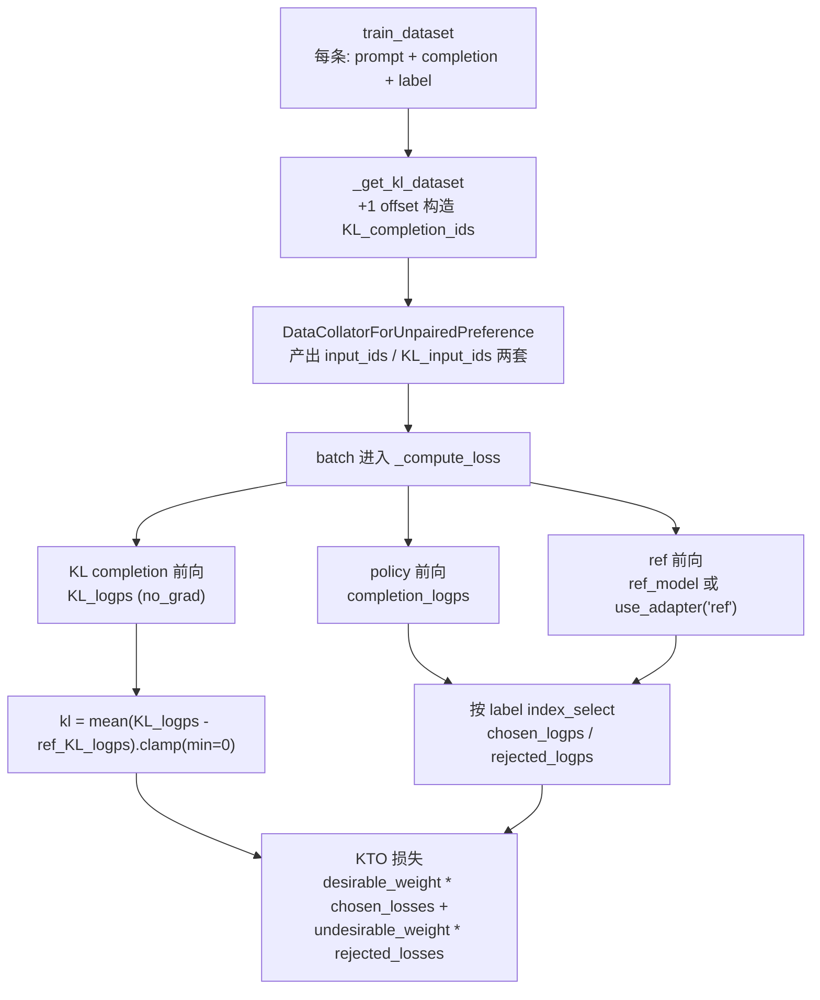
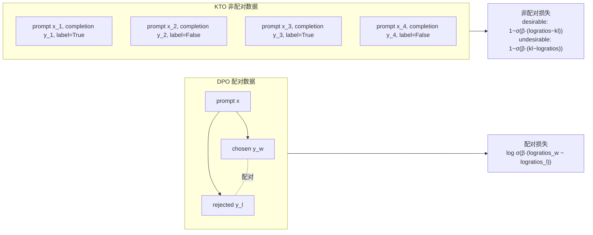

# 07 · KTO 训练器详解

> 本篇导览：KTO 把 DPO 的"成对偏好"拆成"单点好/坏"——每条样本只带一个 `label: bool`，模型仍然学一个隐式奖励，但损失改用 Kahneman-Tversky 的前景理论价值函数，对"得"和"失"分别套不同的 sigmoid。本篇从 KTO 论文的非配对设定出发，逐段拆解 `trl/trainer/kto_trainer.py`：独特的 "KL completion" 对照序列怎么构造、`_get_train_sampler` 为什么强制 `sequential`、`_compute_loss` 如何按 label 把 batch 切成 chosen/rejected 两支再合损失、Liger 融合损失如何绕过 `lm_head` 直接读 hidden states，以及为什么 KTO 不集成 vLLM。

> 核心问题：
> - KTO 为什么"非配对"也能学偏好？前景理论的 value function 在损失公式里长什么样？
> - "KL completion" 是什么？为什么必须从 batch 内部用 +1 offset 的 (prompt, 别人的 completion) 来构造？
> - `_get_train_sampler` 为什么在 `calculate_KL=True` 时强制 `SequentialSampler`？换 `random` 会发生什么？
> - `_compute_loss` 怎么在不分两次前向的前提下，用 `index_select` 把一个混合 batch 切成 chosen/rejected？
> - PEFT 怎么用一份 LoRA 同时充当 policy 和 reference？Liger 路径为什么必须绕开 `PeftModel.forward()`？

---

## 一、原理：Kahneman-Tversky Optimization

论文 [KTO: Model Alignment as Prospect Theoretic Optimization](https://huggingface.co/papers/2402.01306) 的核心观察：DPO 这类配对方法依赖 `(chosen, rejected)` 同 prompt 配对，数据采集成本高；而真实人类反馈往往只是"这条回复好/不好"的单点判断。KTO 直接放弃配对，每条样本只带一个布尔 `label`（desirable / undesirable），损失套用前景理论：对"得"和"失"分别用不同的 sigmoid 形式，使得模型对 desirable 提升 logprob、对 undesirable 压低 logprob，并以 KL 正则化避免偏离参考模型太远。

KTO 的 KL 项估计尤其特别：它**不是**直接用 `KL(π || π_ref)` 的解析形式，而是用一条 "KL completion" 来估计。对每个 batch 中的样本 `(x_i, y_i)`，构造一条对照序列 `(x_i, y_{i-1})`——同一 prompt 配上 batch 内**另一条** completion（`+1` 循环偏移）。在这条不匹配的序列上算 `logπ(y_{i-1}|x_i) − logπ_ref(y_{i-1}|x_i)`，再对 batch 取均值、`clamp(min=0)`，作为 KL 项 `kl`。这样不需要从 `π_ref` 采样，仅靠 batch 内现有的 completion 就能估出 KL 散度。

代码中 `calculate_KL = args.loss_type not in ["apo_zero_unpaired"]`（kto_trainer.py:728）决定是否启用 KL 估计。`loss_type="kto"`（默认）启用；`loss_type="apo_zero_unpaired"` 不启用（APO-zero 的非配对变体不需要 KL 项）。

---

## 二、损失公式

设 `chosen_logratios = logπ(y|x) − logπ_ref(y|x)`（desirable 样本），`rejected_logratios` 同理（undesirable 样本），`kl` 是上一节估计的 KL 项。KTO 损失（`_compute_loss` 中 1568-1598 行）按 label 分两支：

```python
# trl/trainer/kto_trainer.py:1568-1598（简化）
if chosen_logps.shape[0] != 0 or ref_chosen_logps.shape[0] != 0:
    chosen_logratios = chosen_logps - ref_chosen_logps
    if self.loss_type == "kto":
        # Eqn (7) of the KTO paper
        chosen_losses = 1 - F.sigmoid(self.beta * (chosen_logratios - kl))
    elif self.loss_type == "apo_zero_unpaired":
        chosen_losses = 1 - F.sigmoid(self.beta * chosen_logratios)
    chosen_rewards = self.beta * chosen_logratios.detach()

if rejected_logps.shape[0] != 0 or ref_rejected_logps.shape[0] != 0:
    rejected_logratios = rejected_logps - ref_rejected_logps
    if self.loss_type == "kto":
        rejected_losses = 1 - F.sigmoid(self.beta * (kl - rejected_logratios))
    elif self.loss_type == "apo_zero_unpaired":
        rejected_losses = F.sigmoid(self.beta * rejected_logratios)
    rejected_rewards = self.beta * rejected_logratios.detach()

losses = torch.cat(
    (self.desirable_weight * chosen_losses, self.undesirable_weight * rejected_losses),
    0,
)
loss = losses.nanmean()
```

要点：

- desirable 损失 `1 − σ(β·(chosen_logratios − kl))`：策略相对参考模型对好回复提升越多，`chosen_logratios` 越大，损失越小；减去 `kl` 是因为"已经偏离参考模型 kl 这么多了"，再多出来的提升才算真正贡献。
- undesirable 损失 `1 − σ(β·(kl − rejected_logratios))`：对称地，策略对坏回复的提升 `rejected_logratios` 越小（即相对参考模型更不偏好它），损失越小；`kl` 在分子上把"参考模型已经允许的偏离量"扣除。
- `apo_zero_unpaired` 砍掉 `kl` 项，等价于认为数据本身已经足够好（chosen 比 model 默认输出更好），适合高密度正反馈数据。
- `desirable_weight` / `undesirable_weight` 不是 DPO 那种 implicit；它直接乘到损失上再 `nanmean`，用来抵消数据集 desirable/undesirable 比例不均。
- `β`（`beta`，默认 0.1）控制偏离参考模型的强度，越大越紧贴 `π_ref`。

---

## 三、KL completion 的构造与采样器

KL completion 在 `_get_kl_dataset`（kto_trainer.py:994-1042）里批量构造，关键就一行：

```python
# trl/trainer/kto_trainer.py:1015-1021（简化）
def get_kl_completion_ids(examples):
    # +1 offset 把 (x_1, y_1), ..., (x_n, y_n) 变成 (x_1, y_n), ..., (x_n, y_1)
    examples["completion_ids"] = [examples["completion_ids"][-1]] + examples["completion_ids"][:-1]
    return examples
```

这个 map 以 `batch_size=per_device_train_batch_size` 分批跑，所以 "邻居" 就是同一训练 batch 里的样本。**一旦 batch 顺序被打乱，KL completion 与原样本的配对就失效**——这就是 `_get_train_sampler` 在 `calculate_KL=True` 时必须返回 `SequentialSampler` 的根本原因：

```python
# trl/trainer/kto_trainer.py:1196-1203（行号基于 2026-07 探索）
def _get_train_sampler(self, train_dataset: Dataset | None = None) -> Sampler | None:
    if self.calculate_KL and Version(transformers.__version__) < Version("5.2.0"):
        if train_dataset is None:
            train_dataset = self.train_dataset
        if train_dataset is None or not has_length(train_dataset):
            return None
        return SequentialSampler(train_dataset)
    return super()._get_train_sampler(train_dataset)
```

`KTOConfig.train_sampling_strategy` 取值为 `random` / `sequential` / `group_by_length`，默认 `sequential`。`__init__` 在 750-756 行硬性校验：`calculate_KL=True` 时必须 `sequential`，否则报错。`balanced` 这种"保 50/50 desirable/undesirable"的需求并不是在 sampler 层做的，而是靠 `desirable_weight` / `undesirable_weight` 加权——`_prepare_dataset`（1143-1168 行）按论文 Eq.(8) 给出推荐权重区间，超出区间会打 warning。`calculate_KL=True` 时还要求 `per_device_train_batch_size > 1`（757-760 行），否则 KL 项等价于隐式奖励，没有意义。



**图说明**：KTO 单步数据流。橙色的 "KL completion" 路径是 KTO 区别于 DPO 的核心特征——它复用 batch 内的 completion，零额外采样开销估出 KL 项；ref 前向在 PEFT 路径下复用同一份模型（切 `ref` adapter），在非 PEFT 路径下走独立的 `ref_model`。

---

## 四、`_compute_loss` 与 Liger 路径

主损失入口在 `compute_loss`（kto_trainer.py:1695），按 `use_liger_kernel` 分派到 `_compute_loss` 或 `_compute_loss_liger`。

### 4.1 标准 `_compute_loss`（kto_trainer.py:1486）

流程：先算 `KL_logps`（`_compute_kl_logps`，1308-1340 行，`no_grad`）→ policy 前向拿 `completion_logps` → 用 `index_select` 按 `bool_labels` 把同一 batch 切成 chosen / rejected 两支（不重新前向）→ ref 前向（PEFT 用 `use_adapter("ref")` 切 adapter，否则用独立 `self.ref_model`）→ 算 `kl` → 套损失公式 → `desirable_weight`/`undesirable_weight` 加权 `nanmean` → MoE 的 `aux_loss` 加进来。

```python
# trl/trainer/kto_trainer.py:1519-1533（简化）
bool_labels = torch.as_tensor(batch["label"], dtype=torch.bool, device=device)
chosen_idx = torch.nonzero(bool_labels, as_tuple=False).view(-1)
rejected_idx = torch.nonzero(~bool_labels, as_tuple=False).view(-1)

chosen_logps = completion_logps.index_select(0, chosen_idx)
rejected_logps = completion_logps.index_select(0, rejected_idx)
chosen_logits = outputs.logits.index_select(0, chosen_idx)
rejected_logits = outputs.logits.index_select(0, rejected_idx)
```

注意 ref 路径有三种来源（和 DPO 一致）：独立 `ref_model`、PEFT `ref` adapter、`precompute_ref_logps` 从 batch 直接读 `ref_logps` / `ref_KL_logps`。`precompute_ref_logps=True` 时 `_precompute_ref_logps`（1205-1254 行）训练前用 ref 模型把整个数据集跑一遍缓存到磁盘，指纹含 `hash_module(self.ref_model or self.model)` + dataset fingerprint + `calculate_KL`。

### 4.2 Liger `_compute_loss_liger`（kto_trainer.py:1342）

Liger 路径用 `LigerFusedLinearKTOLoss` 把 `lm_head` 的 matmul 和 KTO 损失融合，**不 materialize logits**，省显存。代价是不能 `return_outputs=True`，不能 `precompute_ref_logps`，不能给 `lm_head` 加 PEFT adapter（785-797 行：Liger 直接读 `lm_head.weight`，adapter 会被静默冻结，故直接报错）。它走 `model.base_model` 拿 backbone，跳过 `PeftModel.forward()`，所以也不兼容 prompt-learning 类 PEFT（798-809 行）。

---

## 五、`KTOConfig` 关键字段

`trl/trainer/kto_config.py` 中的 `KTOConfig` 继承 `_BaseConfig`，与 `TrainingArguments` 不同的默认值在文件 100-110 行集中说明：`logging_steps=10`、`gradient_checkpointing=True`、`bf16` 默认开、`learning_rate=1e-6`（远小于 SFT 的 5e-5）、`train_sampling_strategy="sequential"`。

KTO 特有字段分组：

- **训练控制**：`loss_type`（`kto` / `apo_zero_unpaired`）、`beta`（默认 0.1）、`desirable_weight` / `undesirable_weight`（默认各 1.0，配合 Eq.(8) 区间调）、`activation_offloading`（默认 False，开启时 `training_step` 套 `maybe_activation_offload_context`）。
- **数据预处理**：`max_length`（默认 1024，从右截断）、`pad_to_multiple_of`、`dataset_num_proc`、`precompute_ref_log_probs` + `precompute_ref_batch_size`。
- **模型控制**：`model_init_kwargs`、`trust_remote_code`、`router_aux_loss_coef`（默认 0.001，MoE 专用）、`disable_dropout`（默认 True，同时关掉 model 和 ref_model 的 dropout）。
- **TR-DPO ref 同步**：`sync_ref_model` + `ref_model_mixup_alpha`（默认 0.6）+ `ref_model_sync_steps`（默认 512），来自 [TR-DPO](https://huggingface.co/papers/2404.09656)。`sync_ref_model=True` 不兼容 PEFT 也不兼容 `precompute_ref_log_probs=True`（906-922 行）。

---

## 六、集成关系

KTO 的集成面比 GRPO/RLOO 窄：

- **Accelerate**：标准 `Trainer` 路径，多卡通过 `accelerator.gather_for_metrics` 聚合 `kl`、`num_chosen/rejected`、rewards/margins 等指标。
- **PEFT**：通过 `add_adapter("ref", default_config)` + `use_adapter(model, "ref")` 用一份 LoRA 同时充当 policy 与 reference，省一份显存；若用户已自带预训练 adapter，则用 `use_adapter(model, None)` 调 `disable_adapter()` 回退到 base 模型（668-689 行）。
- **DeepSpeed / FSDP**：`ref_model` 通过 `prepare_deepspeed` / `prepare_fsdp` 包一层（898-904 行）。
- **Liger Kernel**：`use_liger_kernel=True` 走 `_compute_loss_liger`，融合 `lm_head` + KTO 损失。
- **`SyncRefModelCallback`**：`sync_ref_model=True` 时注册，按 `ref_model_sync_steps` 周期性把 `π_θ` 与 `π_ref` 按 `ref_model_mixup_alpha` 做加权平均。
- **不集成 vLLM**：KTO 是判别式训练（直接吃现成 completion），不需要在线生成，因此没有 `vLLM` 客户端、`_generate_single_turn`、`sync_weights` 等 GRPO/RLOO 里的生成路径。



**图说明**：DPO 要求每条 prompt 同时给出 chosen 和 rejected，损失是两者的 logratios 之差过 sigmoid；KTO 每条样本独立携带 `label`，chosen/rejected 来自不同 prompt，损失分别套"得/失"的 sigmoid 形式，再靠 `desirable_weight`/`undesirable_weight` 抵消比例不均。

---

## 七、`training_step` / `prediction_step` 的覆盖

`training_step`（kto_trainer.py:1710）只做一件事：套 `self.maybe_activation_offload_context` 后调 `super().training_step`，开启 `activation_offloading=True` 时把激活卸到 CPU。

`prediction_step`（kto_trainer.py:1727）的覆盖更关键：KTO 的 batch 里 `"label"` 是布尔列表而非 tensor label，标准 `Trainer.prediction_step` 看到没 label 会只跑 forward 返回 logits——这会绕过损失计算。所以这里强制走 `self.compute_loss(model, inputs, ...)`，`prediction_loss_only=False` 时再从 `outputs.logits` / `inputs["input_ids"]` 拼出 logits/labels 给 `compute_metrics`。

---

## 八、上手示例

下面是一段最小可运行 KTO 训练代码。`train_sampling_strategy` 用默认的 `"sequential"`（KTO 默认 `loss_type="kto"` 启用 KL 估计，强制 sequential；50/50 平衡通过 `desirable_weight` / `undesirable_weight` 加权实现）：

```python
from datasets import load_dataset
from peft import LoraConfig
from transformers import AutoModelForCausalLM, AutoTokenizer
from trl import KTOConfig, KTOTrainer

model_id = "Qwen/Qwen2.5-0.5B-Instruct"
model = AutoModelForCausalLM.from_pretrained(model_id, dtype="bfloat16")
tokenizer = AutoTokenizer.from_pretrained(model_id)
tokenizer.pad_token = tokenizer.eos_token

# trl-lib/ultrafeedback 已 unpair：每条带 label (bool)
dataset = load_dataset("trl-lib/ultrafeedback", split="train")

peft_config = LoraConfig(
    r=16, lora_alpha=32, lora_dropout=0.05,
    target_modules=["q_proj", "v_proj"],
    task_type="CAUSAL_LM",
)

args = KTOConfig(
    output_dir="./kto-qwen",
    learning_rate=5e-7,
    per_device_train_batch_size=4,        # 必须 > 1，否则 KL 项等价于隐式奖励
    gradient_accumulation_steps=4,
    num_train_epochs=1,
    beta=0.1,
    loss_type="kto",                       # 启用 KL completion
    train_sampling_strategy="sequential",  # KL 路径强制 sequential
    desirable_weight=1.0,                 # 配合 Eq.(8) 区间调
    undesirable_weight=1.0,
    bf16=True,
    gradient_checkpointing=True,
    max_length=1024,
)

trainer = KTOTrainer(
    model=model,
    args=args,
    train_dataset=dataset,
    processing_class=tokenizer,
    peft_config=peft_config,              # PEFT: 一份 LoRA + 隐式 ref adapter
)
trainer.train()
```

要点：用 PEFT 时 trainer 会自动 `add_adapter("ref", ...)`，无需手传 `ref_model`；`per_device_train_batch_size` 必须 > 1；`train_sampling_strategy` 在 KL 路径下不能改 `random`，否则 `__init__` 直接报错。

---

## 小结

- KTO 的"非配对"不是省略 chosen/rejected 区分，而是把它们打散到 batch 不同样本上，用 `label` 标记；损失按 label 分两支套前景理论的 sigmoid 形式。
- KL 项是 KTO 的灵魂：用 batch 内 +1 offset 的 (prompt, 别人的 completion) 构造 "KL completion"，零采样开销估出 KL 散度；这强制 `train_sampling_strategy="sequential"` 和 `per_device_train_batch_size > 1`。
- `_compute_loss` 用 `index_select` 在同一前向结果上切 chosen/rejected，不重跑前向；ref 路径有独立 `ref_model` / PEFT `ref` adapter / `precompute_ref_logps` 三种来源。
- Liger 路径用 `LigerFusedLinearKTOLoss` 融合 `lm_head`，省显存但不支持 `return_outputs`、`precompute_ref_logps`、`lm_head` 上加 adapter。
- 集成面比 GRPO/RLOO 窄：无 vLLM 生成路径（判别式训练），但 PEFT / DeepSpeed / FSDP / Liger / `SyncRefModelCallback` 都支持。

下一篇 [08 · Reward 训练器详解](08_分_Reward训练器详解.md) 将转向 KTO/DPO 之外的另一条偏好建模路径——显式训练一个奖励模型。
