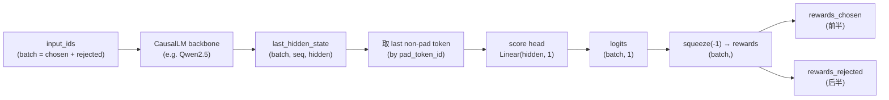
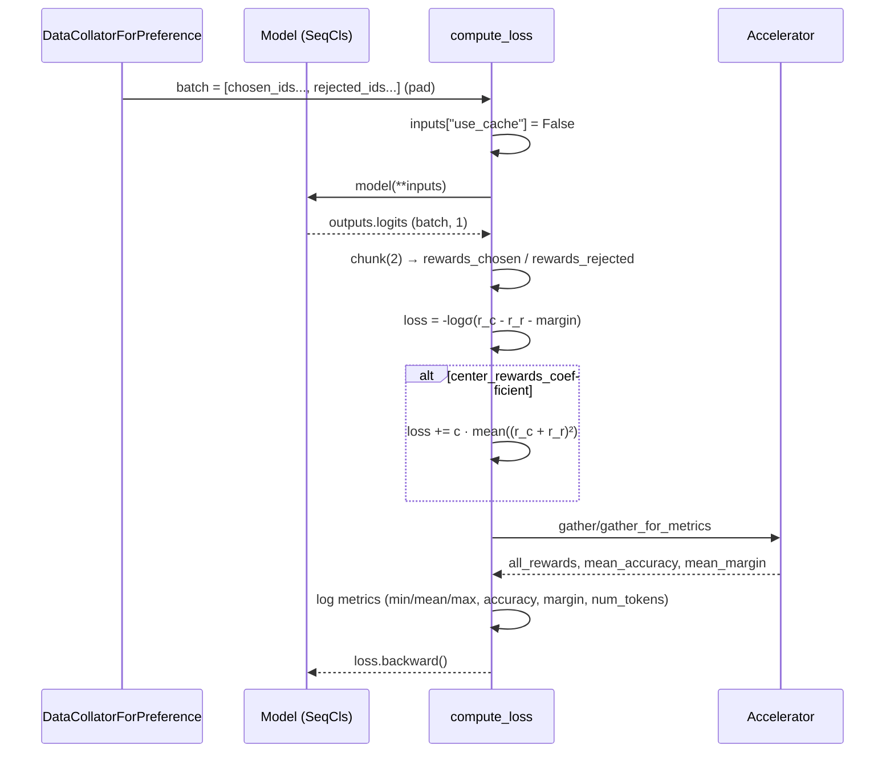

# 08 · Reward 训练器详解

> 本篇导览：Reward 训练器是 TRL 系列里最朴素的一员——它不在线采样、不维护参考模型、不与 vLLM 打交道，只做一件事：把 (prompt, chosen, rejected) 偏好对喂给一个带 `score` 头的 SequenceClassification 模型，用 Bradley-Terry 配对损失把它训成一个标量奖励函数。本篇从 BT 损失推导出发，逐段拆解 `trl/trainer/reward_trainer.py`（全 806 行）：从 CausalLM checkpoint 加载到 SeqCls 头时的跨架构键告警抑制、`compute_loss` 中 `chunk(2)` 切分 chosen/rejected 的 batch 布局、可选的 `center_rewards_coefficient` 正则、以及为什么它的 PEFT 任务类型是 `SEQ_CLS` 而非 SFT/DPO/GRPO 的 `CAUSAL_LM`。

> 核心问题：
> - Bradley-Terry 配对排序损失 `-log σ(r_chosen − r_rejected − margin)` 是怎么从"chosen 应排在 rejected 前"这个朴素假设推出来的？
> - 一个 CausalLM checkpoint 怎么变成输出标量奖励的 SeqCls 模型？`score.weight` 缺失、`lm_head.weight` 多余的告警怎么处理？
> - chosen 和 rejected 在 batch 里如何布局，使得一次前向就能同时拿到两条序列的 reward？
> - `center_rewards_coefficient` 这个正则项是干什么的，为什么会出现在 BT 损失的尾巴上？
> - 为什么 RewardTrainer 的集成面这么窄——不要 vLLM、不要 ref model、不要 Liger、不要 DeepSpeed/FSDP ref prep？

---

## 一、Bradley-Terry 配对排序原理

奖励模型的目标是学一个函数 `r(x, y)`，使得对于任意偏好对 `(y_w, y_l)`（chosen / rejected），有 `r(x, y_w) > r(x, y_l)`。Bradley-Terry 模型把它参数化为概率：

```
P(y_w ≻ y_l | x) = σ(r(x, y_w) − r(x, y_l))
```

其中 `σ` 是 sigmoid。最大化该似然等价于最小化负对数似然：

```
L_BT = -log σ(r(x, y_w) − r(x, y_l))
```

如果偏好对里带显式的 margin `m`（数据集的 `margin` 字段，表示 chosen 至少要比 rejected 高多少），损失变为：

```
L_BT = -log σ(r_chosen − r_rejected − m)
```

trl 的实现就是这条公式的直接落地（reward_trainer.py:751-754）。可选地，[《Managing Sparse Rewards in RLHF》](https://huggingface.co/papers/2312.09244) Eq.2 提出加一个 L2 正则把奖励往均值零推：

```
L = L_BT + c · mean((r_chosen + r_rejected)²)
```

对应 `RewardConfig.center_rewards_coefficient`（推荐值 `0.01`）。它的直觉是：BT 损失只约束"差" `r_chosen − r_rejected`，对绝对值无约束，模型可能把奖励整体漂走，加上正则让 reward 分布中心化、数值稳定，方便后续 PPO/DPO 复用。

---

## 二、模型加载：CausalLM → SeqCls 头

Reward 模型本质是一个 SequenceClassification 模型：backbone（通常是个 CausalLM，如 Qwen2.5）取 `last_hidden_state`，在 `pad_token_id` 处（最后一个非 pad token）取 hidden，过一个 `score` 线性头映射到 `num_labels=1` 的标量。

```python
# 简化的 forward 路径
outputs = model(**inputs)               # input_ids, attention_mask
logits = outputs.logits                 # shape: (batch, 1)
rewards = logits.squeeze(-1)           # shape: (batch,)
```

入口在 `__init__`（reward_trainer.py:325，行号基于 2026-07 探索）。当 `model` 是字符串时，走 `AutoModelForSequenceClassification.from_pretrained` 并强制 `num_labels=1`：

```python
# trl/trainer/reward_trainer.py:364-379（简化）
if isinstance(model, str):
    model_init_kwargs = dict(args.model_init_kwargs or {})
    if quantization_config is not None:
        model_init_kwargs["quantization_config"] = quantization_config
    if args.distributed_state.distributed_type in ["MULTI_GPU", "DEEPSPEED"]:
        model_init_kwargs["device_map"] = None          # 分布式下不能用 "auto"
    model_init_kwargs["num_labels"] = 1                  # 唯一输出：奖励标量
    model_init_kwargs.setdefault("trust_remote_code", args.trust_remote_code)
    with suppress_seqcls_warning():
        model = create_model_from_path(model, AutoModelForSequenceClassification, **model_init_kwargs)
```

如果用户直接传 `PreTrainedModel` 实例，会校验 `model.config.num_labels == 1`（392-397 行），否则报错——因为 SeqCls 头的输出维度必须等于 1 才能当 reward。

### 跨架构键告警抑制

把 CausalLM checkpoint（带 `lm_head.weight`）加载到 SeqCls 模型（带 `score.weight`）会触发两条"无害但吓人"的告警：

- `MISSING score.weight`：新加的 score 头不在 checkpoint 里，随机初始化（这正是我们想要的）。
- `UNEXPECTED lm_head.weight`：checkpoint 里有 lm_head，但 SeqCls 模型用不到（仅 transformers ≥ 4.57.0 才会报这一条）。

`suppress_seqcls_warning()` 上下文管理器（reward_trainer.py:122-133）按 transformers 版本分两路处理：

```python
# trl/trainer/reward_trainer.py:122-133
@contextmanager
def suppress_seqcls_warning():
    if Version(transformers.__version__) >= Version("4.57.0"):
        with _ignore_seqcls_cross_arch_keys():    # 新路：用 _keys_to_ignore_on_load_*
            yield
    else:
        transformers_logger = logging.getLogger("transformers.modeling_utils")
        with _suppress_seqcls_cross_arch_keys(transformers_logger):  # 旧路：logging filter
            yield
```

- **新路（≥ 4.57.0）`_ignore_seqcls_cross_arch_keys`**（97-118 行）：临时给 `GenericForSequenceClassification` 类打上 `_keys_to_ignore_on_load_missing = [r"^score\.weight$"]` 与 `_keys_to_ignore_on_load_unexpected = [r"^lm_head\."]`，加载完再恢复。这是 transformers 官方支持的"白名单"机制，比过滤日志更干净。
- **旧路（< 4.57.0）`_suppress_seqcls_cross_arch_keys`**（76-93 行）：用正则匹配那条 `Some weights of ... were not initialized ...` 日志并加 `logging.Filter` 过滤掉。注意旧版只报 `MISSING score.weight`，不报 `lm_head`，所以正则只针对 missing。

`GenericForSequenceClassification` 来自 `transformers.modeling_layers`，是一个通用的"任意 backbone + score 头"封装，让 reward 训练能复用任何 CausalLM 主干。

### PEFT：SEQ_CLS 任务类型

PEFT 应用走标准 `get_peft_model`（488 行），但有一个 reward 专属细节：**`lora_task_type` 应为 `peft.TaskType.SEQ_CLS`**，与 SFT/DPO/GRPO 的 `CAUSAL_LM` 不同。SEQ_CLS 模式下 LoRA 会挂到分类头的 score 层附近；而且文档明确建议：如果底模型是 causal LM + PEFT，要把 `modules_to_save=["score"]` 加进 `peft_config`，确保随机初始化的 score 头能正常训练（不会因为 LoRA 只挂 attention 而让 score 头一直冻在随机值）。

ZeRO-3 + 非量化模型的 `autocast_adapter_dtype=False` 处理与 DPO 同款（480-487 行），这里不重复。QLoRA 时把可训练参数 upcast 到 bf16（499-502 行），与原论文建议一致。

---

## 三、损失计算主流程 `compute_loss`

入口 `compute_loss`（reward_trainer.py:740，行号基于 2026-07 探索），核心只有 40 行——这是全 TRL 最短的 loss 路径：

```python
# trl/trainer/reward_trainer.py:740-779（简化）
def compute_loss(self, model, inputs, return_outputs=False, num_items_in_batch=None):
    mode = "train" if self.model.training else "eval"
    inputs["use_cache"] = False
    outputs = model(**inputs)                                  # 一次前向：batch = [chosen, rejected]

    # batch 前半是 chosen，后半是 rejected，chunk(2) 沿 batch 维切
    rewards_chosen, rewards_rejected = torch.chunk(outputs.logits.squeeze(-1), chunks=2)

    # BT 损失，可选 margin
    if "margin" in inputs:
        loss = -nn.functional.logsigmoid(rewards_chosen - rewards_rejected - inputs["margin"]).mean()
    else:
        loss = -nn.functional.logsigmoid(rewards_chosen - rewards_rejected).mean()

    # 可选：奖励中心化正则
    if self.args.center_rewards_coefficient is not None:
        loss += self.args.center_rewards_coefficient * torch.mean((rewards_chosen + rewards_rejected) ** 2)

    # 指标记录（见下节）
    ...
    return (loss, outputs) if return_outputs else loss
```

batch 布局由 `DataCollatorForPreference.torch_call`（198-224 行）保证：每个 example 拆成 `chosen_ids` / `rejected_ids`，collator 把所有 chosen 拼在前半、所有 rejected 拼在后半，再统一 pad：

```python
# trl/trainer/reward_trainer.py:200-205
chosen_ids   = [torch.tensor(ex["chosen_ids"])   for ex in examples]
rejected_ids = [torch.tensor(ex["rejected_ids"]) for ex in examples]
input_ids = chosen_ids + rejected_ids              # chosen 在前，rejected 在后
attention_mask = [torch.ones_like(ids) for ids in input_ids]
```

这样 `model(**inputs)` 一次前向就能拿到全部 reward，再用 `torch.chunk(outputs.logits.squeeze(-1), chunks=2)` 沿 batch 维对半切——和 DPO 的 `chunk(2, dim=0)` 是同一个套路。`squeeze(-1)` 是因为 SeqCls 输出形状是 `(batch, 1)`，要压成 `(batch,)` 才能做差。

注意 `inputs["use_cache"] = False`：reward 训练通常开 gradient checkpointing（默认 `True`），与 KV cache 不兼容，这里显式关掉避免 transformers 报 warning。

### 图 1：Reward 模型结构



**图说明**：从 `input_ids` 到标量 reward 的完整数据流。CausalLM backbone 取 `last_hidden_state`，按 `pad_token_id` 定位每个序列最后一个非 pad token 的 hidden（SeqCls 模型内置逻辑），过 `score` 线性头得到 `(batch, 1)` 的 logits，再 `squeeze(-1)` 成 `(batch,)`。collator 保证 batch 前半是 chosen、后半是 rejected，所以 `chunk(2)` 直接切出 `rewards_chosen` 与 `rewards_rejected`，进入 BT 损失。

---

## 四、指标记录与 `training_step`

`compute_loss` 在算完 loss 后，会在 `torch.no_grad()` 块里记录五项指标（764-777 行）：

```python
# trl/trainer/reward_trainer.py:765-777（简化）
with torch.no_grad():
    all_rewards = self.accelerator.gather(outputs.logits)
    self._metrics[mode]["min_reward"].append(all_rewards.min().item())
    self._metrics[mode]["mean_reward"].append(all_rewards.mean().item())
    self._metrics[mode]["max_reward"].append(all_rewards.max().item())

    mean_accuracy = (rewards_chosen > rewards_rejected).float().mean()
    mean_accuracy = self.accelerator.gather_for_metrics(mean_accuracy).mean().item()
    self._metrics[mode]["accuracy"].append(mean_accuracy)

    mean_margin = (rewards_chosen - rewards_rejected).mean()
    mean_margin = self.accelerator.gather_for_metrics(mean_margin).mean()
    self._metrics[mode]["margin"].append(mean_margin.item())
```

- `min_reward` / `mean_reward` / `max_reward`：reward 分布的范围，跨 rank 用 `accelerator.gather` 收齐后再算 min/mean/max，监控 reward 是否漂走或塌缩。
- `accuracy`：`rewards_chosen > rewards_rejected` 的比例——这是偏好准确率，是 reward 模型最关心的指标。
- `margin`：`rewards_chosen - rewards_rejected` 的均值，监控模型对偏好的"自信程度"。

此外还有 `num_tokens`（760-762 行），跨 rank 用 `gather_for_metrics` 收齐 `attention_mask.sum()`，累加到 `self._total_train_tokens`——记录训练期间处理的总 token 数，方便估算 throughput。

### 图 2：训练步数据流



**图说明**：一次 `training_step` 的完整时序。collator 把 chosen/rejected 拼成单 batch 一次性喂给模型；`compute_loss` 拿到 `(batch, 1)` logits 后 `chunk(2)` 切分，套 BT 损失（带可选 margin）和可选的中心化正则；指标用 `accelerator.gather` 跨 rank 聚合后写入 `self._metrics[mode]`；最后返回 loss 让父类做反传。整条链路里没有任何 vLLM 调用、没有 ref model 前向、没有 Liger 融合。

### `training_step` 与激活卸载

`training_step`（reward_trainer.py:782-784）只做一件事：把父类的 `training_step` 包在 `self.maybe_activation_offload_context` 里：

```python
# trl/trainer/reward_trainer.py:782-784
def training_step(self, *args, **kwargs):
    with self.maybe_activation_offload_context:
        return super().training_step(*args, **kwargs)
```

这个 context manager 在 `__init__` 里按 `args.activation_offloading` 决定（567-570 行）：开启时用 `get_act_offloading_ctx_manager(model=self.model)`，否则用 `contextlib.nullcontext()`。激活卸载把前向中间激活 offload 到 CPU，换显存省内存，代价是反向时多一次 H2D 拷贝。

`log`（786-797 行）在父类 log 之前把 `self._metrics[mode]` 里所有指标按 batch 求均值后塞进 `logs`，eval 模式自动加 `eval_` 前缀，然后清空 buffer——标准的"累积 + flush"模式。

`_save_checkpoint`（800-805 行）在保存 checkpoint 前先调用 `self.create_model_card(model_name=model_name)` 生成模型卡（用 `_template_file = "rm_model_card.md"` 模板），保证 hub 上每个 checkpoint 都自带描述。

---

## 五、`RewardConfig` 字段清单

`trl/trainer/reward_config.py` 是全 TRL 最小的 config——继承 `_BaseConfig`（即 `TrainingArguments` + 几个 TRL 通用默认）后只新增约 14 个字段：

```python
# trl/trainer/reward_config.py（精选字段，含 _BaseConfig 默认覆盖）
# 来自 _BaseConfig 的默认覆盖（与 SFT/DPO 一致）：
logging_steps = 10                                  # 而非 transformers 默认 500
gradient_checkpointing = True                       # 而非 False
bf16 = True if not fp16                             # 而非 False
use_liger_kernel = False                            # Reward 不支持 Liger，这里只是继承

# RewardConfig 自己的字段：
learning_rate: float = 1e-4                          # 比 SFT/DPO 大一档
model_init_kwargs: dict | None = None                # 透传给 AutoModelForSequenceClassification
trust_remote_code: bool = False                      # 远程代码加载
chat_template_path: str | None = None                # 指定 chat template
disable_dropout: bool = True                         # 关 dropout，让 reward 确定性

dataset_num_proc: int | None = None                  # map 并发数
eos_token: str | None = None                         # 默认用 processing_class.eos_token
max_length: int | None = 1024                        # 超长样本被 filter 掉
pad_to_multiple_of: int | None = None                # pad 到 N 的倍数

center_rewards_coefficient: float | None = None      # BT 正则系数，推荐 0.01
activation_offloading: bool = False                  # 激活卸载到 CPU

pad_token: str | None = None                         # Deprecated v1.1.0，v2.0 移除
```

几个值得注意的点：

- `learning_rate` 默认 `1e-4`，比 SFT（`2e-5`）和 DPO（`5e-5` 或 `5e-7`）都大一档——因为 reward 模型是个分类任务，新初始化的 `score` 头需要更快收敛。
- `max_length` 在 reward 里是**过滤**而非截断：超过 `max_length` 的样本直接 `dataset.filter` 丢掉（703-707 行），而不是像 SFT 那样 `truncation`。
- `disable_dropout` 默认 `True`，与 DPO 同理——保证 chosen/rejected 在确定性网络里前向，让 BT 损失的对比有意义。
- `pad_token` 已 deprecated，文档明确建议直接设 `tokenizer.pad_token` 再把 tokenizer 传给 `processing_class`。
- `use_liger_kernel` 虽然从 `_BaseConfig` 继承下来，但 RewardTrainer 没有实现 Liger 融合损失路径——设了也不会用。

---

## 六、集成面：极简主义

RewardTrainer 的集成面是所有 TRL 训练器里最窄的：

- **Accelerate**：`self.accelerator.gather / gather_for_metrics` 跨 rank 聚合 metric 与 reward 张量（760、766、772、776 行）；`prepare_deepspeed / prepare_fsdp` 由父类自动处理主模型。无 ref model，所以不需要 `prepare_model(evaluation_mode=True)`。
- **PEFT**：支持 `SEQ_CLS` 任务类型；QLoRA、ZeRO-3 + 非量化的 `autocast_adapter_dtype=False` 都与 DPO 对齐；克隆 chat template 时新增 token 会自动加到 `peft_config.trainable_token_indices["embed_tokens"]`。
- **不集成 vLLM**：reward 训练是纯离线偏好学习，没有生成步骤，整个文件没有 `vllm` 字样。
- **不集成 ref model**：BT 损失只依赖 chosen/rejected 的 reward 差，不需要 frozen 参考——这跟 DPO/PPO 形成鲜明对比。
- **不集成 DeepSpeed/FSDP ref prep**：因为没有 ref model，`prepare_deepspeed` / `prepare_fsdp` 只作用于主模型，由父类 `transformers.Trainer` 自动完成。
- **不集成 Liger**：没有 `_compute_loss_liger` 路径，`use_liger_kernel=True` 在 reward 里是 no-op。

这种"什么都没有"的状态让 reward_trainer.py 只有 806 行——作为对照，dpo_trainer.py 约 1700 行，grpo_trainer.py 约 2000+ 行。它是理解 TRL 训练器骨架的最佳入口：父类 `_BaseTrainer` 只提供 `create_model_card` 工具，其余全在这一个文件里。

---

## 七、上手示例

基于 `trl-lib/ultrafeedback_binarized` + `Qwen/Qwen2.5-0.5B-Instruct` 的最小可运行片段：

```python
from datasets import load_dataset
from transformers import AutoTokenizer
from trl import RewardConfig, RewardTrainer

# 数据集字段: chosen / rejected (均为 [{"role":..., "content":...}, ...])
ds = load_dataset("trl-lib/ultrafeedback_binarized", split="train")

tokenizer = AutoTokenizer.from_pretrained("Qwen/Qwen2.5-0.5B-Instruct")
if tokenizer.pad_token is None:
    tokenizer.pad_token = tokenizer.eos_token

args = RewardConfig(
    output_dir="rm-qwen25-0.5b",
    learning_rate=1e-4,
    max_length=1024,
    per_device_train_batch_size=4,
    gradient_accumulation_steps=4,
    num_train_epochs=1,
    bf16=True,
    logging_steps=10,
    center_rewards_coefficient=0.01,    # 奖励中心化正则
)

trainer = RewardTrainer(
    model="Qwen/Qwen2.5-0.5B-Instruct",   # 字符串路径：自动加载为 SeqCls + score 头
    args=args,
    train_dataset=ds,
    processing_class=tokenizer,
)
trainer.train()
```

模型传字符串时，`__init__` 会用 `AutoModelForSequenceClassification.from_pretrained(num_labels=1)` 自动加一个随机初始化的 score 头，并用 `suppress_seqcls_warning()` 屏蔽 `MISSING score.weight` / `UNEXPECTED lm_head.weight` 告警。如果用 PEFT，把 `peft_config=LoraConfig(task_type="SEQ_CLS", modules_to_save=["score"])` 一起传进去，确保 score 头被训练。

---

## 小结

- RewardTrainer 是 TRL 系列里最朴素的训练器，806 行实现完整的 BT 配对排序训练：`loss = -log σ(r_chosen − r_rejected − margin)`，可选追加 `center_rewards_coefficient · mean((r_c + r_r)²)` 让奖励中心化。
- 模型加载用 `AutoModelForSequenceClassification` + `num_labels=1`，把 CausalLM checkpoint 复用为带 `score` 头的 reward 模型；`suppress_seqcls_warning()` 按 transformers 版本分两路（≥4.57 用 `_keys_to_ignore_on_load_*`，<4.57 用 logging filter）屏蔽跨架构键告警。
- batch 布局由 `DataCollatorForPreference` 保证：chosen 拼前半、rejected 拼后半，一次前向后 `torch.chunk(logits.squeeze(-1), 2)` 切分——和 DPO 的 `chunk(2, dim=0)` 同套路，但 reward 没有 ref forward、没有 log_softmax、没有 f-散度变换，整条 loss 路径只有 40 行。
- 指标记录 5 项：`min/mean/max_reward`（监控漂移）、`accuracy`（偏好准确率，最关键）、`margin`（自信度）；外加 `num_tokens` 累积 throughput。
- 集成面极窄：只有 Accelerate 与 PEFT（`SEQ_CLS` 任务类型）；**不集成** vLLM、ref model、DeepSpeed/FSDP ref prep、Liger——这是 reward 作为"纯离线分类任务"的本质体现。

下一篇 [09 · 实验性训练器 · GRPO 家族](09_分_实验性训练器_GRPO家族.md) 将转向 TRL 的实验性训练器集合，看看那些更小众的训练范式如何在 _BaseTrainer 之上各自演化。
