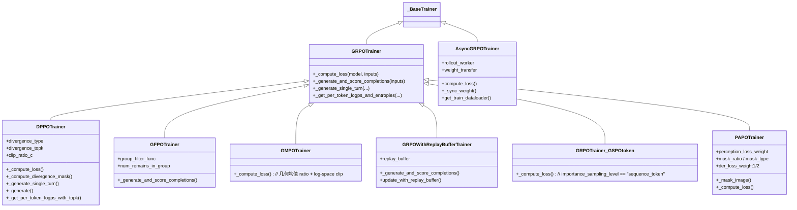
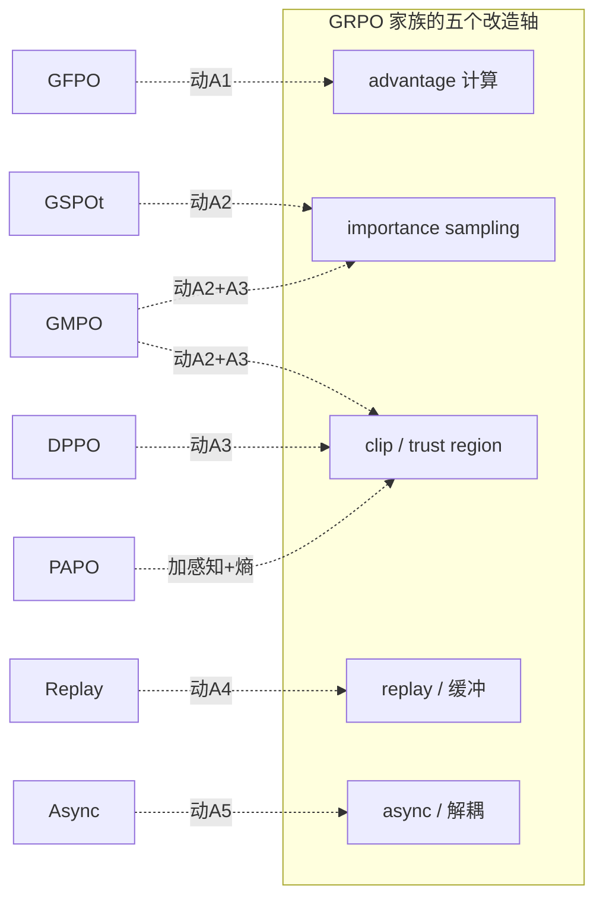

# 09 · 实验性训练器 · GRPO 家族

> 本篇导览：TRL 在 `trl/experimental/` 下存放了一批尚未稳定的 GRPO 变体训练器，它们围绕"无 value model 的 PPO"这条主线，分别从信赖域、importance sampling、组内采样、replay、多模态感知、异步生成等不同维度做改造。家族成员几乎都直接继承 `GRPOTrainer`/`GRPOConfig`，且多数只重写 `_compute_loss`——这正是 GRPO 自包含设计带来的红利：改一个方法就能换一种算法。本篇先给速览表，再用类图与差异点流程图把家族脉络串起来，最后逐个深入剖析成员、给出最小配置示例。

> 核心问题：
> - 实验区训练器和稳定区的 `GRPOTrainer` 是什么关系？为什么多数成员只重写 `_compute_loss` 一个方法就够了？
> - DPPO 用"发散式信赖域"替代 PPO clip 的数学动机是什么？为什么必须配 `loss_type="dapo"`？
> - GMPO 把算术均值 ratio 换成几何均值后，为什么需要更宽的 clip `exp(±0.4)`？
> - GSPO-token 的 `importance_sampling_level="sequence_token"` 是怎么用 stop-gradient 把序列权重逐 token 应用的？
> - AsyncGRPO 为什么不是 `GRPOTrainer` 的子类，而要完全自实现 GRPO loop？

---

## 一、家族成员速览

| 训练器 | 算法 | arXiv | 基类 | 关键创新 |
|---|---|---|---|---|
| DPPO | Divergence Proximal Policy Optimization | 2602.04879 | `GRPOTrainer` | 发散式信赖域（TV/KL，binary/top-k）替代 clip，需 `loss_type="dapo"` |
| GFPO | Group Filter Policy Optimization | — | `GRPOTrainer` | `group_filter_func` + `num_remains_in_group`，组内 top-k 过滤 |
| GMPO | Geometric-Mean Policy Optimization | 2507.20673 | `GRPOTrainer` | 几何均值 importance ratio，log-space clip，宽 clip `exp(±0.4)` |
| GRPOWithReplayBuffer | GRPO + replay | — | `GRPOTrainer` | 高 advantage 缓冲，零方差组替换 |
| GSPO-token | Group Sequence Policy Optimization - token | 2507.18071 | `GRPOTrainer`（仅重写 `_compute_loss`） | `importance_sampling_level="sequence_token"`，stop-gradient 序列权重逐 token 应用 |
| PAPO | Perception-Aware Policy Optimization | 2507.06448 | `GRPOTrainer` | 多模态，image masking 隐式感知损失 + 双熵正则 |
| AsyncGRPO | Asynchronous GRPO | 2402.03300（GRPO 论文） | `_BaseTrainer`（自实现 GRPO loop） | rollout 与训练解耦，独立 vLLM server + 心跳 + staleness 控制 |

注意表里有一个例外：**AsyncGRPO 不是 `GRPOTrainer` 的子类**，它直接继承 `_BaseTrainer`，把生成、奖励计算、loss 全部重写——因为它要在子进程里跑 rollout、跨进程共享 vLLM 权重，已经无法复用 `GRPOTrainer` 的同步 rollout 路径。其它六个成员都是 `GRPOTrainer` 子类，且其中五个（GFPO、GMPO、GRPOWithReplayBuffer、GSPO-token、PAPO）只覆盖一个方法（`_compute_loss` 或 `_generate_and_score_completions`），DPPO 因为需要采集 top-K logprobs，额外重写了 `_generate_single_turn` / `_tool_call_loop` / `_generate` 三个生成相关方法。

---

## 二、家族继承与重写关系



**图说明**：图中明确显示家族分成两支——一支是 `GRPOTrainer` 的子类（DPPO/GFPO/GMPO/GRPOWithReplayBuffer/GSPO-token/PAPO），覆盖的方法用 `()` 列出；另一支是 AsyncGRPO，直接挂在 `_BaseTrainer` 下，与 `GRPOTrainer` 平级。覆盖范围从最轻的 GMPO/GSPO-token（仅 `_compute_loss`，约 100 行）到最重的 DPPO（生成路径要透传 top-K logprobs，约 1400 行新增/重写）差异很大。

---

## 三、各成员深入剖析

### 3.1 DPPO：发散式信赖域替代 PPO clip

DPPO（trl/experimental/dppo/dppo_trainer.py，行号基于 2026-07 探索）的核心论点是：PPO/GRPO 那种基于概率比 `π/μ` 的硬 clip 是"启发式"的——它对低概率 token 过度惩罚、对高概率 token 惩罚不足。DPPO 改成直接对"策略分布发散度"做硬阈值：当 `π` 与采样分布 `μ` 的 TV 或 KL 超过阈值 `delta_high`（正 advantage）或 `delta_low`（负 advantage）时，把该 token 在 loss 里 mask 掉。

`divergence_type` 取值 `{binary_tv, binary_kl, topk_tv, topk_kl}`（dppo_config.py:54）。`binary_*` 只看采样 token 本身那一维的概率差或 Bernoulli KL；`topk_*` 则取 top-K 个 token 加一个"剩余概率桶"算离散分布的 TV/KL，需要 vLLM 在生成时返回 `divergence_topk`（默认 20）个 logprobs。`clip_ratio_c`（默认 20.0）是对 IS ratio `r = exp(log π - log μ)` 的上界保护，防止极端 token 把梯度炸掉。`_compute_loss` 的核心就是（dppo_trainer.py:1356-1367）：

```python
ratio = torch.exp(log_ratio.clamp(max=math.log(self.clip_ratio_c))).detach()
divergence_mask = self._compute_divergence_mask(
    per_token_logps, sampling_per_token_logps, advantages, mask,
    current_topk_logps=current_topk_logps, sampling_topk_logps=sampling_topk_logps,
)
per_token_loss = -advantages * ratio * divergence_mask * per_token_logps
```

要求 `loss_type="dapo"` 的原因（dppo_config.py:108）：DPPO 的 mask 是逐 token 的硬掩码，被 mask 掉的 token 不应再参与分母归一化——`dapo` 用 `num_items_in_batch` 作 normalizer（按未 mask 的 token 数求和），而 `grpo`/`bnpo`/`dr_grpo` 都是按 `completion_mask.sum()` 归一化，会把被发散 mask 掉的 token 也算进分母，稀释梯度。

### 3.2 GFPO：组内过滤采样

GFPO（trl/experimental/gfpo/gfpo_trainer.py）的算法不复杂，但工程接口值得记。它通过 `group_filter_func: Callable[[list[list[Any]], list[list[Any]]], list[list[float]]]` 让用户传一个自定义打分函数，输入是"按组整理的 completions"和"按组整理的 rewards"，输出是每组每个 completion 的过滤分数。然后 trainer 在 `_generate_and_score_completions` 里 `torch.topk` 取每组前 `num_remains_in_group` 个：

```python
group_filter_scores = self.group_filter_func(
    group_completions=[all_completions[i:i+self.num_generations] for i in ...],
    group_rewards=rewards.view(-1, self.num_generations).tolist(),
)
_, group_local_indices = torch.topk(group_filter_scores, self.num_remains_in_group, dim=-1)
```

典型过滤策略是把"长度归一化奖励"或"组内排名"当 filter score——先按 `num_generations`（如 16）正常采样，再过滤到 `num_remains_in_group`（如 8）参与训练，用更便宜的过滤策略替代提高 `num_generations` 的采样成本。注意它没有重写 `_compute_loss`，只是把 GRPO 的输入张量按保留索引切片了一遍（gfpo_trainer.py:384-405），advantage 重算时 `num_in_group = num_remains_in_group`，保证 mean/std 都在保留子集上算。

### 3.3 GMPO：几何均值 importance ratio

GMPO（trl/experimental/gmpo/gmpo_trainer.py，论文 https://huggingface.co/papers/2507.20673 ）的论点是：GRPO 把 token-level ratio 求算术均值做 sequence-level loss，但算术均值对离群 token 极其敏感（一个 `r=10` 的 token 会主导整个序列权重）。GMPO 改用**几何均值**：

```
GM = (∏_t r_t)^{1/T}  ⇔  log GM = (1/T) Σ_t log r_t
```

代码体现就是先在 log-space 逐 token clip，再对 log-ratio 求 mask 内的算术均值（等价于 ratio 的几何均值），最后 `exp` 回去（gmpo_trainer.py:87-103）：

```python
clamped_log_ratio = torch.clamp(log_ratio, min=-self.epsilon_low, max=self.epsilon_high)
clipped_log_ratio = torch.where(
    advantages_col > 0,
    torch.minimum(log_ratio, clamped_log_ratio),
    torch.maximum(log_ratio, clamped_log_ratio),
)
log_importance_weights = (clipped_log_ratio * seq_mask).sum(-1) / seq_mask.sum(-1).clamp(min=1.0)
coef = torch.exp(log_importance_weights)
per_sequence_loss = -coef * advantages
```

为什么用更宽的 clip `exp(±0.4)`（gmpo_config.py:33）？因为几何均值本身已经"压住"了离群 token 的影响——`r=10` 在算术均值里贡献 `+9`，在几何均值里只贡献 `+log 10 ≈ 2.3`——所以可以放宽 clip 鼓励探索，不至于像 GRPO 那样 `ε=0.2` 把 ratio 锁死在 `[0.8, 1.2]`。注意 GMPO 还可选 `top_entropy_quantile < 1.0` 把低熵 token 从几何均值里剔除，因为低熵 token 的 ratio 本就接近 1，把它们算进分母只会稀释信号。

### 3.4 GRPOWithReplayBuffer：高 advantage 缓冲 + 零方差组替换

GRPOWithReplayBuffer（trl/experimental/grpo_with_replay_buffer/grpo_with_replay_buffer_trainer.py）解决的是 GRPO 的一个老问题：当一组 G 个 completion 的 reward 方差为零（全对或全错）时，advantage 全为 0，这一组白采样了。它的对策是维护一个 min-heap `ReplayBuffer`（grpo_with_replay_buffer_trainer.py:29-58），大小由 `replay_buffer_size`（默认 64）控制。

策略分两步：(1) 把当前 batch 里"有方差的组"按 `(abs(advantage) * std_reward).sum()` 打分塞进缓冲（line 564，高 advantage + 高方差的组学习信号最强）；(2) 当前 batch 里"零方差的组"被采样自缓冲的样本替换掉（line 675-683 `num_groups_to_replace`）。替换时还要做长度对齐的 pad：被替换进来的组如果比当前 batch 长，整批 tensor 要 left-pad 一次（line 699-722），避免截断。

### 3.5 GSPO-token：stop-gradient 序列权重逐 token 应用

GSPO-token（trl/experimental/gspo_token/grpo_trainer.py，论文 https://huggingface.co/papers/2507.18071 ）介于 token-level IS 和 sequence-level IS 之间。token-level IS（GRPO 默认）每个 token 独立 ratio，方差大；sequence-level IS 把整个序列的 log-ratio 求均值当一个权重，方差小但偏置大。GSPO-token 的做法是：先算序列级 log 权重 `si(θ)`，但**只把它的 stop-gradient 版本逐 token 应用**（grpo_trainer.py:77-81）：

```python
elif self.importance_sampling_level == "sequence_token":
    # GSPO-token: sg[si(θ)] * πθ(yi,t)/sg[πθ(yi,t)]
    seq_level_log_weight = (log_ratio * completion_mask).sum(-1) / completion_mask.sum(-1).clamp(min=1.0)
    seq_level_log_weight = seq_level_log_weight.detach().unsqueeze(-1)  # Stop gradient
    log_importance_weights = per_token_logps - per_token_logps.detach() + seq_level_log_weight
```

展开看就是 `log_importance_weights = sg[si(θ)] + log πθ(yi,t) - sg[log πθ(yi,t)]`，即 `sg[si(θ)] · πθ(yi,t) / sg[πθ(yi,t)]`。`sg[·]` 表示 stop-gradient——序列级权重 `si(θ)` 只贡献缩放系数，梯度不通过它回流；真正承载梯度的是逐 token 的 `πθ(yi,t) / sg[πθ(yi,t)]`。这样既享受了序列级 IS 的低方差，又保留了 token-level loss 的细粒度梯度。loss 主体仍是 GRPO 的 `min(coef_1·A, clip(coef_1)·A)` 形式（grpo_trainer.py:97-99）。

### 3.6 PAPO：多模态 + 隐式感知损失 + 双熵正正则

PAPO（trl/experimental/papo/papo_trainer.py，论文 https://huggingface.co/papers/2507.06448 ）是 GRPO 家族里唯一显式多模态的成员。它的核心创新是把"图像被 mask 掉一部分后的输出分布"和"原图输出分布"做 KL，作为隐式感知损失——逼模型在视觉信息残缺时还能保持稳定输出，相当于强迫它真的"看图"。

`mask_ratio`（默认 0.3）控制 mask 比例；`mask_type ∈ {random, patch, grid}`（papo_config.py:52-54）控制 mask 形状——random 是逐像素随机丢、patch 是连续矩形块、grid 是网格状丢弃。`_compute_loss` 里先做一次正常 forward 拿 `per_token_logps`，再把 `pixel_values` mask 掉重做一次 forward 拿 `mask_img_per_token_logps`，然后（papo_trainer.py:307-317）：

```python
perception_kl = (
    torch.exp(mask_img_per_token_logps - per_token_logps)
    - (mask_img_per_token_logps - per_token_logps) - 1
)
perception_kl = torch.clamp(perception_kl, min=0.0, max=0.2)
perception_loss = self.perception_loss_weight * perception_kl
der_loss = self.der_loss_weight1 * entropies + self.der_loss_weight2 * mask_img_entropies
loss = (loss - perception_loss + der_loss).mean()
```

`perception_kl` 被 clamp 到 `[0, 0.2]` 防止 mask 太狠时梯度爆炸。双熵正则（Double Entropy Regularization）`der_loss = w1·H(original) + w2·H(masked)` 同时压低两次 forward 的熵，配合 `der_loss_weight1/2`（默认都 0.03）控制强度。`loss_type` 可选 `grpo` 或 `dapo`，分别对应 PAPO-G / PAPO-D 两个变体。

### 3.7 AsyncGRPO：rollout 与训练解耦

AsyncGRPO（trl/experimental/async_grpo/async_grpo_trainer.py，行号基于 2026-07 探索）是家族里架构最特殊的一个。它**不是 `GRPOTrainer` 子类**，直接继承 `_BaseTrainer`，因为生成不在 trainer 进程里做——而是交给一个独立的 `AsyncRolloutWorker` 子进程（async_rollout_worker.py:764），子进程里 `CUDA_VISIBLE_DEVICES=""` 不占 GPU，只跑 reward 函数和与外部 vLLM server 通信。Trainer 主进程只负责梯度更新。

权重同步走 `WeightTransferClient`（weight_transfer.py:32），用 vLLM 的 `NCCLWeightTransferEngine` 通过 NCCL group 把训练进程的权重 push 到 vLLM server（weight_transfer.py:92-122）。`_sync_weight` 由 `StepIntervalCallback` 每隔 N 步触发（async_grpo_trainer.py:87-98）。

控制 staleness 的关键是 `RolloutQueueDataset`（async_grpo_trainer.py:132-175）：它从 `rollout_buffer` queue 里拉样本，算 `staleness = current_version - sample.model_version`，超过 `max_staleness`（默认 4）就丢弃。`max_inflight_tasks` 默认 `-1`，会自动设成 `max_staleness * samples_per_step`，避免生成超过消费能力造成浪费。子进程 liveness 由共享的 `mp.Value('d')` 心跳值监控（async_rollout_worker.py:797-883），主进程每次 `queue.get` 超时后会调用 `check_health(stale_after_s)`（默认 300s），如果心跳年龄超过阈值就 raise `RuntimeError("Rollout worker heartbeat stale")`，避免训练卡死在空队列上。Trainer 还重写了 `compute_loss`（async_grpo_trainer.py:728）和 `get_train_dataloader`（line 661），把数据源从 dataset 换成 `RolloutQueueDataset`。

---

## 四、算法差异点定位



**图说明**：横轴是 GRPO 算法的五个关键改造点。DPPO 只动 trust region（把 clip 换成发散 mask），GFPO 只动 advantage 上游（组内过滤），GMPO 同时动 IS（几何均值）和 clip（log-space 宽 clip），GSPO-token 只动 IS（序列- token 混合），PAPO 在 trust region 之外**新增**了感知损失和双熵正则（不是替换而是叠加），AsyncGRPO 完全动 async 轴（其它六个都是同步生成）。注意没有任何一个成员同时动两个以上轴——这正是 GRPO 自包含设计的好处：每篇论文只改一个维度，fork 一份 `GRPOTrainer` 子类就能验证。

---

## 五、共性：自 contained 设计的红利

从上面七个成员可以看出一个明显的规律：

- **GFPO、GMPO、GRPOWithReplayBuffer、GSPO-token、PAPO 都只覆盖一个方法**（`_compute_loss` 或 `_generate_and_score_completions`），其余 99% 的代码（vLLM 生成、权重同步、奖励计算、metric logging）全部继承自 `GRPOTrainer`。
- **DPPO 例外**：因为它要在生成阶段就把 top-K logprobs 取出来（vLLM 的 `logprobs=K` 参数），所以 `_generate_single_turn` / `_tool_call_loop` / `_generate` 都要改一遍透传 top-K 数据。即便如此，loss 主体还是只动了 `_compute_loss`。
- **AsyncGRPO 是彻底的例外**：架构差异太大（跨进程、跨 NCCL、queue-based dataset），无法靠覆盖一两个方法实现，只能 fork 一份。
- 所有成员的 `Config` 都继承 `GRPOConfig`，只追加自己专有的字段（`divergence_type`、`mask_type`、`replay_buffer_size` 等），通用字段（`epsilon`、`beta`、`loss_type`、`scale_rewards`）全部继承。

这种"基类提供脚手架，子类只换 loss"的模式，正是仓库 AGENTS.md 里强调的"自 contained 训练器"哲学的最直接受益者——一份稳定的 `GRPOTrainer` 让 6 篇论文各自加 100-400 行就能跑起来。

---

## 六、上手示例

下面给一个 PAPO 的最小配置（多模态 VLM，启用 patch mask + 双熵正则）：

```python
from datasets import load_dataset
from trl.experimental.papo import PAPOTrainer, PAPOConfig

dataset = load_dataset("your-vlm-dataset", split="train")

# PAPO-D 变体：以 DAPO 为底座
config = PAPOConfig(
    loss_type="dapo",          # 或 "grpo" 走 PAPO-G
    perception_loss_weight=0.1,
    mask_ratio=0.3,
    mask_type="patch",         # 连续矩形 patch mask
    der_loss_weight1=0.03,
    der_loss_weight2=0.03,
    epsilon=0.2,               # GRPOConfig 继承字段，DAPO clip 仍生效
    beta=0.0,                   # 不加载 ref model
)

trainer = PAPOTrainer(
    model="Qwen/Qwen2-VL-2B-Instruct",
    reward_funcs=my_reward_func,
    args=config,
    train_dataset=dataset,
)
trainer.train()
```

如果要切换成 DPPO，把 `PAPOConfig`/`PAPOTrainer` 换成 `DPPOConfig`/`DPPOTrainer`，并把 `divergence_type="topk_tv"`、`divergence_topk=20`、`clip_ratio_c=20.0`、`loss_type="dapo"` 设好即可——`epsilon`/`epsilon_high`/`beta` 等 GRPOConfig 字段不用动。

---

## 小结

- GRPO 家族 7 个成员里 6 个是 `GRPOTrainer` 子类，且其中 5 个仅重写一个方法——这是 GRPO 自 contained 设计的直接红利，每篇变体论文只需改 100-400 行。
- DPPO 把 PPO clip 换成"分布发散度硬掩码"，要求 `loss_type="dapo"` 是因为发散 mask 后被剔除的 token 不应再进归一化分母。
- GMPO 用几何均值 ratio（log-space clip + 算术 log-ratio 均值）替代算术均值，配 `exp(±0.4)` 的宽 clip 鼓励探索，因为几何均值本身已压住离群 token。
- GSPO-token 用 `sg[si(θ)] · πθ(yi,t) / sg[πθ(yi,t)]` 把序列级 IS 权重以 stop-gradient 形式逐 token 应用，兼顾序列 IS 的低方差与 token-level loss 的细粒度梯度。
- AsyncGRPO 是唯一不自 `GRPOTrainer` 继承的成员：跨进程 rollout worker + NCCL 权重传输 + queue 数据集 + 心跳/staleness 监控，是架构层面的彻底解耦。

下一篇 [10 · 实验性训练器 · DPO 偏好家族](10_分_实验性训练器_DPO偏好家族.md) ...
