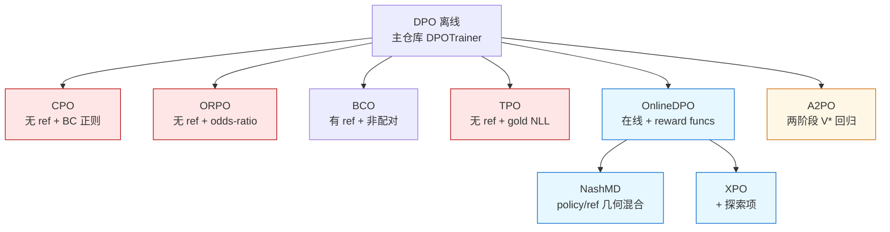
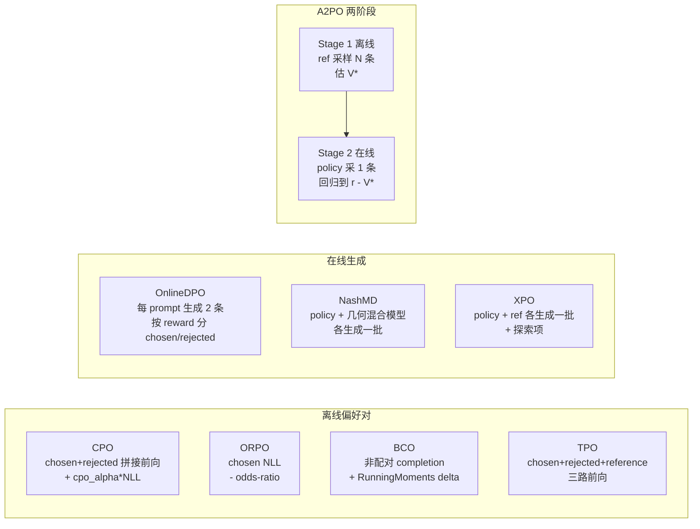

# 10 · 实验性训练器 · DPO 偏好家族

> 本篇导览：TRL 的 `trl/experimental/` 子树是一块"算法沙盒"——稳定版 `DPOTrainer` 之外，一批围绕"偏好学习"的新算法以独立 trainer 的形式落草。本篇梳理这条 DPO 偏好家族：CPO / ORPO / BCO / TPO / OnlineDPO / NashMD / XPO / A2PO，重点对比它们各自的"损失创新点""是否需要参考模型""配对还是非配对""在线还是离线"，以及它们在源码里如何复用与分歧。

> 核心问题：
> - 这八个 trainer 都叫"偏好优化"，它们与主仓库的 `DPOTrainer` 是继承关系还是平级重写？
> - 哪些走在线生成（边训边采样），哪些走离线偏好对（一次性读 dataset）？哪些需要 ref 模型，哪些不需要？
> - CPO 的 5 种 `loss_type` 与 `cpo_alpha` / `alpha` 三个旋钮到底各管什么？`alphapo` 是新算法还是语法糖？
> - OnlineDPO 的家族（NashMD / XPO）是怎么在父类 `training_step` 上"打补丁"换损失、换生成源的？
> - A2PO 的"两阶段"是怎么把 V\* 离线估计和在线回归拼到同一个 `_BaseTrainer` 子类里的？

---

## 一、家族定位与共性

`trl/experimental/` 下的训练器**不稳定**：API、默认值、损失公式都可能在版本间变动。其中 DPO 偏好家族包含 8 个成员，全部与 DPO 算法同源（都是"用偏好信号直接微调策略、绕过显式奖励模型 + PPO"），但每个都有自己的创新点。

一个关键共性：**它们大多不继承 `DPOTrainer`，而是直接继承 `_BaseTrainer` / `_BaseConfig`**，各自重写 `compute_loss` 或 `training_step`，复制一份 chosen/rejected 拼接前向的逻辑。这与本仓库 AGENTS.md 强调的"trainer 自包含、可读、可独立修改"设计一致——代价是冗余，收益是每个 trainer 都能从上到下读通。

例外是 NashMD / XPO：它们继承 `OnlineDPOTrainer`，复用其生成与统计基础设施，只覆盖 `training_step` 与损失计算。

### 家族成员表

| 训练器 | 算法 | arXiv | 基类 | 关键创新 |
|---|---|---|---|---|
| CPO | Contrastive Preference Optimization | 2401.08417 | `_BaseConfig` | sigmoid/hinge/ipo/simpo/alphapo + BC 正则 `cpo_alpha` |
| ORPO | Monolithic Preference Optimization | 2403.07691 | `_BaseConfig` | SFT NLL + odds-ratio，无 ref 模型 |
| BCO | Binary Classifier Optimization | 2404.04656 | `_BaseConfig` | 非配对密度比二分类器 |
| TPO | Triple Preference Optimization | 2405.16681 | `_BaseConfig` | 偏好损失 + NLL on gold + `tpo-l` margin |
| OnlineDPO | Online DPO | 2402.04792 | `_BaseConfig` | 在线生成 + DPO 损失，`missing_eos_penalty` |
| NashMD | Nash Learning from Human Feedback | 2312.00886 | `OnlineDPOConfig` | OnlineDPO + `mixture_coef` policy/ref 混合 |
| XPO | Exploratory Preference Optimization | 2405.21046 | `OnlineDPOConfig` | OnlineDPO + 探索项 `alpha`，Q\*-approx |
| A2PO | A\*-PO / Optimal Advantage Regression | 2505.20686 | `_BaseTrainer` | 两阶段：V\* 离线估计 + 回归 |

---

## 二、家族谱系与训练循环对比



**图说明**：上图为 DPO 偏好家族的算法谱系。红色节点表示"无参考模型"——CPO/ORPO/TPO 直接用策略自身对数概率，省掉了 ref 模型的显存与 forward；蓝色节点表示"在线生成"——每个 step 都用当前策略采样再算损失；橙色 A2PO 既在线又两阶段。NashMD 与 XPO 显式继承 `OnlineDPOTrainer`，其余 trainer 仅与 `_BaseTrainer` 同级、不共享 DPO 主类。



**图说明**：上图为各家族成员的训练循环对比。离线组直接消费数据集里的 chosen/rejected 对；在线组每个 `training_step` 都先采样再算损失，因此源码里都有 `unwrap_model_for_generation` 上下文与 vLLM 同步逻辑；A2PO 是混合形态——Stage 1 在 `train()` 入口跑一遍 ref 模型缓存 V\*，Stage 2 才进入正常的 `training_step`。

---

## 三、CPO：5 种损失 + BC 正则

源码：`trl/experimental/cpo/cpo_trainer.py`（行号基于 2026-07 探索）。`CPOTrainer(_BaseTrainer)` 不带参考模型——`cpo_loss`（677-748 行）只接受 `policy_chosen_logps` / `policy_rejected_logps`，没有 ref 项：

```python
# cpo_trainer.py:714-732（简化）
if self.loss_type == "simpo":
    gamma_logratios = self.simpo_gamma / self.beta
    logits = logits - gamma_logratios
    losses = -F.logsigmoid(self.beta * logits) * (1 - self.label_smoothing) \
             - F.logsigmoid(-self.beta * logits) * self.label_smoothing
elif self.loss_type == "sigmoid":
    losses = -F.logsigmoid(self.beta * logits) * (1 - self.label_smoothing) \
             - F.logsigmoid(-self.beta * logits) * self.label_smoothing
elif self.loss_type == "hinge":
    losses = torch.relu(1 - self.beta * logits)
elif self.loss_type == "ipo":
    losses = (logits - 1 / (2 * self.beta)) ** 2
```

5 种 `loss_type`：`sigmoid`（DPO 式）、`hinge`（SLiC 式）、`ipo`（IPO 回归式）、`simpo`（带 `simpo_gamma` 目标 margin 的 SimPO）、`alphapo`。`alphapo` 实为语法糖——`cpo_config.py` 的 `__post_init__` 把它改写成 `loss_type="simpo"` 并把 `cpo_alpha` 强制设为 `0.0`，所以走的是 SimPO 损失且不加 BC 正则。

总损失在 `get_batch_loss_metrics` 末尾合成（889 行）：

```python
loss = losses.mean() + self.cpo_alpha * policy_nll_loss
```

`cpo_alpha`（默认 `1.0`）控制 BC/SFT 正则强度——`policy_nll_loss` 是 chosen 序列上的 cross-entropy，对齐 BC 项；设为 0 时纯偏好损失。另设独立 `alpha`（默认 `0.0`）做 AlphaPO 奖励整形：`r = (1 - p^(-alpha)) / alpha`，对 chosen/rejected 概率分别变换后再走 sigmoid（696-705 行），用于缓解长序列对数概率偏低问题。注意三个旋钮语义独立：`cpo_alpha` 管正则、`alpha` 管奖励形状、`loss_type` 管损失形式。

---

## 四、ORPO：无参考模型 + 单体损失

源码：`trl/experimental/orpo/orpo_trainer.py`。ORPO 的核心卖点是"无 ref 模型"——通过把 SFT 的 NLL 直接编进偏好损失，省掉第二份模型显存。损失（851 行）：

```python
loss = policy_nll_loss - losses.mean()
```

`policy_nll_loss` 是 chosen 序列（含 prompt）的 cross-entropy，`losses` 是 `odds_ratio_loss` 返回的相对概率比惩罚（700 行）：

```python
log_odds = (policy_chosen_logps - policy_rejected_logps) \
         - (log1mexp(policy_chosen_logps) - log1mexp(policy_rejected_logps))
ratio = F.logsigmoid(log_odds)
losses = self.beta * ratio
```

`log1mexp` 是数值稳定的 `log(1 - exp(x))` 实现（88-92 行）。`beta` 即论文中的 λ（ORPO 论文里 code 中又叫 `alpha`），控制 odds-ratio 项的权重——NLL 主导训练，odds-ratio 项负责"拉远 chosen 与 rejected"。整个 trainer 没有任何 `ref_model` 字段，`__init__` 里也不创建参考模型，显著区别于 CPO/BCO/OnlineDPO。

---

## 五、BCO：非配对偏好 + 密度比分类器

源码：`trl/experimental/bco/bco_trainer.py`。BCO 处理**非配对**偏好数据——每条样本只有 `prompt + completion + label`（label=True/False），不存在显式 chosen/rejected 对。`maybe_unpair_preference_dataset` 会把配对数据自动拆成非配对形式。

`bco_loss`（1219-1273 行）核心是用 `RunningMoments` 维护一个全局滑动均值 `delta`，把 chosen/rejected 的奖励校准到同一尺度：

```python
chosen_losses  = -F.logsigmoid(chosen_rewards - delta)
rejected_losses = -F.logsigmoid(-(rejected_rewards - delta))
```

`delta` 通过 `running.update(torch.cat((chosen_rewards, rejected_rewards), 0))` 在训练中持续更新（1259 行），可随 checkpoint 持久化。

可选的 UDM（Underlying Distribution Matching）机制：当 chosen/undesirable 的 prompt 分布不一致时，BCO 用一个 `LogisticRegression` 二分类器估计"该 prompt 来自 desirable 分布的概率"，对 rejected loss 做密度比加权（`_get_udm_weight`，1210-1217 行）：

```python
weight = (prob_desirable / (1 - prob_desirable + 1e-8)).clamp(min=min_ratio, max=max_ratio)
```

`prompt_sample_size`（默认 1024）控制分类器训练采样数；`min_density_ratio` / `max_density_ratio`（默认 0.5 / 10.0）夹紧权重防止爆炸。BCO 仍是"有 ref 模型"的——`__init__` 默认 `create_reference_model(model)`（603 行），与 DPO 主线一致。

---

## 六、TPO：三目标 + TPO-L margin

源码：`trl/experimental/tpo/tpo_trainer.py`。TPO 要求**三元组数据**：`chosen` / `rejected` / `reference`（gold），由 `DataCollatorForTriplePreference` 把三条序列拼成 `[chosen, rejected, reference]` 一批前向（n_branches=3）。

`_compute_loss`（628-771 行）三个目标：

1. **偏好损失**：`delta_score = chosen_logps - rejected_logps`，按 `loss_type`（sigmoid/hinge/ipo/tpo-l）算（663-688 行）。注意 TPO 不减 ref 模型 logp——`reference` 列是 gold response，不是参考策略。
2. **NLL on gold**：`tpo_alpha * F.cross_entropy(ref_logits[ref_mask], ref_labels[ref_mask])`（696-702 行），`tpo_alpha`（默认 1.0）控制权重。设为 0 时 collator 自动 drop reference 分支，n_branches 退化为 2，省一次前向。
3. **TPO-L margin**：`loss_type="tpo-l"` 时引入 `tpo_l_gamma / beta` 作为目标 reward margin（676-683 行），等价于 SimPO 的长度归一化 + margin 思路，对长序列更鲁棒。

`tpo_l_gamma`（默认 0.5）控制 margin 大小。整体看 TPO 把 SFT（gold NLL）与偏好学习放进单一损失，避免 DPO 类方法"对齐但能力下降"的问题。

---

## 七、OnlineDPO：在线生成家族的基石

源码：`trl/experimental/online_dpo/online_dpo_trainer.py`。`OnlineDPOTrainer(_BaseTrainer)` 完全重写 `training_step`（1097-1296 行），每个 step 都先采样再算损失：

1. **生成**：`use_vllm=True` 走 `_generate_vllm`（server 或 colocate 两种模式），否则走 transformers `model.generate`。每个 prompt 生成 **2 条** completion（`num_generations = 2`，358 行）。
2. **打分**：用 `reward_funcs`（奖励模型或 callable）给 2 条 completion 打分，**高的当 chosen、低的当 rejected**（1204-1209 行）：
   ```python
   first_half, second_half = rewards.split(batch_size)
   mask = first_half >= second_half
   chosen_indices = batch_range + (~mask * batch_size)
   rejected_indices = batch_range + (mask * batch_size)
   ```
3. **损失**：`logits = pi_logratios - ref_logratios`（1229 行），按 `loss_type`（sigmoid/ipo）算（1231-1236 行）。

`missing_eos_penalty`（1200-1201 行）对没生成 EOS 的 completion 减 reward，鼓励短回复。`beta` 是少有的支持 **list** 的实现（246-254 行），按 epoch 调度：

```python
@property
def beta(self):
    if isinstance(self._beta, list):
        epoch = self.state.epoch
        return self._beta[epoch] if epoch < len(self._beta) else self._beta[-1]
    return self._beta
```

vLLM 同步是 OnlineDPO 最复杂的部分：`_move_model_to_vllm`（765-839 行）在每次 gradient accumulation 结束后把训练侧权重同步到 vLLM 推理引擎，FSDP1/FSDP2/DeepSpeed ZeRO-3 各有专门路径，PEFT 还要 `merge_adapter` → 同步 → `unmerge_adapter`。

---

## 八、NashMD：policy/ref 几何混合

源码：`trl/experimental/nash_md/nash_md_trainer.py`。`NashMDTrainer(OnlineDPOTrainer)` 复用父类的初始化与统计基础设施，只覆盖 `training_step` 与生成路径。核心创新是 `GeometricMixtureWrapper`（48-103 行），把 policy 与 ref 的 logits 做几何混合再采样：

```python
# nash_md_trainer.py:85-87
model_outputs.logits = torch.nn.functional.log_softmax(
    self.mixture_coef * ref_model_logits + (1 - self.mixture_coef) * model_logits, dim=-1
)
```

`mixture_coef`（默认 0.5）控制混合权重，支持 list 按 epoch 调度（228-234 行）。NashMD 每个 step 生成两批 completion——一批纯 policy、一批混合模型（`_generate_completions`，236-289 行）——然后用 reward model 给两批打分，按 `F.sigmoid(model_scores - mixture_scores)` 算 probability 作为 control variate（471 行）。

损失（`_compute_losses`，361-379 行）与 OnlineDPO 的 sigmoid DPO 完全不同，走的是 reinforce + KL 形式：

```python
score = (probability - 0.5) * model_logprobs_model_data.sum(1)
kl_div_loss = (log_ratio * model_logprobs_model_data).sum(1)
loss = self.beta * kl_div_loss - score
```

这是 Nash Learning from Human Feedback 论文里"自我博弈收敛到纳什均衡"思路的实现——probability 是 0.5-centered 的优势，KL 项防止策略跑偏。

---

## 九、XPO：探索项 + 隐式 Q\*-近似

源码：`trl/experimental/xpo/xpo_trainer.py`。`XPOTrainer(OnlineDPOTrainer)` 同样复用父类，但损失结构与 NashMD 又不同。每个 step 生成两批 completion——一批 policy、一批 ref（`_generate_completions`，188-226 行），然后按 reward 分 chosen/rejected。

`_compute_losses`（305-343 行）= DPO 损失 + 探索项：

```python
# DPO 损失（标准 sigmoid/ipo）
logits = chosen_log_ratios - rejected_log_ratios
dpo_losses = -F.logsigmoid(self.beta * logits)  # sigmoid 分支
# XPO 探索项：鼓励策略给 ref 生成的 completion 高概率
xpo_losses = self.alpha * model_logprobs_ref_data_sum
loss = (dpo_losses + xpo_losses).mean()
```

`alpha`（默认 1e-5）控制探索强度，支持 list 按 epoch 调度（180-186 行）。探索项让策略"主动访问 ref 模型会生成但 reward 未知的区域"——对应论文里的 implicit Q\*-approximation：DPO 主项负责利用、XPO 项负责探索，二者结合保证样本效率。stats 里 `loss/dpo` 与 `loss/xpo` 分开记录便于调参。

---

## 十、A2PO：两阶段 V\* 回归

源码：`trl/experimental/a2po/a2po_trainer.py`。`A2POTrainer(_BaseTrainer)` 是家族里唯一的两阶段算法，逻辑放在 `train()` 与 `_prepare_inputs` 里：

**Stage 1：离线 V\* 估计**（`_estimate_optimal_values`，212-275 行）。训练前对每个 prompt 用 ref 模型采 `num_value_samples`（默认 8）条 completion，用 reward funcs 打分，按 logsumexp 估最优值：

```python
# a2po_trainer.py:255-256
# V*(x) = beta1 * log(mean_i exp(r_i / beta1)), computed stably
v_star = beta1 * (torch.logsumexp(rewards / beta1, dim=1) - math.log(n))
```

`beta1`（默认 0.5）是 V\* 的 KL 温度。V\* 以 `dict[prompt_text, float]` 形式跨 rank `gather_object` 共享，并可 `filter_all_incorrect` 丢弃全错 prompt（无学习信号）。

**Stage 2：在线回归**（`_prepare_inputs` + `compute_loss`，278-348 行）。每 step 用当前 policy 采 1 条 completion，算 `implicit_reward = beta2 * (policy_logps - ref_logps)`，回归到最优优势：

```python
# a2po_trainer.py:342-344
implicit_reward = self.args.beta2 * (policy_logps - inputs["ref_logps"])
target = inputs["rewards"] - inputs["v_star"]
loss = ((implicit_reward - target) ** 2).mean()
```

`beta2`（默认 1e-3）是 Stage 2 的 KL 温度。A2PO 假设 reward 是二值（`{0,1}`），通过最小化 `||beta2·log(π/π_ref) - (r - V*)||²` 直接回归到 A\*-PO 论文里的最优优势函数，避开 DPO 的 sigmoid BT 假设。Stage 1 在 `train()` 入口被显式触发（358-362 行），也支持 `evaluate()` 时懒加载（`_prepare_inputs` 里检测 `_optimal_values is None`）。

---

## 十一、共性小结

家族成员虽多，结构上有几条共性值得记住：

- **配置基类**：除 NashMD/XPO 继承 `OnlineDPOConfig` 外，其余 6 个都直接继承 `_BaseConfig`，与 `DPOConfig` 平级——这意味着 DPO 主仓库里的 `f_divergence_type`、`reference_free`、`sync_ref_model` 等高级特性**不自动可用**，每个实验 trainer 都得自己复制。
- **训练循环自包含**：8 个 trainer 都重写 `compute_loss` 或 `training_step`，复制 chosen/rejected 拼接前向、`get_batch_logps`、metrics 累积等逻辑；OnlineDPO/NashMD/XPO/A2PO 还各自维护 `self.stats` / `self._metrics` 字典在 `log()` 里聚合，与主仓库 DPOTrainer 的 `_stored_metrics` 命名不完全一致。
- **PEFT + ZeRO-3 处理**：CPO/ORPO/BCO/TPO 的 `__init__` 里都有一段几乎相同的 `autocast_adapter_dtype=False` 注释块（详见 AGENTS.md 关于 ZeRO-3 + PEFT 的说明），复制而非共享。
- **reward_funcs 接口**：OnlineDPO/NashMD/XPO/A2PO 都支持 `str | PreTrainedModel | Callable` 三态奖励函数，加载逻辑高度相似但各自实现。

---

## 上手示例：OnlineDPO 最小配置

```python
from datasets import Dataset
from transformers import AutoTokenizer
from trl.experimental.online_dpo import OnlineDPOConfig, OnlineDPOTrainer

# 1) 奖励函数：最简形式，返回 list[float]
def reward_func(prompts, completions, **kwargs):
    return [float(len(c) < 100) for c in completions]  # 鼓励短回复

# 2) 数据集：只需 prompt 列
dataset = Dataset.from_dict({"prompt": ["写一首关于春天的诗。"] * 64})

# 3) 配置：beta 支持 list 调度，每 epoch 一个值
args = OnlineDPOConfig(
    output_dir="./online-dpo-out",
    beta=[0.1, 0.05, 0.01],   # epoch 0/1/2 各用一个 beta，之后用最后一个
    loss_type="sigmoid",
    max_new_tokens=128,
    max_length=1024,
    missing_eos_penalty=1.0,  # 没生成 EOS 就扣 1 分
    use_vllm=True,
    vllm_mode="colocate",     # 与训练共享 GPU
    vllm_gpu_memory_utilization=0.4,
    per_device_train_batch_size=4,
    gradient_accumulation_steps=4,
    learning_rate=5e-7,
    num_train_epochs=3,
    bf16=True,
)

trainer = OnlineDPOTrainer(
    model="Qwen/Qwen2.5-0.5B-Instruct",
    reward_funcs=reward_func,
    args=args,
    train_dataset=dataset,
    processing_class=AutoTokenizer.from_pretrained("Qwen/Qwen2.5-0.5B-Instruct"),
)
trainer.train()
```

注意点：`use_vllm=True` 时必须在 `super().__init__` 之后才能初始化 vLLM 引擎（`_last_loaded_step = -1` 标记避免梯度累积中间重复同步）；`beta` 若只传一个值会被 `__post_init__` 自动展开成标量；`missing_eos_penalty` 是 reward 上的减项而非 loss 上的加权，与 `max_new_tokens` 配合可显著缓解"模型不收尾"的问题。

---

## 小结

- DPO 偏好家族 8 个成员**几乎都直接继承 `_BaseTrainer`**，不复用 `DPOTrainer`——这是 AGENTS.md "trainer 自包含"原则的体现，代价是 chosen/rejected 拼接前向、`get_batch_logps`、metric 累积等逻辑在每个 trainer 里各有一份拷贝，修改时需同步。
- **是否需要 ref 模型**是家族分水岭：CPO/ORPO/TPO 无 ref（直接用策略自身 logp），BCO/OnlineDPO/A2PO 有 ref（用 `create_reference_model` 或 PEFT adapter disable），NashMD/XPO 继承 OnlineDPO 因此也带 ref 并在生成时使用。
- **CPO 的三个旋钮**容易混淆：`cpo_alpha`（BC 正则权重）、`alpha`（AlphaPO 奖励整形系数）、`loss_type`（含 `alphapo` 语法糖=SimPO+`cpo_alpha=0`）；调试时务必分清。
- **OnlineDPO 是家族枢纽**：NashMD/XPO 都继承它，复用 vLLM 同步、reward_funcs、`missing_eos_penalty`、`beta` list 调度等基础设施，只在 `training_step` 与损失上分歧——这是实验性 trainer 里少见的"复用而非复制"。
- **A2PO 独特的两阶段**：Stage 1 用 ref 模型离线估 `V*(x) = beta1·log(mean exp(r/beta1))`，Stage 2 在线回归 `||beta2·log(π/π_ref) - (r - V*)||²`；这是家族里唯一明确"二值 reward + 回归式损失"的算法，绕开了 Bradley-Terry 假设。

下一篇 [11 · 实验性训练器 · 蒸馏家族](11_分_实验性训练器_蒸馏家族.md) 将转向 GKD / MiniLLM / SDFT / Distillation 等基于师生分布匹配的训练器，关注它们如何用 KL 散度与序列级 logp 实现 on-policy / off-policy 蒸馏。
