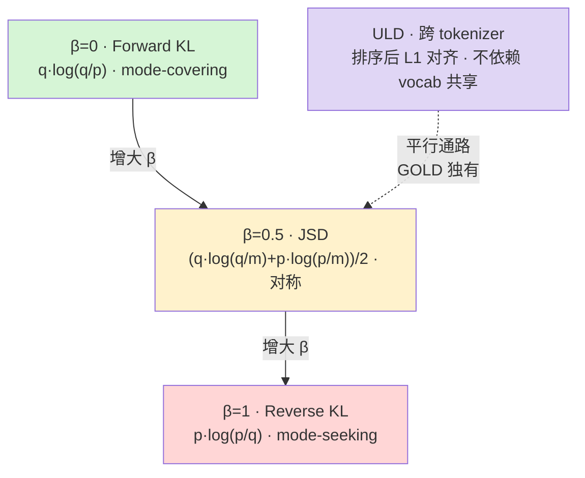
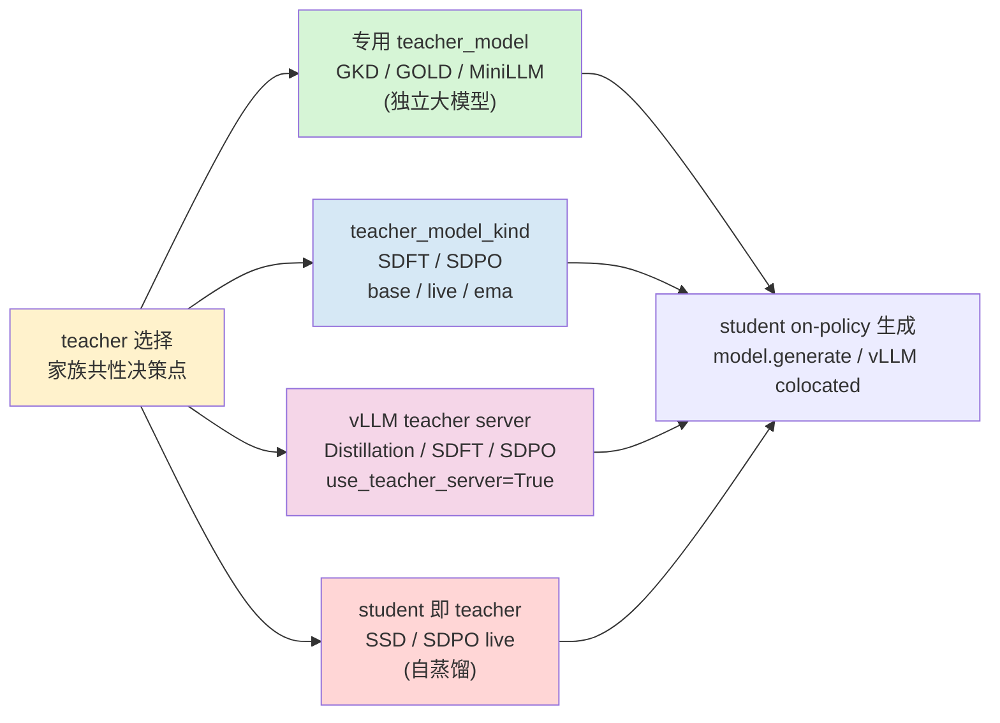

# 11 · 实验性训练器 · 蒸馏家族

> 本篇导览：实验区（`trl/experimental/`）里的训练器并不保证稳定，但它们是 TRL 探索新范式的前沿。本篇聚焦其中**蒸馏家族**——七个用大模型（teacher）蒸馏小模型（student）的训练器，它们共享同一套散度框架（forward KL / JSD / reverse KL / ULD），却各自做出不同的工程取舍：on-policy 比例怎么调、teacher 是谁、跨 tokenizer 怎么对齐、是否混合 RL。理解这七个，就理解了 on-policy 蒸馏的设计空间。

> 核心问题：
> - β 参数如何在 forward KL（mode-covering）、JSD（对称）、reverse KL（mode-seeking）之间插值？
> - 跨 tokenizer 蒸馏为什么需要 ULD（Universal Logit Distillation）和 byte-offset 对齐？
> - teacher 选择是家族的核心决策点：base / live / ema / vLLM-server / colocated 各自的含义与代价？
> - "自蒸馏"（SDFT/SDPO/SSD）与"标准蒸馏"（GKD/GOLD/Distillation/MiniLLM）的分水岭在哪？
> - 同一份 `generalized_jsd_loss` 在 GKD/GOLD/Distillation 三个训练器里几乎逐字复制，AGENTS.md 的"复制一致性"原则如何落地？

---

## 一、实验区与蒸馏家族定位

蒸馏家族都位于 `trl/experimental/<name>/<name>_trainer.py`，每个训练器自带 `<name>_config.py`。它们的共同范式是：用一个 teacher 模型（更大或更稳）的输出分布去约束 student 的训练信号，损失函数都是某种**散度**而非硬标签交叉熵。基类上分成两派：

- 继承 `SFTTrainer`/`SFTConfig`：GKD、GOLD——复用 SFT 的数据处理、`compute_loss` 路径与 Liger 通路。
- 继承 `_BaseTrainer`（独立）：Distillation、SDFT、SDPO、SSD——自带 collator、dataloader、`_prepare_inputs` 缓冲，与 GRPO 训练器结构更近。
- 特例 MiniLLM：继承 `GRPOTrainer` + `GRPOConfig`，把 reverse-KL 当作一种 policy gradient 来跑。

家族里反复出现同一个损失函数 `generalized_jsd_loss`，在 `gkd_trainer.py`、`gold_trainer.py`、`distillation_trainer.py` 三处逐字复制（仅 GOLD 多一个 `logits_are_probs` 形参），这正是 AGENTS.md "复制一致性"原则的活样本。

---

## 二、散度谱系：β 插值与 ULD

七个训练器的差异，本质是在"散度谱系"上选不同位置。设 teacher 分布为 `q`、student 为 `p`：

- **Forward KL**（`β=0`）：`KL(q‖p) = Σ q·log(q/p)`，等价于按 teacher 的支撑加权，**mode-covering**——student 必须覆盖 teacher 的所有高峰，容易过度生成。
- **Reverse KL**（`β=1`）：`KL(p‖q) = Σ p·log(p/q)`，按 student 自身加权，**mode-seeking**——student 只敢落在 teacher 高概率处，容易塌缩。
- **JSD**（`β=0.5`）：`JSD = (KL(q‖m) + KL(p‖m))/2`，`m=(q+p)/2`，对称、平衡。
- **广义 JSD**：`JSD_β = β·KL(q‖m_β) + (1-β)·KL(p‖m_β)`，`m_β=(1-β)p+βq`，β∈[0,1] 在 forward KL↔JSD↔reverse KL 间插值。GKD/GOLD/Distillation 都用这套公式。
- **ULD（Universal Logit Distillation）**：GOLD 独有，不要求 student/teacher 共享词表——把两边分布**各自降序排列后做 L1 距离**，绕过 vocab 对齐问题，从而支持跨家族（如 Llama→Qwen）蒸馏。



**图说明**：β 在 [0,1] 区间连续插值三种散度，三个训练器（GKD/GOLD/Distillation）共用这一公式；ULD 是与 vocab 对齐脱钩的平行通路，只在 GOLD 里与 JSD 混合（`uld_use_hybrid_loss`）。MiniLLM 走的是另一条路——reverse-KL 的 policy gradient 形式，不是 logit 直接散度。

---

## 三、家族成员一览

| 训练器 | 算法 | arXiv | 基类 | 关键创新 |
|---|---|---|---|---|
| GKD | Generalized Knowledge Distillation | [2306.13649](https://huggingface.co/papers/2306.13649) | `SFTTrainer`/`SFTConfig` | 广义 JSD，on-policy 比例 `lmbda` |
| GOLD | General On-policy Logit Distillation | [HF Space](https://huggingface.co/spaces/HuggingFaceH4/general-on-policy-logit-distillation) | `SFTTrainer`/`SFTConfig` | ULD + 跨 tokenizer 对齐 + 混合 ULD/JSD |
| Distillation | On-policy distillation | [2306.13649](https://huggingface.co/papers/2306.13649) | `_BaseConfig`（独立） | β 插值 + top-k + 可选 vLLM teacher server |
| SDFT | Self-Distillation Fine-Tuning | [2601.19897](https://huggingface.co/papers/2601.19897) | `_BaseConfig` | top-k logit 自蒸馏，base/live/ema teacher |
| SDPO | Self-Distillation Policy Optimization | [2601.20802](https://huggingface.co/papers/2601.20802) | `_BaseConfig` | 自蒸馏 + 在线 RL 混合，reprompt 机制 |
| SSD | Simple Self-Distillation | [2604.01193](https://huggingface.co/papers/2604.01193) | `_BaseConfig` | 极简，原样 finetune 自生成 |
| MiniLLM | MiniLLM | [2306.08543](https://huggingface.co/papers/2306.08543) | `GRPOConfig` + teacher | reverse-KL PG + length normalization |

---

## 四、GKD：广义 JSD 的 on-policy 蒸馏

`GKDTrainer(SFTTrainer)`（`trl/experimental/gkd/gkd_trainer.py:54`，行号基于 2026-07 探索）是最朴素的成员。它的损失 `generalized_jsd_loss`（`:236`）就是上一节的广义 JSD，`beta` 默认 0.5。两个旋钮决定行为：

- `lmbda`（`:209`）：on-policy 比例。`training_step`（`:474`）里 `if random.random() <= self.lmbda` 才用 student 自己 `generate` 出来的 completion 替换原 batch，否则用原数据。`lmbda=0` 是纯 off-policy（finetune），`lmbda=1` 是纯 on-policy。
- `seq_kd`（`:212`）：序列级 KD，当 `lmbda` 未命中时，改用 teacher 生成序列再做 SFT——可视为"teacher 替 student 采样"。

GKD 强制 student 与 teacher **共享词表**（`:192-198` 显式校验 `vocab_size`，否则报错并提示改用 GOLD）。它还接 Liger 的 `LigerFusedLinearJSDLoss`（`:149`）走 lm_head 融合路径省显存。

---

## 五、GOLD：跨 tokenizer 的 ULD

`GOLDTrainer(SFTTrainer)`（`trl/experimental/gold/gold_trainer.py:729`）解决 GKD 的"必须同词表"限制。核心是 `ULDLoss`（`:229`），它接受一个**独立的 teacher tokenizer**（`:816-820`），通过两条机制对齐：

1. `use_extended_uld`（默认 `True`）：用 `encode_with_byte_offsets` 给每个 token 标注 UTF-8 字节区间，再用 `_align_by_byte_offsets`（`:490`）把 student/teacher 的 token 序列按字节边界对齐成"组"——两个 tokenizer 在同一段文本上切法不同，但字节边界一致。
2. `uld_token_merge_strategy` ∈ `{observed, bayesian}`（`:243`）：组内多 token 的概率如何合并。`observed` 用首位置边际分布 × 后续实际 token 标量条件概率；`bayesian` 用末位置全分布 × 前缀标量概率（链式法则，且把 logit 切片前移一位使 `probs[k]` 预测 `token_ids[k]`）。
3. `uld_use_hybrid_loss`（`:252`）：词表重叠部分用直接 JSD（精确语义对应），不重叠部分用 ULD 排序 L1，两者按 `matched/unmatched` 权重加权——既保精度又跨家族。

teacher 是一个独立加载的 `teacher_model`（可不同家族），不涉及 base/live/ema。GOLD 还内置 on-policy 缓冲（`_fill_buffer`，跨 gradient accumulation 步预生成）和 vLLM 通路，是家族里工程最完整的一个。

---

## 六、Distillation：β 插值的独立训练器

`DistillationTrainer(_BaseTrainer)`（`trl/experimental/distillation/distillation_trainer.py:356`）不继承 SFT，自带 `_DistillationCollator`（`:208`，prompt/completion 独立截断预算）和 `_RepeatBatchDataLoader`（避免 RepeatSampler 重复 tokenize）。它的 `generalized_jsd_loss`（`:1090`）在 GKD 版基础上多了 `top_k` / `add_tail` 两条：

- `beta`（`:592`）插值散度类型，与 GKD 一致；
- `loss_top_k`（`:597`）：只在该 beta 决定的支撑集（forward 用 teacher top-k、reverse 用 student top-k、混合用并集）上算散度，省显存；
- `loss_add_tail`（`:598`）：追加一个 `(K+1)` 桶表示 top-k 之外剩余概率（`_add_tail_bucket`，`:106`），防止 top_k=1 时损失塌缩为 0；
- `reverse_kl_top_1_mode`（`:596`）∈ `{sampled, argmax}`：reverse 侧 top-1 token 选谁。

最大特色是 **teacher 可以是外部 vLLM server**（`use_teacher_server=True`，`:497`）。server 只返回 top-k logprobs，因此 `beta>0` 时强制 `loss_top_k=1` 走 sparse top-1 通路（`_compute_server_sparse_top_1_divergence_loss`，`:1375`）。student 的 on-policy 生成也可走 vLLM（colocated）或 `model.generate`，是家族里 teacher/student 解耦最彻底的一个。

---

## 七、SDFT：自蒸馏 + privileged context

`SDFTTrainer(_BaseTrainer)`（`trl/experimental/sdft/sdft_trainer.py:211`）进入"自蒸馏"领地——teacher 不再是另一个大模型，而是 student 自己的某种"另一面"。论文 [Self-Distillation Enables Continual Learning](https://huggingface.co/papers/2601.19897)。关键设计：

- `distillation_mode` 默认 `topk_logits`（另支持 `full_logits` / `sampled_token`），`distillation_topk` 默认 100，`distillation_alpha` 即 β；
- `teacher_model_kind` ∈ `{base, live, ema}`（`_setup_teacher_model`，`:487`）：`live` 即 student 当前权重（无散度）；`base` 在 PEFT 模型下用 `use_adapter` 关掉 adapter 取 base 权重，非 PEFT 则冻结一份初始 deepcopy；`ema` 在纯 LoRA 训练下挂一个独立 "teacher" LoRA adapter 由 `PEFTAdapterEMACallback` 滑动更新，否则用 `SyncTeacherModelCallback` 同步一份 deepcopy。
- `DemonstrationTeacherContextBuilder`（`:140`）：teacher 的 prompt 可以比 student 多一段 `privileged_context`（"特权上下文"，如参考答案），通过 `teacher_prompt_template` 拼接——teacher 看得见答案、student 看不见，蒸馏出"知道答案时该怎么生成"的分布。
- `distillation_is_clip`（默认 2.0）：用 rollout 时刻的 `old_per_token_logps` 做重要性采样比裁剪（`apply_importance_sampling_clipping`），纠正 on-policy 漂移。

---

## 八、SDPO：自蒸馏 + 在线 RL 混合

`SDPOTrainer(_BaseTrainer)`（`trl/experimental/sdpo/sdpo_trainer.py:319`）是家族里唯一把蒸馏和 RL 揉在一起的。论文 [Reinforcement Learning via Self-Distillation](https://huggingface.co/papers/2601.20802)。思路：把"模型在拿到反馈后条件化生成"当成 self-teacher，蒸馏回原始 policy。

- `reward_funcs` 必填（`:358`），先按 GRPO 风格采样 rollout、算 reward、归一化 advantage（`:871-881`）；
- `SuccessfulRolloutTeacherContextBuilder`（`:145`）用 `success_reward_threshold` 挑出组内高 reward rollout 作为"成功示范"，套进 `reprompt_template` / `solution_template` / `feedback_template`（`:566-574`）拼成 teacher prompt——teacher 看成功解法 + 环境反馈，student 只看原 prompt；
- `distillation_weight`（`:530`，默认 1.0）插值：`(1-w)·policy_loss + w·distillation_loss`，`w=1` 是纯自蒸馏、`w=0` 退化为纯 GRPO；
- 还内置退化解告警（`_warn_on_inactive_self_distillation`，`:1741`）：当无成功 rollout 或无可用反馈时提示 SDPO 失活。

SDPO 的 teacher 同样支持 `teacher_model_kind` 三态与 `use_teacher_server`，工程上与 SDFT 高度对齐（连 `_compute_liger_loss` 都几乎逐字复制）。

---

## 九、SSD：极简自蒸馏

`SSDTrainer(_BaseTrainer)`（`trl/experimental/ssd/ssd_trainer.py:74`）是家族里最"反理论"的成员。论文 [Embarrassingly Simple Self-Distillation Improves Code Generation](https://huggingface.co/papers/2604.01193)。

- `num_generations = 1`（`:180`，硬编码），每个 prompt 只采一个 completion；
- 不验证、不挑 reward，直接用 student 自生成 completion 做标准 cross-entropy（`:498-502`）；
- `filter_empty`（`:434`）：仅做最朴素的过滤——丢弃空串或单行短于 10 字符的 stub；
- 损失就是 `-log p(y_t | x, y<t)`，没有任何散度。

SSD 的存在说明：在代码生成这类有"自洽性"的任务上，连 teacher 都不需要——student 采样出来的"伪标签"原样 finetune 就能涨点。它与 SDFT/SDPO 共享 `_BaseTrainer` + `RepeatSampler` + 缓冲生成骨架，但把蒸馏目标退化成了 SFT。

---

## 十、MiniLLM：reverse-KL policy gradient

`MiniLLMTrainer(GRPOTrainer)`（`trl/experimental/minillm/minillm_trainer.py:48`）是家族里唯一的"反向"成员。论文 [MiniLLM: Knowledge Distillation of Large Language Models](https://huggingface.co/papers/2306.08543)。它不直接最小化 reverse KL，而是把它写成 policy gradient：

- `rkl_advantage`（`:242`，默认 True）：把 reward 定义为 `teacher_logp - student_logp`，再按 γ 折扣累加成 advantage（`_compute_advantage`，`:291`），加到 GRPO 的 reward advantage 上；
- `single_step_decomposition`（`:241`，默认 True）：把 reverse KL 拆成单步 KL 正则（`_single_step_decomposition_loss`，`:246`，`F.kl_div(teacher_logp, student_logp, log_target=True)`）叠加到 GRPO loss；
- `length_normalization`（`:244`）+ `gamma`（`:243`）：长序列折扣归一，避免长 completion 主导；
- `kd_temperature`（`:240`）：teacher/student logits 都先除以温度；
- `MiniLLMConfig.post_init`（`minillm_config.py:92`）：`num_generations==1` 时强制 `scale_rewards="none"`，否则单样本无标准差会出 nan。

MiniLLM 把蒸馏塞进 RL 框架，是 GKD（logit 散度）与 GRPO（policy gradient）之间的桥梁。

---

## 十一、共性：teacher 选择决策点

七个训练器最本质的工程决策都是同一件事——**teacher 是谁**。下图归纳家族的取值空间：



**图说明**：纵轴是 teacher 的来源（独立大模型 / student 自身某状态 / 外部 server / student 当前权重），横轴是 student on-policy 生成的通路。无论 teacher 选哪种，student 端都需要"采样 + 缓冲 + 算散度"三步，因此家族共享 `_fill_buffer`/`_prepare_inputs` 缓冲模式和 `RepeatSampler` 取样器。代价上：专用 teacher 最贵但语义最准；base/ema 几乎零额外显存（复用 student 权重）；vLLM server 把 teacher 推到另一进程，代价是只能拿 top-k logprobs。

---

## 上手示例

GKD 的最小配置——用一个 1.7B teacher 蒸馏 0.6B student，`lmbda=0.5` 一半 on-policy、`beta=0.5` 标准 JSD：

```python
from datasets import load_dataset
from trl.experimental.gkd import GKDConfig, GKDTrainer

dataset = load_dataset("trl-lib/tldr", split="train")
trainer = GKDTrainer(
    model="Qwen/Qwen3-0.6B",
    teacher_model="Qwen/Qwen3-1.7B",
    args=GKDConfig(
        output_dir="gkd-out",
        lmbda=0.5,        # on-policy 比例
        beta=0.5,         # 0=forward KL, 1=reverse KL, 0.5=JSD
        temperature=1.0,
        max_new_tokens=128,
    ),
    train_dataset=dataset,
)
trainer.train()
```

注意 GKD 要求 student 与 teacher 共享词表；若要跨家族蒸馏，改用 GOLD 并开 `use_uld_loss=True` + 独立的 `teacher_tokenizer_name_or_path`。

---

## 小结

- 蒸馏家族共享一套**散度谱系**：β∈[0,1] 在 forward KL（mode-covering）↔ JSD（对称）↔ reverse KL（mode-seeking）间插值，GKD/GOLD/Distillation 三家逐字复用 `generalized_jsd_loss`——AGENTS.md "复制一致性"原则的活样本。
- **跨 tokenizer** 是 GOLD 独有的难题：ULD 用 byte-offset 对齐 + 排序 L1 距离绕开 vocab 共享，`use_extended_uld`/`uld_token_merge_strategy`/`uld_use_hybrid_loss` 三档控制精度。
- **自蒸馏**（SDFT/SDPO/SSD）与标准蒸馏的分水岭是 teacher 身份：前者 teacher 是 student 的 base/live/ema 状态，无需大模型；SDFT 加 privileged context、SDPO 加 RL 混合与 reprompt、SSD 干脆退化成 SFT。
- **teacher 选择**是家族共性决策点（base/live/ema/vLLM-server/colocated），server 通路把 teacher 推到另一进程、只回 top-k logprobs，因此 Distillation/SDFT/SDPO 在 server 模式下强制走 sparse top-1 散度。
- MiniLLM 是异类：把 reverse-KL 写成 policy gradient 塞进 GRPO，`rkl_advantage` + `single_step_decomposition` + length normalization，是 logit 散度与 RL 之间的桥梁。

下一篇 [12 · 实验性训练器 · PPO 与 PRM 家族](12_分_实验性训练器_PPO与PRM家族.md) 将转向实验区另一支——基于 PPO 与过程奖励模型（PRM）的训练器，它们与蒸馏家族共享 vLLM 生成与 _BaseTrainer 缓冲骨架，但把信号源从 teacher 散度换成环境/PRM 打分。
