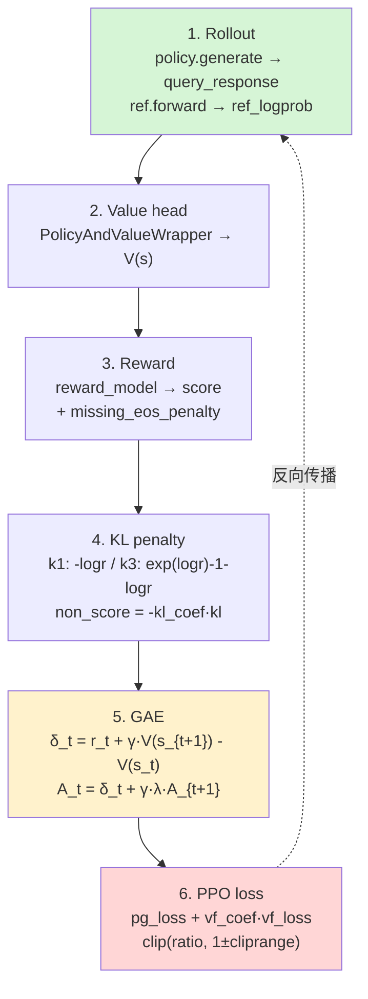
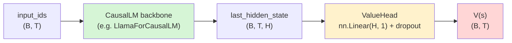

# 12 · 实验性训练器 · PPO 与 PRM 家族

> 本篇导览：实验区（`trl/experimental/`）里的训练器并不保证稳定，但它们是 TRL 探索新范式的前沿。本篇聚焦其中**两个独立的训练器**：PPO 与 PRM。PPO 是经典 RLHF 训练器，带 value head 与 GAE 优势估计，是 OpenAI "Fine-Tuning Language Models from Human Preferences" 范式的完整实现；PRM 是过程奖励模型（Process Reward Model），把 RewardTrainer 的 outcome-level 标签下沉到 step-level，为数学推理等需要"中间过程监督"的场景服务。理解这两个，就理解了 TRL 对 RLHF 全家桶的最后两块拼图。

> 核心问题：
> - PPO 的完整循环：rollout（policy + ref）→ value head → GAE 优势 → PPO clip loss + value loss → KL 惩罚，每一步对应 trainer 里哪段代码？
> - value head 是如何挂在 CausalLM 之上的？为什么实验版 PPO 用 `PolicyAndValueWrapper` + 独立 value_model，而 `AutoModelForCausalLMWithValueHead` 又是另一条通路？
> - KL 估计器 `k1` vs `k3` 的差异是什么？为什么不能选 `k2`？
> - 多 PEFT adapter 模式下，`model_adapter_name` / `ref_adapter_name` 如何让"一个模型两个 LoRA"分别扮演 policy 和 reference？
> - PRM 的 `step_separator` 如何把推理轨迹切成多步？`train_on_last_step_only` 的训练/评估差异在哪？与 RewardTrainer 的 outcome-level 标签差在哪一步？

---

## 一、家族定位与基类

PPO 与 PRM 都位于 `trl/experimental/<name>/`，各自自带 `<name>_trainer.py` 与 `<name>_config.py`，且都继承自实验区共用的 `_BaseTrainer`/`_BaseConfig`，与第 09 篇（GRPO 家族）走的是同一套基类骨架。但两者的算法定位完全不同：

- **PPO**（`trl/experimental/ppo/`）：经典 RLHF。policy 在线生成 rollout，reward model 打分，value head 预测 V(s)，GAE 算优势，PPO clip loss + value loss 联合训练。论文 [Fine-Tuning Language Models from Human Preferences](https://huggingface.co/papers/1909.08593)（注意 trainer 类签名里给出的 `_paper.id` 是 `1909.08593`，即 Ziegler et al. 2019，而不是 PPO 原始论文 1707.06347，后者只在 docstring 里被引用为算法出处）。
- **PRM**（`trl/experimental/prm/`）：训练一个 step-level 过程奖励模型。论文 [Solving math word problems with process-and outcome-based feedback](https://huggingface.co/papers/2211.14275)（Uesato et al. 2022）。本质上是 token classification：在每个 step 末尾位置打一个 reward 标签，监督信号比 outcome-level 更密集。

两者都不参与 GRPO/DPO 等主仓库的"主流 RLHF"叙事，它们是实验区里"老 RLHF（PPO）+ 新监督（PRM）"的组合。

---

## 二、PPO 算法原理与完整循环

PPO 是这个家族里最复杂、也最"教科书"的训练器。整个训练循环在 `PPOTrainer.training_step`（`trl/experimental/ppo/ppo_trainer.py`，行号基于 2026-07 探索）里，按顺序分六步走完一个 RLHF 步。



**图说明**：PPO 一个 `training_step` 的完整六步。rollout 阶段同时跑 policy 生成与 ref 前向，得到 `(logprobs, ref_logprobs)`；value head 给出每个 token 的 V(s)；reward model 在序列末位打 score；KL 项把"policy 偏离 ref"的代价摊到每个 token 上；GAE 用 `gamma` 与 `lam` 把未来奖励折回当前；最后 PPO clip loss 与 value loss 一起反向。虚线表示梯度回流到 policy 与 value head。

下面把六步与代码逐一对应。

**第 1 步 rollout** 在 `batch_generation`（`ppo_trainer.py:114`）里：policy 用 `lm_backbone.generate` 生成 response，ref 用 `forward(ref_policy, query_response, ...)`（`ppo_trainer.py:711`）拿到 ref_logprob。两者都不带梯度。

**第 2 步 value head** 走 `PolicyAndValueWrapper`（`ppo_trainer.py:275`），它把 policy 与 value_model 绑在一起，让 `accelerator.prepare(model)` 只需调用一次：

```python
class PolicyAndValueWrapper(nn.Module):
    def __init__(self, policy, value_model) -> None:
        super().__init__()
        self.policy = policy
        self.value_model = value_model
        self.critic_backbone = getattr(value_model, value_model.base_model_prefix)

    def forward(self, **kwargs):
        output = self.critic_backbone(**kwargs)
        logits = self.value_model.score(output.hidden_states[-1])
        return self.policy(**kwargs), logits
```

注意这里 `value_model` 不是 `AutoModelForCausalLMWithValueHead`，而是一个带 `.score` 头的模型（通常 `AutoModelForSequenceClassification` 的 `num_labels=1`，其 `base_model_prefix` 指向 backbone，`score` 是最后一个 Linear）。`AutoModelForCausalLMWithValueHead` 是另一条通路，主要给加载/保存 checkpoint 用。

**第 3 步 reward** 在 `ppo_trainer.py:733`：`get_reward(reward_model, postprocessed_query_response, ...)` 拿到 `score`。`missing_eos_penalty` 给没生成 EOS 的样本扣分（`ppo_trainer.py:758`）。

**第 4 步 KL penalty** 是关键，直接对应 Schulman 的 [blog](http://joschu.net/blog/kl-approx.html) 两种估计器（`ppo_trainer.py:773`）：

```python
logr = ref_logprobs - logprobs
kl = -logr if args.kl_estimator == "k1" else (logr.exp() - 1) - logr
non_score_reward = -args.kl_coef * kl
rewards = non_score_reward.clone()
rewards[actual_start, actual_end] += scores  # 末位加 score
```

`k1` 是一阶 log-ratio（`-logr`，无偏但方差大），`k3` 是 Schulman 近似（`(exp(logr)-1) - logr`，无偏且方差更低，Schulman 称"appears to be a strictly better estimator"）。`k2` 不能用——它被保留用于日志统计。

**第 5 步 GAE**（`ppo_trainer.py:786`）是 PPO 的灵魂：

```python
lastgaelam = 0
for t in reversed(range(gen_length)):
    nextvalues = values[:, t + 1] if t < gen_length - 1 else 0.0
    delta = rewards[:, t] + args.gamma * nextvalues - values[:, t]
    lastgaelam = delta + args.gamma * args.lam * lastgaelam
    advantages_reversed.append(lastgaelam)
advantages = torch.stack(advantages_reversed[::-1], axis=1)
returns = advantages + values
advantages = masked_whiten(advantages, ~padding_mask)
```

`gamma`（折扣因子，默认 `1.0`）控制未来奖励的衰减，`lam`（GAE λ，默认 `0.95`）在 bias 与 variance 间插值——`lam=0` 退化为 TD(0)，`lam=1` 退化为 Monte Carlo。advantages 还要做 `masked_whiten`（均值方差归一化），与 CleanRL 的 PPO 实现一致。

**第 6 步 loss** 在 `ppo_trainer.py:841`：

```python
logprobs_diff = new_logprobs - mb_logprobs
ratio = torch.exp(logprobs_diff)
pg_losses = -mb_advantage * ratio
pg_losses2 = -mb_advantage * torch.clamp(ratio, 1.0 - args.cliprange, 1.0 + args.cliprange)
pg_loss = masked_mean(torch.max(pg_losses, pg_losses2), ~padding_mask[micro_batch_inds])
vf_loss = 0.5 * masked_mean(torch.max(vf_losses1, vf_losses2), ~padding_mask_p1[micro_batch_inds])
loss = pg_loss + args.vf_coef * vf_loss
```

policy loss 走标准 PPO clip（`cliprange=0.2`），value loss 也带 clip（`cliprange_value=0.2`），最终用 `vf_coef=0.1` 加权。一个细节：`new_logprobs` 用 `selective_log_softmax` 重新算（避免 log-softmax 数值不稳），不是直接拿 rollout 时的 logprob——这是 PPO 多 epoch 复用 rollout 数据的必要前提。

---

## 三、Value Head 结构

`trl/experimental/ppo/modeling_value_head.py` 提供两条通路，理解它们的关系是看懂 PPO 的关键。



**图说明**：value head 的结构。CausalLM backbone 输出 `last_hidden_state`，经过一个 dropout 与一个 `nn.Linear(hidden_size, 1)` 投影到标量 V(s)。`ValueHead` 类（`modeling_value_head.py:594`）会按优先级自动判定 `hidden_size`：`word_embed_proj_dim`（OPT-350m）→ `hidden_size` → `text_config.hidden_size`（多模态）→ `decoder.hidden_size`（encoder-decoder）。

`AutoModelForCausalLMWithValueHead`（`modeling_value_head.py:647`）把 `pretrained_model`（CausalLM）与 `v_head`（ValueHead）打包，`forward` 同时返回 `lm_logits` 与 `value`：

```python
def forward(self, input_ids=None, attention_mask=None, **kwargs):
    kwargs["output_hidden_states"] = True
    base_model_output = self.pretrained_model(input_ids=input_ids, attention_mask=attention_mask, **kwargs)
    last_hidden_state = base_model_output.hidden_states[-1]
    value = self.v_head(last_hidden_state).squeeze(-1)
    return (lm_logits, loss, value)
```

但在实际训练里，`PPOTrainer` 用的是 `PolicyAndValueWrapper` + 独立 `value_model`（带 `.score` 头），不是 `AutoModelForCausalLMWithValueHead`。后者的主要价值是 checkpoint 加载/保存——`state_dict` 会把 `v_head.*` 的 key 单独保存（`modeling_value_head.py:785`），`post_init` 再用 `v_head.` 前缀过滤回填（`modeling_value_head.py:806`），让 PPO 训练的 value head 能跟 policy 一起 resume。

---

## 四、多 PEFT adapter：一个模型两个 LoRA

PPO 需要一个 policy 与一个 reference。常规做法是把 policy 复制一份冻结当 ref，但 LoRA 时代更省显存的做法是：**一个 base model + 两个 LoRA adapter**，一个可训练（policy），一个冻结（ref）。`PPOConfig` 提供两个字段：

- `model_adapter_name`（`ppo_config.py:224`）：训练目标的 adapter 名。
- `ref_adapter_name`（`ppo_config.py:228`）：reference 的 adapter 名。

切换由 `null_ref_context` 上下文管理器完成（`ppo_trainer.py:577`）：

```python
@contextmanager
def null_ref_context(self):
    with (
        self.accelerator.unwrap_model(self.model.policy).disable_adapter()
        if self.is_peft_model and not self.ref_adapter_name
        else nullcontext()
    ):
        if self.ref_adapter_name:
            self.model.policy.set_adapter(self.ref_adapter_name)
        yield
        if self.ref_adapter_name:
            self.model.policy.set_adapter(self.model_adapter_name or "default")
```

两种模式：① 只有一个 adapter（policy），ref 走 `disable_adapter()` 即 base model 本身；② 两个 adapter，ref 通过 `set_adapter(ref_adapter_name)` 切过去，结束后切回 `model_adapter_name`。第二种模式让 ref 也可以是一个训练过的 LoRA（比如先 SFT 过的 adapter 当 ref，再训一个新的当 policy），比"base model 当 ref"更灵活。

`__init__` 还会显式校验：`ref_model is model` 直接报错（`ppo_trainer.py:368`），强制你要么传一个独立的 ref_model，要么用 peft 多 adapter 走 `null_ref_context`。

---

## 五、PPO 配置要点

`PPOConfig`（`trl/experimental/ppo/ppo_config.py`）继承 `_BaseConfig`，覆盖了一批 `TrainingArguments` 默认值（`learning_rate=3e-6`、`logging_steps=10`、`gradient_checkpointing=True`、`bf16=True`），新增的字段分四组：

**RLHF 专属**：`kl_coef=0.05`（KL 系数）、`kl_estimator="k1"`（估计器，可选 `k3`）、`vf_coef=0.1`（value loss 权重）、`whiten_rewards=False`（是否对 reward 做归一化）。

**PPO clip**：`cliprange=0.2`（policy ratio clip）、`cliprange_value=0.2`（value clip）。两者独立，因为 value head 与 policy 的训练动态不同。

**GAE**：`gamma=1.0`（折扣）、`lam=0.95`（GAE λ）。`gamma=1.0` 是 RLHF 默认——回答通常不长，无需折现；如果是长轨迹任务（比如 agent 多步交互），应该调小。

**rollout 控制**：`response_length=53`、`temperature=0.7`、`missing_eos_penalty=None`、`stop_token`/`stop_token_id`、`local_rollout_forward_batch_size=64`、`num_ppo_epochs=4`、`num_mini_batches=1`。

注意：当前实验版 PPO **没有自适应 KL 控制器**（`adap_kl_ctrl`）。`kl_coef` 是固定值，全训练过程不变。这与早期 TRL（`trl/trainer/ppo_config.py` 旧版）的 `AdaptiveKL` 控制器不同，是实验区简化版的一个取舍——少一个超参、少一段状态机，调试更直接。

---

## 六、PRM：step-level 过程奖励

PRM 与 PPO 完全不同——它不是 RL，而是监督学习。它训练的是一个**打分模型**，输入"prompt + 多步推理"，输出每个 step 末尾的 reward 标签。论文 [2211.14275](https://huggingface.co/papers/2211.14275) 的核心洞察是：只用 outcome-level reward（最终答案对/错）训练 RM，对长链推理不够密集；用 step-level reward（每步对/错）能学到更细的信号。

数据格式：每个样本是 `{"prompt": ..., "completions": [step1, step2, ...], "labels": [0/1, 0/1, ...]}`。`tokenize_row`（`prm_trainer.py:274`）负责把它转成 token classification 的 `input_ids` + `labels`：

```python
prompt_ids = tokenizer(features["prompt"], add_special_tokens=False)["input_ids"]
completions_ids = [
    tokenizer(completion, add_special_tokens=False)["input_ids"] for completion in features["completions"]
]
if train_on_last_step_only and not is_eval:
    labels = [-100] * (len(features["labels"]) - 1) + [int(features["labels"][-1])]
else:
    labels = [int(label) for label in features["labels"]]

separator_ids = tokenizer.encode(step_separator, add_special_tokens=False)
completions_ids = [completion + separator_ids for completion in completions_ids]
labels = [[-100] * (len(completion) - 1) + [label] for completion, label in zip(completions_ids, labels, strict=True)]
```

关键设计：

- **`step_separator`**（默认 `"\n"`）插在每步末尾，分隔符之后才打 label——所以每步的 label 落在该步最后一个 token 的位置（其他 token 是 `-100` 忽略）。
- **`train_on_last_step_only`** 只训最后一步（`labels` 中前 N-1 个变 `-100`），但**评估时不受影响**（`if train_on_last_step_only and not is_eval`）。这是个易错点：训练只看最后一步，但评估要看所有步，否则会高估训练精度。
- model 推荐用 `AutoModelForTokenClassification`（docstring 里明示），`compute_accuracy`（`prm_trainer.py:55`）按 token classification 算准确率，过滤 `-100`。

**与 RewardTrainer 的区别**：RewardTrainer（第 08 篇）是 outcome-level——整个回答一个标量 reward，loss 是 chosen/rejected 的 pairwise margin。PRM 是 step-level——每个 step 一个 reward，loss 是 token classification 的交叉熵。数据格式上，RewardTrainer 吃 `(chosen, rejected)` 对，PRM 吃 `(prompt, [step1, step2, ...], [label1, label2, ...])`。两者不能混用数据。

PRM 训练好的模型最终用法是：把它当作 reward model 喂给 PPO/GRPO 等 RL 训练器，提供更密集的 step-level 信号——这是 PRM 与 PPO 在工程上的衔接点。

---

## 七、上手示例

一个 PPO 的简化配置示例，展示 value head + GAE 关键参数：

```python
from trl.experimental.ppo import PPOConfig, PPOTrainer
from transformers import AutoModelForCausalLM, AutoModelForSequenceClassification, AutoTokenizer

ppo_config = PPOConfig(
    # GAE：gamma=1.0 不折现（短回答），lam=0.95 接近 Monte Carlo
    gamma=1.0,
    lam=0.95,
    # PPO clip：policy 与 value 各自独立
    cliprange=0.2,
    cliprange_value=0.2,
    vf_coef=0.1,
    # KL：固定系数 + k3 低方差估计器
    kl_coef=0.05,
    kl_estimator="k3",
    # rollout
    response_length=128,
    temperature=0.7,
    missing_eos_penalty=1.0,  # 没生成 EOS 扣 1 分
    num_ppo_epochs=4,
    learning_rate=3e-6,
)

policy = AutoModelForCausalLM.from_pretrained("EleutherAI/pythia-160m")
ref_model = AutoModelForCausalLM.from_pretrained("EleutherAI/pythia-160m")
reward_model = AutoModelForSequenceClassification.from_pretrained("EleutherAI/pythia-160m", num_labels=1)
value_model = AutoModelForSequenceClassification.from_pretrained("EleutherAI/pythia-160m", num_labels=1)
tokenizer = AutoTokenizer.from_pretrained("EleutherAI/pythia-160m")

trainer = PPOTrainer(
    args=ppo_config,
    processing_class=tokenizer,
    model=policy,
    ref_model=ref_model,
    reward_model=reward_model,
    value_model=value_model,
    train_dataset=train_dataset,
)
trainer.train()
```

注意 `value_model` 用 `AutoModelForSequenceClassification` + `num_labels=1`，这正是 `PolicyAndValueWrapper` 里 `.score` 头的来源。如果要用 LoRA 多 adapter 模式，省略 `ref_model`，改传 `peft_config` 与 `ref_adapter_name`/`model_adapter_name`。

---

## 小结

- **PPO 是经典 RLHF 的完整实现**：rollout → value head → GAE → PPO clip loss + value loss → KL penalty，六步全在 `training_step` 里。`kl_estimator` 在 `k1`（一阶 log-ratio）与 `k3`（Schulman 低方差近似）间选，`k2` 留给日志。
- **value head 两条通路**：`AutoModelForCausalLMWithValueHead` 用于 checkpoint 加载/保存（`v_head.` 前缀），`PolicyAndValueWrapper` + 独立 `value_model.score` 用于实际训练——前者是包装层，后者是计算路径。
- **GAE 的两个旋钮**：`gamma` 控折扣（短回答可设 1.0），`lam` 控 bias-variance 折中（默认 0.95 接近 Monte Carlo）。advantages 还要做 `masked_whiten` 归一化。
- **多 PEFT adapter 模式**让"一个 base model 两个 LoRA"分别当 policy 和 ref，由 `null_ref_context` 切换 adapter，比复制一份 ref 省显存。
- **PRM 是 step-level 监督**，与 RewardTrainer 的 outcome-level 互补——前者用 `step_separator` 切轨迹，每步末尾打 label；后者吃 chosen/rejected 对，整体打一个 reward。PRM 训练好的模型可作为 RL 训练器的密集 reward model。

下一篇 [13 · 环境集成 · Harbor / OpenEnv / OpenReward](13_分_环境集成_Harbor_OpenEnv_OpenReward.md) 将转向 TRL 与外部环境/奖励基础设施的集成层。
