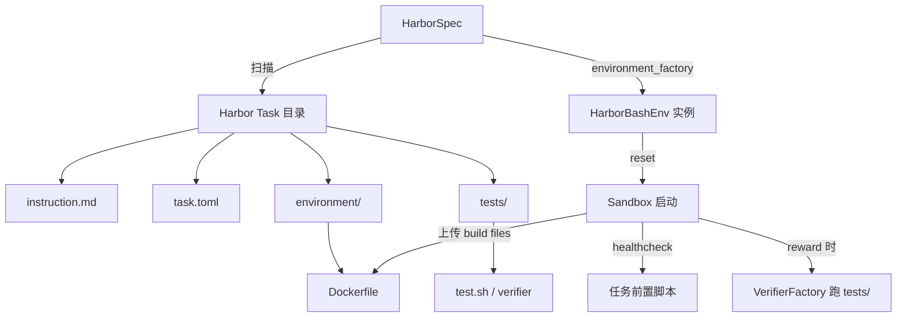

# 13 · 环境集成 · Harbor / OpenEnv / OpenReward

> 本篇导览：聚焦 TRL 把"外部 RL 环境"接进 `GRPOTrainer`（及 `AsyncGRPOTrainer`）的三条官方路径——Harbor、OpenEnv、OpenReward。三者本身都不是训练器，而是包装好的 spec 对象，对外暴露 `train_dataset` / `environment_factory` / `reward_funcs` 三件套，分别对应 `GRPOTrainer` 的三个同名 kwargs。读完本篇你可以判断：拿到一个新任务，应该走哪条路径接入。

> 核心问题：
> - `GRPOTrainer(environment_factory=...)` 这个槽位到底要喂什么？TRL 又如何把它和 `train_dataset` / `reward_funcs` 拼起来？
> - Harbor 任务树长什么样？为什么沙箱被设计成"in-sandbox verifier"？
> - OpenEnv 不像另两者有"spec 类"，它是怎么落地的？
> - OpenReward（ORS）的"工具发现"为什么要在 trainer 构造前就跑一遍 `session.list_tools()`？
> - 三者的奖励语义差异（outcome-only vs. step-level vs. 任务内置 verifier）如何影响 reward_funcs 的写法？

## 一、为什么是"三件套"接入

`GRPOTrainer` 在做带工具调用的 rollout 时，需要三个外部输入：

1. `train_dataset`：每一行是一个 rollout 的"种子"——至少包含 `prompt`（chat-format 消息列表）。TRL 在生成时把"环境的 instruction"追加到这个空 prompt 后面。
2. `environment_factory`：零参 callable，每次调用返回一个**新的** env 实例。TRL 每个 rollout 调一次，保证隔离。之所以是 factory 而不是单个 env，是因为 GRPO 一个 prompt 要采样 `num_generations` 次，每次都需要一个干净的 env。
3. `reward_funcs`：一个或多个 callable，签名形如 `(completions, environments=..., environment_reward=..., **kwargs) -> list[float]`。TRL 在 rollout 完成后调用，从 env 里读 reward。

`environment_factory` 这条路径只在 `GRPOTrainer`（及其异步变体）里有；SFT/DPO 等不用工具的训练器没有这个 kwarg。

```python
# trl/experimental/harbor/_spec.py（行号基于 2026-07 探索）
trainer = GRPOTrainer(
    model="Qwen/Qwen3.5-4B",
    args=GRPOConfig(num_generations=8, max_steps=50, max_tool_calling_iterations=25),
    train_dataset=spec.train_dataset,
    environment_factory=spec.environment_factory,
    reward_funcs=spec.reward_funcs,
)
```

下面是一张整体数据流图，把"采样 prompt → env.reset → agent.step → env.step → reward → 训练"穿起来。它对三种集成路径都成立，区别只在 env 这一步的内部实现。

```mermaid
flowchart LR
    A[train_dataset 行] -->|task_index / task_dir| B[environment_factory]
    B --> C[env = Env实例]
    C -->|reset| D[env 返回 instruction]
    D --> E[GRPOTrainer 采样 num_generations 条]
    E -->|循环 max_tool_calling_iterations 次| F[模型生成 tool_call]
    F -->|env.tool_method| G[env.step 更新状态]
    G -->|observation| F
    G -->|rollout 结束| H[reward_funcs 读 env.reward]
    H --> I[GRPO 策略梯度更新]
```



**图说明**：左边的 `train_dataset` 行决定本轮 rollout 跑哪个任务；中间 `environment_factory` 出一个隔离 env；右边 reward_funcs 只在 rollout 结束后读 env 的 reward 属性。Harbor 的 reward 来自 verifier，OpenReward 的 reward 来自工具返回的 `out.reward`，OpenEnv 的 reward 由用户在自定义 env 类里写。

## 二、Harbor：沙箱任务套件

### 2.1 定位与安装

Harbor 是一套"agentic 任务套件"——每个任务自带 instruction + sandbox image + verifier。它的特点是 verifier 跑在沙箱里（in-sandbox），而不是 TRL 这边：env 在 `reset` 时启动 sandbox，在 `reward` 时调 Harbor 的 verifier 跑 `tests/` 下的脚本。

安装（注意 Python >= 3.12 的硬性要求，因为 `harbor` 包依赖最新特性）：

```sh
pip install trl[harbor]
# 沙箱后端按需另装，例如 e2b：
pip install "harbor[e2b]"
```

`harbor` 包是 lazy-import 的（见 `_env.py` 顶部 docstring），所以 `from trl.experimental.harbor import HarborSpec` 即使没装 `harbor` 也能 import——只在真正跑 `reset()` 时才会爆 ImportError。这跟 OpenReward 的 `_import_openreward()` 是同一套模式。

### 2.2 任务树结构

Harbor 的 dataset 是一个目录树，每个任务是一个子目录，包含四个固定件：

| 文件/目录 | 作用 |
|---|---|
| `instruction.md` | 任务的指令文本，由 `reset` 返回给模型 |
| `task.toml` | 元数据：`gold_answer`、`difficulty_level`、`reward_mode_initial`、`kaggle_dataset_name` 等 |
| `environment/` | 沙箱镜像的构建上下文（含 `Dockerfile`） |
| `tests/` | verifier 脚本，沙箱内运行，向 `verifier_dir` 写 reward |

`HarborSpec._task_dirs`（_spec.py，行号基于 2026-07 探索）解析时优先看本地是否有 `tasks/` 子目录，否则把 dataset 当作 HF repo id 调 `snapshot_download`：

```python
# trl/experimental/harbor/_spec.py
local = Path(self._dataset)
if (local / "tasks").is_dir():
    root = local / "tasks"
elif local.is_dir() and any(local.glob("*/task.toml")):
    root = local
else:
    from huggingface_hub import snapshot_download
    path = Path(snapshot_download(self._dataset, repo_type="dataset",
                                  allow_patterns=["tasks/**"]))
    root = path / "tasks"
dirs = sorted(p.parent for p in root.glob("*/task.toml"))
```

`num_tasks` 与 `indices` 二选一（构造时就会校验），前者取前 N 个、后者按指定下标取——`indices` 适合 curriculum 或调试。

### 2.3 Harness：插拔式"基础 agent"

TRL 不直接驱动 sandbox，而是通过 `HarborEnv` 的子类决定"模型能调哪些工具 + 如何提交答案"。这就是 harness。`AGENTS` 字典是内置 harness 的注册表（`_env.py`）：

```python
# trl/experimental/harbor/_env.py
AGENTS: dict[str, type[HarborEnv]] = {"bash": HarborBashEnv}
```

唯一内置的是 `HarborBashEnv`，只暴露一个 `bash(command: str) -> str` 工具，提交方式是写文件 `/workdir/answer.txt`。仓库里还附带两个示例 harness（在 `examples/scripts/harbor/harnesses/` 下，不在 `trl/experimental/harbor/`）：

- `bash/`：直接 re-export `HarborBashEnv`，作为 `BashEnv`。
- `jupyter/`：stateful Python kernel——`add_and_execute_code_cell(code)` 在一个常驻 kernel 里跑，变量/import 跨调用保持；外加一个非 stateful 的 `execute_shell_command(command)`。实现见 `env.py`，靠上传到沙箱的 `kernel_server.py`（监听 `127.0.0.1:8765`）+ `run_cell.py` 完成。
- `terminal_notes/`：6 个 shell 工具（含后台进程：`shell_exec`/`shell_write_to_process`/`shell_view`/`shell_wait`/`shell_kill_process`/`shell_write_content_to_file`）+ 4 个持久化笔记工具（`create_note`/`append_note`/`read_note`/`list_note`）。笔记跨 turn 持久，但不会自动注入 prompt（与原 SETA 不同）。

接入时用 `agent=` 选 harness，接受四种形式（`_resolve_agent`，_spec.py）：

```python
spec = HarborSpec(dataset, agent="bash")                                      # 内置名
spec = HarborSpec(dataset, agent="pkg.module:ClassName")                     # 模块路径
spec = HarborSpec(dataset, agent="examples/scripts/harbor/harnesses/jupyter/env.py:JupyterEnv")  # 文件路径
spec = HarborSpec(dataset, agent=MyHarborEnvSubclass)                        # 直接传类
```

要写自定义 harness，继承 `HarborEnv`、覆写 `_setup`（沙箱起好后做一次准备，比如上传辅助文件、启动 kernel）和工具方法即可。

### 2.4 沙箱生命周期与 verifier

`HarborEnv` 把 Harbor 的 async API 用一个独占的 daemon 线程 + `asyncio.run_coroutine_threadsafe` 包成同步接口（`_env.py` 顶部 docstring 解释了为什么：Harbor sandbox client 绑定创建它的 loop，所以每个 env 持有一个 loop，既能从主线程调，也能在 AsyncGRPOTrainer 的 rollout worker 已有 loop 时调，不会触发 "another loop is already running"）。

每次 rollout：

1. `reset(task_dir)` → `_start`：建临时 trial 目录 → `EnvironmentFactory.create_environment_from_config` → `start(force_build=False)` → `_upload_build_files`（处理 E2B 远程构建丢 `COPY` 文件的 quirk）→ `run_healthcheck` → `_setup`。返回 `task.instruction + PROMPT_SUFFIX`。
2. 工具方法被反复调用 → `_exec`（命令在沙箱里跑，stdout+stderr 拼起来截断到 8k）。
3. `reward` property（首次访问时 `_verify`）：用 `VerifierFactory` 在沙箱里跑 verifier，读 `rewards` dict 取 `reward` 字段。

`reward` 用 sentinel `_NO_REWARD` 区分"还没算"和"算出来是 0.0"——0.0 也是合法 reward，不能 falsy 处理。还有个边界：trainer 会用 `inspect.getmembers` 探测工具方法，这会触发 property 求值，所以没 reset 过的 env 直接返回 0.0 而不调 verifier。



**图说明**：HarborSpec 扫描任务树得到 dataset；environment_factory 出的 HarborBashEnv 在 `reset` 时启动 sandbox（按 `environment/` 里的 Dockerfile 构建，远端 E2B 模式还会补 COPY 丢失的文件），rollout 结束后由 `reward` 触发 verifier 跑 `tests/`。一切奖励都来自沙箱内，TRL 这边不参与判分。

### 2.5 默认 reward_funcs

`HarborSpec.reward_funcs` 是模块级函数 `_outcome_reward_func`（_spec.py）：

```python
def _outcome_reward_func(environments=None, environment_reward=None, **_) -> list[float]:
    if environment_reward is not None:
        return [float(r) for r in environment_reward]
    return [float(env.reward) for env in environments]
```

它同时兼容 `GRPOTrainer`（传 `environments=`）和 `AsyncGRPOTrainer`（在 worker 里跑完 rollout 后传 `environment_reward=`）。这种"两路径都接"的写法是 spec 的约定，写自定义 reward 时也要照搬。

`environment_factory` 用 `functools.partial` 而不是闭包（_spec.py）——因为 `AsyncGRPOTrainer` 要把 factory pickle 到子进程，闭包/lambda 会失败。这是个细节但很重要。

## 三、OpenEnv：开放 RL 环境集合

### 3.1 定位

OpenEnv 是"开放 RL 环境集合"的统称——它不像 Harbor/OpenReward 那样有一个 `Spec` 类。仓库里有两块：

- `trl/experimental/openenv/utils.py`：共享工具，核心是 `generate_rollout_completions(trainer, prompts, ...)`——给自定义 rollout 用的 vLLM 生成包装，统一 colocate / server 两种 mode 的输出格式。
- `examples/scripts/openenv/`：每个文件是一个独立的 RL 环境示例脚本，自己定义 env 类、自己写 reward_funcs、自己组装 dataset。TRL 不提供"OpenEnvSpec"。

这种"脚本即环境"的设计让 OpenEnv 比另两者自由得多——你直接在 Python 里写 env 类，不用关心任务树或服务器协议。

### 3.2 内置环境

`examples/scripts/openenv/` 下目前有这些环境（按主题分）：

| 脚本 | 类型 |
|---|---|
| `sudoku.py` | 经典网格推理，TextArena 后端 |
| `wordle.py` | 单词推理 |
| `browsergym.py` / `browsergym_llm.py` | 浏览器自动化（含 LLM 评判变体） |
| `carla.py` / `carla_vlm.py` / `carla_vlm_gemma.py` | 自动驾驶仿真（含 VLM/Gemma 变体） |
| `catch.py` | 简单 gym-style 游戏，常做最小示例 |
| `echo.py` | 极简回显环境，做接入测试用 |
| `multi_env.py` | 多环境混合训练 |

`utils.py` 提供的 `generate_rollout_completions` 主要服务于那些需要在 env.step 内部"再调一次模型"的环境（比如多轮交互里 env 自己要 LLM 评判）。它干三件事：

1. 调 `_build_base_generation_kwargs` 把 trainer 上的 `temperature`/`top_k`/`max_completion_length` 等拍成 vLLM kwargs。
2. 按 `vllm_mode` 分流到 `_generate_rollout_completions_server`（走 `vllm_client.chat` / `generate`）或 `_generate_rollout_completions_colocate`（走 `llm.chat` / `generate`，处理 TP>1 时的 all_gather + slice）。
3. 返回统一格式：`{prompt_ids, completion_ids, logprobs, text}` 列表。

### 3.3 sudoku.py 示例的接入形态

OpenEnv 的接入"模板"看 `examples/scripts/openenv/sudoku.py`（行号基于 2026-07 探索）：用户自己写一个 `SudokuEnv` 类，里面定义 `reset(**kwargs) -> str`、工具方法（如 `place(row, col, number)`）以及若干 reward property。然后：

```python
# examples/scripts/openenv/sudoku.py
trainer = GRPOTrainer(
    model=args.model_id,
    reward_funcs=[reward_empty_cell, reward_valid_moves,
                  reward_repetition, reward_progress, reward_correct],
    train_dataset=dataset,
    args=grpo_config,
    environment_factory=SudokuEnv,   # 直接传类（TRL 内部会调）
    callbacks=[RichProgressCallback()],
)
```

注意 OpenEnv 里 `environment_factory` 直接传类（TRL 会自己 instantiate），而 Harbor/OpenReward 则是传 factory callable——两种形式 TRL 都支持，因为内部都走"调用一次得到 env 实例"的协议。

OpenEnv 的 reward 可以做得很细——sudoku 同时挂 5 个 reward 函数，分别针对不同子目标（命中空格、合法走法、惩罚重复、进度、解出）。这跟 Harbor 的 outcome-only、OpenReward 的稀疏 outcome 形成对比。

## 四、OpenReward (ORS)：开放奖励服务器

### 4.1 定位与安装

OpenReward 是把"环境 + verifier"都放在远端服务器（ORS）上的方案。TRL 这边只负责按 ORS 协议开 session、调 tool、读 reward。安装：

```sh
pip install trl[openreward]
```

入口是 `OpenRewardSpec`（`trl/experimental/openreward/_spec.py`），与 `HarborSpec` 镜像设计——同样对外暴露 `.train_dataset` / `.environment_factory` / `.reward_funcs` 三个属性。

### 4.2 两种接入方式

`target` 参数支持两种形式（`_spec.py` 顶部 docstring + 构造函数 `_is_url = "://" in target`）：

- **Catalog 名**：`OpenRewardSpec("Eigent/SETA")`——走 openreward.ai 平台，需要 `OPENREWARD_API_KEY`。
- **Server URL**：`OpenRewardSpec("https://you-seta.hf.space")` 或 `http://localhost:8080`——直接对接任何 ORS 协议服务器（自建 Space、本地 Docker 等）。无需 api_key。

这两种形式在 spec 内部分流到不同 kwargs，最终都构造一个 `_RolloutEnvironment` 子类（见 4.4）。

### 4.3 工具发现：为什么构造前就要跑 `session.list_tools()`

这是 OpenReward 最有意思的设计点。`GRPOTrainer` 在构造时（早于第一个 rollout）就要 inspect env 的方法来决定模型可见的 tool schema（见 grpo_trainer.py 的 tool 收集逻辑）。但 ORS 的工具有两类：

- shared tools：`GET /tools` 拿到，env 级别共享。
- task-specific tools：`GET /task_tools`，session-scoped——只有开了 session 才能问。

如果只列 shared tools，那些 `@tool(shared=False)` 装饰的工具模型就看不到。所以 `OpenRewardSpec._discovered_tool_specs`（_spec.py）在 spec 构造时就开一个临时 session 调 `session.list_tools()`，把 shared + task-specific 合并：

```python
# trl/experimental/openreward/_spec.py（简化版）
shared = env.list_tools()
if not self._discover_task_tools:
    return shared
probe_indices = self._task_tools_probe_indices()
for idx in probe_indices:
    with env.session(split=self._split, index=idx, secrets=secrets) as sess:
        specs = list(sess.list_tools())
    # merge by name，schema冲突时保留第一个并 warn
```

`task_tools_discovery_index` 可以指定单一下标探针；不指定时，若用户给了 `indices=`，就对每个不同的 index 各开一次探针 session、合并工具——这样多任务训练时所有任务的 task-specific 工具都可见。失败则 fallback 到 shared-only，并记 warning。

### 4.4 动态工具绑定

`_RolloutEnvironment`（`trl/experimental/openreward/environment.py`）在 `__init__` 时遍历发现到的 tool specs，对每个 spec 调 `_bind_tool_method(cls, spec)`——动态生成一个 Python 方法并 `setattr` 到类上：

```python
# trl/experimental/openreward/environment.py（简化）
src = (
    f"def {tool_name}(self, {', '.join(params_src)}) -> str:\n"
    f"    {docstring!r}\n"
    f"    _kwargs = dict(locals()); _kwargs.pop('self', None)\n"
    f"    return self._call_ors_tool({tool_name!r}, _kwargs)\n"
)
exec(src, ns)
fn = ns[tool_name]
fn.__annotations__ = {**annotations, "return": str}
setattr(cls, tool_name, fn)
```

生成的 docstring 用 `repr()` 包一层、工具名过正则 `^[A-Za-z_][A-Za-z0-9_]*$` 校验，避免不可信的 server 端文本（描述、参数名）破坏生成的源码或注入。每个工具方法只是把 kwargs 转给 `self._call_ors_tool(name, kwargs)`，后者调 `session.call_tool` 并更新 episode state（`rewards`/`metadata`/`finished`/`last_output`）。

注意每个 spec 在 `environment_factory` 里都会 new 一个独立的 `_RolloutEnvironment` 子类（`type(f"_RolloutEnvironment_{id(self):x}", (_RolloutEnvironment,), {})`）——这是为了避免两个 spec（不同 env、不同工具集）的方法在共享父类上互相覆盖。

### 4.5 默认稀疏 outcome 奖励

`OpenRewardSpec.reward_funcs` 指向 `_outcome_only_reward_func`（_spec.py）：

```python
def _outcome_only_reward_func(environments, **_):
    return [env.reward for env in environments]
```

`env.reward` 在 `_RolloutEnvironment` 里是"最后一个非空 step reward"（`environment.py` 的 `_call_ors_tool` 中：`if step_reward is not None: self.reward = step_reward`）。这对 SETA 这种"只有 `submit_solution` 才返回非空 reward"的环境正合适——全程稀疏，最后一步出分。要做密集 reward 可以传自己的 `reward_funcs`，直接读 `env.rewards` 列表。

### 4.6 session 生命周期

`reset(task_index=...)`（`environment.py`）做三件事：① 关掉上一次的 session context manager；② 重置 episode state；③ 调 `self._env.session(split=, index=, secrets=)` 开新 session，拿 `prompt`。注意它保留了 `_session_cm`（context manager 本身），退出时调 `__exit__`——只调 session 的方法不足以删除服务端的 env state + sid。

`_close` 方法以 `_` 前缀开头，是为了让 TRL 的 tool 收集器（按 `inspect.getmembers` + 名字过滤）把它排除在工具面之外。

## 五、三者对比

| 维度 | Harbor | OpenEnv | OpenReward |
|---|---|---|---|
| 类型 | 沙箱任务套件 | RL 环境集合 | 奖励服务器接入 |
| 安装 | `pip install trl[harbor]`（Py>=3.12） | 内置 + 各脚本自带依赖 | `pip install trl[openreward]` |
| 任务来源 | 任务树目录（HF dataset 或本地） | `examples/scripts/openenv/` 各脚本 | ORS catalog 名或 server URL |
| 工具面来源 | harness 子类的方法（`bash`/`jupyter`/`terminal_notes`） | 用户在 env 类里直接定义 | server 端 tool spec 动态绑定 |
| 奖励来源 | 任务内置 verifier（沙箱内跑） | 用户在 env 类里写 reward property | 稀疏 outcome-only（最后非空 step reward） |
| 自定义方式 | 继承 `HarborEnv`，覆写 `_setup` + 工具方法 | 直接写 Python env 类 | 通过 ORS 协议（server 端定义） |
| Spec 类 | `HarborSpec` | 无（脚本自己组 dataset/factory/reward） | `OpenRewardSpec` |
| async 兼容 | `partial` + 模块级 reward func（可 pickle） | 直接传类 | `partial` 风格 + 模块级 reward func |
| 后端 | docker / e2b / daytona / gke / modal / runloop | 各环境自带（如 TextArena HTTP） | ORS 协议任意实现 |

选择策略：

- 任务能装成"沙箱 + 测试"→ Harbor。它的 verifier 跑在沙箱里，最难作弊。
- 想快速做点 gym 风格的实验、自己掌控所有逻辑 → OpenEnv。
- 任务已经在 ORS 平台或自己搭了 ORS server → OpenReward。

## 六、上手示例

最小可跑的 Harbor 接入（基本是 `examples/scripts/harbor/data_agent.py` 的精简版）：

```python
from trl import GRPOConfig, GRPOTrainer
from trl.experimental.harbor import HarborSpec

# 一个 spec 对象，三个属性分别填进 GRPOTrainer 的三个槽位
spec = HarborSpec(
    "AdithyaSK/data_agent_rl_environment_train",
    agent="bash",                # 内置 bash harness；也可换 jupyter/terminal_notes 路径
    environment_type="e2b",      # 沙箱后端；docker / e2b / daytona / ...
    num_tasks=64,                # 取前 64 个任务
)

trainer = GRPOTrainer(
    model="Qwen/Qwen3-4B",
    args=GRPOConfig(
        num_generations=8,
        max_steps=50,
        max_tool_calling_iterations=25,
        chat_template_kwargs={"enable_thinking": False},
        use_vllm=True,
        vllm_mode="server",
        vllm_server_base_url="http://localhost:8000",
    ),
    train_dataset=spec.train_dataset,           # 任务行：prompt + task_dir + metadata
    environment_factory=spec.environment_factory,  # partial(HarborBashEnv, environment_type="e2b")
    reward_funcs=spec.reward_funcs,             # _outcome_reward_func，读 env.reward
)
trainer.train()
```

OpenEnv 风格的最小接入（catch.py 风格）：

```python
class CatchEnv:
    def reset(self, **_): ...
    def move(self, direction: str) -> str: ...   # 工具方法
    @property
    def reward(self) -> float: ...               # reward_funcs 读它

trainer = GRPOTrainer(
    model="Qwen/Qwen3-4B",
    args=GRPOConfig(num_generations=8, max_tool_calling_iterations=10),
    train_dataset=dataset,                       # 自己组装的 Dataset
    environment_factory=CatchEnv,                # 直接传类
    reward_funcs=[lambda environments, **_: [e.reward for e in environments]],
)
```

OpenReward 风格：

```python
from trl.experimental.openreward import OpenRewardSpec
spec = OpenRewardSpec("Eigent/SETA", num_tasks=64)   # 或传 https://your-space.hf.space
trainer = GRPOTrainer(model="Qwen/Qwen3-4B",
                      args=GRPOConfig(num_generations=2, max_tool_calling_iterations=20),
                      train_dataset=spec.train_dataset,
                      environment_factory=spec.environment_factory,
                      reward_funcs=spec.reward_funcs)
```

三种写法结构完全一致——区别全在 spec 内部如何把"任务 + env + reward"凑出来。

## 小结

- **三者都不是训练器**，而是把外部 RL 环境接入 `GRPOTrainer` 的 spec 对象；统一通过 `train_dataset` + `environment_factory` + `reward_funcs` 三件套对接，对 trainer 透明。
- **Harbor** 适合"任务 + 沙箱 + verifier"打包的场景；harness 可插拔（`bash`/`jupyter`/`terminal_notes`，可继承 `HarborEnv` 自定义）；奖励来自沙箱内 verifier，最可信。
- **OpenEnv** 不是 spec 类而是脚本集合——每个脚本自己组装 dataset/factory/reward，最自由；`trl/experimental/openenv/utils.py` 提供共享的 `generate_rollout_completions` 给需要"env 内部再调模型"的场景。
- **OpenReward** 是 ORS 协议的客户端接入器；最关键的设计是构造时跑 `session.list_tools()` 做 shared + task-specific 工具发现，再动态绑定为 Python 方法；默认稀疏 outcome-only 奖励。
- **三件套的统一约束**：reward_funcs 要同时支持 `environments=` 和 `environment_reward=` 两条路径（兼容 sync/async trainer）；environment_factory 要 pickleable（用 `partial` 或直接传类，不能用闭包/lambda）。

下一篇 [14 · vLLM 生成与权重同步系统](14_分_vLLM生成与权重同步系统.md) 会拆开 GRPOTrainer 在 colocate / server 两种 vLLM 模式下如何批量生成、如何把训练侧权重同步到生成侧——本篇里出现的 `generate_rollout_completions` 就是其中的关键拼图之一。
