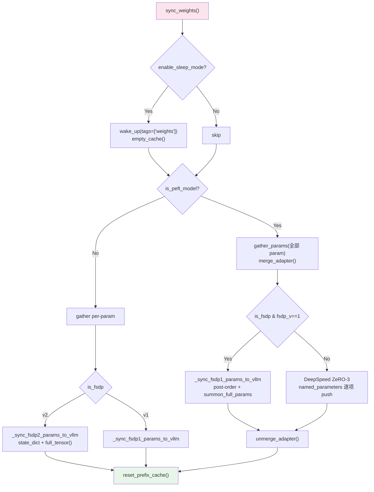

# 14 · vLLM 生成与权重同步系统

> 本篇导览：GRPO/RLOO 的 online 生成是 RL 训练吞吐的关键瓶颈。`trl/generation/` 模块把所有 vLLM 相关细节（初始化、生成、权重同步）从训练器里抽出，封进两个类——`VLLMGeneration`（trainer 侧编排）与 `VLLMClient`（HTTP 侧客户端）。本篇沿着两条主线讲：一条是"两种部署模式"（colocate 与 server）的取舍与拓扑；另一条是 `sync_weights` 在 FSDP v1 / FSDP v2 / DeepSpeed ZeRO-3 / PEFT 四种分片场景下如何把训练好的全权重广播到 vLLM workers。理解这两条线，就理解了 TRL 在线生成的全部工程骨架。

> 核心问题：
> - colocate 与 server 两种模式各有什么拓扑代价？为什么 colocate 要用 `distributed_executor_backend="external_launcher"`，server 要用 `StatelessProcessGroup` + `PyNcclCommunicator`？
> - `sync_weights` 如何在 PEFT、FSDP v1、FSDP v2、DeepSpeed ZeRO-3 四种参数分片场景下，都能正确汇聚全权重并 push 到 vLLM？
> - server 模式下，rank0 把生成请求发到 vLLM server，再 broadcast 切片回各 rank——这一汇聚→生成→广播的 round-trip 怎么避免死锁？
> - `enable_sleep_mode` 把 vLLM 权重 offload 出去再 wake up，与 `sync_weights` 的 `wake_up(tags=["weights"])` 是怎么协作的？Ascend NPU 上的"写入未映射显存"陷阱又怎么避免？
> - `VLLMClient.get_sequence_logprobs` 为什么单独搞一套 base64-numpy 二进制协议 + 分块并发？教师 logprobs 的 forward / reverse KL 两路输出分别对应什么？

---

## 一、模块全貌与 lazy export

`trl/generation/` 由三个文件组成：

- `__init__.py` —— 仅 25 行，用 lazy export：只有 `is_vllm_available()` 为真时，才从 `vllm_generation` 导入 `VLLMGeneration` 并写入 `__all__`。这保证未装 vLLM 的用户 import `trl.generation` 不会触发 ImportError。
- `vllm_generation.py` —— 核心类 `VLLMGeneration`，外加两个模块级辅助函数 `empty_cache()` 与 `extract_logprobs(all_outputs)`。
- `vllm_client.py` —— HTTP 客户端 `VLLMClient`，连接由 `trl vllm-serve` 启动的服务端。

```python
# trl/generation/__init__.py
from ..import_utils import is_vllm_available

__all__ = []

if is_vllm_available():
    from .vllm_generation import VLLMGeneration
    __all__.append("VLLMGeneration")
```

`VLLMGeneration` 的角色是把 trainer 里所有 vLLM 相关逻辑（`_init_vllm` / `sync_weights` / `generate`）抽出成可独立测试的类（docstring 原话："Extracts all vLLM-specific logic ... into a separate, testable class"，`vllm_generation.py:114`）。GRPO、RLOO 等训练器把生成与权重同步委托给它，自己只保留 reward 与 loss 路径。

---

## 二、两种模式：colocate 与 server

vLLM 在 TRL 里支持两种部署模式，由 `VLLMGeneration(mode=...)` 切换。二者本质差异是 **vLLM 进程与训练进程是否同一进程**。

```mermaid
flowchart TD
    subgraph Colocate["colocate 模式：vLLM 与训练同进程"]
        T1["Trainer rank0"]
        T2["Trainer rank1"]
        T3["Trainer rankN"]
        V1["vLLM LLM<br/>(in-process)"]
        V2["vLLM LLM<br/>(in-process)"]
        V3["vLLM LLM<br/>(in-process)"]
        T1 -.共享GPU.-> V1
        T2 -.共享GPU.-> V2
        T3 -.共享GPU.-> V3
    end
    subgraph Server["server 模式：vLLM 独立进程"]
        TR0["Trainer rank0<br/>(HTTP + NCCL client)"]
        TR1["Trainer rank1<br/>(idle)"]
        SRV["trl vllm-serve<br/>FastAPI + DP workers"]
        HTTP["HTTP /generate/"]
        NCCL["PyNccl broadcast<br/>(权重同步)"]
        TR0 -->|HTTP| HTTP --> SRV
        TR0 -.NCCL.-. NCCL -.-> SRV
    end
    style Colocate fill:#e8f5e9
    style Server fill:#fff3e0
```

**图说明**：colocate 模式下每个 trainer rank 内嵌一个 vLLM `LLM` 实例，共享 GPU；server 模式下只有 rank0 通过 HTTP + NCCL 与独立 vLLM server 通信，其它 rank 在生成阶段保持 idle，由 `broadcast_object_list` 接收 rank0 切片好的结果。

### 2.1 colocate 模式

`_init_vllm()` 在 `mode="colocate"` 分支（`vllm_generation.py:311-365`）直接 `LLM(...)` 构造一个引擎，关键参数：

- `distributed_executor_backend="external_launcher"`（`:355`）—— 让 vLLM 复用 trainer 已有的 torchrun 进程组，不自己 spawn 新 worker，避免与 accelerate 的进程组冲突。
- `logprobs_mode="processed_logprobs"`（`:361`）—— 让 temperature scaling / logit tweaking 真正反映到 TIS（Token-In-Token-Out Sampling）的 logprobs 上。
- `seed=accelerator.process_index // self.tensor_parallel_size`（`:357`）—— 同一 TP group 内的 rank 给相同 seed，保证 TP 采样结果一致；不同 group 给不同 seed，保证数据并行间多样。
- `max_num_batched_tokens=4096`（`:359`）—— workaround vLLM v1 默认 32768 在显存预估时误判。
- 可选 bnb 量化（`:337-344`）：检测 `bnb.nn.Linear4bit` → `quantization="bitsandbytes"`；`Linear8bitLt` 直接报错（vLLM 不支持 in-flight 8bit）。
- `enable_sleep_mode=True` 时初始化完立刻 `self.llm.sleep(level=2)`（`:364-365`），把权重与 KV cache 都 offload，把显存还给训练。
- TP>1 时用 `torch.distributed.new_subgroups_by_enumeration` 切 TP 子组（`:323-328`），每组 `tensor_parallel_size` 个 rank 共同驱动一个 vLLM 引擎。

colocate 的优点是**没有进程间通信开销**——权重 push 直接调 `model.load_weights([(name, param)])`（`_push_param_to_vllm`，`:387`）；缺点是 vLLM 与训练**共享 GPU 显存**，需要 `gpu_memory_utilization` 调小（默认 0.9），且 sleep mode 切换有 host↔device 传输开销。

### 2.2 server 模式

`_init_vllm()` 在 `mode="server"` 分支（`:300-309`）只让 rank0 构造 `VLLMClient` 并 `init_communicator(device=...)`，其它 rank 跳过。生成与权重同步都通过 HTTP 走，权重广播用 `StatelessProcessGroup` + `PyNcclCommunicator`（XPU/HCCL 走 `ProcessGroupXCCL`）。

server 的优点是 vLLM **独占一组 GPU**，可以满载 `gpu_memory_utilization` 并配 DP/TP；缺点是要单独启动 server 进程，且每次权重同步都要走一遍 HTTP + NCCL broadcast。

`accelerator.wait_for_everyone()`（`:372`）收尾——主进程加载 vLLM 模型可能耗时，要 barrier 防止 DeepSpeed 初始化 hang。

---

## 三、`VLLMGeneration` 类骨架

构造函数（`:222-287`）参数分四组：

1. **基础**：`model`、`accelerator`、`processing_class`。`_dist = DistributedBackend(accelerator)` 在这里就检测好 `is_zero3` / `is_fsdp` / `fsdp_version`。
2. **server 配置**：`server_base_url` / `server_host` / `server_port` / `server_timeout` / `group_port`。
3. **colocate 配置**：`tensor_parallel_size` / `gpu_memory_utilization` / `max_model_length` / `max_num_seqs` / `enable_sleep_mode` / `model_impl`。
4. **生成配置**：`repetition_penalty` / `temperature` / `top_p` / `top_k` / `min_p` / `max_completion_length` / `logprobs` / `generation_kwargs`，外加可选 `structured_outputs_regex` 与 chat/tools 参数。

构造完立刻 `self._init_vllm()`（`:287`），所以创建 `VLLMGeneration` 实例时 vLLM 引擎/客户端就已经就绪。

`logprobs` 参数有个反直觉约定：`logprobs=0` 时返回 1 个 logprob（采样 token 自己的），`logprobs=N` 返回最多 N+1 个——因为 vLLM 总把采样 token 的 logprob 与 top-N 一起返回，采样 token 可能本来就在 top-N 里也可能不在（`vllm_generation.py:202-206`）。

---

## 四、`sync_weights`：四路分支决策

这是模块最复杂的方法，也是 GRPO/RLOO 每个 step 必调的瓶颈。整体逻辑（`vllm_generation.py:439-496`）：



**图说明**：`sync_weights` 的分支决策树，由 `is_peft_model` × `is_fsdp` × `fsdp_version` 三个布尔组合出四条主路径。PEFT 必须先 `gather_params` 拉全权重再 `merge_adapter`——sharded 状态下无法 merge（注释 `:455-457`）。

### 4.1 PEFT 分支

```python
with self._dist.gather_params(list(model.parameters())):
    model.merge_adapter()       # LoRA 权重融进 base
    if self._dist.is_fsdp:
        self._sync_fsdp_params_to_vllm(model)
    else:
        for name, param in model.named_parameters():
            name = name.removeprefix("base_model.model.").replace(".base_layer", "")
            if model.prefix in name:  # skip LoRA params
                continue
            if "original_module" in name:  # skip modules_to_save 的原始备份
                continue
            name = self._fix_param_name_to_vllm(name, extra_prefixes=["modules_to_save.default."])
            self._push_param_to_vllm(name, param.data)
    model.unmerge_adapter()     # 恢复 LoRA，让训练继续
```

关键点：merge 后 push 进 vLLM 的都是 base 权重名（剥掉 `base_model.model.`、`.base_layer`、`modules_to_save.default.`），unmerge 恢复回 LoRA 训练态。`unmerge_adapter()` 必须在 `gather_params` 上下文里调，否则 sharded 状态下 merge 不回去。

### 4.2 FSDP v1：post-order traversal

`_sync_fsdp1_params_to_vllm`（`:389-410`）用递归 + `FSDP.summon_full_params(module, recurse=False, writeback=False)`。`recurse=False` + post-order 意味着先递归到叶子 FSDP 单元，逐层 `summon_full_params` 把分片权重物化到本地，然后 push。`visited` 集合避免父 FSDP 重复访问已被子 FSDP 处理过的参数。

### 4.3 FSDP v2：state_dict + full_tensor

`_sync_fsdp2_params_to_vllm`（`:412-430`）更简洁：FSDP2 的 `module.state_dict()` 已能返回全参数，无需递归；CPU 上则 `.to("cuda")`；sharded 张量用 `param.full_tensor()` 拉全。PEFT 名称剥离逻辑同 v1。

### 4.4 DeepSpeed ZeRO-3：gather_params 上下文

非 FSDP 非 PEFT 路径（`:486-490`）走的就是 `DistributedBackend.gather_params`（`trl/distributed.py:57-71`）：

```python
@contextmanager
def gather_params(self, params):
    if self.is_zero3:
        import deepspeed
        with deepspeed.zero.GatheredParameters(params):
            yield
    else:
        yield  # no-op for non-ZeRO-3
```

ZeRO-3 时进入 `GatheredParameters` 上下文拉全权重，非 ZeRO-3 时 no-op，直接 push。

### 4.5 reset_prefix_cache

不管哪条路径，最后都 `reset_prefix_cache()`（`:492-496`）——server 模式 rank0 调 `vllm_client.reset_prefix_cache()`，colocate 模式 `self.llm.reset_prefix_cache()`。这是必要的：旧权重对应的 KV cache 已失效，不 reset 会污染下一轮生成。

---

## 五、`generate` 路径

`generate(prompts, images, num_generations, profiler)`（`:498-699`）也分两路。

### 5.1 server 模式：汇聚→生成→广播切片

```python
all_prompts = gather_object(prompts)              # 各 rank 的 prompts 汇到 rank0
all_images = gather_object(images or [None]*len(prompts))
if accelerator.is_main_process:
    ordered_set_of_prompt_ids = all_prompts[::num_generations]  # 去重
    output = self.vllm_client.generate(prompts=ordered_set_of_prompt_ids,
                                       images=..., n=num_generations, ...)
    payload = (output["prompt_ids"], output["completion_ids"],
               output["logprobs"], output.get("logprob_token_ids"))
else:
    payload = None
broadcast_object_list([payload], from_process=0)  # 广播回各 rank
# 切片：每个 rank 拿自己那一段
process_slice = slice(accelerator.process_index * len(prompts),
                      (accelerator.process_index + 1) * len(prompts))
prompt_ids = all_prompt_ids[process_slice]
```

`all_prompts[::num_generations]` 是因为 trainer 已经把每个 prompt 重复了 `num_generations` 次给 vLLM——但 vLLM 一次 `n=num_generations` 采样就够，所以先去重再让 server 内部并发采样。`gather_object` 即使 `images=None` 也要传，因为它是 collective op——混合数据集时部分 rank `None` 部分 rank 非 `None`，不全 gather 会死锁（注释 `:548-550`）。

### 5.2 colocate 模式：每 rank 独立生成

TP>1 时先 `all_gather_object` 把 TP group 内各 rank 的 prompts 拼成全集，每 rank 都跑一遍 `llm.generate`，最后用 `local_rank_in_group` 切片（`:631-689`）。`n=1`——colocate 下 vLLM 每次只生成 1 个 completion（`:609`）。`enable_sleep_mode` 时 `wake_up(tags=["weights"])` + `wake_up(tags=["kv_cache"])` 双唤醒，生成完再 `sleep(level=2)`（`:650-651, :696-697`）。

PEFT + TP>1 时还要在 `llm.generate` 前 `torch.distributed.barrier(device_ids=[local_process_index])`（`:671-672`），强制 NCCL drain 完 DDP all-reduce 后再开 TP 通信，否则在非 NVLink 硬件（A40/A100）上会 race hang（issue #3671）。

---

## 六、`VLLMClient` 类

`VLLMClient`（`vllm_client.py:58`）是 server 模式下 trainer 与 vLLM server 的桥。构造时调 `check_server` 轮询 `/health/` 直到 server 起来或超时（`server_timeout` 默认 240s）；HTTP session 装了 `Retry`（`total=5, backoff_factor=2`，`:141-149`），让 transient 故障自愈。

关键方法：

- `generate(prompts, images, n, ...)` → POST `/generate/`，把 PIL 图像转 base64，返回 `{prompt_ids, completion_ids, logprobs, logprob_token_ids}`（`:204-300`）。
- `chat(messages, ...)` → POST `/chat/`，支持 tool calling（`tools` 通过 `get_json_schema` 序列化）。
- `init_communicator(device)`（`:416-487`）：先 GET `/get_world_size/` 拿到 vLLM worker 数，再 POST `/init_communicator/` 让 server 建 `StatelessProcessGroup`，client 端 `rank = vllm_world_size`（最高 rank），然后构造 `PyNcclCommunicator(pg, device)`。XPU 走 `ProcessGroupXCCL` 分支（`:467-479`）。`atexit.register(self.close_communicator)` 自动收尾。
- `update_named_param(name, weights)`（`:489-512`）：POST `/update_named_param/` 告诉 server 准备接收 → 然后 `communicator.broadcast(weights, src=self.rank)` 把张量广播到所有 vLLM workers → `barrier()`。
- `update_model_params(model)`：对每个 `named_parameters` 调 `update_named_param`。
- `get_sequence_logprobs(...)`（`:526-645`）：教师 logprobs 专用，用于蒸馏。`chunk_size>0` 时用 `ThreadPoolExecutor` 分块并发（默认 `max_concurrent_requests=4`），保持 server 的 DP workers 都忙。`use_binary=True` 时返回 base64 numpy 数组而非嵌套 JSON list，大幅减少序列化开销。`_decode_binary_logprobs`（`:647-691`）解出两路输出：top-k（forward KL）+ actual-token（reverse KL）。
- `reset_prefix_cache()` / `close_communicator()`。

服务端的 `WeightSyncWorkerExtension`（`scripts/vllm_serve.py:36-161`）是 vLLM worker 的扩展，`init_communicator` 建同样的 `StatelessProcessGroup`，`update_named_param` 用 `broadcast(weight, src=client_rank)` 接收权重后调 `model_runner.model.load_weights([(name, weight)])` 写入。XPU/HCCL 同样有专门分支，并加 UUID 校验防止 trainer 与 vLLM 复用同一 GPU 导致 hang（`:84-93`）。

---

## 七、模块辅助函数

`empty_cache()`（`vllm_generation.py:50-67`）是 device-aware 的显存清理：按 MLU → MPS → NPU → XPU → CUDA 顺序检测并调对应 `empty_cache`。`sync_weights` 和 `generate` 在 sleep mode 唤醒前都会调它避免 OOM。

`extract_logprobs(all_outputs)`（`:70-99`）把 vLLM 的 `RequestOutput` 列表展平为 `(logprobs, logprob_token_ids)`，每个 token 位置按 `rank` 排序，NaN logprob 替换为 `None`。它同时被 trainer 侧 colocate 生成路径和 server 端 `/generate/` 端点复用——所以定义在 `vllm_generation.py` 模块级，被 `scripts/vllm_serve.py:413` 导入。

---

## 八、`trl vllm-serve` 服务端（简略）

`scripts/vllm_serve.py` 用 FastAPI + uvicorn 启动一个 HTTP server，端点列表：

| 端点 | 方法 | 用途 |
|---|---|---|
| `/health/` | GET | 健康检查 |
| `/get_world_size/` | GET | 返回 `TP × DP` worker 数 |
| `/generate/` | POST | 文本/token 生成 |
| `/chat/` | POST | chat 模式生成（含 tools） |
| `/get_sequence_logprobs/` | POST | 教师 logprobs（蒸馏专用） |
| `/init_communicator/` | POST | 建 NCCL 权重广播组 |
| `/update_named_param/` | POST | 接收单个权重张量 |
| `/reset_prefix_cache/` | POST | 清 prefix cache |
| `/close_communicator/` | POST | 关闭通信组 |

server 内部按 `data_parallel_size` spawn 多个 `llm_worker` 子进程，每个子进程持有一个 `LLM` 实例 + `WeightSyncWorkerExtension` 扩展。`/generate/` 用 `chunk_list` 把 prompts 均分给各 DP worker，通过 `Pipe` 同步调用 `llm.generate`。`/get_sequence_logprobs/` 有专门的 `_logprob_batcher` 后台任务（`:708-791`），把并发 HTTP 请求合并成 batch 再 dispatch，让 DP workers 持续满载——这是教师 logprobs 在多 trainer 并发时的吞吐关键。详细架构留给第 17 篇。

---

## 上手示例

**1. colocate 模式**（最简单，单机单卡）：

```python
from trl import GRPOConfig, GRPOTrainer

config = GRPOConfig(
    output_dir="grpo-out",
    use_vllm=True,
    vllm_mode="colocate",
    vllm_gpu_memory_utilization=0.3,  # 训练与 vLLM 共享 GPU，要调小
    vllm_max_model_length=2048,
    max_completion_length=128,
    num_generations=8,
)
trainer = GRPOTrainer(
    model="Qwen/Qwen2.5-7B",
    args=config,
    train_dataset=dataset,
    reward_funcs=reward_fn,
)
trainer.train()
```

**2. server 模式**（vLLM 独占一组 GPU）：

```bash
# 终端 1：启动 vLLM server
trl vllm-serve --model Qwen/Qwen2.5-7B \
    --tensor-parallel-size 2 \
    --port 8000
```

```python
# 终端 2：训练器
config = GRPOConfig(
    output_dir="grpo-out",
    use_vllm=True,
    vllm_mode="server",
    vllm_server_port=8000,
    vllm_server_timeout=600,
    max_completion_length=128,
    num_generations=8,
)
trainer = GRPOTrainer(model="Qwen/Qwen2.5-7B", args=config, ...)
trainer.train()
```

server 模式下训练器只让 rank0 与 server 通信，其它 rank 在 `generate` 与 `sync_weights` 阶段通过 `broadcast_object_list` 接收结果。

---

## 小结

- `trl/generation/__init__.py` 用 lazy export 把 vLLM 依赖隔离在 `is_vllm_available()` 后，未装 vLLM 不影响主代码 import。
- **colocate vs server** 是核心拓扑选择：colocate 同进程、零 IPC、但显存共享要调 `gpu_memory_utilization` 与 `enable_sleep_mode`；server 独占 GPU、可 TP/DP、但要起独立进程 + HTTP + NCCL 权重广播。
- `sync_weights` 是四路分支决策树：PEFT 先 `merge_adapter` 再 unmerge、FSDP v1 用 post-order + `summon_full_params`、FSDP v2 用 `state_dict` + `full_tensor`、ZeRO-3 用 `gather_params` 上下文——四条路径最后都 `reset_prefix_cache` 让旧 KV 失效。
- server 模式 `generate` 走"rank0 汇聚 → HTTP `/generate/` → broadcast 切片回各 rank"；colocate 走"每 rank 自己 `llm.generate`，TP>1 时 TP group all-gather 后切片"。混合数据集时 images 即便为 None 也必须 collective gather，否则死锁。
- `VLLMClient.get_sequence_logprobs` 用 base64 numpy + 分块并发把教师 logprobs 推到 server，是蒸馏家族（第 11 篇）vLLM-server teacher 通路的具体实现，同时返回 top-k（forward KL）与 actual-token（reverse KL）两路。

下一篇 [15 · 数据处理与聊天模板](15_分_数据处理与聊天模板.md) 将转向 trainer 的数据通路：dataset 加载、chat template 渲染、collator 与 multi-turn 消息处理，这是上面所有训练器共用的"前端"。
