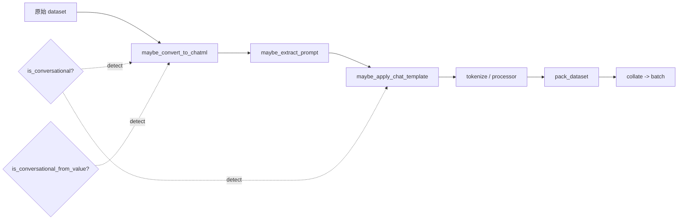
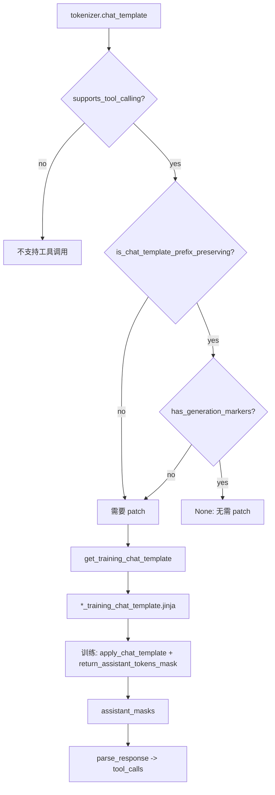

# 15 · 数据处理与聊天模板

> 本篇导览：围绕 `trl/data_utils.py`、`trl/chat_template_utils.py` 与 `trl/extras/dataset_formatting.py` 三个模块，梳理 TRL 如何把一份原始数据集（标准 / 对话 / ShareGPT / 多模态）变换成训练 batch，以及聊天模板在训练侧如何被 patch 成 prefix-preserving 且带 `` 损失掩码的可训练版本。

> 核心问题：
> - 一条样本从原始 dict 到 tokenized batch，要经过哪几步变换？谁负责检测格式、谁负责应用模板？
> - preference 数据集中"隐式 prompt"如何被还原成显式 `prompt` / `chosen` / `rejected` 三段？
> - DeepSeek-R1 等模型在 prompt-only 与 prompt+completion 渲染之间出现的 `thinking` token 错位如何被归一化？
> - 为什么训练用的 chat template 不能直接用推理模板？`` 损失掩码、prefix preservation、stop-token-in-loss 各解决什么问题？
> - 短序列如何被打包到固定 `seq_length`？`bfd` / `bfd_split` / `wrapped` 三种策略各自的取舍？

## 一、数据集格式：5 种 type × 2 种 format

TRL 把"数据集长什么样"拆成两个正交维度（参见 `docs/source/dataset_formats.md`）：

- **format**（结构）：`standard`（纯字符串）或 `conversational`（list of `{role, content}`）。
- **type**（任务）：`language-modeling`、`prompt-only`、`prompt-completion`、`preference`、`unpaired-preference`（外加实验性的 `stepwise-supervision`）。

5 种 type 各自的最小示例如下（conversational 形式）：

```python
# language-modeling
{"messages": [{"role": "user", "content": "..."}, {"role": "assistant", "content": "..."}]}
# prompt-only
{"prompt": [{"role": "user", "content": "..."}]}
# prompt-completion
{"prompt": [...], "completion": [{"role": "assistant", "content": "..."}]}
# preference（显式 prompt）
{"prompt": [...], "chosen": [...], "rejected": [...]}
# unpaired-preference
{"prompt": [...], "completion": [...], "label": True}
```

`trl/extras/dataset_formatting.py` 中的 `FORMAT_MAPPING` 给出两种 schema 的 features 定义：`chatml` 是 `List({content: Value("string"), role: Value("string")})`，`instruction` 是 `{prompt: Value("string"), completion: Value("string")}`；`datasets>=4.0` 用 `datasets.List`，老版本回退到原生 list-of-fields（dataset_formatting.py，行号基于 2026-07 探索）。它主要用于把外部数据集 cast 成 TRL 期望的 schema。

## 二、数据变换链路总览



**图说明**：实线箭头是数据流向，虚线箭头是检测分支。`maybe_*` 系列函数会在每一步先做格式检测，不满足条件就 no-op 直接放行，因此可以无副作用地串联进 `dataset.map(...)` 流水线。

## 三、`trl/data_utils.py`：数据集变换函数

### 3.1 多模态消息归一化

`prepare_multimodal_messages(messages, images=None)`（data_utils.py 行 33）把 raw-string `content` 转成结构化块列表，并在第一条 user 消息前注入 `{"type": "image"}` 占位（数量与 `images` 对齐），随后用 PIL 图像对象填充占位。占位数与 `images` 长度不匹配会抛 `ValueError`。已有的带 `image` payload 的块会被保留，不重复填充。

`prepare_multimodal_messages_vllm(messages)`（行 127）做一次深拷贝，把 `{"type": "image", "image": ...}` 改写成 vLLM 期望的 `{"type": "image_pil", "image_pil": ...}`。两个函数互为上下游：先用前者把任意输入规整成统一结构，再用后者在 vLLM 推理路径上改键名。

### 3.2 格式检测与 ShareGPT 兼容

`is_conversational(example)`（行 160）扫描 `prompt` / `chosen` / `rejected` / `completion` / `messages` 五个键，找到任一就检查它是否是 list、首元素是否是带 `role` 的 dict。这是 TRL 区分 standard / conversational 的总开关。

`is_conversational_from_value(example)`（行 894）检测 legacy ShareGPT 格式：`conversations` 字段下的消息用 `from` / `value` 而非 `role` / `content`。检测命中后由 `maybe_convert_to_chatml(example)`（行 934）做键名映射，并把 `conversations` 重命名为 `messages`：

```python
for key in ["prompt", "completion", "chosen", "rejected", "messages", "conversations"]:
    if key in example and isinstance(example[key], list):
        for message in example[key]:
            if "from" in message:
                message["role"] = message.pop("from")
            if "value" in message:
                message["content"] = message.pop("value")
if "conversations" in example:
    example["messages"] = example.pop("conversations")
```

### 3.3 应用聊天模板

`apply_chat_template(example, processing_class, tools=None, **template_kwargs)`（行 201）是核心。它先校验 example 的键集合必须落在六种合法组合（`{messages}` / `{prompt}` / `{prompt, completion}` / `{prompt, chosen, rejected}` / `{chosen, rejected}` / `{prompt, completion, label}`）内，否则抛 `KeyError`。

对 `prompt` 字段，根据最后一条消息的 role 决定渲染策略：

- 最后是 `user` 或 `tool` → `add_generation_prompt=True, continue_final_message=False`，即加上 assistant 头让模型继续生成；
- 最后是 `assistant` → `add_generation_prompt=False, continue_final_message=True`，即拼接续写已有 assistant turn。

对 `chosen` / `rejected` / `completion`，会用 `prompt + completion` 整体再渲染一次，然后以 prompt 渲染结果为前缀做最长公共前缀截取（行 270、283、296）：

```python
prompt = "".join(x for x, _ in takewhile(
    lambda x: x[0] == x[1], zip(prompt, prompt_chosen, strict=False)
))
chosen = prompt_chosen[len(prompt):]
```

这条公共前缀逻辑是为了消化 DeepSeek-R1 这类模板在 `add_generation_prompt=True` 与 `add_generation_prompt=False` 之间插入的 `thinking` token 差异：单独渲染 prompt 时模板可能加一个 `thinking` opener，但 `prompt+chosen` 整体渲染时不加，二者前缀对不齐会污染 prompt 边界。取公共前缀后，被截掉的部分被并入 completion，prompt 始终是两种渲染方式的一致前缀。注释里写得很清楚："In most cases, this is a no-op."

`maybe_apply_chat_template`（行 335）是 `apply_chat_template` 的 conversational 守卫版本：先 `is_conversational` 检测，命中才委托，否则原样返回。这让它可以无脑 `dataset.map`。

### 3.4 preference 数据集的拆 / 合

`extract_prompt(example)`（行 516）解决"隐式 prompt"问题：当 `chosen` / `rejected` 各自完整包含相同的对话前缀时，逐条比对找到首个不一致的 index，把 `[0, idx)` 切出来作为 `prompt`，`[idx, end)` 留作 completion。`maybe_extract_prompt`（行 603）加了守卫——若 example 已有 `prompt` 且 prompt 与 chosen 同为 conversational 或同为 standard，就视为已显式，不再二次抽取。

`unpair_preference_dataset(dataset, **map_kwargs)`（行 413）通过 `_unpair_row` 把每行 `{chosen, rejected, prompt?}` 拆成两行 `{completion, label, prompt?}`：chosen 行 `label=True`，rejected 行 `label=False`。这是 KTO 风格的非配对训练格式。`maybe_unpair_preference_dataset`（行 465）同样做了 `chosen` + `rejected` 列存在的守卫。

### 3.5 序列打包

`pack_dataset(dataset, seq_length, strategy="bfd", map_kwargs=None)`（行 804）把 tokenize 后的短序列拼到 `seq_length`，三种策略：

- `"bfd"`（Best Fit Decreasing，默认）：保留序列边界，超长序列直接截断丢弃溢出 token，调用 `_pack_bfd(..., on_seq_length_overflow="truncate")`。适合 SFT / 对话数据，保结构。
- `"bfd_split"`：同 BFD 但 `on_seq_length_overflow="split"`，把超长序列切成 `seq_length` 大小的片段，保留所有 token，但可能破坏对话结构。适合预训练 / 长文档。
- `"wrapped"`：调用 `_pack_wrapped`（行 788），完全忽略序列边界，按 `seq_length` 步长切整个 token 流。最快但最激进。

BFD 用 `_SegmentTree`（行 653）做 best-fit 查找：把序列按长度降序排，对每个序列在 segment tree 上 `search(length)` 找到 ≥ length 的最小剩余空间，没有就开新 bin。返回的表会附带一个 `seq_lengths` 列，记录每个 packed bin 中各段长度，后续可用来构造 `position_ids` 与 attention 边界。论文依据是 [Fewer Truncations Improve Language Modeling](https://huggingface.co/papers/2404.10830)。

`get_dataset_column_names(dataset)`（行 984）兼容 `Dataset` 与 `IterableDataset`：后者在 `column_names` 为 None 时回退到首条样本的 keys。

## 四、`trl/chat_template_utils.py`：聊天模板工具

聊天模板存在两副面孔：推理模板（tokenizer 自带）和训练模板（带损失掩码、prefix-preserving）。TRL 的目标是让任意支持工具调用的模板都能被安全地用于训练。



**图说明**：上半部分是检测链，下半部分是训练 + 解析链。`` 标记让 transformers 在 `return_assistant_tokens_mask=True` 时只对 assistant 段计算 loss；prefix-preserving 保证后续追加 tool 消息不会改变前序消息的 token 化结果，这是 `_get_tool_suffix_ids` 抽取 tool 格式 token 的前提。

### 4.1 检测函数族

`has_generation_markers(chat_template)`（行 37）用正则 `\{%-?\s*generation\s*-?%\}` 匹配 ``、`` 等变体。

`supports_tool_calling(processing_class)`（行 620）渲染一段 `user → assistant(tool_calls) → tool` 的对话，验证四个 sentinel（tool name、arg key、arg val、tool content）都出现在渲染结果里。basic Llama 3 会静默丢弃 `tool_calls`，Cohere2 / Phi3 会丢弃 tool 消息，都被这套 sentinel 检查拦下。对 DeepSeek-V3 这类对 dict 参数报 TypeError 的模板，会回落到把 `arguments` 序列化成 JSON 字符串再渲染。

`is_chat_template_prefix_preserving(processing_class)`（行 686）渲染 `messages1` 与 `messages2 = messages1 + [tool msg]` 两次，检查后者 token 序列的前缀是否等于前者。VLM 路径会注入一张 8x8 虚拟图，触发真实的 image-token 展开逻辑。

`is_chat_template_stop_token_trained(processing_class, chat_template=None)`（行 747）检查 assistant turn 的 end-of-turn token 是否落在 loss mask 内：渲染 `user → assistant → user`，取 `assistant_masks` 中最后一个非空白 token，验证它是否属于 `tokenizer.get_added_vocab()`。一些模板会把 eot token 归到下一条 user 消息上，导致模型永远学不会停下来。

### 4.2 训练模板获取

`get_training_chat_template(processing_class=None, tokenizer=None)`（行 875）的判定逻辑：

1. `prefix_ok = not supports_tool_calling(...) or is_chat_template_prefix_preserving(...)`：不支持工具调用就跳过 prefix 检查；
2. 若 `prefix_ok and has_generation_markers(chat_template)` → 返回 `None`，表示原模板可直接用于训练；
3. 否则按 `processing_class.chat_template` 字符串比对，返回对应的 `*_training_chat_template` 常量（这些常量在行 816-872 从 `trl/chat_templates/*_training.jinja` 读入）；
4. 全都不匹配则抛 `ValueError`，提示用户手动改模板。

目前支持的模型族：Cohere / Cohere2 / DeepSeek-V3 / Gemma / Gemma3 / GLM-4-MoE / GPT-OSS / Idefics3 / Llama3 / Llava-Next / Nemotron-3 (nano/super/ultra) / Phi3 / Phi3.5 / Qwen2.5 / Qwen2.5-VL / Qwen3 (含 Instruct-2507) / Qwen3-VL / Qwen3.5 (nothink/think) / Qwen3.6。`tokenizer` 参数已 deprecated，仅做向后兼容。

### 4.3 响应解析与 schema 注入

`add_response_schema(processing_class)`（行 537）按 chat template 字符串匹配，把对应的 legacy `*_schema`（regex dict）或 new-style `*_template`（结构化 fields dict）挂到 tokenizer 上。匹配对象包括 Qwen3 / Qwen3.5 / Qwen3.6 / Llama3.1-3.2 / GLM-4-MoE / GPT-OSS / Nemotron-3。`transformers>=5.13`（`_SUPPORTS_RESPONSE_TEMPLATE` 门控，行 34）走 `tokenizer.response_template`，老版本走 `tokenizer.response_schema`。

`parse_response(tokenizer, ids, prefix=None)`（行 1065）是 `tokenizer.parse_response` 的包装：

- `prefix` 参数仅在新式 parser（`response_template` 已设置且 transformers≥5.13）下传递，用于把 assistant 头部的 thinking opener 等上下文喂给 parser；
- 解析成功后做几步归一化：剥掉误附在 content 末尾的 EOS token（transformers#42249 热修复），把 None content 归一化为 `""`，调用 `_validate_tool_calls`（行 1027）确保 `tool_calls[i].function.name` 是 str、`arguments` 缺失时补 `{}`；
- 解析失败（`ValueError` / `TypeError`）时回落到 `tokenizer.decode(ids, skip_special_tokens=True)`，返回纯文本 content。

### 4.4 模板克隆

`clone_chat_template(model, tokenizer, source_tokenizer_path, resize_to_multiple_of=64)`（行 45）把源 tokenizer 的 chat template、added tokens、EOS token 复制到目标 tokenizer，并 `model.resize_token_embeddings(new_num_tokens=len(tokenizer.vocab), pad_to_multiple_of=...)`；如果 resize 后 embedding 仍大于 vocab，会循环添加 `<extra_id_N>` dummy token 直到对齐，最后断言 `len(tokenizer.vocab) == model.vocab_size`。

### 4.5 模块级常量

文件顶部加载了约 30 个 chat-template 字符串（行 482-531，从 `trl/chat_templates/*.jinja` 读），以及对应的 `*_training_chat_template`（行 816-872）。legacy schema dict（`glm4moe_schema` / `gptoss_schema` / `qwen3_schema` / `llama3_schema` / `qwen3_5_schema`）与新式 template dict（`qwen3_template` / `qwen3_5_template` / `glm4moe_template` / `llama3_template` / `gptoss_template` / `nemotron_3_template`）成对出现，分别对应 transformers 5.13 之前与之后的两种 parser。

## 五、上手示例

下面把一份 standard ShareGPT 风格数据集从原始格式一路推到可 tokenize 的状态：

```python
from datasets import Dataset
from transformers import AutoTokenizer
from trl import (
    maybe_convert_to_chatml,
    maybe_apply_chat_template,
    pack_dataset,
)

# 1) 原始 ShareGPT 风格数据
ds = Dataset.from_dict({
    "conversations": [
        [{"from": "user", "value": "What color is the sky?"},
         {"from": "assistant", "value": "It is blue."}],
    ],
})

# 2) ShareGPT -> ChatML
ds = ds.map(maybe_convert_to_chatml)
# -> {'messages': [{'role': 'user', 'content': '...'}, {'role': 'assistant', ...}]}

# 3) 应用 chat template
tok = AutoTokenizer.from_pretrained("Qwen/Qwen3-0.6B")
ds = ds.map(lambda ex: maybe_apply_chat_template(ex, tok))
# -> {'text': '<|im_start|>user\n...<|im_end|>\n<|im_start|>assistant\n...'}

# 4) tokenize + pack
def tok_fn(ex):
    return tok(ex["text"], truncation=True, max_length=2048)
ds = ds.map(tok_fn, remove_columns=["text"])
ds = pack_dataset(ds, seq_length=2048, strategy="bfd")
```

注意 `apply_chat_template` 对 `messages` 字段会把输出键改成 `text`（language-modeling 语义），而对 `prompt` / `completion` / `chosen` / `rejected` 保持原键名。preference 数据请额外走 `extract_prompt` 与 `unpair_preference_dataset` 还原 + 拆对。

## 小结

- TRL 的数据流水线是"检测 → 转换"的串联：`maybe_convert_to_chatml` → `maybe_extract_prompt` → `maybe_apply_chat_template` → tokenize → `pack_dataset`。每一步用 `is_conversational*` 守卫，不匹配就 no-op。
- 隐式 prompt preference 用 `extract_prompt` 取 chosen/rejected 的最长公共前缀还原；DeepSeek-R1 的 `thinking` token 错位用 prompt 与 prompt+completion 渲染结果的最长公共前缀消化。
- 训练用 chat template 必须同时满足 prefix-preserving 与 `` 标记两个性质，否则 `get_training_chat_template` 会返回对应 `*_training.jinja` 的 patched 版本；`None` 表示原模板可直接用。
- `parse_response` 是工具调用训练的关键收尾：解析模型输出 → 校验 `tool_calls` 结构 → 失败回落纯文本；EOS 误附、None content、缺 arguments 都有归一化处理。
- 打包策略按任务取舍：SFT/对话数据用 `bfd` 保边界、`bfd_split` 不丢 token；预训练/长文档可用 `wrapped` 充分填满 bin。`_SegmentTree` 把 best-fit 查找从 O(N) 压到 O(log N)。

下一篇 [16 · 分布式与 PEFT 集成](16_分_分布式与PEFT集成.md) 将切到训练并行与 LoRA/QLoRA 集成的实现细节。
