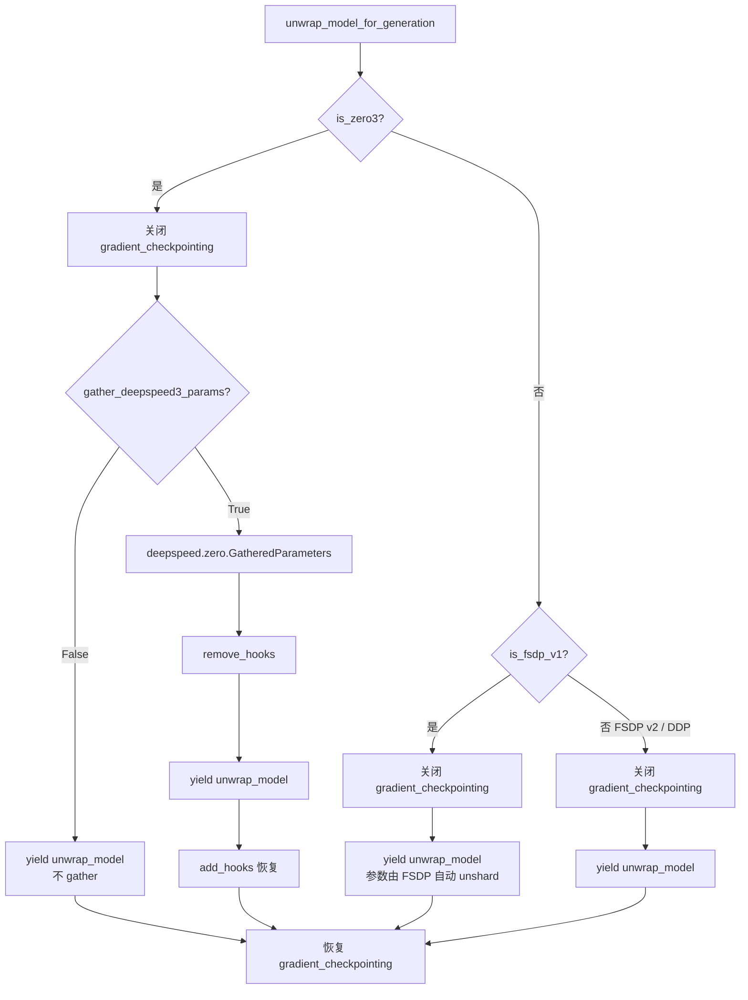

# 16 · 分布式与 PEFT 集成

> 本篇导览：TRL 的训练器要同时面对两类基础设施——多卡分布式（DeepSpeed ZeRO / FSDP v1&v2 / DDP）与参数高效微调（PEFT / bnb 量化）。两者交织在 `trl/distributed.py`、`trl/models/utils.py`、`trl/trainer/utils.py` 三个文件里：前者抽象后端、中者负责 unwrap/ref/prep、后者负责把 `ModelConfig` 翻译成 `PeftConfig`/`BitsAndBytesConfig`。本篇沿着这三块讲清楚，最后落到 accelerate yaml 模板与训练器集成要点。

> 核心问题：
> - 为什么 `DistributedBackend` 只暴露 `is_zero3` / `is_fsdp` 两个布尔 + 两个 no-op 上下文？
> - ZeRO-3 下做 generate 为什么要 `remove_hooks` → `gather` → `add_hooks` 这一套组合拳？DeepSpeed 0.16.4 的 API rename 又是怎么兼容的？
> - DPO/KTO 的 ref-via-adapter 技巧到底是怎么用 `use_adapter("ref")` 把"一份 PEFT 模型当两份用"的？
> - PEFT-under-FSDP 的 forward 重路由（`_ForwardRedirection`）解决了什么问题？
> - Liger + lm_head adapter 为什么会冲突？prompt-learning PEFT 又为什么不行？

---

## 一、`trl/distributed.py` 分布式后端抽象

### 1.1 设计意图

`distributed.py` 全文不到 100 行（行号基于 2026-07 探索），核心是一个 `DistributedBackend` 类。设计目标非常窄：**让上层训练器在写 ZeRO-3 gather、FSDP summon 这些操作时，不必 `import deepspeed`、`import torch.distributed.fsdp`，也不必写 `if is_zero3 / elif is_fsdp_v1 / else`**。一切 backend-specific 的 import 都被关进上下文管理器内部，按需 `import`。

### 1.2 构造与检测

```python
# trl/distributed.py:41-45
def __init__(self, accelerator):
    ds_plugin = accelerator.state.deepspeed_plugin
    fsdp_plugin = getattr(accelerator.state, "fsdp_plugin", None)
    self.zero_stage = ds_plugin.zero_stage if ds_plugin else 0
    self.fsdp_version = getattr(fsdp_plugin, "fsdp_version", None) if fsdp_plugin else None
```

构造时一次性从 `accelerator.state` 抓两个量：DeepSpeed 的 `zero_stage`（0/1/2/3，无 DS 时记 0）、FSDP 的 `fsdp_version`（1/2/None）。这两个值决定后续两个上下文是干活还是 no-op。

注意 `fsdp_plugin` 用 `getattr(..., "fsdp_plugin", None)` 取——这是为了兼容老版 accelerate（state 上没有这个字段时退化为 `None`，等价于"非 FSDP"）。`ds_plugin` 则直接取属性，因为 accelerate 一定提供这个字段（即便没启用 DS 也是 `None`）。

### 1.3 两个布尔属性

```python
# trl/distributed.py:47-55
@property
def is_zero3(self) -> bool:           # DeepSpeed ZeRO Stage 3
    return self.zero_stage == 3
@property
def is_fsdp(self) -> bool:            # FSDP v1 或 v2 任一
    return self.fsdp_version is not None
```

注意 `is_fsdp` 不区分 v1/v2，因为对外只关心"是不是 FSDP"；v1 与 v2 的差异被吸收进 `summon_full_params`。

### 1.4 两个上下文管理器

```python
# trl/distributed.py:57-71
@contextmanager
def gather_params(self, params):
    if self.is_zero3:
        import deepspeed
        with deepspeed.zero.GatheredParameters(params):
            yield
    else:
        yield
```

`gather_params` 在 ZeRO-3 下 wrap `deepspeed.zero.GatheredParameters`，把分片到各卡的参数临时 gather 到本卡；非 ZeRO-3 时直接 `yield`，零开销。这是 merge_adapter、generate、保存模型等场景的通用入口。

```python
# trl/distributed.py:73-91
@contextmanager
def summon_full_params(self, module, **kwargs):
    if self.fsdp_version == 1:
        from torch.distributed.fsdp import FullyShardedDataParallel as FSDP
        with FSDP.summon_full_params(module, **kwargs):
            yield
    else:
        yield
```

`summon_full_params` 只在 FSDP v1 下 wrap `FSDP.summon_full_params`；**FSDP v2 显式 no-op**——因为 v2（`fully_shard`）的参数在 forward 时本就自动 unshard，外部无需手动 materialize。注释明确写了这条设计原则。

文档示例展示了典型用法：

```python
>>> dist = DistributedBackend(accelerator)
>>> with dist.gather_params(list(model.parameters())):
...     model.merge_adapter()
>>> with dist.summon_full_params(model, recurse=False):
...     outputs = model.generate(inputs)
```

---

## 二、`trl/models/utils.py` 模型 unwrap 与准备

这个文件是 TRL 与分布式/PEFT 接驳的"主战场"，约 400 行（行号基于 2026-07 探索），承接了所有需要在分布式环境下"摸到原始模型"的操作。

### 2.1 DeepSpeed ZeRO-3 hook 管理

ZeRO-3 把参数 offload 到 optimizer 上，靠 forward/backward hook 在合适时机把分片拉回。但**生成时**这套 hook 会与 `model.generate()` 的多步 forward 冲突（典型表现：`Invalidate trace cache` 错误）。所以 `remove_hooks` / `add_hooks` 一对函数负责临时拆/装 hook：

```python
# trl/models/utils.py:47-67（节选）
def remove_hooks(model: "DeepSpeedEngine") -> None:
    if not hasattr(model, "optimizer"):  # 训练第一步前还没有 optimizer
        return
    if model.optimizer is not None and hasattr(model.optimizer, "parameter_offload"):
        optimizer_offload = model.optimizer.parameter_offload
    elif model.optimizer is not None:
        optimizer_offload = model.optimizer
    else:
        raise RuntimeError("The model optimizer is None, which is not yet supported.")
    for param in iter_params(optimizer_offload.module, recurse=True):
        param.ds_active_sub_modules.clear()
    for hook in optimizer_offload.forward_hooks:
        hook.remove()
    for hook in optimizer_offload.backward_hooks:
        hook.remove()
    optimizer_offload.forward_hooks = []
    optimizer_offload.backward_hooks = []
```

`add_hooks` 有两段兼容代码值得记：

```python
# trl/models/utils.py:93-103
if hasattr(optimizer_offload, "param_coordinator"):  # 仅 ZeRO stage 3 有
    coordinator = optimizer_offload.param_coordinator
    if not coordinator.is_invalid_trace():
        coordinator._invalidate_trace()   # 防 stale trace（修 GKD 兼容性）

if Version(deepspeed.__version__) >= Version("0.16.4"):
    # https://github.com/deepspeedai/DeepSpeed/pull/6847 改名
    optimizer_offload._register_deepspeed_module(optimizer_offload.module)
else:
    optimizer_offload._register_hooks_recursively(optimizer_offload.module)
```

第一段对应 DeepSpeed 的 `_invalidate_trace`：generate 时多次 forward 会让 param_coordinator 缓存的"该 gather 哪个模块"信息过期，必须显式失效。第二段对应 0.16.4 的 API rename（`_register_hooks_recursively` → `_register_deepspeed_module`），靠版本比较分叉。

### 2.2 `_unwrap_model_for_generation`

这是所有 GRPO/RLOO/OnlineDPO 等需要 in-loop generation 的训练器都要走的上下文：

```python
# trl/models/utils.py:133-150（节选）
unwrapped_model = accelerator.unwrap_model(model)
is_gradient_checkpointing = unwrapped_model.is_gradient_checkpointing
if is_gradient_checkpointing:
    unwrapped_model.gradient_checkpointing_disable()
if DistributedBackend(accelerator).is_zero3:
    if not gather_deepspeed3_params:
        yield accelerator.unwrap_model(model)
    else:
        with deepspeed.zero.GatheredParameters(model.parameters()):
            remove_hooks(model)
            yield accelerator.unwrap_model(model)
            add_hooks(model)
else:
    yield unwrapped_model
if is_gradient_checkpointing:
    unwrapped_model.gradient_checkpointing_enable()
```

三件事按顺序做：
1. **关 gradient_checkpointing**：generate 是 no_grad，开着 ckpt 浪费且会触发额外开销。
2. **ZeRO-3 时 gather + 拆 hook**：让参数可被 generate 直接读，避免 hook 在多步 forward 中冲突。退出时 `add_hooks` 把 hook 装回去。
3. **非 ZeRO-3 直接 yield**：FSDP / DDP 下 `unwrap_model` 出来的就是完整可用模型。

退出上下文时反向恢复 gradient_checkpointing 状态。注意：FSDP v2 在这里不需要特殊处理，正是因为 `summon_full_params` 那条 no-op 设计。

四种后端的分支可对照下图：



**图说明**：四种后端在 `_unwrap_model_for_generation` 下的行为差异。ZeRO-3 是唯一需要 `gather + 拆/装 hook` 的路径；FSDP v1 / v2 / DDP 都直接 yield。所有路径最终都汇合到"恢复 gradient_checkpointing"。

### 2.3 `_override_model_generation_config`

绕过 transformers <5 的 config-merge bug（issue transformers#42762，PR transformers#42702 在 v5 修复）。逻辑很简单：把 `model.generation_config` 临时替换成"原 config + 训练 kwargs"的合成版，退出时还原。

```python
# trl/models/utils.py:182-194（节选）
if hasattr(model, "get_base_model"):     # PEFT-aware：替换 base 的 config
    model = model.get_base_model()
original_config = model.generation_config
generation_config = GenerationConfig.from_dict(model.generation_config.to_dict())
generation_config.update(**generation_kwargs)
model.generation_config = generation_config
try:
    yield
finally:
    model.generation_config = original_config
```

注意 PEFT-aware 的细节：`get_base_model()` 钻进底层 transformers 模型再换 config，否则 PEFT wrapper 的 `generation_config` 可能不是真正参与生成的那个。

### 2.4 公开 API `unwrap_model_for_generation`

把上面两个内部上下文用 `with` 嵌套组合起来：

```python
# trl/models/utils.py:227-233
with (
    _unwrap_model_for_generation(model, accelerator,
                                  gather_deepspeed3_params=gather_deepspeed3_params) as unwrapped_model,
    _override_model_generation_config(unwrapped_model, generation_kwargs=generation_kwargs),
):
    yield unwrapped_model
```

这是训练器调用 generate 时唯一应该用的入口。

### 2.5 `prepare_deepspeed` 与 `prepare_fsdp`

这两个函数专门用于**ref / 推理模型**的初始化（policy 模型由 `accelerator.prepare` 统一处理）。

`prepare_deepspeed` 的关键点是 bucket 大小推导与 stage 0 退化：

```python
# trl/models/utils.py:269-273
if stage != 3:
    config_kwargs["zero_optimization"]["stage"] = 0   # ref 模型不分片，stage 0
model, *_ = deepspeed.initialize(model=model, config=config_kwargs)
model.eval()
return model
```

ZeRO-3 时 ref 也分片（否则 7B 以上 ref 会撑爆显存）；非 ZeRO-3 时把 stage 强制改成 0，让 ref 在每张卡上都常驻一份。bucket 大小（`reduce_bucket_size` / `stage3_prefetch_bucket_size` / `stage3_param_persistence_threshold`）按 `hidden_size` 推导，避免用户手动调。

`prepare_fsdp` 同时支持 v1（`FSDP(...)`）与 v2（`fully_shard(...)`）。v1 路径直接构造长 kwargs 字典调 `FSDP` 构造器；v2 路径用 `fully_shard` 函数式 API，并尊重 `ignored_modules`（通过 `get_parameters_from_modules` 抽出 ignored 参数传给 `ignored_params`）。注意 **`ignored_modules` 的处理对 PEFT 很关键**——嵌入到 base 模型里的 lm_head/embed_tokens 如果被 LoRA `modules_to_save`，往往要进 ignored 名单避免 FSDP 错误 wrap。

### 2.6 `_ForwardRedirection`

PEFT-under-FSDP 的关键技巧，注释里写明 ported from pytorch-lightning。问题背景：PEFT 包了一层 `PeftModel`，FSDP 又包了一层 `FSDP`。训练器调用 `model.training_step(...)` 时，期望它走 FSDP 的 forward（保证参数 unshard），但 PEFT 的 forward 又会拦在中间。`_ForwardRedirection` 的做法是临时把 `original_module.forward` 替换成一个 `wrapped_forward`，把方法调用"重路由"到 wrapper 的 forward：

```python
# trl/models/utils.py:352-366（节选）
def wrapped_forward(*_args, **_kwargs):
    original_module.forward = original_forward   # 立即 unpatch，防自递归
    out = method(*_args, **_kwargs)              # 真正调用 training_step 等
    self.on_after_inner_forward(wrapper_module, original_module)
    return out
original_module.forward = wrapped_forward       # patch
wrapper_output = wrapper_module(*args, **kwargs)  # 走 FSDP 的 forward
self.on_after_outer_forward(wrapper_module, original_module)
return wrapper_output
```

GRPO 在 Liger 路径上就用它：`self._forward_redirection(model, unwrapped_model, self.compute_liger_loss, unwrapped_model, inputs)`（grpo_trainer.py:2659）。

### 2.7 `disable_gradient_checkpointing`

简单工具：临时关掉 ckpt 再恢复。与 `_unwrap_model_for_generation` 内部的逻辑重叠，但作为独立上下文暴露给训练器在 ref forward 等场景使用。

---

## 三、`trl/trainer/utils.py` PEFT 与量化配置

### 3.1 `get_peft_config`

把 `ModelConfig` 的 LoRA 字段翻译成 `peft.LoraConfig`：

```python
# trl/trainer/utils.py:204-227
def get_peft_config(model_args: ModelConfig) -> "PeftConfig | None":
    if model_args.use_peft is False:
        return None
    if not is_peft_available():
        raise ValueError("...pip install -U peft")
    peft_config = LoraConfig(
        task_type=model_args.lora_task_type,
        r=model_args.lora_r,
        target_modules=model_args.lora_target_modules,
        target_parameters=model_args.lora_target_parameters,
        lora_alpha=model_args.lora_alpha,
        lora_dropout=model_args.lora_dropout,
        bias="none",
        use_rslora=model_args.use_rslora,
        use_dora=model_args.use_dora,
        modules_to_save=model_args.lora_modules_to_save,
    )
    return peft_config
```

注意 TRL 当前只产出 `LoraConfig`（不支持 PromptTuning/P_Tuning 等的自动翻译，那类配置由用户直接传 `peft_config` 进训练器）。`use_peft=False` 时返回 `None`，训练器据此跳过 `get_peft_model` 包裹。

### 3.2 `get_quantization_config`

构造 bnb 4bit/8bit 配置（QLoRA 用）：

```python
# trl/trainer/utils.py:185-201
if model_args.load_in_4bit:
    quantization_config = BitsAndBytesConfig(
        load_in_4bit=True,
        bnb_4bit_compute_dtype=model_args.dtype,
        bnb_4bit_quant_type=model_args.bnb_4bit_quant_type,
        bnb_4bit_use_double_quant=model_args.use_bnb_nested_quant,
        bnb_4bit_quant_storage=model_args.bnb_4bit_quant_storage,
    )
elif model_args.load_in_8bit:
    quantization_config = BitsAndBytesConfig(load_in_8bit=True)
else:
    quantization_config = None
```

`bnb_4bit_compute_dtype` 与模型 `dtype` 对齐，避免计算时再 cast。`bnb_4bit_quant_storage` 控制 4bit 量化底层存储类型，对 ZeRO-3 / FSDP 分片至关重要——分片大小取决于存储 dtype 而非 compute dtype。

### 3.3 `use_adapter` —— ref-via-adapter 的核心

DPO/KTO 不加载第二份模型，而是给同一份 PEFT 模型加一个 `"ref"` adapter，通过切换 active adapter 来"扮演"ref：

```python
# trl/trainer/utils.py:1084-1121
@contextmanager
def use_adapter(model: "PeftModel", adapter_name: str | None):
    if not is_peft_available():
        raise ImportError("...pip install peft")
    if adapter_name is None:
        with model.disable_adapter():   # 关掉所有 adapter = base 模型
            yield
    else:
        previous_adapter = model.active_adapter
        model.set_adapter(adapter_name)
        try:
            yield
        finally:
            model.set_adapter(previous_adapter)
```

`adapter_name=None` 时走 `model.disable_adapter()`——这等价于"用 base 模型"，所以即便没显式建 `"ref"` adapter，也可以拿 base 当 ref。这是 DPO 训练器里那段 `adapter_name="ref" if "ref" in model.peft_config else None` 的来历（dpo_trainer.py:1183、1370；grpo_trainer.py:2375）。

### 3.4 `create_model_from_path`

按 `ModelConfig` 加载模型 + 应用 PEFT 的总入口，逻辑：把字符串 dtype（`'bfloat16'` 等）转成 `torch.dtype`，`device_map` 默认 `"auto"`，根据 config 推断 architecture（含 remote-code 兜底走 `AutoModelForImageTextToText` / `AutoModelForCausalLM`），最后 `from_pretrained`。

### 3.5 `disable_dropout_in_model`

```python
# trl/trainer/utils.py:179-182
def disable_dropout_in_model(model: torch.nn.Module) -> None:
    for module in model.modules():
        if isinstance(module, torch.nn.Dropout):
            module.p = 0
```

DPO 中 `args.disable_dropout=True` 时调（dpo_trainer.py:880-883），同时作用于 policy 与 ref，避免 dropout 导致 ref logps 与 policy logps 不一致——这是 DPO 损失对 logps 差值敏感的必然要求。GRPO 同样有这个开关（grpo_trainer.py:834-837）。

---

## 四、加速配置 yaml 模板

TRL 在 `trl/accelerate_configs/` 自带 7 份 yaml：

| 文件 | distributed_type | 关键字段 | 用途 |
|---|---|---|---|
| `single_gpu.yaml` | `NO` | `mixed_precision: bf16` | 单卡 |
| `multi_gpu.yaml` | `MULTI_GPU` | 8 进程 bf16 | DDP 多卡 |
| `zero1.yaml` | `DEEPSPEED` | `zero_stage: 1` | ZeRO-1（仅分片 optimizer state） |
| `zero2.yaml` | `DEEPSPEED` | `zero_stage: 2`，无 offload | ZeRO-2（+ gradient） |
| `zero3.yaml` | `DEEPSPEED` | `zero_stage: 3`，`zero3_init_flag: true`，`zero3_save_16bit_model: true` | ZeRO-3（+ param） |
| `fsdp1.yaml` | `FSDP` | `fsdp_version: 1`，`TRANSFORMER_BASED_WRAP`，`FULL_SHARD` | FSDP v1 |
| `fsdp2.yaml` | `FSDP` | `fsdp_version: 2`，`fsdp_reshard_after_forward: true`（需 accelerate ≥ 1.7.0） | FSDP v2 |

用法：

```bash
trl sft --accelerate_config zero2 --num_processes 8 ...
```

CLI 会到 `trl/accelerate_configs/` 找对应文件，传给 `accelerate launch`。模板里 `num_processes: 8` 是默认值，命令行 `--num_processes` 会覆盖。

值得注意的几条：
- `zero3.yaml` 把 `zero3_init_flag` 和 `zero3_save_16bit_model` 都开成 true——前者让 init 时就分片（FnD），后者保证 save 时出 16bit 模型而非分片 ckpt。
- `fsdp1.yaml` 用 `fsdp_use_orig_params: true`——这是 PEFT 必须的，否则 LoRA adapter 参数没法单独管理。
- `fsdp2.yaml` 的注释明示要 accelerate ≥ 1.7.0，`fsdp_version: 2` 走的是 `fully_shard` 函数式 API。

---

## 五、PEFT 与训练器集成要点

### 5.1 统一的 `peft_config` 入口

所有稳定训练器（SFT/DPO/GRPO/RLOO/KTO/Reward）的 config 都暴露 `peft_config: PeftConfig | None` 字段；训练器 `__init__` 里若非 None 则用 `get_peft_model(model, peft_config)` 包裹。这是用户进 PEFT 的唯一显式入口；`ModelConfig` 的 LoRA 字段走 `get_peft_config` 路径，最终也汇到 `peft_config`。

### 5.2 DPO / KTO 的 ref-via-adapter

DPO 三种 ref 策略（dpo_trainer.py:861-903）：
1. **PEFT 模型** → 不建独立 ref，用 `use_adapter("ref")` 或 `use_adapter(None)`（base 当 ref）。
2. **precompute_ref_log_probs** → 一次性算完，存进 dataset，训练时不再走 ref。
3. **独立 ref_model** → `prepare_deepspeed` / `prepare_fsdp` 装备进对应后端。

PEFT 路径下 ref forward 的典型代码：

```python
# trl/trainer/dpo_trainer.py:1183
with use_adapter(model, adapter_name="ref" if "ref" in model.peft_config else None):
    ref_outputs = model(...)
```

注意条件：只有当用户真的建了名为 `"ref"` 的 adapter 时才切过去；否则用 `use_adapter(None)` 走 base（disable 所有 adapter）。这是"一份 PEFT 模型当两份用"的精髓——base 当 ref，active adapter 当 policy，共享所有 base 权重。

### 5.3 GRPO 的 Liger 不兼容 guard

GRPO 在 Liger 路径下做了两类 PEFT 兼容性检查（grpo_trainer.py:681-706）：

```python
# trl/trainer/grpo_trainer.py:681-706（节选）
if self.use_liger_kernel and is_peft_model(model):
    # ... 检查 target_modules 是否包含 lm_head ...
    "`use_liger_kernel=True` is incompatible with applying a PEFT adapter to `lm_head`.
     Either remove 'lm_head' from your target_modules, or set use_liger_kernel=False."
    # ... 检查是否为 prompt-learning PEFT ...
    "`use_liger_kernel=True` is incompatible with prompt-learning PEFT methods
     (PromptTuning, ...). Set use_liger_kernel=False."
```

原因：Liger 的 `LigerFusedLinearGRPOLoss` 直接吃 `lm_head` 的 weight（fused linear），如果 lm_head 上挂了 adapter，fused path 走的就是错权重；prompt-learning 类 PEFT 改的是 embedding 而非 weight，与 fused linear 假设完全不兼容。

### 5.4 PEFT-under-FSDP 的 forward 重路由

见 2.6 节。GRPO 在 Liger 损失计算时通过 `_ForwardRedirection` 把 `compute_liger_loss` 的调用重路由进 FSDP 的 forward，保证参数在 forward 期间 unshard。这是 PEFT-under-FSDP 训练能跑起来的关键技巧之一。

### 5.5 dropout 一致性

`disable_dropout_in_model` 在 DPO 与 GRPO 中都有应用。核心动机：ref logps 与 policy logps 必须在同一 dropout 状态下计算，否则 DPO 的 `logratio` 项会引入噪声。开 `disable_dropout=True` 时同时作用于 policy 与 ref。

---

## 上手示例：PEFT + DeepSpeed ZeRO-3 的 GRPO 配置

下面给一个完整可跑的 GRPO + LoRA + ZeRO-3 配置示例，把本篇讲到的所有点串起来。

```bash
# 1) 启动：用 TRL 自带 zero3 模板，8 卡
trl grpo \
  --accelerate_config zero3 \
  --num_processes 8 \
  --model Qwen/Qwen2.5-7B-Instruct \
  --dataset trl-lib/tldr \
  --output_dir grpo-lora-zero3 \
  --bf16 \
  --use_peft \
  --lora_r 16 --lora_alpha 32 \
  --lora_target_modules q_proj k_proj v_proj o_proj \
  --num_generations 8 \
  --per_device_train_batch_size 2 \
  --gradient_accumulation_steps 8 \
  --learning_rate 5e-6 \
  --num_train_epochs 1
```

要点：
- `--accelerate_config zero3` 选 `trl/accelerate_configs/zero3.yaml`，开 ZeRO-3 + `zero3_init_flag` + `zero3_save_16bit_model`。
- `--use_peft` + LoRA 字段经 `get_peft_config` 翻译成 `LoraConfig`，由 `get_peft_model` 包裹。
- 训练循环里 GRPO 调 `unwrap_model_for_generation(model, accelerator)` 走 generate 路径——此时 ZeRO-3 分支触发 `GatheredParameters` + `remove_hooks` → yield → `add_hooks`。
- 不要在 LoRA `target_modules` 里加 `lm_head`，否则若同时开 `--use_liger_kernel` 会被 5.3 的 guard 拒掉。
- 注意 `trl/accelerate_configs/zero3.yaml` 默认无 offload，若 7B + LoRA 仍吃紧，可手写 `zero_offload_optimizer: true` / `zero_offload_param: true` 进 yaml。

代码层面等价的 Python 写法：

```python
from trl import GRPOConfig, GRPOTrainer
from peft import LoraConfig

cfg = GRPOConfig(
    output_dir="grpo-lora-zero3",
    model_name_or_path="Qwen/Qwen2.5-7B-Instruct",
    bf16=True,
    use_peft=True,
    lora_r=16, lora_alpha=32,
    lora_target_modules=["q_proj", "k_proj", "v_proj", "o_proj"],
    num_generations=8,
    per_device_train_batch_size=2,
    gradient_accumulation_steps=8,
    learning_rate=5e-6,
)
peft_config = LoraConfig(
    r=cfg.lora_r, lora_alpha=cfg.lora_alpha,
    target_modules=cfg.lora_target_modules,
    lora_dropout=cfg.lora_dropout, bias="none",
    task_type="CAUSAL_LM",
)
trainer = GRPOTrainer(config=cfg, peft_config=peft_config)
trainer.train()
# 启动：accelerate launch --config_file trl/accelerate_configs/zero3.yaml train.py
```

---

## 小结

- **`DistributedBackend` 的极简设计**：只暴露两个布尔 + 两个 no-op 上下文，把 backend-specific import 全部关进上下文内部，让上层训练器不必写 `if zero3 / elif fsdp`。
- **ZeRO-3 generate 三件套**：`remove_hooks` → `GatheredParameters` + yield → `add_hooks`。`add_hooks` 内含 DeepSpeed 0.16.4 API rename 与 `_invalidate_trace` 兼容。FSDP v2 在 `summon_full_params` 上是 no-op，因为参数本就自动可访问。
- **ref-via-adapter 是 PEFT 节省显存的精髓**：DPO/KTO 用 `use_adapter("ref")` 或 `use_adapter(None)` 让一份 PEFT 模型同时扮演 policy 与 ref，省一倍 base 权重。
- **`_ForwardRedirection` 解决 PEFT-under-FSDP 的方法调用重路由**：临时 patch `forward`，让训练器方法调用走 FSDP 的 forward，从而触发参数 unshard。
- **Liger + PEFT 有显式 guard**：`lm_head` adapter 与 prompt-learning PEFT 都与 Liger fused path 不兼容，GRPO 在 init 时直接报错。

下一篇 [17 · CLI 与脚本入口](17_分_CLI与脚本入口.md) 将转向 TRL 的命令行入口——`trl` CLI 如何发现训练器、解析参数、`accelerate launch` 怎么被自动调起、`accelerate_configs/` 模板怎么被引用，以及 `scripts/` 下的示例脚本如何与 CLI 协作。
