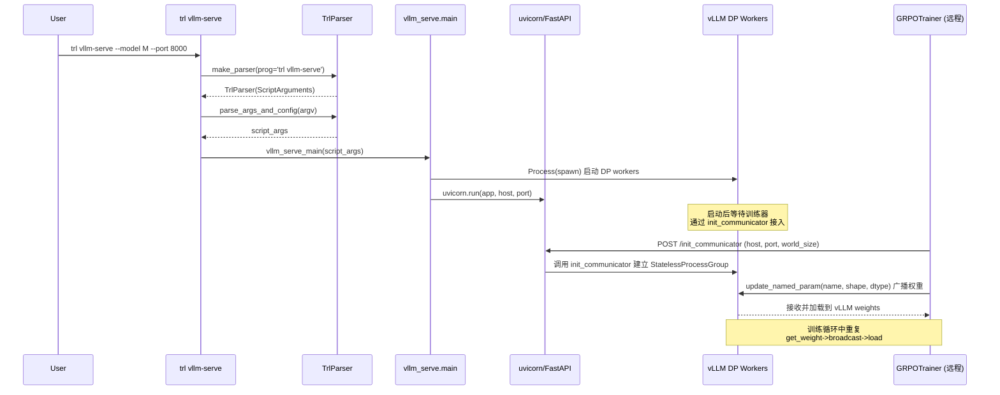

# 17 · CLI 与脚本入口

> 本篇导览：从用户在终端键入 `trl sft ...` 那一刻起，到训练进程被 `accelerate launch` 拉起、构造 `SFTTrainer` 之前，TRL 是如何把命令行字符串拆解、解析、转发到底层训练脚本的。我们将完整跟踪 `trl/cli/` 与 `trl/scripts/` 两层结构，理解 `TrlParser` 如何同时承载 YAML 配置与命令行参数，`accelerate_config` 如何在两套命名约定之间转换，以及 `--config <yaml>`、`--accelerate_config <name>`、`vllm-serve` 这些特殊入口的工作机制。

> 核心问题：
> - `trl <cmd>` 这个命令背后到底调用了什么？为什么进程不是直接 `python trl/scripts/sft.py`？
> - CLI 子命令 `dpo/grpo/kto/rloo/sft/reward` 共用同一个 `TrainingCommand` 类，为什么它们仍能各自承载独立的脚本入口与参数？
> - `--config <yaml>` 与 `--accelerate_config <name>` 看起来都叫 "config"，但分别归 `TrlParser` 与 `accelerate_config.py` 管理，两者职责如何切分？
> - vLLM 服务入口 `trl vllm-serve` 与训练入口的差异在哪里？为什么它不走 `accelerate launch`？

## 一、`trl/cli/` 命令行界面总览

TRL CLI 在 `pyproject.toml` 中以 entry-point 形式注册：

```toml
[project.scripts]
trl = "trl.cli:main"
```

也就是说，安装后终端的 `trl` 命令最终调用 `trl/cli/__init__.py` 暴露的 `main` 函数（`trl/cli/__init__.py` 第 15 行 re-export `trl/cli/main.py` 的 `main`）。整个 CLI 层只是个非常薄的调度器，本身不实现任何训练逻辑，只负责把字符串参数转发给 `trl/scripts/` 下的训练脚本。

### 1.1 `main(argv)` 入口

`trl/cli/main.py`（行号基于 2026-07 探索）的整体流程只有 5 步：

```python
def main(argv: list[str] | None = None) -> int:
    commands = get_commands()
    commands_by_name = {command.name: command for command in commands}
    parser = _build_parser(commands)
    argv = list(sys.argv[1:] if argv is None else argv)
    args, _ = parser.parse_known_args(argv)
    command_name = getattr(args, "command", None)
    if command_name is None:
        parser.print_help()
        return 0
    command = commands_by_name[command_name]
    context = CommandContext(argv=argv)
    return command.run(args, context)
```

注意三个细节：第一，这里用的是 `parse_known_args` 而不是 `parse_args`，目的在于只解析子命令名（`dest="command"`），其余 token 全部留给子命令的 `run` 自己处理；第二，`argv` 被原样装进 `CommandContext` 透传给子命令，子命令自己再去取 `argv_after(token)`；第三，CLI 顶层 parser 用 `allow_abbrev=False`，避免前缀匹配干扰后续 `TrlParser` 的参数切分。

### 1.2 `Command` 抽象基类与 `CommandContext`

`trl/cli/commands/base.py` 定义了 CLI 调度的最小契约：

```python
@dataclass(slots=True)
class CommandContext:
    argv: list[str]

    def argv_after(self, token: str) -> list[str]:
        try:
            index = self.argv.index(token)
        except ValueError:
            return []
        return self.argv[index + 1 :]


class Command(ABC):
    def __init__(self, name: str, help_text: str):
        self.name = name
        self.help_text = help_text

    @abstractmethod
    def register(self, subparsers) -> None: ...

    @abstractmethod
    def run(self, args: Namespace, context: CommandContext) -> int: ...
```

`CommandContext.argv_after(token)` 是一个极简工具：给定子命令名 `token`，返回它在 argv 中第一次出现之后的所有 token。`TrainingCommand` 用它把 `trl grpo --model ...` 切成 `["--model", ...]` 交给 `TrlParser`。

`Command` 是一个典型的策略模式：每个子命令把"如何注册 subparser"与"如何执行"两件事分别交由 `register` 与 `run` 实现，`main` 只做注册和派发。这避免了把所有命令逻辑塞在一个巨型 `if/elif` 中。

### 1.3 `get_commands()` 命令清单

`trl/cli/commands/__init__.py` 集中列出所有顶层子命令：

```python
def get_commands() -> list[Command]:
    return [
        TrainingCommand("dpo"),
        EnvCommand(),
        TrainingCommand("grpo"),
        TrainingCommand("kto"),
        TrainingCommand("reward"),
        TrainingCommand("rloo"),
        TrainingCommand("sft"),
        SkillsCommand(),
        VllmServeCommand(),
    ]
```

注意 `dpo/grpo/kto/reward/rloo/sft` 共用同一个 `TrainingCommand` 类，区别仅是构造时传入的 `name` 字符串不同——这个字符串同时决定了脚本文件名（`trl/scripts/<name>.py`）和子命令名（`trl <name>`）。`EnvCommand`、`SkillsCommand`、`VllmServeCommand` 因为行为差异较大，独立成类。

## 二、`TrainingCommand`：参数切分与脚本派发

`trl/cli/commands/training.py` 是 CLI 层最关键的文件之一。它要解决的核心难题是：用户在命令行同时传入了三种来源的参数——`--config <yaml>` 的训练参数、`accelerate launch` 的分布式启动参数、`--accelerate_config <name>` 的预定义加速器配置名——三者前缀相似但归属不同，必须分门别类喂给不同消费者。

### 2.1 切分逻辑

```python
def run(self, args, context):
    from ..accelerate_config import resolve_accelerate_config_argument
    from ..accelerate_launcher import launch_training_script

    module = importlib.import_module(f"...scripts.{self.name}", package=__package__)
    all_args = context.argv_after(self.name)
    parser = module.make_parser(prog=f"trl {self.name}")

    *_, config_remaining, cli_remaining = parser.parse_args_and_config(
        all_args, return_remaining_strings=True, separate_remaining_strings=True
    )
    launch_args = resolve_accelerate_config_argument(config_remaining + cli_remaining)
    training_script_args = _subtract_subsequence(all_args, cli_remaining)

    launch_training_script(
        script_name=f"{self.name}.py",
        launch_args=launch_args,
        training_script_args=training_script_args,
    )
    return 0
```

注意几个关键点：

1. **动态 import**：`importlib.import_module(f"...scripts.{self.name}", ...)` 才真正加载训练脚本模块。也就是说 `trl/cli/` 在不进入子命令之前，完全不会 import `trl.scripts.sft`/`trl.scripts.grpo` 等，CLI 启动开销因此非常低。

2. **`make_parser(prog=f"trl {self.name}")`**：每个训练脚本必须暴露一个 `make_parser(subparsers=None, prog=None)` 工厂，返回一个 `TrlParser` 实例。`prog` 决定了 `-h` 输出里的命令前缀。

3. **`separate_remaining_strings=True`**：这是 `TrlParser` 的扩展能力（见 §3.1）。开启后 `parse_args_and_config` 会把"未识别参数"分成两份——`config_remaining`（来自 YAML 顶层未被任何 dataclass 字段消费的键）与 `cli_remaining`（命令行上未被消费的 token）。两者相加才是 accelerate launch 该收到的参数。`_subtract_subsequence(all_args, cli_remaining)` 则反过来从原始 argv 中剔除命令行未消费部分，得到完整的训练参数（含 YAML 中已通过 `set_defaults_with_config` 注入到 parser default 的部分，因为它们已被消费、不在 remaining 中）。

4. **`resolve_accelerate_config_argument`**：见下节。

## 三、accelerate 配置解析与脚本启动

### 3.1 `resolve_accelerate_config_argument`

`trl/cli/accelerate_config.py` 解决一个命名约定的差异：TRL CLI 暴露的是 `--accelerate_config <name>`（下划线、单横线风格），而 `accelerate launch` 接受的是 `--config_file <path>`。

```python
def resolve_accelerate_config_argument(launch_args: list[str]) -> list[str]:
    if "--accelerate_config" not in launch_args:
        return launch_args

    config_index = launch_args.index("--accelerate_config")
    if config_index + 1 >= len(launch_args):
        raise ValueError("Expected a value after `--accelerate_config`.")

    config_name = launch_args[config_index + 1]
    if Path(config_name).is_file():
        accelerate_config_path = config_name
    else:
        candidate = resources.files("trl.accelerate_configs").joinpath(f"{config_name}.yaml")
        if not candidate.exists():
            raise ValueError(
                f"Accelerate config {config_name} is neither a file nor a valid config in the `trl` package."
            )
        accelerate_config_path = candidate

    launch_args = launch_args[:config_index] + launch_args[config_index + 2 :]
    return ["--config_file", str(accelerate_config_path)] + launch_args
```

`<name>` 可以是文件系统路径（直接透传），也可以是 `trl/accelerate_configs/` 下预定义的 yaml 名（去掉 `.yaml` 后缀），当前仓库预置 `single_gpu`、`multi_gpu`、`zero1`、`zero2`、`zero3`、`fsdp1`、`fsdp2` 七种。解析后的 token 会被改写为 `["--config_file", <path>, ...]`，前置是为了让 accelerate launch 优先识别。

### 3.2 `launch_training_script`

`trl/cli/accelerate_launcher.py` 把剩余 launch 参数与训练脚本路径拼成 accelerate launch 的命令行：

```python
def launch_training_script(script_name, launch_args, training_script_args, *, 
                           launch_command_fn=launch_command,
                           launch_parser_fn=launch_command_parser):
    training_script = resources.files("trl.scripts").joinpath(script_name)
    accelerate_args = launch_parser_fn().parse_args(
        launch_args + [str(training_script)] + training_script_args
    )
    launch_command_fn(accelerate_args)
```

注意两点：第一，`importlib.resources.files("trl.scripts").joinpath(script_name)` 直接定位到安装后的脚本路径，不需要在文件系统上找；第二，`launch_command` 与 `launch_command_parser` 是 accelerate 包提供的，TRL 不重新实现，只是把组装好的 `Namespace` 喂进去。`launch_command` 内部会按需 fork 出多个 rank 进程，每个进程最终都执行 `python <training_script> <training_script_args>`。

整体调用链可由下图概括：

```mermaid
flowchart LR
    A["trl grpo --model M --dataset D<br/>--accelerate_config zero2 --num_processes 8"] --> B["main(argv)<br/>trl/cli/main.py"]
    B --> C["get_commands().TrainingCommand('grpo')"]
    C --> D["argv_after('grpo')<br/>得到 all_args"]
    D --> E["scripts.grpo.make_parser<br/>(prog='trl grpo')"]
    E --> F["TrlParser.parse_args_and_config<br/>(separate_remaining_strings=True)"]
    F --> G1["config_remaining<br/>(yaml 残留)"]
    F --> G2["cli_remaining<br/>(命令行残留)"]
    G1 --> H["resolve_accelerate_config_argument<br/>--accelerate_config zero2 -><br/>--config_file trl/accelerate_configs/zero2.yaml"]
    G2 --> H
    H --> I["launch_args"]
    D --> J["_subtract_subsequence(all_args, cli_remaining)<br/>-> training_script_args"]
    I --> K["accelerate_launcher.launch_training_script('grpo.py', ...)"]
    J --> K
    K --> L["accelerate launch --config_file zero2.yaml<br/>trl/scripts/grpo.py --model M --dataset D"]
    L --> M["构造 GRPOTrainer.train()"]
```



**图说明**：上图展示了一条完整的 `trl grpo` 命令从终端到训练器构造的端到端调用链。重点在于参数被切分成 `launch_args`（accelerate launch 消费）与 `training_script_args`（训练脚本消费）两股，前者还经历了 `--accelerate_config` 到 `--config_file` 的命名重写。

## 四、`TrlParser` 与共享数据类

### 4.1 vendored `HfArgumentParser`

`trl/scripts/_hf_argparser.py` 在文件头注释中写明：

```
# Copied from: https://github.com/huggingface/transformers/blob/3a275d3581c0ecf962f7412aa764c2047331fd6b/src/transformers/hf_argparser.py
# This avoids an upstream latency issue: https://github.com/huggingface/transformers/issues/44273
# - Moved yaml import inside function
```

也就是把 transformers 的 `HfArgumentParser` 整体拷贝到本地，唯一的修改是把 `import yaml` 从模块顶部移到方法内部，规避 transformers 上游 #44273 的 import-latency bug。`trl/scripts/utils.py` 顶部注释也明确说明"等 transformers 最低版本包含修复后可以撤回"。

### 4.2 `ScriptArguments` / `DatasetMixtureConfig` / `DatasetConfig`

`trl/scripts/utils.py` 定义了所有训练脚本共享的数据类，其中 `ScriptArguments` 是所有脚本 dataclass 链的根基：

```python
@dataclass
class ScriptArguments:
    dataset_name: str | None = None
    dataset_config: str | None = None
    dataset_train_split: str = "train"
    dataset_test_split: str = "test"
    dataset_streaming: bool = False
    ignore_bias_buffers: bool = False  # DDP bool-buffer 修复
```

`DatasetConfig` 字段对齐 `datasets.load_dataset` 的签名（`path`/`name`/`data_dir`/`data_files`/`split`/`columns`）；`DatasetMixtureConfig` 把多个 `DatasetConfig` 装在一起，并加 `streaming` 与 `test_split_size` 两个字段，`__post_init__` 中会把 dict 形式的项自动转成 `DatasetConfig`（这来自 YAML 解析时的纯 dict 形态）。

### 4.3 `TrlParser.parse_args_and_config`

`TrlParser` 是 `HfArgumentParser` 的子类，核心扩展是 `parse_args_and_config`：

```python
def parse_args_and_config(self, args=None, return_remaining_strings=False,
                          fail_with_unknown_args=True, separate_remaining_strings=False):
    args = list(args) if args is not None else sys.argv[1:]
    if "--config" in args:
        config_index = args.index("--config")
        args.pop(config_index)
        config_path = args.pop(config_index)
        with open(config_path) as yaml_file:
            config = yaml.safe_load(yaml_file)

        if "env" in config:
            env_vars = config.pop("env", {})
            for key, value in env_vars.items():
                os.environ[key] = str(value)

        config_remaining_strings = self.set_defaults_with_config(**config)
    else:
        config_remaining_strings = []

    output = self.parse_args_into_dataclasses(args=args, return_remaining_strings=return_remaining_strings)
    ...
```

它做了三件事：

1. **加载 `--config <yaml>`**：从 argv 中摘掉 `--config` 与路径，把 yaml 内容拆成 `env` 段和顶层键。
2. **设置环境变量**：yaml 的 `env:` 段里每个键值对直接写进 `os.environ`，注意 value 被 `str()` 化以兼容 yaml 的 int/bool 推断。
3. **改写 parser 默认值**：剩余键通过 `set_defaults_with_config(**config)` 递归地（含 subparsers）替换每个 dataclass 字段的 default，并把这个字段标记为 `required=False`。这样命令行不显式传该字段时，默认值就来自 yaml；显式传时仍以命令行为准（覆盖 default）。

`separate_remaining_strings=True` 把 YAML 残留（未被 dataclass 消费的键）与命令行残留（未识别的 token）分开返回，正好供 `TrainingCommand.run` 使用。

### 4.4 配套工具函数

`trl/scripts/utils.py` 还提供了：

- `init_zero_verbose()`：把 logging level 提到 ERROR、用 RichHandler 美化输出、把 `warnings.showwarning` 重定向到 logging，让 CLI 输出更干净。
- `get_git_commit_hash(package_name)`：通过 `importlib`+`inspect` 找到包路径，向上找 `.git` 目录并 `git rev-parse HEAD`，被 `scripts/env.py` 用于在 TRL 版本号后追加 `+<short_hash>`。
- `get_dataset(mixture_config)`：按 `DatasetMixtureConfig.datasets` 逐项 `load_dataset`、`select_columns`，再 `concatenate_datasets`，可选 `train_test_split`，返回 `DatasetDict`。

## 五、各训练脚本要点

所有训练脚本都遵守同一份"模板"：模块顶部声明 `main(script_args, training_args, model_args, dataset_args)`，文件末尾再定义 `make_parser(subparsers=None, prog=None)` 与 `if __name__ == "__main__"` 块。`make_parser` 返回的 dataclass 元组依次对应 `main` 的四个参数，名字一一对应。

| 脚本 | 训练器 | Config | ScriptArgs |
|---|---|---|---|
| `scripts/sft.py` | `SFTTrainer` | `SFTConfig` | `ScriptArguments` |
| `scripts/dpo.py` | `DPOTrainer` | `DPOConfig` | `ScriptArguments` |
| `scripts/kto.py` | `KTOTrainer` | `KTOConfig` | `ScriptArguments` |
| `scripts/grpo.py` | `GRPOTrainer` | `GRPOConfig` | `GRPOScriptArguments(ScriptArguments)` |
| `scripts/rloo.py` | `RLOOTrainer` | `RLOOConfig` | `RLOOScriptArguments(ScriptArguments)` |
| `scripts/reward.py` | `RewardTrainer` | `RewardConfig` | `ScriptArguments` |

### 5.1 `scripts/sft.py`

`make_parser` 把 `(ScriptArguments, SFTConfig, ModelConfig, DatasetMixtureConfig)` 注册到 `TrlParser`。`main` 把 `model_args` 的 `revision/trust_remote_code/attn_implementation/dtype` 写到 `training_args.model_init_kwargs`，再由 `SFTTrainer` 在内部用这些 kwargs 去 `from_pretrained`。

### 5.2 `scripts/dpo.py`

结构与 sft 几乎一致，但保留 `ScriptArguments.ignore_bias_buffers`（DPO 显式支持该 DDP bool-buffer 修复），并在 `DPOTrainer` 构造时透传。这是因为 DPO 在反向时会同步 ref/active 两份模型的 buffer，DDP 下 bool buffer 类型不匹配会触发 `invalid scalar type`。

### 5.3 `scripts/kto.py`

KTO 的特殊点在于显式加载 ref model：

```python
model = AutoModelForCausalLM.from_pretrained(...)
ref_model = AutoModelForCausalLM.from_pretrained(...)
trainer = KTOTrainer(model=model, ref_model=ref_model, ...)
```

KTO 的损失需要参照模型来计算未对齐概率，因此脚本里同时 `from_pretrained` 两份。

### 5.4 `scripts/grpo.py` 与 `scripts/rloo.py`

GRPO 引入 `GRPOScriptArguments(ScriptArguments)`，加 `reward_model_name_or_path` 与 `reward_funcs: list[str]` 两个字段。`main` 中构造 `reward_funcs_registry`：

```python
reward_funcs_registry = {
    "accuracy_reward": accuracy_reward,
    "reasoning_accuracy_reward": reasoning_accuracy_reward,
    "think_format_reward": think_format_reward,
    "get_soft_overlong_punishment": get_soft_overlong_punishment(max_completion_len=1280, soft_punish_cache=256),
}
```

`reward_funcs` 列表中的每一项要么命中 registry、要么是点分导入路径（如 `my_lib.rewards.custom_reward`，用 `importlib.import_module` + `getattr` 加载，加载前会把 `os.getcwd()` 加到 `sys.path` 以便找到用户工程内的奖励函数），否则抛 `ValueError`。`rloo.py` 在结构与奖励处理逻辑上与 grpo 镜像，唯一差别是构造 `RLOOTrainer`、用 `RLOOScriptArguments`。这种镜像正是 `AGENTS.md` 中"重复但保持一致"原则的体现。

### 5.5 `scripts/reward.py`

`RewardTrainer` + `RewardConfig`，训练独立的奖励模型。结构与 sft 同构，但不需要 ref model，也不需要 reward_funcs 解析。

### 5.6 `scripts/env.py`

`print_env()` 把当前环境打印成一份 markdown 列表，包含 platform、Python、TRL 版本（含 git hash）、torch/transformers/accelerate/datasets/huggingface_hub/bitsandbytes/deepspeed/liger_kernel/peft/vllm 版本、加速器设备（CUDA/MPS/XPU/CPU）、accelerate 默认配置内容。`trl env` 子命令直接调它，常用于 bug report。

### 5.7 `scripts/vllm_serve.py`（详见第 14 篇）

启动 FastAPI/uvicorn vLLM 服务，核心组件包括 `WeightSyncWorkerExtension`（vLLM worker 扩展，用于训练器与推理 worker 之间的权重同步）、`StatelessProcessGroup`+`PyNcclCommunicator` 通信、`update_named_param` 流式权重推送。它由 `VllmServeCommand` 直接调用 `main(script_args)`，不走 accelerate launch。

`VllmServeCommand` 与 `TrainingCommand` 的区别值得注意：前者把 argv 全部交给 `parse_args_and_config`（不传 `separate_remaining_strings`），得到单个 `script_args` 后直接 `vllm_serve_main(script_args)`；后者则需要切分 launch 与训练参数、再走 `accelerate_launcher`。这是因为 vllm-serve 不在 accelerate 框架下，自己管多 GPU（通过 spawn + NCCL）。



**图说明**：vllm-serve 启动后是常驻进程，等待训练器（GRPO/RLOO）通过 HTTP + StatelessProcessGroup 介入，然后周期性同步权重。这与训练入口的"一次性 accelerate launch"完全不同——`vllm-serve` 的生命周期独立于任何一次训练。

## 六、`--config <yaml>` 用法详解

YAML 文件支持两类内容：

- `env:` 段：键值对会被 `os.environ[key] = str(value)`，等价于在执行前 `export`。
- 顶层键：作为 `TrlParser` 中各 dataclass 字段的默认值，命令行同名参数可覆盖。

仓库 `examples/cli_configs/example_config.yaml` 给了最小示例：

```yaml
# env:
#   CUDA_VISIBLE_DEVICES: 0

model_name_or_path:
  Qwen/Qwen2.5-0.5B
dataset_name:
  stanfordnlp/imdb
report_to:
  none
learning_rate:
  0.0001
lr_scheduler_type:
  cosine
```

单 GPU SFT 场景下：

```bash
trl sft --config examples/cli_configs/example_config.yaml \
        --output_dir ./sft-out
```

多 GPU ZeRO-2 场景则叠加 `--accelerate_config`：

```bash
trl sft --config my_config.yaml \
        --accelerate_config zero2 \
        --num_processes 8 \
        --output_dir ./sft-out
```

注意 `--config` 与 `--accelerate_config` 完全独立：前者经 `TrlParser.parse_args_and_config` 走训练脚本参数通道；后者经 `resolve_accelerate_config_argument` 走 accelerate launch 参数通道。它们可以同时存在，互不干扰。

## 七、CLI 与训练器的关系

CLI 是面向终端用户的便捷入口，但训练器**不依赖** CLI。`SFTTrainer`、`DPOTrainer`、`GRPOTrainer` 等都是普通 Python 类，可以直接 `from trl import SFTTrainer` 后在脚本里构造、调用 `.train()`，无需经 CLI。CLI 的存在只是把"加载模型、构造 dataset、配置训练参数、调用 trainer"这套样板代码固化在 `trl/scripts/<name>.py` 里。

调用链可以概括为：

```
trl <cmd> ...              # 用户终端
  → trl.cli.main           # 调度
    → TrainingCommand.run  # 切分参数
      → resolve_accelerate_config_argument
      → launch_training_script
        → accelerate launch trl/scripts/<cmd>.py <args>
          → TrlParser.parse_args_and_config  # 解析为 dataclass
            → main(script_args, training_args, model_args, dataset_args)
              → 构造 Trainer → .train() → .save_model()
```

理解了这条链，再看 `trl scripts <cmd> -h` 的输出、`--config` 失效原因、`--accelerate_config` 报错信息，都能精确地定位到链中某一环。

## 上手示例

**示例 1：最简单的 SFT**

```bash
trl sft --model_name_or_path Qwen/Qwen2.5-0.5B \
        --dataset_name trl-lib/Capybara \
        --output_dir ./out
```

CLI 调度 → `accelerate launch trl/scripts/sft.py ...` → `SFTTrainer(...).train()`。默认 accelerate 配置为单 GPU。

**示例 2：多 GPU ZeRO-2 + accelerate 预置配置**

```bash
trl sft --accelerate_config zero2 \
        --num_processes 8 \
        --model_name_or_path Qwen/Qwen2.5-0.5B \
        --dataset_name trl-lib/Capybara \
        --output_dir ./out
```

`--accelerate_config zero2` 被 `resolve_accelerate_config_argument` 重写为 `--config_file trl/accelerate_configs/zero2.yaml`，`--num_processes 8` 是 accelerate launch 直接消费的 token，其余参数透传给训练脚本。

**示例 3：YAML config 全量配置**

```yaml
# my_config.yaml
env:
  CUDA_VISIBLE_DEVICES: 0,1,2,3
  TOKENIZERS_PARALLELISM: "false"

model_name_or_path: Qwen/Qwen2.5-1.5B
dataset_name: trl-lib/Capybara
learning_rate: 2.0e-5
num_train_epochs: 1
per_device_train_batch_size: 2
gradient_accumulation_steps: 8
packing: true
```

```bash
trl sft --config my_config.yaml \
        --accelerate_config multi_gpu \
        --num_processes 4 \
        --output_dir ./out
```

`env:` 段被写入环境变量；顶层键作为 `SFTConfig`/`ModelConfig`/`ScriptArguments` 的默认值；命令行 `--output_dir` 覆盖未在 yaml 中出现的字段；`--accelerate_config multi_gpu` 启动 4 进程 DDP。

## 小结

- **CLI 是薄壳，脚本是肉**：`trl/cli/` 只做参数切分与派发，所有训练逻辑都在 `trl/scripts/<name>.py`。`TrainingCommand` 通过 `importlib` 懒加载脚本，CLI 启动开销极低。
- **三套参数三套消费者**：`--config <yaml>` → `TrlParser`（训练参数+env）；`--accelerate_config <name>` → `resolve_accelerate_config_argument` → accelerate launch；命令行残留 → 加速器启动器。`separate_remaining_strings=True` 是切分的关键开关。
- **`TrlParser` 是 `HfArgumentParser` 的扩展**：vendored 在 `_hf_argparser.py` 解决 transformers #44273 import 延迟问题；`parse_args_and_config` 同时承载 yaml 加载、环境变量注入、默认值重写三件事。
- **`vllm-serve` 是特例**：不走 accelerate，自身管多 GPU；与训练器的关系不是"被启动"而是"被远程接入"。
- **训练器与 CLI 解耦**：可完全用 Python API `from trl import SFTTrainer` 绕过 CLI；CLI 只是把样板代码固化在 `trl/scripts/` 中。

下一篇 [18 · 奖励函数与回调系统](18_分_奖励函数与回调系统.md) 将深入 `trl/rewards/` 与 trainer 的回调钩子机制。
