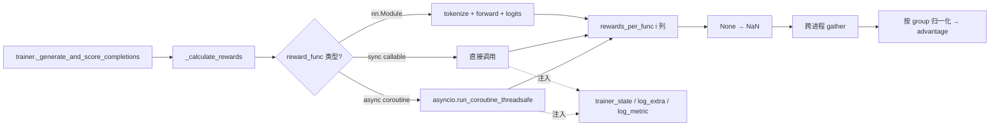
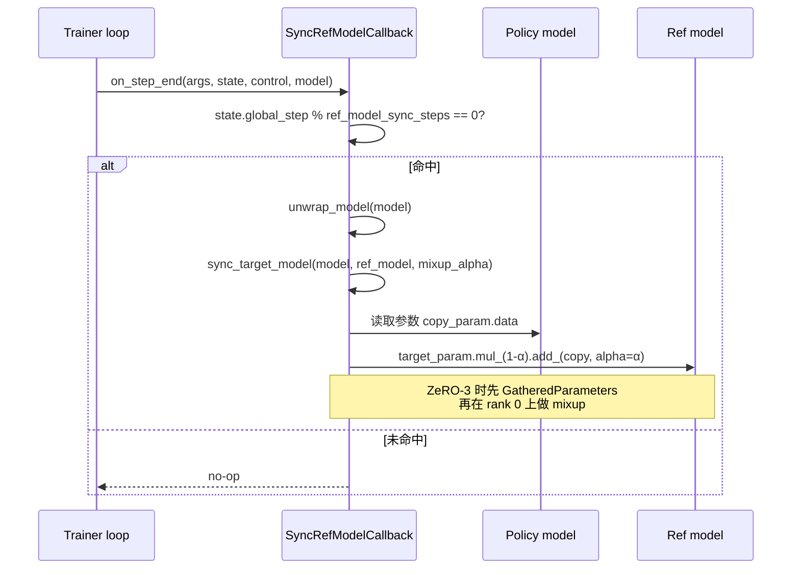

# 18 · 奖励函数与回调系统

> 本篇导览：TRL 的 RL 训练器（GRPO / RLOO）把"评分"与"训练循环外的副作用"分别交给两套可扩展机制——奖励函数与训练回调。前者集中在 `trl/rewards/` 三份文件里：`accuracy_rewards.py`、`format_rewards.py`、`other_rewards.py`，统一签名 `(completions, **kwargs)`；后者集中在 `trl/trainer/callbacks.py`，覆盖 ref 模型同步、完成样本日志、Rich 进度条、Weave 跟踪与 BEMA EMA。本篇先讲奖励函数的设计与三类内置实现，再讲 `trl/scripts/grpo.py` 的注册机制，然后讲训练器侧的统一调用流（同步/异步分发），最后讲回调系统与上手示例。

> 核心问题：
> - 为什么所有奖励函数都吃 `**kwargs`？为什么工厂函数（`get_cosine_scaled_reward` 等）返回的是 callable class 而不是闭包？
> - `accuracy_reward` 在主线程与子线程里 timeout 行为为什么不同？`None` 在结果里代表什么？
> - `reasoning_accuracy_reward` 与 `accuracy_reward` 都用 `math_verify`，前者多走一步"剥离 reasoning"，区别在哪里？为什么无 reasoning 标记时返回 `0.0` 而不是 `None`？
> - `_calculate_rewards` 在 GRPO 与 RLOO 之间复制——它们到底是不是逐字相同？sync 与 async 两条路径如何分流？
> - `SyncRefModelCallback` 的 EMA mixup 公式是什么？为什么要在 ZeRO-3 下走 `GatheredParameters`？

---

## 一、`trl/rewards/` 奖励函数库

### 1.1 设计原则

`trl/rewards/` 下三份文件 + 一个 `__init__.py`，导出 6 个名字：

```python
# trl/rewards/__init__.py:21-25
_import_structure = {
    "accuracy_rewards": ["accuracy_reward", "get_cosine_scaled_reward", "reasoning_accuracy_reward"],
    "format_rewards": ["think_format_reward"],
    "other_rewards": ["get_repetition_penalty_reward", "get_soft_overlong_punishment"],
}
```

`__init__.py` 走 `_LazyModule` 懒加载，`math_verify` 这类重依赖只在真正 import `accuracy_reward` 时才被拉起。两个统一约定贯穿整个库：

1. **签名统一**：每个奖励函数都吃 `**kwargs`，并且显式声明训练器会注入的 kwargs（`completions`、`solution`、`completion_ids`、`log_extra`、`reasoning_delimiters`）。docstring 里写明"`**kwargs` 是为了与 `GRPOTrainer` 等训练器兼容"。
2. **工厂必须可 pickle**：`get_cosine_scaled_reward`、`get_repetition_penalty_reward`、`get_soft_overlong_punishment` 返回的是 callable class 实例（`_CosineScaledReward` / `_RepetitionPenalty` / `_SoftOverlongPunishment`），而不是闭包。原因是 async GRPO 的 rollout worker 会把 reward funcs 经 pickle 转发到 spawn 出来的子进程，闭包不可 pickle。每个 callable class 都显式声明 `__name__`（如 `"cosine_scaled_reward"`），让 metric log 的 key 与"旧版用内部函数时"对齐。

### 1.2 `accuracy_rewards.py` —— 数学正确性奖励

三个函数都依赖 `math_verify`（`latex2sympy2_extended` + `parse`/`verify`）。

**`accuracy_reward`** 是最基础的一条：用 `math_verify.parse` 解析 gold 与 completion 中的 LaTeX/boxed 答案，再 `verify` 比对。

```python
# trl/rewards/accuracy_rewards.py:28-33
def accuracy_reward(
    completions: list[list[dict[str, str]]],
    solution: list[str],
    log_extra: Callable[[str, list], None] | None = None,
    **kwargs,
) -> list[float | None]:
```

三段关键逻辑（accuracy_rewards.py，行号基于 2026-07 探索）：

- **timeout 适配**（行 72-81）：`math_verify` 内部用 `signal.alarm` 实现超时，这只在主线程有效。函数在子线程里跑时把 `parsing_timeout=None`、`verify_timeout=None`，并 `setLevel(logging.ERROR)` 抑制 "Timeout is disabled" 警告。这条分支对 async GRPO（reward 在 daemon 线程跑）至关重要。
- **三态返回**（行 83-108）：gold 可解析、completion 也可解析 → `verify` 返回 `1.0`/`0.0`；gold 不可解析 → 返回 `None`（让训练器把这条样本"跳过"，不参与归一化）；completion 不可解析但 gold 可解析 → `verify` 返回 `0.0`。
- **`log_extra`**（行 110-113）：把 `solution` / `gold_parsed` / `answer_parsed` 三列写回 `LogCompletionsCallback` 的表格，便于人工 review 模型答错的具体形态。

**`get_cosine_scaled_reward`**（行 118-174）是 `accuracy_reward` 的"长度塑造"包装。返回的 `_CosineScaledReward` 按 `completion_ids` 长度做 cosine 缩放：

```
R_cos(y) = v_min + 0.5 * (v_max - v_min) * (1 + cos(progress * π))
```

正确样本用 `(min_value_correct, max_value_correct)`——**短的正确得分更高**（鼓励简洁）；错误样本把上下界对调成 `(max_value_wrong, min_value_wrong)`——**短的错误扣分更狠，长的错误扣分较轻**（保留探索）。`progress = min(len(ids)/max_len, 1.0)` 显式 clamp，避免 cosine 周期性导致超长样本反而爬回高分。引用论文 *Demystifying Long Chain-of-Thought Reasoning*（App. C.1）。

**`reasoning_accuracy_reward`**（行 223-350）多走一步：先用 `reasoning_delimiters`（默认 `[" think"]`，think/answer 标签的结束 token）从 completion 中切出"最终答案"段，再交给 `parse`/`verify`。两种特殊返回：

- 完全找不到任何 delimiter → `is_reasoning_complete = False`，直接给 `0.0`（**未完成推理**的惩罚），不是 `None`；
- gold 不可解析 → 仍返回 `None`（跳过该样本）。

这与 `accuracy_reward` 的语义差别：前者不区分"答错"与"没答完"，后者会把"没答完"也按 `verify` 比对——往往给 `0.0`，但只有 `reasoning_accuracy_reward` 能在还没结束 reasoning 时就显式打 0 分。

### 1.3 `format_rewards.py` —— 格式奖励

**`think_format_reward`**（format_rewards.py，行 18-50）单文件单函数，正则匹配 think/answer 标签包裹的标准格式：

```python
pattern = r"^ think(?!.* think)(.*?) answer.*$"
matches = [re.match(pattern, content, re.DOTALL | re.MULTILINE) for content in completion_contents]
return [1.0 if match else 0.0 for match in matches]
```

注意 `(?!.* think)` 这个负向先行断言——它确保整段只有一个 `think` 开标签，避免"模型把 reasoning 内部又包了 think/answer 块"这类异常格式被误判为合法。匹配返回 `1.0`，否则 `0.0`，没有 `None` 状态。

### 1.4 `other_rewards.py` —— 长度与重复惩罚

**`get_repetition_penalty_reward(ngram_size=3, max_penalty=-1.0)`** 返回 `_RepetitionPenalty`：

```python
# trl/rewards/other_rewards.py:71-80
def __call__(self, completion_ids, **kwargs):
    for ids in completion_ids:
        if len(ids) < self.ngram_size:
            rewards.append(0.0); continue
        ngrams = list(zip(*[ids[i:] for i in range(self.ngram_size)], strict=False))
        scaling = 1 - len(set(ngrams)) / len(ngrams)
        rewards.append(scaling * self.max_penalty if scaling else 0.0)
```

惩罚正比于"重复 n-gram 占比"：`(1 - unique/total) * max_penalty`。无重复时给 `0.0`（不是 `None`），完全重复趋近 `max_penalty`（必须非正）。引用 *Demystifying Long CoT* App. C.2。

**`get_soft_overlong_punishment(max_completion_len, soft_punish_cache)`** 返回 `_SoftOverlongPunishment`，应用 DAPO 论文 Eq. (13) 的三段长度罚：

- 长度 ≤ `max_completion_len - soft_punish_cache`：`0.0`（不罚短样本）；
- 落在 `[L_max - L_cache, L_max]`：线性从 0 降到 -1；
- 超过 `L_max`：直接 `-1.0`。

这避免"硬截断后突然给负奖励"的不连续，给模型平滑的"快超了"信号。

## 二、奖励函数注册机制

`trl/scripts/grpo.py` 维护一个字符串→可调用对象的内置映射：

```python
# trl/scripts/grpo.py:82-87
reward_funcs_registry = {
    "accuracy_reward": accuracy_reward,
    "reasoning_accuracy_reward": reasoning_accuracy_reward,
    "think_format_reward": think_format_reward,
    "get_soft_overlong_punishment": get_soft_overlong_punishment(max_completion_len=1280, soft_punish_cache=256),
}
```

注意第 4 行——`get_soft_overlong_punishment` 这条注册的不是工厂函数本身，而是**已构造好的 callable class 实例**。这是工厂类奖励函数进 registry 的标准模式：注册时调一次工厂，把参数固化进实例，再把这个实例当 reward func 喂给 trainer。

`--reward_funcs` 字符串列表的解析逻辑（行 94-108）走两级回退：

1. 命中 `reward_funcs_registry` → 直接取；
2. 包含 `.`（点分导入路径，如 `mymodule.my_reward`）→ `importlib.import_module(module_path)` + `getattr(module, func_name)`，并在 `sys.path.insert(0, os.getcwd())` 让 cwd 下的模块也能被找到；
3. 否则抛 `ValueError`，列出可用 key。

也就是说：内置 4 个函数用短名（`accuracy_reward`），自定义函数用点分路径，无需修改 TRL 任何代码。

## 三、`trl/trainer/callbacks.py` 回调系统

`callbacks.py`（行号基于 2026-07 探索）提供 5 个 callback + 1 个工具函数 `_generate_completions`。

### 3.1 `SyncRefModelCallback` —— ref 模型 EMA

```python
# trl/trainer/callbacks.py:117-134
@staticmethod
def _sync_target_model(model, target_model, alpha):
    for target_param, copy_param in zip(target_model.parameters(), model.parameters(), strict=True):
        target_param.data.mul_(1.0 - alpha).add_(copy_param.data, alpha=alpha)
```

每个参数走 `target = (1-α) * target + α * policy` 的 EMA mixup。`sync_target_model` 在 ZeRO-3 下包 `deepspeed.zero.GatheredParameters`（在 rank 0 上做混合），其他情况直接原地操作。`on_step_end` 检查 `state.global_step % args.ref_model_sync_steps == 0` → 调 `sync_target_model(model, self.ref_model, args.ref_model_mixup_alpha)`。两个超参 `ref_model_sync_steps` / `ref_model_mixup_alpha` 都来自训练器 config。

### 3.2 `BEMACallback` —— bias-corrected EMA

`BEMACallback`（行 577-760）实现 BEMA 论文（https://huggingface.co/papers/2508.00180）。它维护 θ₀ 快照与 EMA buffer，按 `αₜ = (ρ + γ·t)⁻ᵏᵃᵖᵖᵃ` 与 `βₜ = (ρ + γ·t)⁻ᵏᵃᵖᵖᵃ` 双衰减，最终输出 `run_param = ema + α * (θₜ - θ₀)`——比朴素 EMA 多一个"偏差校正"项，理论上能在非凸 SGD 下收敛到真值。`on_train_begin` 克隆模型与 θ₀；`on_step_end` 在 `update_after` 之后每 `update_freq` 步更新一次；`on_train_end` 把 `running_model` 存到 `{output_dir}/bema`。

`trl/experimental/bema_for_ref_model/callback.py` 里有一个实验性的 `CallbackHandlerWithRefModel`——它继承 transformers 的 `CallbackHandler`，在 `call_event` 里多传一个 `ref_model` kwarg，让 callback 能拿到 ref 模型。BEMACallback 本体放在 `trainer/callbacks.py`，experimental 目录只是用法扩展。

### 3.3 `LogCompletionsCallback` 与 `WeaveCallback`

`LogCompletionsCallback`（行 256-345）在每 `freq` 步用 `_generate_completions` 在 eval_dataset 的 prompt 上生成样本，攒成 `pd.DataFrame(columns=["step","prompt","completion"])`，按 `args.report_to` 写到 wandb 表格 / Comet。它就是奖励函数 `log_extra` 那一列的真正落点——通过 `trainer._log_completion_extra` 注入到 reward_kwargs。

`WeaveCallback`（行 348-574）类似但走 Weave（W&B 子产品）的 `EvaluationLogger`，分 tracing / evaluation 两模式：前者只 log 预测，后者还会调用户提供的 `scorers: dict[str, Callable]` 给每条预测打分并汇总。两者都在 `on_evaluate` 触发（不是训练 step），更贴合"评估"语义。

### 3.4 `RichProgressCallback`

Rich 库的进度条美化（行 145-253）。把 `on_log` 的扁平 metric 字典按 `/` 前缀分组，每组渲染成一个 `rich.table.Table`，再 `Columns` 并排塞进 `Panel`，比 transformers 默认的 tqdm 输出更易读。仅 world_process_zero 上工作。

## 四、奖励函数在训练器中的调用流

`GRPOTrainer._calculate_rewards` 与 `RLOOTrainer._calculate_rewards` 几乎逐字相同（grpo_trainer.py:1394、rloo_trainer.py:938）。唯一显式差异：GRPO 在同步分支里多了 `if self.environments is not None: reward_kwargs["environments"] = self.environments`——因为 GRPO 支持 Harbor/OpenEnv 工具调用循环，RLOO 不支持。这是 AGENTS.md 所说的"语义性分歧"。

统一调用流的简化结构（grpo_trainer.py:1394-1483）：

```python
def _calculate_rewards(self, inputs, prompts, completions, completion_ids_list):
    device = self.accelerator.device
    rewards_per_func = torch.zeros(len(prompts), len(self.reward_funcs), device=device)
    keys = [k for k in inputs[0] if k not in ["prompt", "completion", "completion_ids"]]
    reward_kwargs = {k: [ex[k] for ex in inputs] for k in keys}
    reward_kwargs["trainer_state"] = self.state   # 动态奖励塑造
    reward_kwargs["log_extra"] = self._log_completion_extra
    reward_kwargs["log_metric"] = self._log_metric
    ...
```

三种分支：

- **`nn.Module`**（reward model 路径）：走 `reward_processing_class` tokenize → `_prepare_inputs` → `reward_func(**inputs).logits[:, 0]`。
- **同步 callable**：直接 `reward_func(prompts=..., completions=..., completion_ids=..., **reward_kwargs)`。
- **async coroutine**：`inspect.iscoroutinefunction(reward_func)` 为真时收集到 `async_funcs_info`，最后用 `asyncio.run_coroutine_threadsafe(_run_async_funcs(), self.async_loop).result()` 提交到训练器 daemon 事件循环并行执行（`asyncio.gather` 收集所有 async reward 协程）。

`None` 处理：每条 reward 是 `None` 时转 `torch.nan`；如果某一行所有 reward func 都返回 `None`，触发 `logger.warning(...)` 把该行的 kwargs 完整 dump 出来，提示用户至少一条 reward func 必须给出有效值。最后 `gather(rewards_per_func)` 跨进程聚合（reward 按 group 归一化，但 completions 可能分布在各进程上，所以必须先 gather）。



**图说明**：trainer 在每个 rollout 结束后调 `_calculate_rewards`，按 reward func 类型分流——reward model 走 nn.Module 路径、同步函数直接调、async 函数提交到 daemon 事件循环并行执行。三条路径都注入 `trainer_state` / `log_extra` / `log_metric`，结果统一写到 `rewards_per_func` 的对应列，`None` 转 NaN，再跨进程 gather，最后按 group 归一化得到 advantage。



**图说明**：`SyncRefModelCallback.on_step_end` 每个 step 都被调，但只在 `global_step % ref_model_sync_steps == 0` 时真正同步。同步就是按 `target = (1-α)*target + α*policy` 的 EMA 公式逐参数混合，ZeRO-3 下需要先 `GatheredParameters` 把分片参数聚到 rank 0，混合完再释放。

## 上手示例：自定义奖励函数 + 注册到 GRPO

最简形态——只要写一个吃 `**kwargs`、返回 `list[float]` 的函数：

```python
# mymodule.py
def my_reward(completions, **kwargs) -> list[float]:
    # kwargs 里会有 prompts / completion_ids / solution / trainer_state / log_extra ...
    # 你只需要返回与 completions 等长的 list[float | None]
    return [1.0 if "answer" in c[0]["content"].lower() else 0.0 for c in completions]
```

直接用点分导入路径喂给 CLI，**无需修改 TRL**：

```bash
trl grpo \
  --model Qwen/Qwen2.5-7B-Instruct \
  --dataset trl-lib/tldr \
  --reward_funcs accuracy_reward \
  --reward_funcs mymodule.my_reward \
  --output_dir grpo-custom-reward
```

如果奖励需要构造参数（像 `get_cosine_scaled_reward(max_len=512)`），就不能用点分路径——必须自己调工厂再传 trainer：

```python
from trl import GRPOConfig, GRPOTrainer
from trl.rewards import get_cosine_scaled_reward, accuracy_reward

cfg = GRPOConfig(output_dir="grpo-cosine", ...)
trainer = GRPOTrainer(
    model="Qwen/Qwen2.5-7B-Instruct",
    reward_funcs=[accuracy_reward, get_cosine_scaled_reward(max_len=512)],
    args=cfg,
    train_dataset=ds,
)
trainer.train()
```

要点：
- 签名一定要带 `**kwargs`，否则训练器注入的 `prompts` / `completion_ids` / `trainer_state` / `log_extra` / `log_metric` 会触发 `TypeError`；
- 返回 `None` 表示"这条样本跳过"，所有 reward func 全 `None` 时训练器会 warn；
- 想在 async GRPO 子进程里跑，工厂必须返回 callable class（不能是闭包）——直接套 `get_xxx` 系列就是安全的。

---

## 小结

- **统一签名 + 可 pickle** 是 `trl/rewards/` 的两条铁律：`**kwargs` 让训练器能传统一 kwargs 包，callable class（带 `__name__`）让 async GRPO worker 能经 pickle 转发 reward funcs。
- **三态返回**（`1.0`/`0.0`/`None`）是 `accuracy_reward` 系列的核心：`None` 表示"gold 不可解析，跳过该样本"，与"答错"语义不同；`reasoning_accuracy_reward` 在此基础上多一个"未完成推理 → `0.0`"的硬性惩罚。
- **`_calculate_rewards` 在 GRPO/RLOO 间几乎逐字相同**，唯一显式分歧是 GRPO 多 `environments` 注入（工具调用循环需要）；sync / async / nn.Module 三条路径分流，async 用 `asyncio.run_coroutine_threadsafe` 提交到 daemon loop。
- **注册机制两级回退**：内置 4 个短名走 `reward_funcs_registry`，自定义走点分导入路径，工厂类奖励函数注册时调一次工厂固化参数。
- **回调系统覆盖训练循环外的副作用**：`SyncRefModelCallback` 做 EMA mixup（ZeRO-3 下走 GatheredParameters），`BEMACallback` 做偏差校正 EMA，`LogCompletionsCallback`/`WeaveCallback` 落盘完成样本与评分，`RichProgressCallback` 美化输出。

下一篇 [19 · 模型工具与激活卸载](19_分_模型工具与激活卸载.md) 将转向 `trl/models/utils.py` 与 `trl/models/activation_offloading.py`——前者覆盖 `unwrap_model_for_generation`、`create_model_from_path`、`get_quantization_config` 等模型加载工具，后者覆盖激活值 checkpoint/offload 的实现细节。
