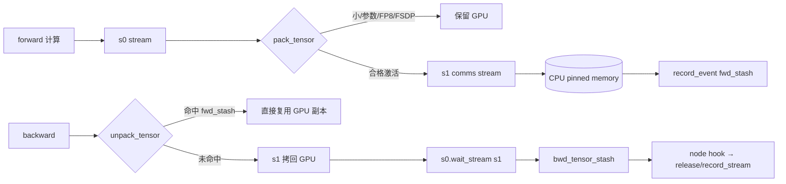
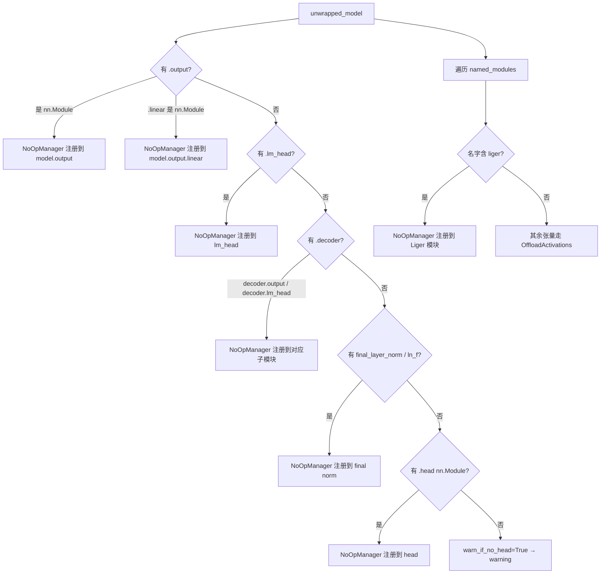

# 19 · 模型工具与激活卸载

> 本篇导览：本篇拆解 TRL 在 `trl/models/` 下的两组"基础设施"代码。其一是 `utils.py` 中面向分布式推理/训练的模型 unwrap 工具（ZeRO-3 hooks、FSDP 包装、forward 重路由、generation_config 临时覆盖、reference_model 兼容垫片），其二是 `activation_offloading.py` 中基于 `saved_tensors_hooks` 的激活卸载引擎以及训练器如何将其挂到 `training_step` 上。两者合在一起解决了"在大模型分布式训练期间如何安全切出一份可推理的模型权重"和"在 VRAM 拘据时如何把前向激活搬到 CPU pinned memory 又不影响反向"两个问题。

> 核心问题：
> - DeepSpeed ZeRO-3 把参数分片在多卡上，做生成时如何 gather 出完整参数并保证退出上下文后 hook 状态不变？
> - FSDP v1/v2、PEFT 嵌套包装下，如何安全 unwrap 模型并临时覆盖 `generation_config`？
> - 如何在不开 gradient checkpointing 的情况下进一步压缩激活显存？又如何与 gradient checkpointing 共存？
> - `create_reference_model` 现在到底在哪？老代码为什么仍能跑？

## 一、`trl/models/utils.py`：模型 unwrap 与分布式准备

### 1.1 ZeRO-3 hooks 的移除与重建

ZeRO-3 通过 forward/backward hooks 在每层执行前自动 all-gather 参数、执行后释放参数。这套 hook 由 `optimizer.parameter_offload` 持有。当我们要在训练中途对模型做一次完整 forward 生成（例如 GRPO rollout、DPO ref logprobs）时，需要主动 gather 全部参数并暂时关掉这些 hook，否则 hook 会在生成路径上反复触发分片加载，性能与正确性都成问题。

`remove_hooks(model)` 直接清空 `optimizer_offload.forward_hooks` 和 `backward_hooks`，同时清空每个参数的 `ds_active_sub_modules`；`add_hooks(model)` 则负责重建。重建逻辑里有一段关键的兼容代码（utils.py，行号基于 2026-07 探索）：

```python
if hasattr(optimizer_offload, "param_coordinator"):  # only ZeRO stage 3
    coordinator = optimizer_offload.param_coordinator
    if not coordinator.is_invalid_trace():
        coordinator._invalidate_trace()  # fixes ZeRO-3 + GKD compatibility
if Version(deepspeed.__version__) >= Version("0.16.4"):
    optimizer_offload._register_deepspeed_module(optimizer_offload.module)
else:
    optimizer_offload._register_hooks_recursively(optimizer_offload.module)
```

`_invalidate_trace` 是为了避免前向生成阶段残留的 trace cache 让后续训练步报 `expected module 1, but got module 0` 之类的错；`_register_deepspeed_module` 是 DeepSpeed 0.16.4 的 API rename（PR 6847），低版本走 `_register_hooks_recursively`。

### 1.2 `_unwrap_model_for_generation` 上下文

`_unwrap_model_for_generation` 把上面两件事组合成上下文（utils.py）：

```python
unwrapped_model = accelerator.unwrap_model(model)
is_gradient_checkpointing = unwrapped_model.is_gradient_checkpointing
if is_gradient_checkpointing:
    unwrapped_model.gradient_checkpointing_disable()
if DistributedBackend(accelerator).is_zero3:
    with deepspeed.zero.GatheredParameters(model.parameters()):
        remove_hooks(model)
        yield accelerator.unwrap_model(model)
        add_hooks(model)
else:
    yield unwrapped_model
if is_gradient_checkpointing:
    unwrapped_model.gradient_checkpointing_enable()
```

它做了三件事：先关 gradient_checkpointing（生成不需要反传，重算纯属浪费）；ZeRO-3 下用 `GatheredParameters` 把全部分片参数物化到 GPU，期间 `remove_hooks` 防止 hook 再触发；退出时按相反顺序恢复。注意 `remove_hooks`/`add_hooks` 都被放在 `GatheredParameters` 上下文内部，保证 gather 状态稳定。

### 1.3 `_override_model_generation_config` 与 transformers v5 bug

`_override_model_generation_config` 解决的是 transformers <5.0 的 config-merge bug（issue transformers#42762，PR transformers#42702 在 v5 修复）。在 v5 之前，传给 `generate` 的 kwargs 会和模型自带 `generation_config` 合并，若某个值与全局默认相同就会被模型默认值覆盖，导致训练时设置的 `temperature`、`top_p` 等静默失效。

实现策略是把整个 `generation_config` 临时替换掉：

```python
if Version(transformers.__version__) >= Version("5.0.0") or generation_kwargs is None \
        or not hasattr(model, "generation_config"):
    yield model; return
if hasattr(model, "get_base_model"):   # PEFT-aware
    model = model.get_base_model()
original_config = model.generation_config
generation_config = GenerationConfig.from_dict(model.generation_config.to_dict())
generation_config.update(**generation_kwargs)
model.generation_config = generation_config
try:
    yield
finally:
    model.generation_config = original_config
```

注意 PEFT 模型会走 `get_base_model()` 取真正的 backbone；离开上下文时 `original_config` 复位，保证 push 到 hub 的模型保留推理时的 generation 行为。

### 1.4 `unwrap_model_for_generation` 公开接口

公开的 `unwrap_model_for_generation` 只是上述两个上下文的组合：

```python
with _unwrap_model_for_generation(model, accelerator, gather_deepspeed3_params=...) as unwrapped_model, \
     _override_model_generation_config(unwrapped_model, generation_kwargs=generation_kwargs):
    yield unwrapped_model
```

调用方拿到 `unwrapped_model` 就能直接 `.generate(...)`，不必再关心 hooks、gradient_checkpointing 与 generation_config 的临时改动。

### 1.5 `prepare_deepspeed` / `prepare_fsdp`

`prepare_deepspeed(model, accelerator)` 为推理/ref 模型初始化 DeepSpeed（utils.py）。它复制一份 deepspeed config，依据 `zero_optimization.stage` 走两条路：ZeRO-3 时按 `hidden_size` 推导 `reduce_bucket_size = hidden_size * hidden_size`、`stage3_prefetch_bucket_size = 0.9 * hidden_size ** 2`、`stage3_param_persistence_threshold = 10 * hidden_size`；非 stage 3 时强制把 stage 改写为 0，等价于"权重不分片、每卡一份"，因为 ref 模型通常足够小，不必走 ZeRO 分片。最后 `deepspeed.initialize(...)` 并 `model.eval()`。

`prepare_fsdp(model, accelerator)` 处理两种 FSDP：

- v1：`FSDP(model, sharding_strategy=..., cpu_offload=..., auto_wrap_policy=..., use_orig_params=..., ignored_modules=..., device_id=accelerator.device, ...)`，参数全部来自 `accelerator.state.fsdp_plugin`。
- v2：调用 `torch.distributed.fsdp.fully_shard`，通过 `MixedPrecisionPolicy`、`mesh`（来自 `accelerator.torch_device_mesh`，按 `fsdp_dim_names` 切片）、`ignored_params`（用 `accelerate>=1.11.0` 的 `get_parameters_from_modules` 收集）传入。
- 若模型已经被外部 wrap 过（`isinstance(model, (FSDP, FSDPModule))`），跳过 wrap 直接 `model.eval()`。

### 1.6 `_ForwardRedirection`：PEFT-under-FSDP 的 forward 重路由

PEFT 的 `peft_model.forward` 经常会做自定义逻辑（如 prompt tuning 拼接、target module 切换），而 FSDP wrap 后期望通过外层 wrapper 的 `forward` 调用才能正确触发 all-gather。`_ForwardRedirection`（ported from pytorch-lightning）把对方法的调用临时"重路由"到 wrapper 的 `forward`：

```python
original_forward = original_module.forward
def wrapped_forward(*_args, **_kwargs):
    original_module.forward = original_forward  # unpatch before calling method
    out = method(*_args, **_kwargs)             # real method e.g. .training_step()
    self.on_after_inner_forward(wrapper_module, original_module)
    return out
original_module.forward = wrapped_forward      # patch
wrapper_output = wrapper_module(*args, **kwargs)  # go through FSDP forward
self.on_after_outer_forward(wrapper_module, original_module)
return wrapper_output
```

把 `method` 的入参通过 patched forward 塞进 wrapper 的 forward 流，让 FSDP 的 all-gather 在 `wrapper_module(*args, **kwargs)` 那一刻按预期触发；`wrapped_forward` 进入时立刻 unpatch 自己，这样 `method` 内部仍可调用真实 `forward`。子类可重写 `on_after_inner_forward` / `on_after_outer_forward` 添加 hook。

### 1.7 `disable_gradient_checkpointing` 与 `create_reference_model` 兼容垫片

`disable_gradient_checkpointing(model, gradient_checkpointing_kwargs)` 是个轻量上下文：保存 `is_gradient_checkpointing`，进入时 disable，离开时按原 `gradient_checkpointing_kwargs` 重新 enable。

`create_reference_model` 在 utils.py 中已经是 deprecated shim：

```python
def create_reference_model(model, num_shared_layers=None, pattern=None):
    warnings.warn(
        "The `create_reference_model` function is now located in `trl.experimental.utils`. "
        "Please update your imports to `from trl.experimental.utils import create_reference_model`. "
        "This import path will be removed in TRL 1.0.0.",
        FutureWarning, stacklevel=2,
    )
    return _create_reference_model(model, num_shared_layers=num_shared_layers, pattern=pattern)
```

真实实现已搬到 `trl/experimental/utils.py`：先拒绝 ZeRO-3（与 `deepcopy` 不兼容），无 `num_shared_layers` 时直接 `deepcopy` 并把所有参数 `requires_grad=False`；否则按 `LAYER_PATTERNS` 匹配，把前 N 层的 `ref_param.data = param.data` 共享存储，剩余参数冻结。

## 二、`trl/models/activation_offloading.py`：激活卸载引擎

### 2.1 设计目标

激活卸载（activation offloading）介于 gradient checkpointing 与全保留之间。gradient checkpointing 在反向时**重算前向**省显存但增加计算；activation offloading 在前向时把大激活**搬到 CPU pinned memory**、反向时**取回 GPU**，不重算但要付 PCIe 带宽代价。两者可叠加使用。设计目标是只 offload"值得 offload"的张量：参数/buffer/FP8/小张量/被 FSDP 持有的参数 storage 全部跳过。

### 2.2 `OffloadActivations` 总览

`OffloadActivations` 继承 `torch.autograd.graph.saved_tensors_hooks`，构造时给定 `pack_tensor` 与 `unpack_tensor`。它在前向 autograd 保存张量时被调用 `pack`，反向需要时被调用 `unpack`。关键配置：

- `min_offload_size`（默认 1024 字节）：小于该尺寸的张量留在 GPU。
- `use_pin_memory`（默认 True）：CPU 端用 pinned memory，加速 `non_blocking` 拷回。
- `use_streams`（默认 True）：开一条副 stream（CUDA/NPU/XPU）做 comms，与计算 stream overlap。
- `max_fwd_stash_size`（默认 5）：前向期间最多暂存多少张激活在 GPU 上等副 stream 完成，≥1，否则报 `ValueError`。

`pack_tensor` 内部依次检查：是否同一 storage 已 offload（`storage_to_tensor_id` 去重）→ 是否在 GPU → 是否过小 → 是否为 `nn.Parameter`/`nn.Buffer` → 是否 FP8（`Float8TrainingTensor` 等）→ 是否落在 `param_storages` 集合（FSDP 参数）→ 上述任一命中则保留 GPU，否则拷到 CPU 并记下 `original_stride/offset/shape` 以便反向时 `as_strided` 复原。

`_get_unique_tensor_key` 用 `(storage_ptr, dtype)` 做去重键，并感知 FSDP v2 的 `DTensor._local_tensor`，避免重复 offload 同一底层 storage。`update_model_params(model)` 遍历模型参数把 storage 指针填进 `param_storages`，确保 FSDP shard 不会被当作激活搬走。

### 2.3 双 stream 与 stash 管理

副 stream 模式下，`pack_tensor` 用 `s1.wait_stream(s0)` 切入，把 `cpu_tensor.copy_(activation, non_blocking=True)` 抛到 `s1`，再 `record_event` 入 `fwd_stash[tensor_id] = (activation, event)`。前向持续推进时，凡是 `id <= tensor_id - max_fwd_stash_size` 的旧 stash 都会被 `s0.wait_event(ev)` 等待并 deref，控制 GPU 上同时存活的张量数。

反向时 `unpack_tensor_with_streams` 先检查 `fwd_stash` 是否还活着（命中则直接复用，省一次回拷），否则用 `s1` 把 CPU tensor `non_blocking` 拷回 GPU，`s0.wait_stream(s1)` 等待完成，并把返回张量塞进 `bwd_tensor_stash` 等 autograd 节点消费。`hook` 在节点结束时根据 `torch._C._storage_Use_Count` 决定走 `record_stream` 还是 `record_event` 路径，避免提前释放被 view 持有的 storage。

### 2.4 `__enter__` / `__exit__` 的清理责任

`__enter__` 显式清空 `tracker`、`storage_to_tensor_id`、各 stash、重置 `tensor_id` 和 first-call 标志。这是为两条泄漏路径兜底：MoE + sample_packing + `torch.compile` 下动态路由可能让某些子图的 backward 节点永不执行，导致 tracker 残留；QLoRA BNB 反量化 buffer 与 saved tensor 共享 allocator block，缓存不被 flush 会逐级累积直至 OOM。后者还会在 `bitsandbytes` 已导入时主动 `torch.cuda.empty_cache()` / `npu` / `xpu` 对应实现。

`__exit__` 用 `try/finally` 包裹 stream 同步，确保即使 sync 抛异常，`saved_tensors_hooks` 的父类清理仍会执行——否则 hook 会永久挂载，造成静默内存泄漏。

### 2.5 `NoOpManager` 与豁免目标

`NoOpManager` 也是 `saved_tensors_hooks`，pack/unpack 都是 `noop`。PyTorch 的语义是只有最近注册的 `saved_tensors_hooks` 生效，因此在某个子模块前注册 `NoOpManager.__enter__()`、后注册 `__exit__()`，就能让该子模块的 saved tensor 完全绕过外层 `OffloadActivations`。

`get_act_offloading_ctx_manager` 自动扫描模型并把 `NoOpManager` 钩到下面这些"输出头"上，避免最后一层大 logits 又被搬来搬去：

- `model.output`（若是 `nn.Module`，或其 `.linear` 是 `nn.Module`）
- `model.lm_head`
- `model.decoder.output` 或 `model.decoder.lm_head`
- `model.final_layer_norm` / `model.ln_f`
- `model.head`（且是 `nn.Module`）

同时遍历 `named_modules()`，凡是名字含 `liger` 的（Liger Kernel 自定义算子）也豁免——这些 fused kernel 内部已经做过 saved tensor 优化，再卸载反而破坏其假设。检测 unwrap 链时先剥 `module`、再剥 PEFT 的 `base_model`，保证能找到真正的 backbone。如果一圈下来没发现任何输出头且 `warn_if_no_head=True`，会发出 warning，提示用户把输出头绑成 `model.output` 以走 fast path。



**图说明**：左侧 forward 在 s0 计算时，合格的 saved tensor 通过 s1 异步 copy 到 CPU pinned memory 并记录 event；前向 stash 中超过 `max_fwd_stash_size` 的旧张量被 s0 等待 event 后释放。右侧 backward 触发 unpack，若 fwd_stash 仍存活则直接复用，否则由 s1 异步拷回 GPU、s0 wait_stream 同步，再交给 autograd 节点的 hook 决定释放时机。



**图说明**：决策树展示 `get_act_offloading_ctx_manager` 如何按优先级（output → lm_head → decoder.* → final_layer_norm/ln_f → head）寻找输出头并豁免；同时并行扫描 Liger 模块。任何命中都注册 `NoOpManager` 的 forward pre/post hook，让对应子模块的 saved tensor 完全跳过 offload。

## 三、训练器如何接入激活卸载

SFT/DPO/KTO/Reward 训练器都在 `__init__` 末尾按 `args.activation_offloading` 决定上下文：

```python
if self.args.activation_offloading:
    self.maybe_activation_offload_context = get_act_offloading_ctx_manager(model=self.model)
else:
    self.maybe_activation_offload_context = contextlib.nullcontext()
```

`training_step` 把父类调用包起来（以 sft_trainer.py 行 1869 为例）：

```python
def training_step(self, *args, **kwargs):
    with self.maybe_activation_offload_context:
        return super().training_step(*args, **kwargs)
```

这样每个 forward+backward 都在 `OffloadActivations` 作用域里完成，而 evaluation/prediction 不受影响。`SFTConfig`、`DPOConfig`、`KTOConfig`、`GRPOConfig`、`RLOOConfig`、`RewardConfig` 都暴露 `activation_offloading: bool` 字段（默认 False）。

与 gradient checkpointing 的关系是互补而非替代：gradient checkpointing 在反向时重算前向（牺牲算力换显存），activation offloading 在前向把激活搬到 CPU（牺牲 PCIe 带宽换显存）。两者可以同时开，前者减少需要保存的激活数量，后者把"剩下需要保存"的部分卸载到 CPU。

## 四、`create_reference_model` 现状

- `trl/models/utils.py::create_reference_model` 是 deprecated 别名，发出 `FutureWarning` 提示 TRL 1.0.0 移除该导入路径。
- 真实实现在 `trl/experimental/utils.py::create_reference_model`，通过 `from ..experimental.utils import create_reference_model as _create_reference_model` 私有导入。
- 真实实现拒绝 ZeRO-3（与 `deepcopy` 不兼容，需直接 `AutoModelForCausalLM.from_pretrained`），其余按 `num_shared_layers`/`pattern` 决定共享前若干层（共享 storage、`requires_grad=False`），其余 deepcopy 后冻结。
- 兼容老代码：保留 `model` / `num_shared_layers` / `pattern` 三个参数完全一致的签名，调用 `_create_reference_model` 转发。

## 上手示例

最小启用激活卸载的 SFT 配置：

```python
from trl import SFTConfig, SFTTrainer

cfg = SFTConfig(
    output_dir="./out",
    activation_offloading=True,        # 打开激活卸载
    gradient_checkpointing=True,       # 可同时开启，二者互补
    bf16=True,
    max_length=4096,
    dataset_num_proc=4,
)
trainer = SFTTrainer(model=model, args=cfg, train_dataset=ds, processing_class=tokenizer)
trainer.train()
```

如需细调 offload 行为（pin memory、stream、阈值），可绕过训练器直接拿上下文：

```python
from trl.models import get_act_offloading_ctx_manager
ctx = get_act_offloading_ctx_manager(
    model, use_pin_memory=True, use_streams=True,
    min_offload_size=1024, max_fwd_stash_size=5,
)
with ctx:
    out = model(**batch); out.loss.backward()
```

## 小结

- TRL 通过 `remove_hooks`/`add_hooks` 处理 ZeRO-3 optimizer-offload hooks，并兼容 DeepSpeed 0.16.4 的 `_register_deepspeed_module` rename 与 `param_coordinator._invalidate_trace`，让训练中途的 gather-then-generate 安全可逆。
- `unwrap_model_for_generation` 组合"关 gradient_checkpointing + ZeRO-3 gather + generation_config 临时覆盖"三件事，PEFT-aware 且 transformers v5-aware，是 GRPO/DPO/RLOO 等训练器在 rollout/ref 阶段的统一入口。
- `prepare_deepspeed` / `prepare_fsdp` 区分推理路径：前者非 stage 3 强制降级到 stage 0；后者识别 FSDP v1/v2 与已 wrap 模型，`fully_shard` 走 `MixedPrecisionPolicy` + device mesh。
- `OffloadActivations` 用 `saved_tensors_hooks` 把大激活异步搬到 CPU pinned memory，并通过副 stream 与 stash/event 机制做 compute/comms overlap；`__enter__` 清理 stale state 与 BNB buffer、`__exit__` 用 try/finally 同步 stream 是正确性兜底。
- `get_act_offloading_ctx_manager` 自动扫描 `lm_head`/`output`/`decoder.output`/`final_layer_norm`/`ln_f`/`head` 与 Liger 模块，挂 `NoOpManager` 钩子做局部豁免，避免输出 logits 与 fused kernel 被反复搬移。

下一篇 [20 · 性能优化与 profiling](20_分_性能优化与profiling.md) 将转向 TRL 的性能剖析与优化路径。
