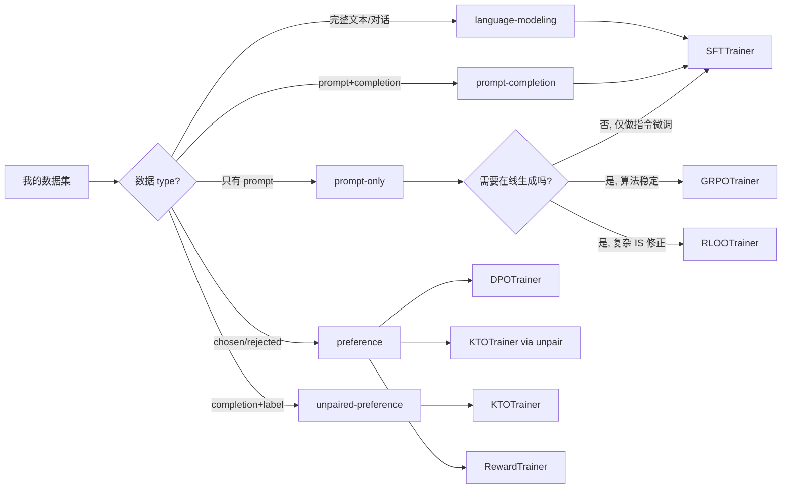
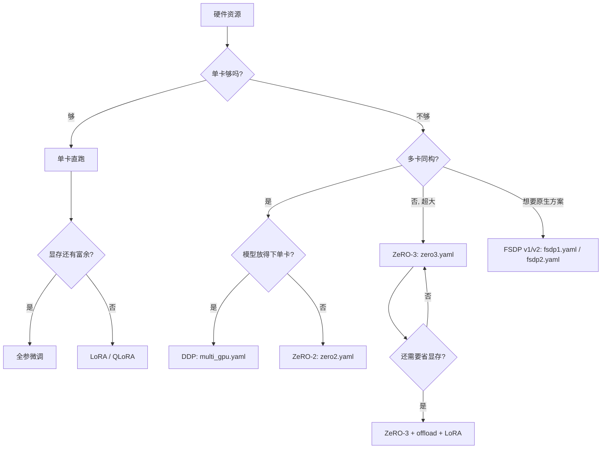

# 21 · 使用指南与实战案例

> 本篇导览：本篇是 TRL 的"上手卷"。前面 03–19 篇逐文件拆解了训练器内部实现，本篇反过来——从外部使用者视角回答"我怎么用 TRL 跑起来一个训练任务"。覆盖从安装、数据集格式、Python API 与 CLI 的取舍，到 10 个可直接复制的可运行案例（SFT、LoRA、DPO、KTO、Reward、GRPO colocate/server、多轮 tool calling、RLOO 对比、CLI 分布式），再到分布式策略选型决策树。每个案例都给出完整 import、模型/数据集/关键超参，以及训练结束后的预期产物。

> 核心问题：
> - TRL 怎么装？哪些 extras 对应哪些场景？
> - 我手里的数据是哪种 type、哪种 format，应该喂给哪个 trainer？
> - 何时用 Python API、何时直接上 CLI？
> - GRPO 的 vLLM colocate 与 server 两种模式怎么选、怎么配？
> - 单卡/多卡/超大模型分别该走 DDP、ZeRO 还是 FSDP？

---

## 一、安装

TRL 是纯 Python 包，三种主流装法覆盖 99% 场景。

```bash
# 1. PyPI 稳定版（最常用）
pip install trl

# 2. 从源码装最新 main 分支（功能早于正式发版）
pip install git+https://github.com/huggingface/trl.git

# 3. 开发者装法：克隆仓库 + 可编辑安装 + dev 依赖
git clone https://github.com/huggingface/trl.git
cd trl
pip install -e .[dev]
```

可选 extras（按需选）：

| extras | 装什么 | 什么时候用 |
|---|---|---|
| `[vllm]` | vLLM 引擎 | GRPO/RLOO 跑在线 RL（强烈推荐） |
| `[deepspeed]` | DeepSpeed ZeRO-1/2/3 | 模型放不下单卡 |
| `[harbor]` | Harbor 沙箱集成 | 训练 agent 对抗沙箱任务套件 |
| `[openreward]` | ORS 客户端 | 接入 openreward.ai 任务目录 |
| `[peft]` | PEFT | LoRA / QLoRA |
| `[dev]` | pytest / ruff / 文档构建 | 贡献者 |

例如要跑 GRPO 加 vLLM：`pip install trl[vllm]`。

---

## 二、数据集格式速查

TRL 把数据集拆成两个正交维度：

- **type**（任务语义，决定列名）：`language-modeling` / `prompt-only` / `prompt-completion` / `preference` / `unpaired-preference`（外加 `stepwise-supervision`）。
- **format**（结构形态）：`standard`（纯字符串）/ `conversational`（`messages` 列表）。

5 type × 2 format = 10 种最小组合（完整对照见 `docs/source/dataset_formats.md`）：

| Type | standard 示例 | conversational 示例 |
|---|---|---|
| language-modeling | `{"text": "The sky is blue."}` | `{"messages": [{"role":"user","content":"..."}, {"role":"assistant","content":"..."}]}` |
| prompt-only | `{"prompt": "The sky is"}` | `{"prompt": [{"role":"user","content":"..."}]}` |
| prompt-completion | `{"prompt":"The sky is", "completion":" blue."}` | `{"prompt":[...], "completion":[{"role":"assistant",...}]}` |
| preference | `{"prompt":"...","chosen":" blue.","rejected":" green."}` | `{"prompt":[...],"chosen":[...],"rejected":[...]}` |
| unpaired-preference | `{"prompt":"...","completion":" blue.","label":true}` | `{"prompt":[...],"completion":[...],"label":false}` |

每个 trainer 期望的 type（来自 `dataset_formats.md` 的对照表）：

- `SFTTrainer` ← language-modeling 或 prompt-completion
- `DPOTrainer` ← preference（explicit prompt 推荐）
- `KTOTrainer` ← unpaired-preference 或 preference
- `RewardTrainer` ← preference（implicit prompt 推荐）
- `GRPOTrainer` / `RLOOTrainer` ← prompt-only

### 选型决策树



**图说明**：先按数据 type 选 trainer 候选，再按"是否需要在线生成 + 奖励函数"在 SFT（离线）与 GRPO/RLOO（在线 RL）之间分流。preference 数据可同时喂给 DPO、KTO（unpair 后）、Reward，对应不同算法目标。

---

## 三、Python API vs CLI

TRL 提供两套对等接口，背后走的是同一份训练脚本（`trl/scripts/sft.py` 等）。

**Python API**（适合原型、调试、定制）：

```python
from trl import SFTTrainer
from datasets import load_dataset

dataset = load_dataset("trl-lib/Capybara", split="train")
trainer = SFTTrainer(model="Qwen/Qwen2.5-0.5B", train_dataset=dataset)
trainer.train()
```

**CLI**（适合生产、一键分布式）：

```bash
trl sft --model_name_or_path Qwen/Qwen2.5-0.5B \
        --dataset_name trl-lib/Capybara \
        --output_dir ./out
```

| 维度 | Python API | CLI |
|---|---|---|
| 灵活性 | 高，可任意改 trainer 内部 | 受参数表约束 |
| 分布式 | 需自己写 `accelerate launch` | `--num_processes` / `--accelerate_config` 一键 |
| 可复现 | 脚本即文档 | yaml 配置即文档 |
| 典型场景 | 研究、消融、debug | 生产训练、批量实验 |

经验：**调试阶段用 Python API**，把 trainer 跑通；**正式训练切到 CLI + yaml**，把超参与 accelerate 配置一起版本化。

---

## 四、10 个实战案例

下面 10 个案例按"SFT → 偏好 → 在线 RL → 分布式"递进。每个案例都假定读者已 `pip install trl[vllm]` 并有 GPU。

### 案例 1：SFT 标准格式

最朴素的指令微调。模型 `Qwen/Qwen2.5-0.5B`，数据集 `trl-lib/Capybara`（对话型，已被 SFTTrainer 自动套 chat template）。

```python
from datasets import load_dataset
from trl import SFTTrainer, SFTConfig

dataset = load_dataset("trl-lib/Capybara", split="train")

trainer = SFTTrainer(
    model="Qwen/Qwen2.5-0.5B",
    args=SFTConfig(
        output_dir="./out",
        max_length=1024,
        bf16=True,
        per_device_train_batch_size=2,
        num_train_epochs=1,
        logging_steps=10,
    ),
    train_dataset=dataset,
)
trainer.train()
```

关键超参：`max_length=1024`（截断/拼包的上限）、`bf16=True`（Ampere+ 显存折半）。`SFTTrainer` 默认会调 `apply_chat_template`，并对短序列做 packing。

预期产物：`./out` 目录含 `model.safetensors` / `tokenizer.json` / `config.json` / `README.md`（自动生成的 model card）。

### 案例 2：SFT 对话格式 + LoRA

显存不够全参微调时上 LoRA。这里用 `ModelConfig + SFTConfig` 的"显式配置对象"风格，对应 `trl/scripts/sft.py` 的 CLI 形态。

```python
from datasets import load_dataset
from trl import SFTTrainer, SFTConfig, ModelConfig, get_peft_config

dataset = load_dataset("trl-lib/Capybara", split="train")

model_config = ModelConfig(
    model_name_or_path="Qwen/Qwen2.5-0.5B",
    use_peft=True,
    lora_r=16,
    lora_alpha=32,
    lora_target_modules=["q_proj", "v_proj"],
)

trainer = SFTTrainer(
    model=model_config.model_name_or_path,
    args=SFTConfig(output_dir="./out-lora", bf16=True, per_device_train_batch_size=4),
    train_dataset=dataset,
    peft_config=get_peft_config(model_config),
)
trainer.train()
```

关键超参：`lora_r=16`、`lora_alpha=32`（常用比例 2:1）、`lora_target_modules=["q_proj","v_proj"]`（Qwen 系标准选法，也可 `"all-linear"`）。

预期产物：`./out-lora` 含 `adapter_model.safetensors` + `adapter_config.json`（仅 LoRA 权重，几十 MB）。可用 `peft.PeftModel.from_pretrained` 加载回基础模型。

### 案例 3：DPO

偏好对齐最常用的算法。模型 `Qwen/Qwen3-0.6B`，数据集 `trl-lib/ultrafeedback_binarized`（preference type）。

```python
from datasets import load_dataset
from trl import DPOTrainer, DPOConfig

dataset = load_dataset("trl-lib/ultrafeedback_binarized", split="train")

# 反向 KL（默认）
trainer = DPOTrainer(
    model="Qwen/Qwen3-0.6B",
    args=DPOConfig(
        output_dir="./out-dpo-rkl",
        beta=0.1,
        loss_type=["sigmoid"],
        f_divergence_type="reverse_kl",
        per_device_train_batch_size=2,
        gradient_accumulation_steps=8,
        learning_rate=5e-7,
        max_length=2048,
        max_prompt_length=1024,
        bf16=True,
    ),
    train_dataset=dataset,
)
trainer.train()
```

切换到 JS 散度做对比，只改 `f_divergence_type` 和 `output_dir`：

```python
trainer_js = DPOTrainer(
    model="Qwen/Qwen3-0.6B",
    args=DPOConfig(
        output_dir="./out-dpo-js",
        beta=0.1,
        loss_type=["sigmoid"],
        f_divergence_type="js_divergence",
        per_device_train_batch_size=2,
        gradient_accumulation_steps=8,
        learning_rate=5e-7,
        bf16=True,
    ),
    train_dataset=dataset,
)
trainer_js.train()
```

关键超参：`beta=0.1`（控制偏离 ref 的强度，越大越保守）、`loss_type=["sigmoid"]`（注意是 list，可混合多种 loss）、`f_divergence_type` 取 `reverse_kl` / `forward_kl` / `js_divergence` / `alpha_divergence`（来自 f-DPO 论文）。

预期产物：`./out-dpo-rkl` 与 `./out-dpo-js` 两个对齐后的模型；用同一份 eval set 比 chosen/rejected 的 logp ratio 即可看出 KL 类型对偏好边界的影响。

### 案例 4：KTO

KTO 不需要 chosen/rejected 配对，只要 `(prompt, completion, label)`。我们用 `unpair_preference_dataset` 把 `trl-lib/ultrafeedback` 偏好数据集拆成 unpaired 形式喂给 `KTOTrainer`。

```python
from datasets import load_dataset
from trl import KTOTrainer, KTOConfig, unpair_preference_dataset

ds = load_dataset("trl-lib/ultrafeedback_binarized", split="train")
ds = unpair_preference_dataset(ds)  # chosen→label=True, rejected→label=False

trainer = KTOTrainer(
    model="Qwen/Qwen2.5-0.5B-Instruct",
    args=KTOConfig(
        output_dir="./out-kto",
        beta=0.1,
        desirable_weight=1.0,
        undesirable_weight=1.0,
        train_sampling_strategy="balanced",
        per_device_train_batch_size=2,
        gradient_accumulation_steps=8,
        learning_rate=5e-7,
        bf16=True,
    ),
    train_dataset=ds,
)
trainer.train()
```

关键超参：`beta=0.1`、`desirable_weight` / `undesirable_weight`（两类样本的损失权重，可平衡样本不均）、`train_sampling_strategy="balanced"`（KTO 经典配比，让 desirable/undesirable 在 batch 内均衡）。注意 KTO 默认 `train_sampling_strategy="sequential"`，因为 KL completion 依赖固定顺序的邻居样本——切 `"random"` 会破坏配对。

预期产物：`./out-kto` 含对齐后模型；KTO 显存约为 DPO 的 1/2（不需要为同 prompt 同时跑 chosen/rejected）。

### 案例 5：Reward 模型训练

`RewardTrainer` 把 LM 头换成 `num_labels=1` 的标量回归头。注意 PEFT 的 `lora_task_type` 必须是 `SEQ_CLS`，**不是** `CAUSAL_LM`（脚本里会显式 warning）。

```python
from datasets import load_dataset
from transformers import AutoModelForSequenceClassification
from trl import RewardTrainer, RewardConfig, ModelConfig, get_peft_config

dataset = load_dataset("trl-lib/ultrafeedback_binarized", split="train")

model_config = ModelConfig(
    model_name_or_path="Qwen/Qwen2.5-0.5B-Instruct",
    use_peft=True,
    lora_task_type="SEQ_CLS",
    lora_r=32,
    lora_alpha=16,
)

model = AutoModelForSequenceClassification.from_pretrained(
    model_config.model_name_or_path, num_labels=1
)

trainer = RewardTrainer(
    model=model,
    args=RewardConfig(
        output_dir="./out-reward",
        per_device_train_batch_size=8,
        num_train_epochs=1,
        learning_rate=1e-4,
        max_length=2048,
        bf16=True,
    ),
    train_dataset=dataset,
    peft_config=get_peft_config(model_config),
)
trainer.train()
```

关键超参：`lora_task_type="SEQ_CLS"`（最常踩的坑）、`num_labels=1`（奖励是标量）、`max_length=2048`（长 prompt 必须够长否则偏好信号被截断）。

预期产物：`./out-reward` 含 reward 模型；可被 `GRPOTrainer(reward_funcs="<path>")` 直接当奖励函数加载。

### 案例 6：GRPO vLLM colocate

GRPO 是 R1 的核心算法。colocate 模式下 vLLM 与训练器同进程，权重在 GPU 上直接广播。模型 `Qwen/Qwen2.5-0.5B-Instruct`，数据集 `trl-lib/DeepMath-103K`（prompt-only + `solution` 字段），奖励用 `trl.rewards.accuracy_reward`。

```python
from datasets import load_dataset
from trl import GRPOTrainer, GRPOConfig
from trl.rewards import accuracy_reward

dataset = load_dataset("trl-lib/DeepMath-103K", split="train")

trainer = GRPOTrainer(
    model="Qwen/Qwen2.5-0.5B-Instruct",
    reward_funcs=accuracy_reward,
    args=GRPOConfig(
        output_dir="./out-grpo-colocate",
        use_vllm=True,
        vllm_mode="colocate",
        vllm_gpu_memory_utilization=0.3,
        num_generations=8,
        max_completion_length=256,
        per_device_train_batch_size=4,
        gradient_accumulation_steps=2,
        learning_rate=1e-6,
        bf16=True,
        log_completions=True,
    ),
    train_dataset=dataset,
)
trainer.train()
```

关键超参：`use_vllm=True` + `vllm_mode="colocate"`（vLLM 与训练器同进程，权重 GPU 内广播）、`num_generations=8`（每个 prompt 采样 8 条做 group-relative baseline，必须 ≥2 且能整除 `generation_batch_size`）、`max_completion_length=256`（生成长度上限，越短越省显存）、`vllm_gpu_memory_utilization=0.3`（vLLM 占 GPU 显存比例，需与训练显存预算协调）。

预期产物：`./out-grpo-colocate` 含策略模型；训练日志中能看到 `reward/mean`、`completion_length`、`kl` 等 RL 专属指标，`log_completions=True` 还会打印采样样例。

### 案例 7：GRPO vLLM server 模式

当模型大到 colocate 单卡放不下，或想把生成与训练部署在不同节点时，用 server 模式：vLLM 跑独立进程，训练器通过 HTTP 调。

**第一步**：起一个 vLLM server（阻塞终端）：

```bash
trl vllm-serve --model Qwen/Qwen2.5-0.5B-Instruct --port 8000
```

**第二步**：训练器配置 `vllm_mode="server"` 并指向该端口：

```python
from datasets import load_dataset
from trl import GRPOTrainer, GRPOConfig
from trl.rewards import accuracy_reward

dataset = load_dataset("trl-lib/DeepMath-103K", split="train")

trainer = GRPOTrainer(
    model="Qwen/Qwen2.5-0.5B-Instruct",
    reward_funcs=accuracy_reward,
    args=GRPOConfig(
        output_dir="./out-grpo-server",
        use_vllm=True,
        vllm_mode="server",
        vllm_server_host="127.0.0.1",
        vllm_server_port=8000,
        num_generations=8,
        max_completion_length=256,
        per_device_train_batch_size=8,
        gradient_accumulation_steps=2,
        learning_rate=1e-6,
        bf16=True,
    ),
    train_dataset=dataset,
)
trainer.train()
```

关键区别：`vllm_mode="server"` + `vllm_server_port=8000`；`vllm_gpu_memory_utilization` **不**在训练器侧配，而是作为 `trl vllm-serve` 的 CLI 参数。训练器在每次 rollout 后把最新权重推到 server（`vllm_model_impl` 决定走 `vllm` 还是 `transformers` 后端）。

预期产物：`./out-grpo-server`；典型用法是 server 跑在 8×H100 的 4 卡（tensor_parallel_size=4），训练器跑在另外 4 卡。

### 案例 8：GRPO 多轮 tool calling

让模型学会调工具：每个 rollout 内模型可发起多次 tool call，TRL 自动执行并把结果回灌进上下文，直到模型给出最终答案或达到 `max_tool_calling_iterations`。

```python
from datasets import Dataset
from trl import GRPOTrainer, GRPOConfig
from trl import supports_tool_calling
from transformers import AutoTokenizer

# 1. 先确认模型的 chat template 支持 tool calling
tokenizer = AutoTokenizer.from_pretrained("Qwen/Qwen2.5-0.5B-Instruct")
assert supports_tool_calling(tokenizer), "该模型 chat template 不支持 tool calling，换 Qwen3 或 Llama-3.1+"

# 2. 定义工具（必须有类型注解 + Google 风格 docstring）
def multiply(a: int, b: int) -> int:
    """
    Multiplies two integers.

    Args:
        a: The first integer.
        b: The second integer.

    Returns:
        The product of the two integers.
    """
    return a * b

def add(a: int, b: int) -> int:
    """
    Adds two integers.

    Args:
        a: The first integer.
        b: The second integer.

    Returns:
        The sum of the two integers.
    """
    return a + b

# 3. 数据集：prompt-only
dataset = Dataset.from_dict({
    "prompt": [
        [{"role": "user", "content": "Compute 3 * 7 + 2."}],
        [{"role": "user", "content": "Compute 10 + 4 * 5."}],
    ]
})

def reward_func(completions, **kwargs):
    # 简单奖励：最终答案正确得 1，否则 0
    return [1.0 if "23" in c[0]["content"] else 0.0 for c in completions]

trainer = GRPOTrainer(
    model="Qwen/Qwen2.5-0.5B-Instruct",
    reward_funcs=reward_func,
    tools=[multiply, add],
    args=GRPOConfig(
        output_dir="./out-grpo-tool",
        use_vllm=True,
        vllm_mode="colocate",
        num_generations=8,
        max_completion_length=256,
        max_tool_calling_iterations=5,
        per_device_train_batch_size=4,
        bf16=True,
    ),
    train_dataset=dataset,
)
trainer.train()
```

关键点：`supports_tool_calling(tokenizer)` 检查模板能否完整渲染 `user → assistant(tool_calls) → tool` 链路（基本 Llama-3 模板会静默吞掉 `tool_calls`，必须拒掉）；`tools=[multiply, add]` 传入 Python 函数列表，TRL 自动用 `get_json_schema` 转成 schema 注入 chat template；`max_tool_calling_iterations=5` 限制单次 rollout 最多 5 轮 tool call，防止死循环。

预期产物：`./out-grpo-tool` 含可调工具的 agent 模型；训练日志的 `completions/mean_length` 只统计非 tool token。

### 案例 9：RLOO 与 GRPO 对比

RLOO（REINFORCE Leave-One-Out）与 GRPO 都是 group-relative baseline，但 baseline 构造方式不同（leave-one-out vs group-mean）。换 trainer 即可对比，数据集与奖励函数完全沿用案例 6。

```python
from datasets import load_dataset
from trl import RLOOTrainer, RLOOConfig
from trl.rewards import accuracy_reward

dataset = load_dataset("trl-lib/DeepMath-103K", split="train")

trainer = RLOOTrainer(
    model="Qwen/Qwen2.5-0.5B-Instruct",
    reward_funcs=accuracy_reward,
    args=RLOOConfig(
        output_dir="./out-rloo",
        use_vllm=True,
        vllm_mode="colocate",
        vllm_gpu_memory_utilization=0.3,
        num_completions=8,            # RLOO 用 num_completions 而非 num_generations
        max_completion_length=256,
        per_device_train_batch_size=4,
        gradient_accumulation_steps=2,
        learning_rate=1e-5,
        steps_per_generation=8,
        bf16=True,
        log_completions=True,
    ),
    train_dataset=dataset,
)
trainer.train()
```

关键差异：`RLOOConfig` 用 `num_completions`（默认 8）而非 `num_generations`；`steps_per_generation` 控制"每 N 个 grad step 才采一次样"以摊薄生成开销；RLOO 的 baseline 是 leave-one-out 均值（无偏），GRPO 是 group 均值（有偏但方差小）。**注意**：RLOO 不支持 IS correction / VESPO / SAPO 等 GRPO 后续改进（这些只挂在 GRPOConfig 上），如需这些特性必须用 GRPO。

预期产物：`./out-rloo`；与案例 6 用同一份 eval 比较 reward 曲线，通常 RLOO 在小 num_generations（如 4）下方差更小，GRPO 在大 num_generations（如 16）下更稳。

### 案例 10：CLI 一键分布式

把案例 1 的 SFT 用 CLI 在 8 卡上跑起来，无需写 `accelerate launch`。`--accelerate_config` 接受预置 profile（`zero1/2/3`、`multi_gpu`、`fsdp1/2`、`single_gpu`）或自定义 yaml 路径。

```bash
trl sft \
    --model_name_or_path Qwen/Qwen2.5-0.5B \
    --dataset_name trl-lib/Capybara \
    --output_dir ./out-cli-dist \
    --accelerate_config zero2 \
    --num_processes 8 \
    --per_device_train_batch_size 2 \
    --gradient_accumulation_steps 4 \
    --bf16
```

与 yaml 组合（推荐：把超参版本化）：

```yaml
# my_config.yaml
model_name_or_path: Qwen/Qwen2.5-0.5B
dataset_name: trl-lib/Capybara
output_dir: ./out-cli-dist
accelerate_config: zero2
num_processes: 8
per_device_train_batch_size: 2
gradient_accumulation_steps: 4
bf16: true
```

```bash
trl sft --config my_config.yaml
```

`--num_processes 8` 与 `--accelerate_config zero2` 会自动展开为 `accelerate launch --config_file trl/accelerate_configs/zero2.yaml --num_processes 8 trl/scripts/sft.py ...`。yaml 里的字段与 `ScriptArguments` / `SFTConfig` / `ModelConfig` 一一对应（参考 `examples/cli_configs/example_config.yaml`）。

预期产物：`./out-cli-dist`，与 Python API 训出的模型无差别；额外好处是 `accelerate` 自动处理 DDP 进程组、ZeRO 优化器分片、混合精度。

---

## 五、分布式策略选择



**图说明**：先按"单卡是否放得下"分两层，再按"是否需要参数分片"在 DDP / ZeRO / FSDP 间选。配置文件路径对应 `trl/accelerate_configs/*.yaml`（CLI 可直接 `--accelerate_config <name>`）。

**单卡**：DDP 无意义，直接单卡跑。模型放不下时上 LoRA + QLoRA（`--load_in_4bit`），可用 24GB 消费卡训 7B。

**多卡同构**：DDP（`multi_gpu.yaml`，`distributed_type: MULTI_GPU`）最简单，每卡一份完整模型，只对梯度做 all-reduce。

**模型放不下单卡但多卡可装**：ZeRO-2（`zero2.yaml`，`zero_stage: 2`）只分片优化器状态 + 梯度，参数仍每卡一份；显存约为 DDP 的 1/2–1/3，速度损失小。

**极致显存**：ZeRO-3（`zero3.yaml`，`zero_stage: 3`）参数也分片，配合 `offload_optimizer_device: cpu` / `offload_param_device: cpu` 可在 8×24GB 训 70B。再叠 LoRA 进一步降显存（但 ZeRO-3 + LoRA + offload 三件套训练慢）。

**FSDP**：v1（`fsdp1.yaml`）或 v2（`fsdp2.yaml`），PyTorch 原生方案，与 DeepSpeed ZeRO 思路类似但维护在 PyTorch 侧。社区趋势是 FSDP2（更简洁的 API、更好的 DTensor 集成），但 DeepSpeed 在 MoE 上仍更成熟。

> 注意：在线 RL（GRPO/RLOO）+ vLLM server 模式天然适合"训练侧多卡 + 生成侧多卡"的资源划分，比 colocate 更适合超大模型。

---

## 小结

- **安装**：`pip install trl` 是默认；上 vLLM 加 `[vllm]`，上 ZeRO 加 `[deepspeed]`，贡献者用 `pip install -e .[dev]`。
- **数据集**：先按 5 种 type × 2 种 format 对号入座，trainer 选型有现成对照表，prompt-only → SFT/GRPO/RLOO、preference → DPO/KTO/Reward、unpaired → KTO。
- **API vs CLI**：调试用 Python API（最大灵活），生产用 CLI + yaml（`--accelerate_config` + `--num_processes` 一键分布式，配置即文档）。
- **GRPO 的 vLLM**：colocate 适合中小模型（同进程权重广播零拷贝），server 适合超大模型或训练/生成分离部署；多轮 tool calling 用 `tools=` + `max_tool_calling_iterations=` + `supports_tool_calling(tokenizer)` 三件套。
- **分布式**：单卡 LoRA → 多卡 DDP → 模型放不下 ZeRO-2 → 极致 ZeRO-3+offload → 原生 FSDP2；GRPO/RLOO server 模式可把生成与训练分别扩到不同卡组。

下一篇 [22 · 总结与最佳实践](22_总_总结与最佳实践.md) 将从实战中提炼 TRL 的最佳实践清单与避坑指南。
